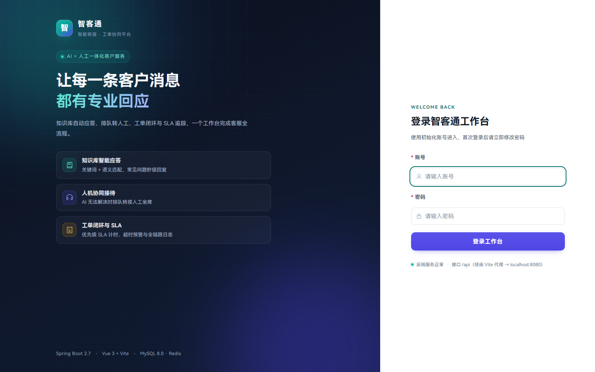
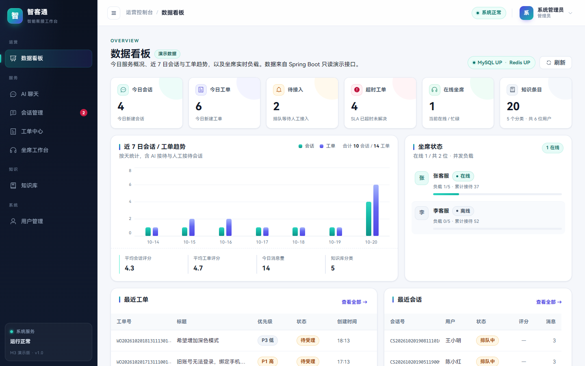
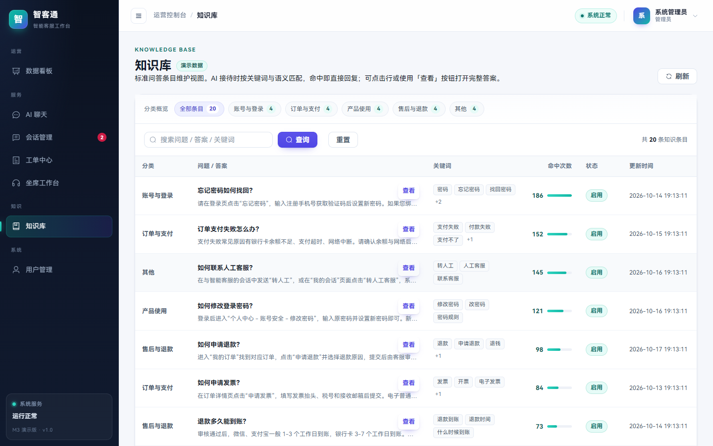
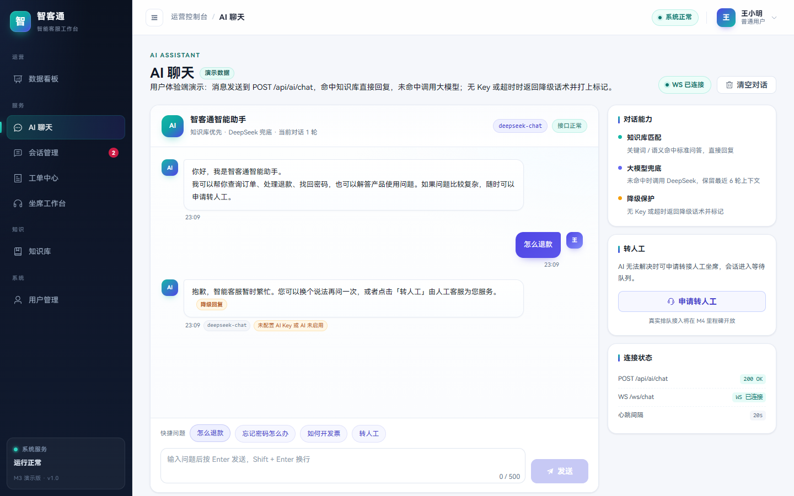
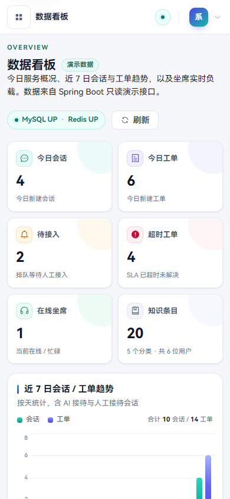
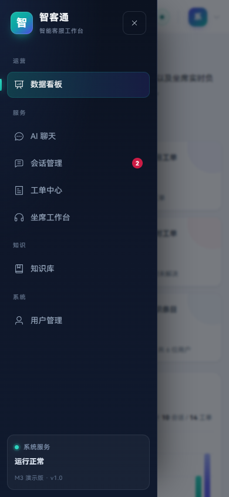
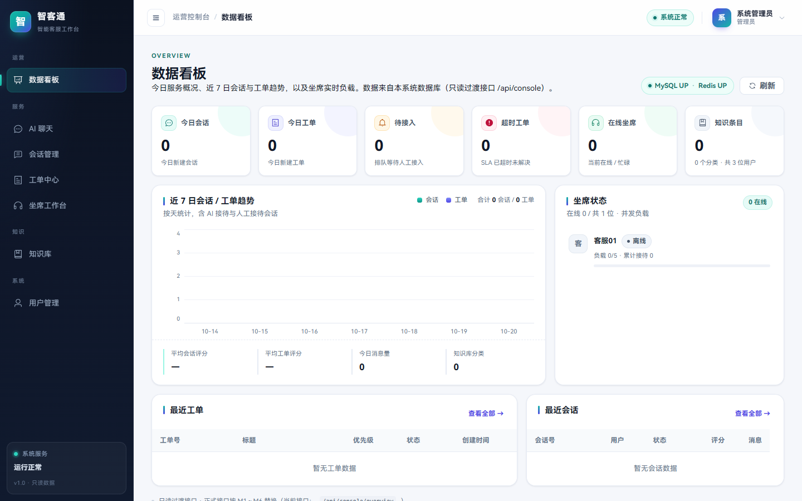

# 智客通 —— 智能对话客服与工单管理系统

> JavaEE 期末大作业 · 后端 Spring Boot 2.7 + MySQL 8.0 + Redis + WebSocket + MyBatis-Plus
> 当前版本：V1.0.0 骨架（可启动、可登录、可调用 AI、数据库已建好）

---

## 1. 环境要求

| 组件 | 版本要求 | 本机已验证 |
|------|----------|-----------|
| JDK | 8（必须，Spring Boot 2.7 不支持更高版本编译目标） | 1.8.0_202 |
| Maven | 3.6+ | 3.9.13 |
| MySQL | 8.0+ | 8.0.45（端口 3306） |
| Redis | 3.0+ | 3.0.504（端口 6379） |
| Node.js | 18+（前端阶段使用） | 24.11.1 |

> 说明：工程内 `.mvn/maven.config` 将 Maven 本地仓库指向工程目录下的 `.m2repo`，
> 避免本机 D 盘仓库的写权限问题；首次构建需要联网下载依赖（约 80MB），之后可离线构建。

---

## 2. 快速启动

### 2.1 初始化数据库

```powershell
$env:MYSQL_PWD='246790'
$mysql = 'F:\MySQL\MySQL Server 8.0\bin\mysql.exe'
# 建库 + 建表（会先删除同名表，仅用于开发环境）
& $mysql -uroot --default-character-set=utf8mb4 -e "source sql/01_schema.sql"
# 最小初始化：3 个角色 + admin/agent01/user01 三个账号；业务表为空
& $mysql -uroot --default-character-set=utf8mb4 -e "source sql/02_data.sql"
Remove-Item Env:MYSQL_PWD
```

可选演示数据（**默认不导入**，仅用于版式演示/答辩，属于人为构造数据）：

```powershell
& 'F:\MySQL\MySQL Server 8.0\bin\mysql.exe' -uroot --default-character-set=utf8mb4 -e "source sql/demo/02_demo_data.sql"
```

若 MySQL 密码不同，修改 `src/main/resources/application.yml` 中的
`spring.datasource.password`，或设置环境变量 `MYSQL_PASSWORD`。

### 2.2 启动后端

```powershell
# 方式一：直接运行
mvn spring-boot:run

# 方式二：打包后运行
mvn clean package -DskipTests
java -jar target/zhiketong-server.jar
```

启动成功后：

| 地址 | 说明 |
|------|------|
| http://localhost:8080/api/health | 健康检查（应用 / MySQL / Redis） |
| http://localhost:8080/swagger-ui.html | 在线接口文档 |
| http://localhost:8080/v3/api-docs | OpenAPI JSON |

### 2.3 配置 AI Key（可选，不配置会自动降级）

```powershell
$env:DEEPSEEK_API_KEY='sk-你的Key'
mvn spring-boot:run
```

配置后 `POST /api/ai/chat` 会调用真实 DeepSeek；未配置时代码会返回兜底话术并写入
`ai_call_log`，不影响演示。也可在 `application.yml` 中通过 `zhiketong.ai.*` 调整为
其它 OpenAI 兼容服务（如通义千问兼容模式）。

### 2.4 启动前端（Vue3 + Element Plus）

前端位于 `frontend/`，当前提供登录、数据看板、知识库、工单、会话、坐席、用户管理、角色管理、登录日志与 AI 聊天 10 个页面。
本机沙箱禁止 Vite 的 esbuild 子进程，因此使用零依赖构建 + 静态代理脚本启动（普通环境可直接 `npm run dev`）：

```powershell
# 1) 安装依赖（首次）
cd frontend
npm install --cache .npm-cache

# 2) 构建（本机已验证脚本，绕开 esbuild 子进程限制）
node scripts/build.mjs

# 3) 启动前端（根目录执行；静态托管 dist，并代理 /api、/ws 到 8080）
cd ..
node serve-frontend.mjs
```

访问 **http://127.0.0.1:5173**，使用初始化账号登录即可。前端登录页、看板与 AI 聊天页截图见
[docs/screenshots](docs/screenshots)。

> 说明：`/api/console/*` 是只读过渡接口，直接查询本系统 MySQL 业务表；M2～M6 正式接口逐步替换。
> M1 的用户/角色/登录日志/坐席状态已使用正式接口 `/api/admin/*`、`/api/agent/*`。
> 默认初始化后知识库、会话、工单等业务表为空，页面会展示真实空态；
> 如需查看带数据的版式，可手动导入 `sql/demo/02_demo_data.sql`（可选演示数据集，非真实业务）。

---

## 3. 初始化账号

首次初始化只创建 3 个账号，密码均为 `123456`（BCrypt 存储），**首次登录后请立即修改密码**。
其余用户/坐席/知识库/会话/工单数据由 M1～M6 的真实功能产生，不再预置。

| 账号 | 角色 | 说明 |
|------|------|------|
| admin | ADMIN | 管理员，可进系统管理、统计、知识库 |
| agent01 | AGENT | 客服坐席（初始为离线，需在工作台真实上线） |
| user01 | USER | 普通用户 |

> 如果导入了可选的 `sql/demo/02_demo_data.sql`，会额外出现 agent02、user02、user03 等演示账号，
> 以及演示用的知识、会话、工单数据；这些都不是真实业务数据。

---

## 4. 目录结构

```
smart-customer-service/
├─ pom.xml
├─ serve-frontend.mjs             # 前端静态服务（零依赖，代理 /api、/ws）
├─ .mvn/maven.config              # 本地 Maven 仓库重定向
├─ sql/
│  ├─ 01_schema.sql               # 建库 + 11 张表
│  ├─ 02_data.sql                 # 最小初始化：3 角色 + 3 账号（业务表为空）
│  └─ demo/
│     ├─ 02_demo_data.sql         # 可选演示数据（默认不导入，非真实业务）
│     └─ README.md                # 演示数据使用说明
├─ docs/
│  ├─ 数据库设计.md                # ER、表字典、索引、Redis 键
│  ├─ 接口与WebSocket协议.md       # REST + WS 协议规范
│  └─ screenshots/                # 登录页、看板、AI 聊天页截图
├─ frontend/                      # Vue3 + Vite + Element Plus 前端
│  ├─ src/views/                  # Login / Dashboard / Knowledge / Orders / Sessions / Agents / Users / Chat
│  ├─ scripts/build.mjs           # 沙箱兼容构建脚本
│  └─ dist/                       # 构建产物（由 serve-frontend.mjs 托管）
├─ src/main/java/com/zhiketong/
│  ├─ ZhiketongApplication.java
│  ├─ common/                     # Result、异常、常量、工具
│  ├─ config/                     # MyBatis-Plus、Redis、Security、WebSocket、Swagger
│  ├─ security/                   # JWT、认证过滤器、握手拦截
│  ├─ controller/                 # Auth / Health / AI / Console
│  ├─ service/                    # AuthService、ConsoleService
│  ├─ ai/                         # DeepSeek 客户端与降级
│  ├─ websocket/                  # WS 会话管理、消息处理器
│  ├─ entity/ mapper/ enums/      # 11 表实体、Mapper、枚举
│  └─ dto/                        # 请求/响应对象
└─ src/main/resources/application.yml
```

---

## 5. 已完成（M0 骨架 + M1 系统管理）

- [x] Maven 工程、统一依赖版本、Java 8 编译
- [x] 11 张业务表 DDL + 最小初始化（3 个角色、3 个账号；业务表为空）
- [x] 统一响应 `Result`、全局异常处理、分页结构 `PageResult`
- [x] JWT 登录/注册/登出/当前用户/改密（BCrypt + Redis Token 黑名单）
- [x] Spring Security 无状态鉴权、CORS、401/403 JSON 返回
- [x] 健康检查（MySQL / Redis 实际探测）
- [x] DeepSeek 客户端（超时、失败降级、调用日志）
- [x] WebSocket 握手鉴权、连接管理、心跳、统一消息信封
- [x] Swagger 在线接口文档
- [x] 前端 10 个页面：登录、看板、知识库、工单、会话、坐席、用户、角色、登录日志、AI 聊天
- [x] 控制台只读过渡接口 `/api/console/*`（直接查询 MySQL，M2～M6 正式接口逐步替换）
- [x] **M1 系统管理**：用户分页/新增/编辑/启停/删除/重置密码（`/api/admin/users`）、角色列表（`/api/admin/roles`）、登录日志（`/api/admin/login-logs`）、坐席上线/下线/忙碌（`/api/agent/*`）
- [x] M1 管理端页面：用户管理（真实 CRUD）、角色管理、登录日志；菜单按角色过滤，越权路由回退看板
- [x] UI/UX v2：统一设计令牌、键盘焦点、移动端抽屉、触控尺寸、空态/加载态、reduced-motion、表格与图表可读性
- [x] 可选演示数据集 `sql/demo/02_demo_data.sql`（默认不导入，明确标注非真实业务）

## 6. 后续里程碑

| 里程碑 | 状态 | 内容 |
|--------|------|------|
| M1 | ✅ 已完成 | 用户/角色管理、登录日志、坐席状态 |
| M2 | 待开始 | 知识库分类/条目 CRUD、搜索、命中排行 |
| M3 | 待开始 | 用户会话、消息持久化、知识库匹配 + AI 对话、WebSocket 路由 |
| M4 | 待开始 | 转人工排队、坐席接入/结束、满意度评价、心跳与负载 |
| M5 | 待开始 | 工单全流程 + 状态机 + SLA 超时扫描 |
| M6 | 待开始 | 统计看板、管理端完善、用户聊天页 |
| M7 | 待开始 | 联调、测试、答辩材料 |

### M1 已知限制

- 角色固定为 `ADMIN/AGENT/USER` 三个内置角色；R-14～R-17 的角色增删改暂未开放，角色列表只读。
- 禁用/删除用户后，**已签发的 JWT 在过期前仍可访问**（重新登录会被拦截）；后续可增加 Redis 按用户失效表。
- 坐席心跳、今日服务量、平均评分统计留待 M4 实现；当前 `/api/agent/*` 返回坐席 ID、状态、并发上限/当前负载与累计接待数。
- 请求级 403 以统一返回体 `code=403` 表达，HTTP 状态可能为 200；前端按 `code` 处理并展示后端 message。

---

## 7. 常见问题

| 问题 | 处理 |
|------|------|
| `AccessDeniedException: D:\Maven\maven-repository` | 已通过 `.mvn/maven.config` 规避；若仍出现，执行 `mvn -Dmaven.repo.local=.m2repo ...` |
| 启动报 Redis 连接失败 | 确认 Redis 服务已启动（`redis-cli ping` 返回 PONG）；旧版 Redis 若报命令不支持，可在 `application.yml` 关闭相关功能或升级 Redis |
| 登录返回「用户名或密码错误」 | 确认已执行 `sql/02_data.sql`；初始账号密码为 `123456`，首次登录后请修改 |
| 端口 8080 被占用 | 修改 `server.port` 或关闭占用进程 |
| 中文乱码 | 终端执行 `chcp 65001`；数据库已统一 utf8mb4 |

---

## 8. 界面预览（UI/UX v2）

| 登录页 | 数据看板 |
|--------|----------|
|  |  |

| 知识库 | AI 聊天 |
|--------|---------|
|  |  |

移动端（390×844，2 列指标卡 + 抽屉导航）：

| 看板 | 抽屉导航 |
|------|----------|
|  |  |

> 以下截图采集时使用了**可选的演示数据集**（`sql/demo/02_demo_data.sql`）以展示有数据时的版式；
> 默认初始化后业务表为空，页面展示真实空态（见下方「默认空库真实状态」）。演示数据仅用于视觉验收，不代表任何真实业务记录。

> 本轮按 UI/UX Pro Max 规则完成对比度、焦点态、移动端抽屉、触控尺寸、空态/加载态、
> reduced-motion、图表可读性等优化，详见 [docs/UI优化说明.md](docs/UI优化说明.md)。

### 默认空库真实状态（3 个初始化账号、业务表为空）



---

## 9. 文档索引

- [项目开发文档.md](项目开发文档.md) —— 总纲：需求、架构、规范、页面、里程碑、验收
- [docs/数据库设计.md](docs/数据库设计.md) —— 数据库设计明细
- [docs/接口与WebSocket协议.md](docs/接口与WebSocket协议.md) —— 接口与实时通信协议
- [docs/UI优化说明.md](docs/UI优化说明.md) —— UI/UX v2 优化记录、设计令牌与验证清单
