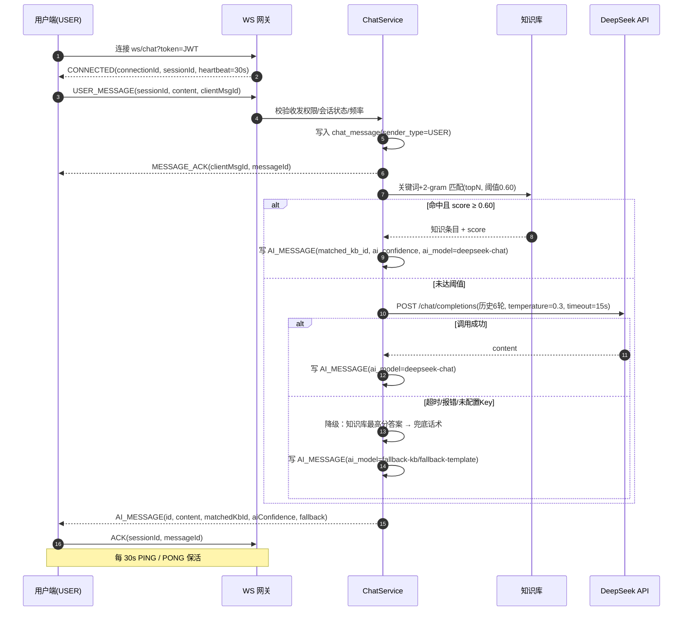
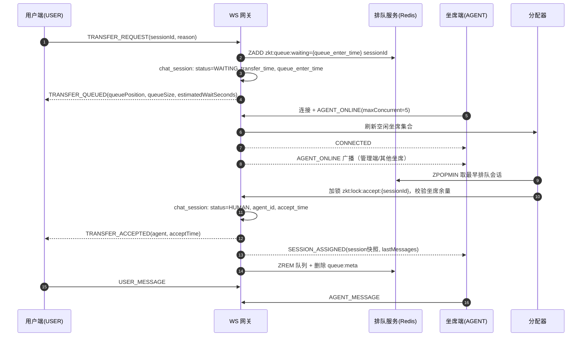
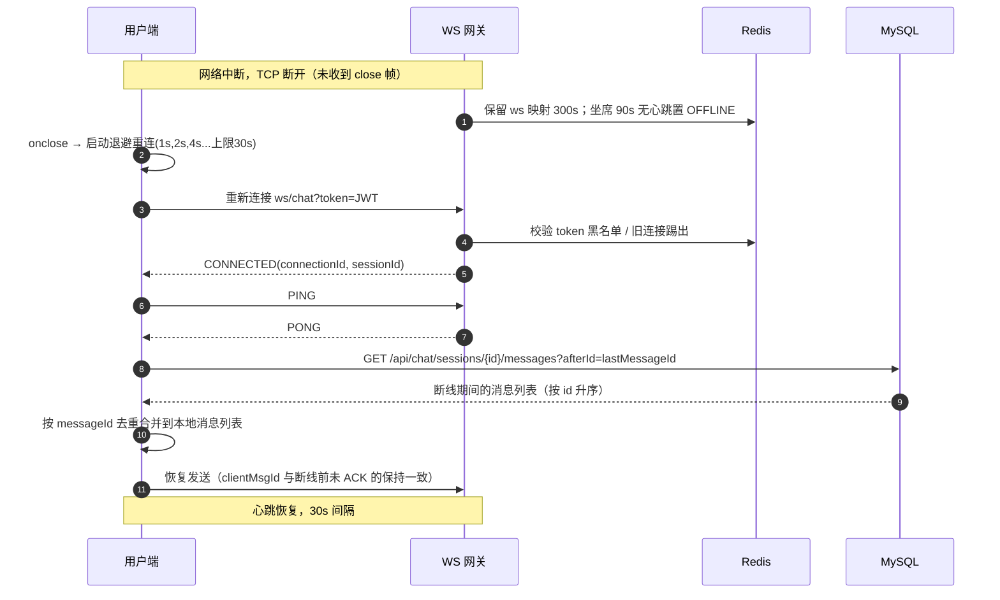
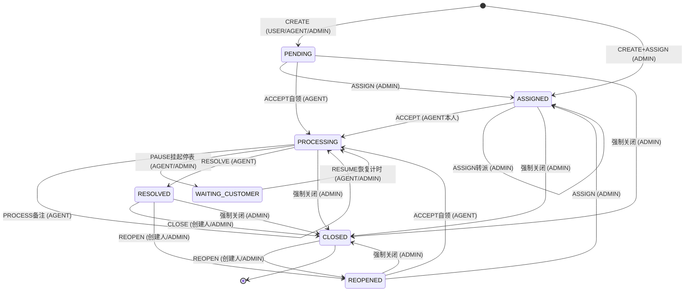
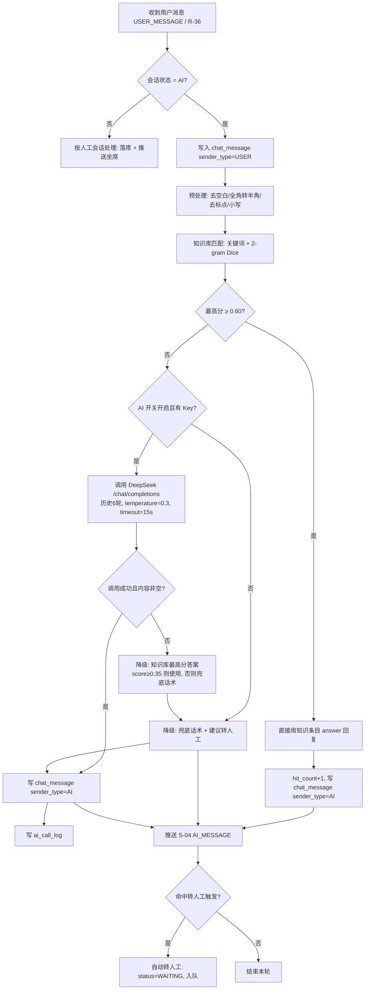

# 智客通 —— 智能对话客服与工单管理系统 接口与 WebSocket 协议规范

| 项目 | 内容 |
|------|------|
| 文档编号 | ZKT-API-V1.15 |
| 版本 | V1.15（S6-C VOC 客户之声与大屏配置化：未命中问法聚类、热点话题、词云与大屏组件布局，R-205 ~ R-217） |
| 状态 | 已评审，作为前后端并行开发唯一契约 |
| 适用工程 | `zhiketong-server` 1.0.0（Spring Boot 2.7.18 / Java 8） |
| 接口前缀 | `/api` |
| 编写目的 | 明确 REST 与 WebSocket 的路径、字段、权限、错误码与状态流转，前后端可据此独立开发、可直接联调 |
| 配套文档 | [项目开发文档.md](../项目开发文档.md)、`sql/schema.sql`、`sql/data.sql` |
| 字段权威性 | 所有字段名以本文「数据表字段」与 `sql/schema.sql` 为准，禁止前端/后端自行改名、造表 |
| 变更规则 | 任何路径、字段、权限、错误码变更必须先改本文档，再改代码，并在文末「待确认问题」留痕 |

---

## 0. 阅读说明

### 0.1 目录

- [一、通用约定](#一通用约定)
  - [1.1 服务地址与基础路径](#11-服务地址与基础路径)
  - [1.2 认证与鉴权](#12-认证与鉴权)
  - [1.3 统一返回结构与错误码总表](#13-统一返回结构与错误码总表)
  - [1.4 分页约定](#14-分页约定)
  - [1.5 时间与数值约定](#15-时间与数值约定)
  - [1.6 枚举字典](#16-枚举字典)
  - [1.7 通用请求头与通用参数](#17-通用请求头与通用参数)
  - [1.8 角色与数据权限矩阵](#18-角色与数据权限矩阵)
  - [1.9 跨域、脱敏与限流](#19-跨域脱敏与限流)
  - [1.10 典型失败响应示例](#110-典型失败响应示例)
- [二、REST 接口清单（217 个）](#二rest-接口清单217-个)
  - [2.0 接口总览表](#20-接口总览表)
  - [2.1 认证模块（R-01 ~ R-05）](#21-认证模块r-01--r-05)
  - [2.2 系统用户与角色管理（R-06 ~ R-17）](#22-系统用户与角色管理r-06--r-17)
  - [2.3 知识库分类与条目（R-18 ~ R-30）](#23-知识库分类与条目r-18--r-30)
  - [2.4 会话与消息（R-31 ~ R-39）](#24-会话与消息r-31--r-39)
  - [2.5 坐席工作台（R-40 ~ R-48）](#25-坐席工作台r-40--r-48)
  - [2.6 工单（R-49 ~ R-63）](#26-工单r-49--r-63)
  - [2.7 统计分析（R-64 ~ R-69）](#27-统计分析r-64--r-69)
  - [2.8 登录日志（R-70）](#28-登录日志r-70)
  - [2.9 健康检查（R-71 ~ R-72）](#29-健康检查r-71--r-72)
  - [2.10 网页接入接口（P-01 ~ P-06）](#210-网页接入接口p-01--p-06)
  - [2.11 知识库运营（R-73 ~ R-88）](#211-知识库运营r-73--r-88)
  - [2.12 快捷回复与技能组（R-89 ~ R-103）](#212-快捷回复与技能组r-89--r-103)
  - [2.13 坐席辅助（R-104 ~ R-109）](#213-坐席辅助r-104--r-109)
  - [2.14 客户信息卡、输入联想与内部备注（R-110 ~ R-114）](#214-客户信息卡输入联想与内部备注r-110--r-114)
  - [2.15 工单表单引擎：自定义字段与工单模板（R-115 ~ R-126）](#215-工单表单引擎自定义字段与工单模板r-115--r-126)
  - [2.16 工单多级 SLA：策略、停表与超时升级（R-127 ~ R-136）](#216-工单多级-sla策略停表与超时升级r-127--r-136)
  - [2.17 工单规则与自动化：自动分配、触发器与时间自动化（R-137 ~ R-146）](#217-工单规则与自动化自动分配触发器与时间自动化r-137--r-146)
  - [2.18 平台租户与套餐（R-147 ~ R-157）](#218-平台租户与套餐r-147--r-157)
  - [2.19 操作审计（R-158 ~ R-159）](#219-操作审计r-158--r-159)
  - [2.20 智能质检（R-160 ~ R-175）](#220-智能质检r-160--r-175)
  - [2.21 运营监控与实时大屏（R-176 ~ R-179）](#221-运营监控与实时大屏r-176--r-179)
  - [2.22 告警规则与组长监听（R-180 ~ R-204）](#222-告警规则与组长监听r-180--r-204)
  - [2.23 客户之声 VOC（R-205 ~ R-214）](#223-客户之声-vocr-205--r-214)
  - [2.24 运营大屏布局配置（R-215 ~ R-217）](#224-运营大屏布局配置r-215--r-217)
- [三、WebSocket 协议](#三websocket-协议)
  - [3.1 连接与握手](#31-连接与握手)
  - [3.2 统一信封](#32-统一信封)
  - [3.3 心跳 PING / PONG](#33-心跳-ping--pong)
  - [3.4 客户端 → 服务端消息类型（12 种）](#34-客户端--服务端消息类型12-种)
  - [3.5 服务端 → 客户端消息类型（21 种）](#35-服务端--客户端消息类型21-种)
  - [3.6 时序一：AI 对话](#36-时序一ai-对话)
  - [3.7 时序二：转人工排队与坐席接入](#37-时序二转人工排队与坐席接入)
  - [3.8 时序三：双方对话与结束评分](#38-时序三双方对话与结束评分)
  - [3.9 时序四：断线重连](#39-时序四断线重连)
  - [3.10 WebSocket 错误码与关闭码](#310-websocket-错误码与关闭码)
  - [3.11 重连策略](#311-重连策略)
  - [3.12 Redis 键设计](#312-redis-键设计)
  - [3.13 消息顺序、幂等与可达性](#313-消息顺序幂等与可达性)
- [四、工单状态机与 SLA](#四工单状态机与-sla)
- [五、AI 对话流程与降级策略](#五ai-对话流程与降级策略)
- [六、前后端联调约定与 Mock 建议](#六前后端联调约定与-mock-建议)
- [七、自检清单](#七自检清单)
- [八、待确认问题](#八待确认问题)

### 0.2 术语

| 术语 | 含义 |
|------|------|
| 用户（USER） | 发起咨询的终端用户，可创建会话、转人工、评价、提交/关闭/重开本人的工单 |
| 坐席（AGENT） | 人工客服，可上线/下线、接入排队会话、与用户对话、处理工单 |
| 管理员（ADMIN） | 系统管理员，负责用户/角色/知识库/工单分配/统计/日志 |
| 会话（session） | 一次用户咨询过程，对应 `chat_session` 一行，状态 `AI/WAITING/HUMAN/CLOSED` |
| 工单（work order） | 需要跨流程跟踪的问题单，对应 `work_order` 一行 |
| 首响（first response） | 坐席首次受理工单（写 `first_response_time`）的时刻 |
| SLA | 多级时限（首响 / 回复间隔 / 解决），按工单优先级绑定策略快照，支持停表与超时升级，见第四章 |
| AI 降级 | LLM 不可用（未配置 Key、超时、报错）时改用知识库直接回答或兜底话术 |
| C2S / S2C | Client to Server / Server to Client，WebSocket 消息方向 |

### 0.3 编号规则与数量自检

| 类别 | 编号规则 | 数量 |
|------|----------|------|
| REST 接口 | `R-01` ~ `R-217`，全文档唯一，按模块连续 | **217 个** |
| 网页接入接口 | `P-01` ~ `P-06`，独立编号，不计入 R 系列 | **6 个** |
| 客户端 → 服务端 WS 消息 | `C-01` ~ `C-12` | **12 种** |
| 服务端 → 客户端 WS 消息 | `S-01` ~ `S-21` | **21 种** |
| WS 业务错误 | `WS_8001` ~ `WS_8012` | 12 个 |
| 工单状态 | `PENDING/ASSIGNED/PROCESSING/WAITING_CUSTOMER/RESOLVED/CLOSED/REOPENED` | 7 个 |

> 编号一经发布不得复用；删除接口时保留编号并标注「已废弃」。

---

## 一、通用约定

### 1.1 服务地址与基础路径

| 项 | 值 | 说明 |
|----|----|------|
| HTTP 服务 | `http://localhost:8080` | `server.port=8080`，`context-path=/` |
| REST 基础路径 | `/api` | 所有业务接口均以 `/api` 开头 |
| WebSocket | `ws://localhost:8080/ws/chat?token=<JWT>` | 用户端、坐席端共用同一端点，按 JWT 中 `role` 路由 |
| 接口文档 | `http://localhost:8080/swagger-ui.html` | springdoc-openapi，仅 dev 环境开放 |
| 健康检查 | `http://localhost:8080/actuator/health` | Spring Boot Actuator 原生端点 |
| 字符编码 | UTF-8 | 请求/响应均为 `application/json; charset=UTF-8` |
| 时区 | `Asia/Shanghai` | 见 `spring.jackson.time-zone` |

### 1.2 认证与鉴权

#### 1.2.1 JWT 约定

| 项 | 值 |
|----|----|
| 算法 | HS256（`jjwt` 0.11.5） |
| 密钥 | `${JWT_SECRET:zhiketong-javaee-final-project-secret-key-2026}`，长度 ≥ 32 字节 |
| 有效期 | 2 小时（`zhiketong.jwt.expire-hours=2`），无 Refresh Token，过期后重新登录 |
| 传输头 | `Authorization: Bearer <token>`（前缀含一个空格） |
| Payload 声明 | `sub`（用户 ID 字符串）、`username`、`role`（`PLATFORM_ADMIN/ADMIN/AGENT/USER`）、`tenantId`（租户 ID，平台管理员恒为 `0`）、`jti`（Token 唯一 ID）、`iat`、`exp` |
| 登出 | 将 `jti` 写入 Redis 黑名单 `zkt:token:blacklist:{jti}`，TTL 取 Token 剩余有效期；网关/过滤器校验黑名单 |

#### 1.2.2 白名单路径（无需 Token）

```
/api/auth/login
/api/auth/register
/api/health
/api/health/ready
/api/public/**  （网页接入：悬浮球配置与公开问答，见 2.10）
/actuator/**
/swagger-ui/**
/v3/api-docs/**
/ws/chat        （WebSocket 握手阶段以 query 参数 token 校验，见 3.1）
```

#### 1.2.3 鉴权失败处理

| 场景 | HTTP 状态 | code | message 示例 | 前端动作 |
|------|-----------|------|--------------|----------|
| 未携带 Token | 401 | 401 | `COMMON_4010 未登录或 Token 缺失` | 跳转登录页 |
| Token 过期 | 401 | 401 | `COMMON_4011 Token 已过期，请重新登录` | 清除本地 Token，跳转登录页 |
| Token 被篡改/签名错误 | 401 | 401 | `COMMON_4012 Token 无效` | 清除本地 Token，跳转登录页 |
| 已登出（命中黑名单） | 401 | 401 | `COMMON_4013 Token 已失效` | 清除本地 Token，跳转登录页 |
| 角色不匹配 | 403 | 403 | `COMMON_4030 无权限访问该资源` | 提示无权限，禁止重试 |
| 数据权限不足（越权访问他人资源） | 403 | 403 | `COMMON_4031 无权访问该数据` | 提示无权限 |

### 1.3 统一返回结构与错误码总表

#### 1.3.1 返回结构

所有 REST 接口统一返回如下 JSON，HTTP 状态码与 `code` 保持一致：

| 字段 | 类型 | 必有 | 说明 |
|------|------|------|------|
| `code` | int | 是 | 业务状态码，取值见 1.3.2 |
| `message` | string | 是 | 可直接展示给用户的中文提示；格式为「错误标识 空格 中文描述」，成功时为 `success` |
| `data` | object/array/null | 是 | 业务数据；无返回数据时为 `null` |

> 说明：响应示例为「字段全集」，用于展示结构；由于全局 Jackson 配置 `default-property-inclusion: non_null`，**实际响应会省略值为 `null` 的字段**，前端必须按「字段可能缺失」处理（例如 `agentId` 缺失等价于 `null`）。分页 `list` 始终为数组（无数据为 `[]`），不会缺失。

成功响应示例：

```json
{
  "code": 200,
  "message": "success",
  "data": {
    "token": "eyJhbGciOiJIUzI1NiJ9.eyJzdWIiOiIxIn0.xxxx",
    "tokenType": "Bearer",
    "expiresIn": 7200
  }
}
```

分页成功响应示例：

```json
{
  "code": 200,
  "message": "success",
  "data": {
    "list": [],
    "total": 0,
    "pageNum": 1,
    "pageSize": 10,
    "pages": 0
  }
}
```

参数校验失败响应示例（`data` 中返回字段级错误）：

```json
{
  "code": 400,
  "message": "COMMON_4001 参数校验失败",
  "data": {
    "username": "用户名不能为空",
    "password": "密码长度需为 6-32 位"
  }
}
```

#### 1.3.2 code 语义表

| code | 含义 | HTTP 状态 | 使用场景 |
|------|------|-----------|----------|
| 200 | 成功 | 200 | 查询、创建、更新、删除成功 |
| 400 | 参数错误 | 400 | 必填缺失、格式错误、枚举非法、校验不通过 |
| 401 | 未登录/认证失败 | 401 | 无 Token、Token 过期/非法、账号密码错误、账号禁用 |
| 403 | 无权限 | 403 | 角色不匹配、越权访问他人数据 |
| 404 | 资源不存在 | 404 | 用户/角色/分类/条目/会话/工单不存在 |
| 409 | 状态冲突 | 409 | 状态机不允许的迁移、重复评分、重复接入、并发已满 |
| 500 | 服务器错误 | 500 | 未捕获异常、数据库/Redis/AI 服务不可用 |

#### 1.3.3 业务错误标识总表

> 前端判断逻辑**只依赖 `code`**；`message` 前缀用于日志排查与埋点，不得作为唯一判断依据。`data` 可能携带字段级错误（400）或冲突对象 ID（409）。

| 错误标识 | code | 含义 | 前端处理建议 |
|----------|------|------|--------------|
| `COMMON_4001` | 400 | 参数校验失败 | 按 `data` 字段错误高亮表单 |
| `COMMON_4002` | 400 | 请求体缺失或 JSON 格式错误 | 提示刷新重试 |
| `COMMON_4003` | 400 | 数值越界（pageSize > 100 等） | 修正参数 |
| `COMMON_4004` | 400 | 非法枚举值 | 修正参数 |
| `COMMON_4010` | 401 | 未登录或 Token 缺失 | 跳登录页 |
| `COMMON_4011` | 401 | Token 已过期 | 清 Token 跳登录页 |
| `COMMON_4012` | 401 | Token 无效 | 清 Token 跳登录页 |
| `COMMON_4013` | 401 | Token 已失效（登出/被踢） | 清 Token 跳登录页 |
| `COMMON_4030` | 403 | 角色无权限 | 提示无权限 |
| `COMMON_4031` | 403 | 数据权限不足 | 提示无权限 |
| `COMMON_4040` | 404 | 资源不存在 | 返回列表页 |
| `COMMON_4090` | 409 | 状态冲突（通用） | 提示并刷新详情 |
| `COMMON_4290` | 429 | 请求过于频繁 | 按钮禁用，稍后重试 |
| `COMMON_5000` | 500 | 服务器内部错误 | 提示稍后重试 |
| `COMMON_5001` | 500 | 数据库操作失败 | 提示稍后重试 |
| `COMMON_5002` | 500 | 缓存服务不可用 | 提示稍后重试 |
| `AUTH_1001` | 401 | 用户名或密码错误 | 提示，不区分哪个错 |
| `AUTH_1002` | 401 | 账号已被禁用 | 提示联系管理员 |
| `AUTH_1003` | 409 | 用户名已存在 | 提示更换用户名 |
| `AUTH_1004` | 400 | 两次输入的密码不一致 | 提示 |
| `AUTH_1005` | 400 | 原密码错误 | 提示 |
| `AUTH_1006` | 404 | 账号不存在 | 提示 |
| `AUTH_1007` | 409 | 手机号或邮箱已被占用 | 提示 |
| `AUTH_1008` | 403 | 允许注册的角色不合法 | 提示仅可注册 USER |
| `USER_2001` | 404 | 用户不存在 | 返回列表 |
| `USER_2002` | 409 | 不能禁用/删除当前登录账号 | 提示 |
| `USER_2003` | 403 | 内置管理员账号不允许该操作 | 提示 |
| `ROLE_2101` | 404 | 角色不存在 | 返回列表 |
| `ROLE_2102` | 409 | 角色下仍有用户，禁止删除或停用 | 提示先迁移用户 |
| `ROLE_2103` | 409 | 内置角色不允许修改 role_code | 仅可改名称/描述/排序 |
| `LOGIN_2201` | 404 | 登录日志不存在 | 返回列表 |
| `KB_3001` | 404 | 知识分类不存在 | 返回列表 |
| `KB_3002` | 409 | 分类下存在子分类，禁止删除 | 先删子分类 |
| `KB_3003` | 409 | 分类下存在条目，禁止删除 | 先迁移/删除条目 |
| `KB_3004` | 404 | 知识条目不存在 | 返回列表 |
| `KB_3005` | 409 | 同一分类下问题标题重复 | 提示修改问题 |
| `CHAT_4001` | 404 | 会话不存在 | 返回会话列表 |
| `CHAT_4002` | 403 | 无权访问该会话 | 提示无权限 |
| `CHAT_4003` | 409 | 会话已结束 | 刷新会话状态 |
| `CHAT_4004` | 409 | 会话当前状态不允许该操作 | 刷新状态 |
| `CHAT_4005` | 409 | 已存在进行中的会话 | 复用已有会话 |
| `CHAT_4006` | 409 | 会话未结束，暂不能评分 | 结束会话后再评分 |
| `CHAT_4007` | 409 | 已评分，不能重复评分 | 展示已有评分 |
| `CHAT_4008` | 400 | 消息内容为空或超长（> 2000 字符） | 修改内容 |
| `CHAT_4009` | 429 | 消息发送过于频繁（1 秒内 > 3 条） | 限流提示 |
| `AGENT_5001` | 404 | 坐席不存在或账号未启用 | 提示联系管理员 |
| `AGENT_5002` | 409 | 坐席当前不在线 | 先上线 |
| `AGENT_5003` | 409 | 坐席并发会话已达上限 | 提示先结束会话 |
| `AGENT_5004` | 409 | 会话已被其他坐席接入 | 刷新队列 |
| `AGENT_5005` | 403 | 当前坐席不是该会话负责人 | 提示无权限 |
| `AGENT_5006` | 409 | 待接入队列为空 | 刷新队列 |
| `AGENT_5007` | 409 | 坐席当前状态不允许该操作 | 刷新状态 |
| `WO_6001` | 404 | 工单不存在 | 返回列表 |
| `WO_6002` | 403 | 无权访问该工单 | 返回我的工单 |
| `WO_6003` | 409 | 工单当前状态不允许该操作 | 刷新详情 |
| `WO_6004` | 409 | 工单已关闭 | 如需继续请先重开 |
| `WO_6005` | 409 | 工单已分配给其他坐席，不能受理 | 刷新详情，等待管理员改派 |
| `WO_6006` | 403 | 只有工单创建人可以评分 | 隐藏评分入口 |
| `WO_6007` | 409 | 工单尚未解决，不能评分 | 解决后评分 |
| `WO_6008` | 409 | 工单已评分 | 展示已有评分 |
| `WO_6009` | 400 | 工单优先级不合法 | 修正优先级 |
| `STAT_7001` | 400 | 统计时间范围不合法（开始 > 结束或跨度 > 366 天） | 修正时间 |
| `TENANT_7101` | 404 | 租户不存在 | 返回租户列表 |
| `TENANT_7102` | 409 | 租户编码已存在 | 更换编码 |
| `TENANT_7103` | 409 | 商户管理员登录名已被占用 | 更换登录名 |
| `TENANT_7104` | 409 | 租户已处于该状态 / 已使用该套餐 | 刷新详情 |
| `TENANT_7105` | 409 | 降级后存量用量超过目标套餐额度 | 按提示清理后重试 |
| `TENANT_7106` | 403 | 默认演示租户不允许删除 | 隐藏删除入口 |
| `TENANT_7107` | 409 | 租户存在进行中的会话，禁止删除 | 先结束会话 |
| `TENANT_7108` | 400 | 套餐不存在或已停用 | 刷新套餐字典 |
| `WS_8001` | 401 | WebSocket 认证失败 | 关闭并重新登录后重连 |
| `WS_8002` | 400 | WS 报文格式错误 / JSON 解析失败 | 修正报文 |
| `WS_8003` | 400 | 未知消息类型 | 升级前端/后端版本 |
| `WS_8004` | 403 | 无权发送该类型消息 | 隐藏入口 |
| `WS_8005` | 404 | 会话不存在或已关闭 | 刷新会话 |
| `WS_8006` | 409 | 坐席并发已满 | 先结束会话 |
| `WS_8007` | 409 | 会话已被其他坐席接入 | 刷新队列 |
| `WS_8008` | 409 | 重复消息（clientMsgId 幂等命中） | 忽略，不重发 |
| `WS_8009` | 429 | 发送频率超限 | 限流提示 |
| `WS_8010` | 500 | 服务端内部错误 | 重试或转 REST 兜底 |
| `WS_8011` | 408 | 心跳超时 | 触发重连 |
| `WS_8012` | 409 | 连接已被同一账号的新连接替换 | 提示「已在其他页面建立连接」 |

### 1.4 分页约定

#### 1.4.1 请求参数

| 参数 | 类型 | 必填 | 默认 | 校验 | 说明 |
|------|------|------|------|------|------|
| `pageNum` | int | 否 | 1 | ≥ 1 | 页码，从 1 开始 |
| `pageSize` | int | 否 | 10 | 1 ~ 100 | 每页条数，超过 100 返回 400 `COMMON_4003` |
| `orderBy` | string | 否 | 各接口指定 | 白名单字段 | 排序字段（下划线命名，如 `create_time`） |
| `orderDir` | string | 否 | `desc` | `asc` / `desc` | 排序方向，统一小写 |

#### 1.4.2 响应结构

| 字段 | 类型 | 说明 |
|------|------|------|
| `list` | array | 当前页数据，无数据时为 `[]`，不是 `null` |
| `total` | long | 总记录数 |
| `pageNum` | int | 当前页码 |
| `pageSize` | int | 每页条数 |
| `pages` | int | 总页数，`ceil(total / pageSize)`；`total=0` 时为 0 |

> 页码超出总页数时返回空 `list` 与正确的 `total`，不报错；`pageSize` 上限 100 防止全表拉取。个别接口可覆盖默认值（如 R-35 消息分页、R-63 日志分页默认 20），以各接口字段表为准。

### 1.5 时间与数值约定

| 类型 | 格式 | 示例 | 说明 |
|------|------|------|------|
| 日期时间（REST） | `yyyy-MM-dd HH:mm:ss` | `2026-10-20 19:00:00` | 全局 Jackson 配置，时区 `Asia/Shanghai`；空值字段不输出（`non_null`） |
| 日期（查询参数） | `yyyy-MM-dd` | `2026-10-20` | 统计类接口的 `startDate`/`endDate` |
| WebSocket `timestamp` | 13 位毫秒时间戳（long） | `1760958000000` | 仅信封字段；信封内业务时间仍用 `yyyy-MM-dd HH:mm:ss` |
| 时长 | 整数（分钟/毫秒） | `15`、`15000` | 字段名或文档注明单位，禁止混用 |
| 评分 | int 1 ~ 5 | `5` | `chat_session.rating`、`work_order.rating` |
| 置信度 | decimal 0 ~ 1，保留 4 位 | `0.8732` | `chat_message.ai_confidence` |
| 布尔 | `true` / `false` | `true` | 数据库中 `tinyint(1)`，JSON 层为布尔 |

### 1.6 枚举字典

> 枚举值区分大小写，REST 与 WebSocket 中一律使用下表英文常量（工单分类除外，见 1.6.9）。数据库使用 `varchar` 存储，禁止写中文别称。

#### 1.6.1 角色 `sys_user.role_code`

| 值 | 含义 | 说明 |
|----|------|------|
| `ADMIN` | 管理员 | 唯一拥有系统管理、统计、分配权限的角色 |
| `AGENT` | 客服坐席 | 拥有坐席工作台、知识库读/写条目、工单处理权限 |
| `USER` | 普通用户 | 拥有咨询、会话、评价、本人工单权限 |

#### 1.6.2 账号状态 `sys_user.status` / `sys_role.status` / `kb_category.status` / `kb_entry.status`

| 值 | 含义 |
|----|------|
| 1 | 启用 |
| 0 | 禁用 |

#### 1.6.3 会话状态 `chat_session.status`

| 值 | 含义 | 可进入方式 |
|----|------|-----------|
| `AI` | AI 接待中 | 创建会话默认状态 |
| `WAITING` | 排队等待人工 | 用户转人工且无可用坐席 |
| `HUMAN` | 人工接待中 | 坐席接入成功 |
| `CLOSED` | 已结束 | 用户/坐席/管理员结束，或排队/会话超时系统关闭 |

#### 1.6.4 会话关闭原因 `chat_session.close_reason`

| 值 | 含义 | 触发方 |
|----|------|--------|
| `USER_CLOSED` | 用户主动结束 | USER |
| `AGENT_CLOSED` | 坐席结束会话 | AGENT |
| `TIMEOUT` | 排队超时或会话超时 | 系统定时任务 |
| `SYSTEM` | 系统关闭（管理员强制/异常回收） | ADMIN / 系统 |

#### 1.6.5 消息发送方 `chat_message.sender_type`

| 值 | 含义 | `sender_id` 取值 |
|----|------|------------------|
| `USER` | 用户 | `sys_user.id` |
| `AI` | AI 助手 | `0`（系统保留） |
| `AGENT` | 人工坐席 | `sys_user.id` |
| `SYSTEM` | 系统提示 | `0` |

#### 1.6.6 消息内容类型 `chat_message.content_type`

| 值 | 含义 | 说明 |
|----|------|------|
| `TEXT` | 纯文本 | V1.0 仅支持该类型；`content` 长度 ≤ 2000 字符 |

#### 1.6.7 工单状态 `work_order.status`

| 值 | 含义 | 终态 |
|----|------|------|
| `PENDING` | 待分配 | 否 |
| `ASSIGNED` | 已分配（待受理） | 否 |
| `PROCESSING` | 处理中 | 否 |
| `RESOLVED` | 已解决（待确认） | 否 |
| `CLOSED` | 已关闭 | 是 |
| `REOPENED` | 已重开 | 否 |

#### 1.6.8 工单优先级 `work_order.priority`

| 值 | 含义 | 首响时限 | 解决时限 |
|----|------|----------|----------|
| `P0` | 紧急 | 30 分钟 | 120 分钟 |
| `P1` | 高 | 120 分钟 | 480 分钟 |
| `P2` | 中 | 480 分钟 | 1440 分钟 |
| `P3` | 低 | 1440 分钟 | 4320 分钟 |

#### 1.6.9 工单分类 `work_order.category`（中文枚举，直接存中文）

| 值 | 含义 |
|----|------|
| `技术问题` | 系统/产品技术故障 |
| `账号问题` | 登录、密码、权限相关 |
| `订单问题` | 下单、支付、退款进度 |
| `售后问题` | 商品/服务售后 |
| `其他` | 其他问题 |

#### 1.6.10 工单来源 `work_order.source`

| 值 | 含义 |
|----|------|
| `CHAT` | 会话中转人工升级生成 |
| `MANUAL` | 后台手工创建 |
| `PHONE` | 电话记录补录 |

#### 1.6.11 工单日志动作 `work_order_log.action`

| 值 | 含义 | 触发接口 |
|----|------|----------|
| `CREATE` | 创建工单 | R-49 |
| `ASSIGN` | 分配/领取工单 | R-55、R-56 |
| `ACCEPT` | 受理工单 | R-56 |
| `PROCESS` | 处理进展备注 | R-57 |
| `RESOLVE` | 解决工单 | R-58 |
| `CLOSE` | 关闭工单 | R-59 |
| `REOPEN` | 重开工单 | R-60 |
| `COMMENT` | 追加备注/编辑留痕 | R-54 编辑工单、R-61 调整优先级时写入 |
| `OVERDUE` | SLA 超时 | 定时任务（非人工接口） |

#### 1.6.12 坐席在线状态 `agent_status.online_status`

| 值 | 含义 | 说明 |
|----|------|------|
| `ONLINE` | 在线空闲 | 可接入排队会话 |
| `BUSY` | 忙碌 | 已达 `max_concurrent` 或手动置忙，暂停分配 |
| `OFFLINE` | 离线 | 心跳超时/主动下线，不参与分配 |

#### 1.6.13 其他布尔/状态字段

| 字段 | 值 | 含义 |
|------|----|------|
| `ai_call_log.success` | 1 / 0 | 1 调用成功，0 调用失败或降级 |
| `sys_login_log.success` | 1 / 0 | 1 登录成功，0 登录失败 |
| `work_order.overdue_flag` | 1 / 0 | 1 已超时（首次超时后置 1，不自动复位） |
| `chat_message.read_flag` | 1 / 0 | 1 已读，0 未读 |

#### 1.6.14 知识库运营枚举（S1）

相似问法来源 `kb_similar_question.source`：

| 值 | 含义 |
|----|------|
| `MANUAL` | 后台手工录入 |
| `AI` | 大模型扩写后经人工确认入库 |
| `IMPORT` | 行业知识包导入 |

未命中处理状态 `kb_unmatched_question.status`：

| 值 | 含义 | 可执行动作 |
|----|------|-----------|
| `PENDING` | 待处理 | 转词条、忽略 |
| `CONVERTED` | 已转词条（终态，`entry_id` 指向新词条） | 无（不可忽略/恢复） |
| `IGNORED` | 已忽略 | 恢复为 `PENDING` |

词条版本变更类型 `kb_entry_version.change_type`：

| 值 | 含义 | 触发接口 |
|----|------|----------|
| `CREATE` | 新建词条 | R-25 |
| `UPDATE` | 编辑词条（含相似问法全量替换） | R-26 |
| `STATUS` | 启用/停用 | R-28 |
| `DELETE` | 逻辑删除 | R-27 |
| `ROLLBACK` | 回滚（回滚动作本身也留痕） | R-79 |
| `IMPORT` | 知识包导入新增 | R-87 |

机器人应答分类 `chat_message.answer_category` / 响应字段 `answerCategory`：

| 值 | 含义 | 计入未命中采集 |
|----|------|:---:|
| `DIRECT` | 知识库直答（得分 ≥ 直答阈值） | 否 |
| `REFERENCE` | 参考知识 + 大模型生成 | 否 |
| `FREE` | 大模型自由生成 | 否 |
| `SUGGEST` | 弱命中推荐问法（0.35 ~ 直答阈值） | 是 |
| `CHITCHAT` | 问候/致谢等闲聊 | 否 |
| `INVALID` | 无意义输入（过短、纯数字、单字重复） | 否 |
| `FALLBACK` | 兜底话术 | 是 |

> 判定口径：只有「本轮没有给出有效答案」（`SUGGEST` / `FALLBACK`）才落库到 `kb_unmatched_question`，大模型正常回答（`FREE` / `REFERENCE`）一律不计入未命中。

#### 1.6.15 工单表单引擎枚举（S3-A）

自定义字段类型 `order_field.field_type`：

| 值 | 含义 | 表单控件 | 值校验 |
|----|------|----------|--------|
| `TEXT` | 单行文本 | 单行输入框 | 去空格后 ≤ 2000 字符 |
| `MULTILINE` | 多行文本 | 多行输入框（3 行） | 去空格后 ≤ 2000 字符 |
| `SELECT` | 下拉单选 | 下拉框 | 必须命中 `order_field.options` 中的某个选项 |
| `NUMBER` | 数字 | 数字输入框 | 可按 `BigDecimal` 解析，否则 400 |
| `DATE` | 日期 | 日期选择器 | 可按 `yyyy-MM-dd` 解析，否则 400 |

> 附件（`ATTACHMENT`）类型依赖文件上传能力，随 S3-C 富媒体一并交付，见待确认 8.20。

字段/模板状态 `order_field.status` / `order_template.status`：1 启用 / 0 停用。停用字段不出现在 R-126 的字段列表与模板明细中，但历史工单字段值仍按快照展示；停用模板不可用于建单（R-49 返回 404）。

#### 1.6.16 平台与租户枚举（S4-A / S4-B）

租户状态 `tenant.status`：

| 值 | 含义 | 登录行为 |
|----|------|----------|
| `ENABLED` | 正常服务 | 允许租户内账号登录 |
| `DISABLED` | 已停用 | 租户内账号登录返回 401 `AUTH_1002` 口径的「租户已停用」提示 |
| `EXPIRED` | 已到期 | 同上；调用续期接口且新到期时间晚于当前时间后自动恢复 `ENABLED` |

> `tenant_plan.period` 取值为中文 `月` / `年` / `14 天`；`tenant_plan.features` 为英文竖线 `|` 分隔的功能点清单；额度字段 `-1` 一律表示不限。

平台侧用户角色 `sys_user.role_code`：

| 值 | 含义 | `tenant_id` |
|----|------|-------------|
| `PLATFORM_ADMIN` | 平台管理员（租户与套餐运营） | 固定 `0`（平台级，不归属任何租户） |

### 1.7 通用请求头与通用参数

| 请求头 | 必填 | 示例 | 说明 |
|--------|------|------|------|
| `Authorization` | 除白名单外必填 | `Bearer eyJhbGciOi...` | JWT |
| `Content-Type` | 有请求体时必填 | `application/json; charset=UTF-8` | 仅支持 JSON |
| `X-Request-Id` | 否 | `7f3d2c1a-...` | 链路追踪 ID，服务端回写日志，不参与业务 |
| `Accept-Language` | 否 | `zh-CN` | 预留，V1.0 固定中文 |

通用约定：

1. 所有写操作（POST/PUT/DELETE）幂等性由前端按钮防抖 + 后端唯一约束/状态机保证，不使用 `Idempotency-Key` 请求头。
2. REST 发送消息使用 `clientMsgId` 做幂等（见 R-36、3.13）。
3. 布尔查询参数统一用 `true/false`；日期范围参数为 `startDate`、`endDate`（含首尾）。
4. 模糊查询参数统一命名 `keyword`，服务端去首尾空格，长度 ≤ 50。
5. 未知字段按 Jackson `fail-on-unknown-properties: false` 策略忽略，不报错。

### 1.8 角色与数据权限矩阵

> `✔` 有权限，`—` 无权限，`△` 有条件（按数据归属判断）。数据权限优先级高于角色权限：即使角色允许，非本人数据也返回 403 `COMMON_4031`。

| 功能 / 接口组 | 匿名 | USER | AGENT | ADMIN | 数据范围说明 |
|---------------|:----:|:----:|:-----:|:-----:|--------------|
| 登录、注册（R-01、R-02） | ✔ | — | — | — | 公开 |
| 登出、当前用户、改密（R-03 ~ R-05） | — | ✔ | ✔ | ✔ | 仅本人 |
| 健康检查（R-71、R-72） | ✔ | ✔ | ✔ | ✔ | 公开 |
| 网页接入公开接口（P-01、P-02） | ✔ | ✔ | ✔ | ✔ | 无需登录；仅返回知识库问答，不涉及后台数据 |
| 用户管理（R-06 ~ R-12） | — | — | — | ✔ | 全部用户；不可操作内置 admin |
| 角色管理（R-13 ~ R-17） | — | — | — | ✔ | 全部角色；内置角色受保护 |
| 知识库分类查询（R-18） | — | — | ✔ | ✔ | 全部分类（含禁用，供后台展示） |
| 知识库分类写操作（R-19 ~ R-22） | — | — | — | ✔ | 全部分类 |
| 知识条目查询/搜索/排行（R-23、R-24、R-29、R-30） | — | — | ✔ | ✔ | 全部条目 |
| 知识条目新增/编辑（R-25、R-26） | — | — | ✔ | ✔ | 记录 `create_by`/`update_by` |
| 知识条目删除/启停（R-27、R-28） | — | — | — | ✔ | 全部条目 |
| 相似问法查询/新增、AI 扩写（R-73、R-74、R-75） | — | — | ✔ | ✔ | 全部条目；新增记录 `create_by` |
| 相似问法删除/启停（R-76、R-77） | — | — | — | ✔ | 改变线上匹配结果，仅 ADMIN |
| 词条版本列表（R-78） | — | — | ✔ | ✔ | 只读 |
| 词条版本回滚（R-79） | — | — | — | ✔ | 回滚会改写线上答案 |
| 未命中问题列表、恢复（R-80、R-83） | — | — | ✔ | ✔ | 只读与状态恢复 |
| 未命中忽略/批量忽略/转词条（R-81、R-82、R-84） | — | — | — | ✔ | AGENT 只读，避免误清运营线索 |
| 知识健康度、查重冲突（R-85、R-86） | — | — | — | ✔ | 全局诊断数据 |
| 知识包导入与批次（R-87、R-88） | — | — | — | ✔ | 批量写库 |
| 快捷回复列表/分类、引用（R-89、R-90、R-95） | — | — | ✔ | ✔ | AGENT：公共话术 + 本人个人话术；ADMIN：全部 |
| 快捷回复写操作（R-91 ~ R-94） | — | — | △ | ✔ | AGENT 仅本人个人话术（改公共话术返回 403）；ADMIN 不限 |
| 技能组管理（R-96 ~ R-101） | — | — | — | ✔ | 全部技能组与成员，仅 ADMIN 可写 |
| 我的技能组（R-102） | — | — | ✔ | — | 仅返回本人已加入且启用中的组 |
| 转人工可选咨询类型（R-103） | — | ✔ | ✔ | ✔ | 仅返回启用中的技能组 |
| 坐席辅助：推荐 / 进线摘要 / 服务小结（R-104 ~ R-109） | — | — | △ | ✔ | AGENT：仅 `agent_id` 为本人且处于 `HUMAN`/`CLOSED` 的会话；ADMIN：全部。AI 产出仅为草稿，不自动对客发送 |
| 客户信息卡、坐席输入联想、内部备注（R-110、R-112 ~ R-114） | — | — | △ | ✔ | AGENT：仅 `agent_id` 为本人的会话；ADMIN：全部。内部备注只对坐席与管理端可见，不对客推送、不计入会话消息数 |
| 访客输入联想（R-111） | — | ✔ | — | — | 仅返回知识库问法与可信度，不返回答案内容 |
| 工单字段与工单模板管理（R-115 ~ R-125） | — | — | — | ✔ | 全部字段与模板；改变三端建单表单，仅 ADMIN 可写 |
| 建单表单配置（R-126） | — | ✔ | ✔ | ✔ | 只读；仅返回启用中的字段、模板与分类字典，用于动态渲染建单弹窗 |
| 创建会话、当前会话、转人工、评分（R-31、R-33、R-37、R-39） | — | ✔ | — | — | 仅本人 |
| 会话列表/详情/消息（R-32、R-34、R-35） | — | △ | △ | ✔ | USER：`user_id` 为本人；AGENT：`agent_id` 为本人；ADMIN：全部 |
| REST 发消息兜底（R-36） | — | △ | △ | — | USER：本人会话且状态 AI/WAITING/HUMAN；AGENT：本人 `HUMAN` 会话 |
| 结束会话（R-38） | — | △ | △ | ✔ | USER：本人；AGENT：本人接待；ADMIN：全部 |
| 坐席上线/下线/置忙、我的会话、接入、结束、转接（R-40 ~ R-42、R-44 ~ R-47） | — | — | ✔ | — | 仅本人坐席身份 |
| 待接入队列（R-43） | — | — | ✔ | ✔ | 只读 |
| 坐席工作台统计（R-48） | — | — | ✔ | — | 仅本人数据 |
| 创建工单（R-49） | — | ✔ | ✔ | ✔ | `creator_id` 为当前登录人 |
| 工单全量列表、超时列表（R-50、R-52） | — | — | ✔ | ✔ | AGENT 仅 `assignee_id` 为本人（`my` 参数可放宽为参与）；ADMIN 全部 |
| 我的工单（R-51） | — | ✔ | ✔ | ✔ | USER：`creator_id`；AGENT：`assignee_id`；ADMIN：可查全部 |
| 工单详情/日志（R-53、R-63） | — | △ | △ | ✔ | 创建人、当前受理人、ADMIN |
| 编辑工单（R-54） | — | △ | — | ✔ | 创建人仅 `PENDING/REOPENED`；ADMIN 不限状态 |
| 分配/调整优先级（R-55、R-61） | — | — | — | ✔ | 全部 |
| 受理/处理/解决（R-56 ~ R-58） | — | — | ✔ | — | 仅 `assignee_id` 为本人，或管理员代为分配后由坐席受理 |
| 关闭/重开（R-59、R-60） | — | △ | — | ✔ | USER 仅创建人；ADMIN 全部；AGENT 无权限（见待确认 8.3） |
| 工单评分（R-62） | — | △ | — | — | 仅创建人 |
| SLA 策略管理（R-127 ~ R-132） | — | — | — | ✔ | 全部策略；三级时限与升级配置，仅 ADMIN 可写 |
| 工单 SLA 计时详情（R-133） | — | △ | △ | ✔ | 创建人、当前受理人、ADMIN（同 R-53 数据范围） |
| 工单挂起/恢复计时（R-134、R-135） | — | — | △ | ✔ | AGENT 仅本人工单（`assignee_id` 为本人），ADMIN 不限；挂起仅 `PROCESSING`、恢复仅 `WAITING_CUSTOMER` |
| SLA 手动扫描/演练（R-136） | — | — | — | ✔ | 触发计时扫描，仅 ADMIN |
| 工单规则与自动化管理（R-137 ~ R-144、R-146） | — | — | — | ✔ | 全部规则；自动分配/触发器/时间自动化的增删改查、启停、执行流水与手动试跑/命中预览，仅 ADMIN 可写 |
| 工单规则执行流水（R-145） | — | △ | △ | ✔ | 创建人、当前受理人、ADMIN（同 R-53 数据范围） |
| 统计分析（R-64 ~ R-69） | — | — | — | ✔ | 全局统计 |
| 登录日志（R-70） | — | — | — | ✔ | 全局日志 |
| 平台租户与套餐（R-147 ~ R-157） | — | — | — | — | 仅 `PLATFORM_ADMIN` 可访问，见 1.8.1 |
| 操作审计（R-158、R-159） | — | — | — | ✔ | 租户端 `ADMIN` 只能看本租户；平台端 `PLATFORM_ADMIN` 跨租户，见 1.8.1 |
| 智能质检：规则配置、记录与评分卡、概览、手动扫描（R-160 ~ R-171） | — | — | — | ✔ | 仅 `ADMIN` 可读写；可质检会话只返回 `CLOSED` 会话，跨租户由多租户拦截器限定 |
| 智能质检：人工复核、归档与驳回、人机对比（R-172 ~ R-175） | — | — | — | ✔ | 仅 `ADMIN`；复核状态机由服务端强校验，非法流转一律 409 |
| 告警规则与告警事件（R-180 ~ R-189） | — | — | — | ✔ | 仅 `ADMIN` 可读写；`owner_id = 0` 的租户级规则全租户生效，内置规则禁删但可调阈值/启停 |
| 坐席个人告警（R-190 ~ R-198） | — | ✔ | — | ✔ | 坐席只能维护 `owner_id = 本人` 的规则、只能处理 `agent_id = 本人` 的告警；租户级规则只读（改/删/启停返回 403） |
| 组长监听与干预（R-199 ~ R-204） | — | — | — | ✔ | 仅 `ADMIN`；强插、接管、强制派单都会改写会话归属并留痕，越权与非法状态一律 409 |
| 客户之声（R-205 ~ R-214） | — | — | — | ✔ | 仅 `ADMIN`；聚类与主题维护会改写未命中问法的归属，属知识运营动作，坐席只读需求由知识库运营页（2.11）满足 |
| 运营大屏布局配置（R-215 ~ R-217） | — | — | — | ✔ | 仅 `ADMIN`；配置为租户级（`layout_code = default`），未配置时所有角色沿用内置默认布局 |

#### 1.8.1 平台管理员权限（PLATFORM_ADMIN，S4-A / S4-B）

> 上表为「租户内角色」矩阵；`PLATFORM_ADMIN` 是独立的平台级角色（`tenant_id=0`），不参与租户内任何业务，反之租户内角色也不得访问平台接口。

| 功能 / 接口组 | PLATFORM_ADMIN | 说明 |
|---------------|:--------------:|------|
| 租户分页、详情（R-147、R-148） | ✔ | 全平台租户，只读 |
| 开通租户（R-149） | ✔ | 一次提交同时创建租户、商户管理员、接入配置与当月用量快照 |
| 编辑资料、启停、换套餐、续期（R-150 ~ R-153） | ✔ | 换套餐与状态变更各有独立接口，不合并提交 |
| 删除租户（R-154） | ✔ | 逻辑删除；默认演示租户（`id=1`）禁止删除 |
| 刷新用量快照（R-155） | ✔ | 只写 `tenant_usage`，不影响实时拦截口径 |
| 套餐字典与配置（R-156、R-157） | ✔ | 套餐额度唯一事实来源 |
| 平台操作审计（R-158） | ✔ | 跨租户检索，可按 `tenantId` 收窄；含变更前后快照（敏感字段已脱敏） |
| 知识库、会话、工单、统计等租户业务接口 | — | 返回 403 `COMMON_4030`，避免平台角色误改租户业务数据 |

### 1.9 跨域、脱敏与限流

| 项 | 约定 |
|----|------|
| CORS | dev 环境允许 `http://localhost:5173`、`http://localhost:8081`、`http://127.0.0.1:5173`；允许方法 `GET/POST/PUT/DELETE/OPTIONS`；允许头 `Authorization, Content-Type, X-Request-Id`；暴露头 `Authorization`；`allowCredentials=false`（JWT 放 Header，不用 Cookie） |
| 密码 | 任何响应都不得返回 `password` 字段；数据库存 BCrypt 哈希 |
| 手机号 | 非管理员接口返回时中间四位脱敏：`138****8000`；管理员用户管理接口返回完整值 |
| 邮箱 | 非本人接口返回时局部脱敏：`a***@example.com` |
| Token | 日志中不得打印完整 Token，最多保留前 8 位 |
| 限流 | 登录接口同一 IP 5 次/分钟；REST 发消息同一用户 3 条/秒；WS 发消息同一连接 10 条/秒；公开问答（P-02）同一 IP 30 次/分钟（进程内滑窗，生产可换网关/Redis）；超限返回 429 `COMMON_4290`/`WS_8009` |
| 上传 | V1.0 不提供文件上传接口，`avatar` 仅接受 URL 字符串（≤ 255 字符）；见待确认 8.6 |

### 1.10 典型失败响应示例

```json
// 400 参数校验失败
{
  "code": 400,
  "message": "COMMON_4001 参数校验失败",
  "data": { "pageSize": "每页条数不能超过 100" }
}
```

```json
// 401 Token 过期
{
  "code": 401,
  "message": "COMMON_4011 Token 已过期，请重新登录",
  "data": null
}
```

```json
// 403 越权访问他人会话
{
  "code": 403,
  "message": "CHAT_4002 无权访问该会话",
  "data": null
}
```

```json
// 404 工单不存在
{
  "code": 404,
  "message": "WO_6001 工单不存在",
  "data": null
}
```

```json
// 409 状态冲突（对已关闭工单执行解决）
{
  "code": 409,
  "message": "WO_6003 工单当前状态不允许该操作",
  "data": { "orderId": 12, "status": "CLOSED", "allowedFrom": ["PROCESSING"] }
}
```

```json
// 500 服务器错误
{
  "code": 500,
  "message": "COMMON_5000 服务器内部错误",
  "data": null
}
```

---

## 二、REST 接口清单（217 个）

### 2.0 接口总览表

> 角色列中「登录」表示任意已登录角色；「创建人」等为数据级权限。所有路径均以 `/api` 开头，路径参数使用 `{id}` 形式，禁止出现动词式路径（`/getUser` 之类）。

| 编号 | 方法 | 路径 | 角色 | 说明 |
|------|------|------|------|------|
| R-01 | POST | `/auth/login` | 匿名 | 登录并签发 JWT |
| R-02 | POST | `/auth/register` | 匿名 | 注册普通用户 |
| R-03 | POST | `/auth/logout` | 登录 | 登出并使 Token 失效 |
| R-04 | GET | `/auth/me` | 登录 | 获取当前登录用户信息 |
| R-05 | PUT | `/auth/password` | 登录 | 修改本人密码 |
| R-06 | GET | `/admin/users` | ADMIN | 用户分页列表 |
| R-07 | GET | `/admin/users/{id}` | ADMIN | 用户详情 |
| R-08 | POST | `/admin/users` | ADMIN | 新增用户 |
| R-09 | PUT | `/admin/users/{id}` | ADMIN | 编辑用户 |
| R-10 | DELETE | `/admin/users/{id}` | ADMIN | 逻辑删除用户 |
| R-11 | PUT | `/admin/users/{id}/status` | ADMIN | 启用/禁用用户 |
| R-12 | PUT | `/admin/users/{id}/password` | ADMIN | 重置用户密码 |
| R-13 | GET | `/admin/roles` | ADMIN | 角色列表 |
| R-14 | POST | `/admin/roles` | ADMIN | 新增角色 |
| R-15 | PUT | `/admin/roles/{id}` | ADMIN | 编辑角色 |
| R-16 | DELETE | `/admin/roles/{id}` | ADMIN | 删除角色 |
| R-17 | PUT | `/admin/roles/{id}/status` | ADMIN | 启用/禁用角色 |
| R-18 | GET | `/kb/categories` | AGENT、ADMIN | 知识分类树列表 |
| R-19 | POST | `/kb/categories` | ADMIN | 新增知识分类 |
| R-20 | PUT | `/kb/categories/{id}` | ADMIN | 编辑知识分类 |
| R-21 | DELETE | `/kb/categories/{id}` | ADMIN | 删除知识分类 |
| R-22 | PUT | `/kb/categories/{id}/status` | ADMIN | 启用/禁用知识分类 |
| R-23 | GET | `/kb/entries` | AGENT、ADMIN | 知识条目分页列表 |
| R-24 | GET | `/kb/entries/{id}` | AGENT、ADMIN | 知识条目详情 |
| R-25 | POST | `/kb/entries` | AGENT、ADMIN | 新增知识条目 |
| R-26 | PUT | `/kb/entries/{id}` | AGENT、ADMIN | 编辑知识条目 |
| R-27 | DELETE | `/kb/entries/{id}` | ADMIN | 删除知识条目 |
| R-28 | PUT | `/kb/entries/{id}/status` | ADMIN | 启用/禁用知识条目 |
| R-29 | GET | `/kb/entries/search` | AGENT、ADMIN | 知识条目检索（问答匹配预览） |
| R-30 | GET | `/kb/entries/ranking` | AGENT、ADMIN | 知识条目命中排行 |
| R-31 | POST | `/chat/sessions` | USER | 创建会话 |
| R-32 | GET | `/chat/sessions` | 登录 | 会话分页列表（按数据权限） |
| R-33 | GET | `/chat/sessions/current` | USER | 查询本人进行中的会话 |
| R-34 | GET | `/chat/sessions/{id}` | 登录 | 会话详情 |
| R-35 | GET | `/chat/sessions/{id}/messages` | 登录 | 会话消息分页 |
| R-36 | POST | `/chat/sessions/{id}/messages` | USER、AGENT | REST 发送消息（WS 兜底） |
| R-37 | POST | `/chat/sessions/{id}/transfer` | USER | 请求转人工 |
| R-38 | POST | `/chat/sessions/{id}/close` | USER、AGENT、ADMIN | 结束会话 |
| R-39 | POST | `/chat/sessions/{id}/rating` | USER | 会话评分 |
| R-40 | POST | `/agent/online` | AGENT | 坐席上线 |
| R-41 | POST | `/agent/offline` | AGENT | 坐席下线 |
| R-42 | PUT | `/agent/status` | AGENT | 设置坐席在线/忙碌状态 |
| R-43 | GET | `/agent/queue` | AGENT、ADMIN | 待接入队列 |
| R-44 | POST | `/agent/sessions/{sessionId}/accept` | AGENT | 接入排队会话 |
| R-45 | GET | `/agent/sessions` | AGENT | 我的会话列表 |
| R-46 | POST | `/agent/sessions/{sessionId}/close` | AGENT | 结束本人接待的会话 |
| R-47 | POST | `/agent/sessions/{sessionId}/transfer` | AGENT | 转接会话给其他坐席 |
| R-48 | GET | `/agent/workbench/stats` | AGENT | 坐席工作台统计 |
| R-49 | POST | `/workorders` | USER、AGENT、ADMIN | 创建工单 |
| R-50 | GET | `/workorders` | AGENT、ADMIN | 工单分页列表（全量/筛选） |
| R-51 | GET | `/workorders/my` | USER、AGENT、ADMIN | 我的工单 |
| R-52 | GET | `/workorders/overdue` | AGENT、ADMIN | 超时工单列表 |
| R-53 | GET | `/workorders/{id}` | 创建人、受理人、ADMIN | 工单详情 |
| R-54 | PUT | `/workorders/{id}` | 创建人、ADMIN | 编辑工单 |
| R-55 | POST | `/workorders/{id}/assign` | ADMIN | 分配工单 |
| R-56 | POST | `/workorders/{id}/accept` | AGENT | 受理工单 |
| R-57 | POST | `/workorders/{id}/process` | AGENT | 处理进展备注 |
| R-58 | POST | `/workorders/{id}/resolve` | AGENT | 标记解决 |
| R-59 | POST | `/workorders/{id}/close` | 创建人、ADMIN | 关闭工单 |
| R-60 | POST | `/workorders/{id}/reopen` | 创建人、ADMIN | 重开工单 |
| R-61 | PUT | `/workorders/{id}/priority` | ADMIN | 调整优先级（重算 SLA） |
| R-62 | POST | `/workorders/{id}/rating` | 创建人 | 工单评分 |
| R-63 | GET | `/workorders/{id}/logs` | 创建人、受理人、ADMIN | 工单流转日志 |
| R-64 | GET | `/statistics/overview` | ADMIN | 数据总览 |
| R-65 | GET | `/statistics/session-trend` | ADMIN | 会话量趋势 |
| R-66 | GET | `/statistics/agent-workload` | ADMIN | 坐席工作量 |
| R-67 | GET | `/statistics/kb-hit` | ADMIN | 知识库命中统计 |
| R-68 | GET | `/statistics/workorder-distribution` | ADMIN | 工单分布统计 |
| R-69 | GET | `/statistics/ai-calls` | ADMIN | AI 调用统计 |
| R-70 | GET | `/admin/login-logs` | ADMIN | 登录日志分页列表 |
| R-71 | GET | `/health` | 匿名 | 自定义健康检查 |
| R-72 | GET | `/health/ready` | 匿名 | 就绪检查（DB/Redis/AI 配置） |
| R-73 | GET | `/kb/entries/{entryId}/similar-questions` | AGENT、ADMIN | 相似问法列表 |
| R-74 | POST | `/kb/entries/{entryId}/similar-questions` | AGENT、ADMIN | 批量新增相似问法 |
| R-75 | POST | `/kb/entries/{entryId}/similar-questions/expand` | AGENT、ADMIN | AI 扩写相似问法（仅返回候选） |
| R-76 | DELETE | `/kb/similar-questions/{id}` | ADMIN | 删除相似问法 |
| R-77 | PUT | `/kb/similar-questions/{id}/status` | ADMIN | 启用/停用相似问法 |
| R-78 | GET | `/kb/entries/{entryId}/versions` | AGENT、ADMIN | 词条版本列表 |
| R-79 | POST | `/kb/versions/{versionId}/rollback` | ADMIN | 回滚到指定版本 |
| R-80 | GET | `/kb/unmatched-questions` | AGENT、ADMIN | 未命中问题分页列表 |
| R-81 | PUT | `/kb/unmatched-questions/{id}/ignore` | ADMIN | 忽略未命中问题 |
| R-82 | PUT | `/kb/unmatched-questions/batch-ignore` | ADMIN | 批量忽略未命中问题 |
| R-83 | PUT | `/kb/unmatched-questions/{id}/restore` | AGENT、ADMIN | 恢复为待处理 |
| R-84 | POST | `/kb/unmatched-questions/{id}/convert` | ADMIN | 未命中问题转知识词条 |
| R-85 | GET | `/kb/health` | ADMIN | 知识健康度看板 |
| R-86 | GET | `/kb/duplicates` | ADMIN | 知识查重与冲突检测 |
| R-87 | POST | `/kb/import` | ADMIN | 导入行业知识包 |
| R-88 | GET | `/kb/import/tasks` | ADMIN | 知识包导入批次列表 |
| R-89 | GET | `/quick-replies` | AGENT、ADMIN | 快捷回复列表（公共 + 本人个人） |
| R-90 | GET | `/quick-replies/categories` | AGENT、ADMIN | 快捷回复分类列表 |
| R-91 | POST | `/quick-replies` | AGENT、ADMIN | 新增话术（坐席仅可建个人话术） |
| R-92 | PUT | `/quick-replies/{id}` | AGENT、ADMIN | 编辑话术 |
| R-93 | PUT | `/quick-replies/{id}/status` | AGENT、ADMIN | 启用/停用话术 |
| R-94 | DELETE | `/quick-replies/{id}` | AGENT、ADMIN | 逻辑删除话术 |
| R-95 | POST | `/quick-replies/{id}/use` | AGENT、ADMIN | 引用话术（累加使用次数） |
| R-96 | GET | `/admin/skill-groups` | ADMIN | 技能组列表（可含成员） |
| R-97 | GET | `/admin/skill-groups/{id}` | ADMIN | 技能组详情 |
| R-98 | POST | `/admin/skill-groups` | ADMIN | 新增技能组 |
| R-99 | PUT | `/admin/skill-groups/{id}` | ADMIN | 修改技能组与成员 |
| R-100 | PUT | `/admin/skill-groups/{id}/status` | ADMIN | 启用/停用技能组 |
| R-101 | DELETE | `/admin/skill-groups/{id}` | ADMIN | 逻辑删除技能组 |
| R-102 | GET | `/agent/skill-groups/mine` | AGENT | 本人所属技能组 |
| R-103 | GET | `/chat/skill-groups` | USER、AGENT、ADMIN | 转人工可选咨询类型 |
| R-104 | GET | `/agent/sessions/{sessionId}/recommendations` | AGENT、ADMIN | 实时推荐答案（知识库优先，未命中 AI 起草） |
| R-105 | GET | `/agent/sessions/{sessionId}/brief` | AGENT、ADMIN | 进线摘要（不存在时即时生成，带出近期工单） |
| R-106 | POST | `/agent/sessions/{sessionId}/brief/regenerate` | AGENT、ADMIN | 重新生成进线摘要 |
| R-107 | GET | `/agent/sessions/{sessionId}/summary` | AGENT、ADMIN | 查询服务小结（未生成返回 null） |
| R-108 | POST | `/agent/sessions/{sessionId}/summary/generate` | AGENT、ADMIN | 生成服务小结草稿 |
| R-109 | PUT | `/agent/sessions/{sessionId}/summary` | AGENT、ADMIN | 保存并采纳服务小结 |
| R-110 | GET | `/agent/sessions/{sessionId}/customer` | AGENT、ADMIN | 客户信息卡（画像、历史会话、历史工单与满意度） |
| R-111 | GET | `/chat/suggestions` | USER | 访客端输入联想（仅返回问法，不返回答案） |
| R-112 | GET | `/agent/sessions/{sessionId}/suggestions` | AGENT、ADMIN | 坐席端输入联想（含答案摘要） |
| R-113 | GET | `/agent/sessions/{sessionId}/notes` | AGENT、ADMIN | 内部备注列表（仅坐席可见） |
| R-114 | POST | `/agent/sessions/{sessionId}/notes` | AGENT、ADMIN | 新增内部备注（不对客推送） |
| R-115 | GET | `/admin/order-fields` | ADMIN | 工单自定义字段列表（含停用） |
| R-116 | POST | `/admin/order-fields` | ADMIN | 新增自定义字段 |
| R-117 | PUT | `/admin/order-fields/{id}` | ADMIN | 修改自定义字段（编码不可改） |
| R-118 | PUT | `/admin/order-fields/{id}/status` | ADMIN | 启用/停用自定义字段 |
| R-119 | DELETE | `/admin/order-fields/{id}` | ADMIN | 逻辑删除自定义字段（被模板引用则 409） |
| R-120 | GET | `/admin/order-templates` | ADMIN | 工单模板列表（含绑定字段明细） |
| R-121 | GET | `/admin/order-templates/{id}` | ADMIN | 工单模板详情 |
| R-122 | POST | `/admin/order-templates` | ADMIN | 新增工单模板并绑定字段 |
| R-123 | PUT | `/admin/order-templates/{id}` | ADMIN | 修改工单模板与字段绑定 |
| R-124 | PUT | `/admin/order-templates/{id}/status` | ADMIN | 启用/停用工单模板 |
| R-125 | DELETE | `/admin/order-templates/{id}` | ADMIN | 逻辑删除工单模板 |
| R-126 | GET | `/workorders/form` | USER、AGENT、ADMIN | 建单表单配置（启用字段、模板、分类与类型字典） |
| R-127 | GET | `/admin/sla-policies` | ADMIN | SLA 策略列表（可按优先级/状态过滤） |
| R-128 | GET | `/admin/sla-policies/{id}` | ADMIN | SLA 策略详情 |
| R-129 | POST | `/admin/sla-policies` | ADMIN | 新增 SLA 策略 |
| R-130 | PUT | `/admin/sla-policies/{id}` | ADMIN | 修改 SLA 策略 |
| R-131 | PUT | `/admin/sla-policies/{id}/status` | ADMIN | 启用/停用 SLA 策略 |
| R-132 | DELETE | `/admin/sla-policies/{id}` | ADMIN | 逻辑删除 SLA 策略 |
| R-133 | GET | `/workorders/{id}/sla` | USER、AGENT、ADMIN（数据权限） | 工单 SLA 计时详情（三级时限、停表流水、服务端时间） |
| R-134 | POST | `/workorders/{id}/pause` | AGENT（受理人）、ADMIN | 挂起停表（转 `WAITING_CUSTOMER`） |
| R-135 | POST | `/workorders/{id}/resume` | AGENT（受理人）、ADMIN | 恢复计时（转回 `PROCESSING`） |
| R-136 | POST | `/workorders/{id}/sla/scan` | ADMIN | 手动扫描 / SLA 演练（支持 `simulateTime`） |
| R-137 | GET | `/admin/order-rules` | ADMIN | 工单规则列表（可按规则类型/状态过滤） |
| R-138 | GET | `/admin/order-rules/{id}` | ADMIN | 工单规则详情 |
| R-139 | POST | `/admin/order-rules` | ADMIN | 新增工单规则 |
| R-140 | PUT | `/admin/order-rules/{id}` | ADMIN | 修改工单规则 |
| R-141 | PUT | `/admin/order-rules/{id}/status` | ADMIN | 启用/停用规则 |
| R-142 | DELETE | `/admin/order-rules/{id}` | ADMIN | 逻辑删除规则 |
| R-143 | GET | `/admin/order-rules/{id}/runs` | ADMIN | 规则执行流水（分页，含待执行队列） |
| R-144 | POST | `/admin/order-rules/{id}/run` | ADMIN | 手动试跑（对当前匹配的非终态工单执行一次） |
| R-145 | GET | `/workorders/{id}/rules` | USER、AGENT、ADMIN（数据权限） | 工单维度规则执行流水（创建人/受理人/ADMIN） |
| R-146 | POST | `/admin/order-rules/preview` | ADMIN | 规则命中预览（草稿条件命中工单数与样本，不落库） |
| R-147 | GET | `/platform/tenants` | PLATFORM_ADMIN | 租户分页列表（关键词/状态/套餐筛选） |
| R-148 | GET | `/platform/tenants/{id}` | PLATFORM_ADMIN | 租户详情（含管理员账号与五项额度水位） |
| R-149 | POST | `/platform/tenants` | PLATFORM_ADMIN | 开通租户（租户 + 商户管理员 + 接入配置 + 快照） |
| R-150 | PUT | `/platform/tenants/{id}` | PLATFORM_ADMIN | 编辑租户资料与到期时间 |
| R-151 | PUT | `/platform/tenants/{id}/status` | PLATFORM_ADMIN | 启用/停用租户 |
| R-152 | PUT | `/platform/tenants/{id}/plan` | PLATFORM_ADMIN | 变更租户套餐（降级按存量校验） |
| R-153 | PUT | `/platform/tenants/{id}/expire` | PLATFORM_ADMIN | 设置到期时间（续期） |
| R-154 | DELETE | `/platform/tenants/{id}` | PLATFORM_ADMIN | 删除租户（逻辑删除） |
| R-155 | POST | `/platform/tenants/{id}/usage/snapshot` | PLATFORM_ADMIN | 刷新租户当月用量快照 |
| R-156 | GET | `/platform/plans` | PLATFORM_ADMIN | 套餐字典（含额度与功能点，仅启用套餐） |
| R-157 | GET | `/platform/plans/config` | PLATFORM_ADMIN | 套餐原始配置（含停用套餐，供配置页使用） |
| R-158 | GET | `/platform/audit-logs` | PLATFORM_ADMIN | 操作审计分页列表（跨租户，可按 tenantId 收窄） |
| R-159 | GET | `/admin/audit-logs` | ADMIN | 本租户操作审计分页列表（拦截器自动限定租户） |
| R-160 | GET | `/admin/quality/rules` | ADMIN | 质检规则列表（可按类型/状态过滤） |
| R-161 | GET | `/admin/quality/rules/{id}` | ADMIN | 质检规则详情 |
| R-162 | POST | `/admin/quality/rules` | ADMIN | 新增质检规则 |
| R-163 | PUT | `/admin/quality/rules/{id}` | ADMIN | 修改质检规则 |
| R-164 | PUT | `/admin/quality/rules/{id}/status` | ADMIN | 启用/停用质检规则 |
| R-165 | DELETE | `/admin/quality/rules/{id}` | ADMIN | 逻辑删除质检规则 |
| R-166 | GET | `/admin/quality/records` | ADMIN | 质检记录分页（关键词/等级/状态/坐席/日期筛选） |
| R-167 | GET | `/admin/quality/records/{id}` | ADMIN | 质检记录详情与评分卡（逐规则明细） |
| R-168 | POST | `/admin/quality/sessions/{sessionId}/evaluate` | ADMIN | 手动质检指定会话（同会话覆盖重评） |
| R-169 | GET | `/admin/quality/overview` | ADMIN | 质检概览（合格率/平均分/等级分布/命中排行/坐席表现） |
| R-170 | POST | `/admin/quality/scan` | ADMIN | 立即执行一轮全量自动质检 |
| R-171 | GET | `/admin/quality/sessions` | ADMIN | 可质检会话列表（仅已关闭会话） |
| R-172 | PUT | `/admin/quality/records/{id}/review` | ADMIN | 提交人工复核（PENDING → REVIEWED，可整体调分或逐条改判） |
| R-173 | PUT | `/admin/quality/records/{id}/confirm` | ADMIN | 确认复核结论归档（REVIEWED → CONFIRMED，终态） |
| R-174 | PUT | `/admin/quality/records/{id}/reject` | ADMIN | 驳回复核结论并退回待复核（REVIEWED → PENDING） |
| R-175 | GET | `/admin/quality/comparison` | ADMIN | 人机质检对比报表（一致率、分差分布、逐规则改判） |
| R-176 | GET | `/statistics/ops/screen` | ADMIN | 实时大屏快照（实时负载/今日累计/坐席实时表现/12 小时趋势/内置预警） |
| R-177 | GET | `/statistics/ops/metrics` | ADMIN | 运营指标区间报表（首响、3 分钟回复率、AI 自主解决率、满意度回收率、工单超时率） |
| R-178 | POST | `/statistics/ops/metrics/rebuild` | ADMIN | 轮次指标回填（对已关闭但 `ops_metric_time IS NULL` 的会话重算） |
| R-179 | GET | `/statistics/ops/agents` | ADMIN | 坐席实时表现分页（在线状态、当前接待、今日接入与平均响应时长） |
| R-205 | GET | `/kb/voc/overview` | ADMIN | 客户之声概览（覆盖率、主题数、热点数、渠道分布、7 日趋势） |
| R-206 | GET | `/kb/voc/topics` | ADMIN | 主题分页（来源 / 状态 / 名称筛选） |
| R-207 | GET | `/kb/voc/topics/{id}` | ADMIN | 主题详情（主题指标 + 归属问法） |
| R-208 | POST | `/kb/voc/topics` | ADMIN | 新增人工主题 |
| R-209 | PUT | `/kb/voc/topics/{id}` | ADMIN | 修改主题（名称 / 关键词 / 代表问法 / 备注 / 排序 / 状态） |
| R-210 | DELETE | `/kb/voc/topics/{id}` | ADMIN | 删除主题并解除问法归属 |
| R-211 | POST | `/kb/voc/topics/merge` | ADMIN | 合并主题（源主题问法并入目标主题） |
| R-212 | PUT | `/kb/voc/topics/{id}/status` | ADMIN | 启用 / 停用主题 |
| R-213 | POST | `/kb/voc/cluster` | ADMIN | 立即执行一轮未命中问法聚类 |
| R-214 | GET | `/kb/voc/word-cloud` | ADMIN | 热点词云（全局或按主题） |
| R-215 | GET | `/statistics/ops/layout` | ADMIN | 查询大屏布局（未配置时返回内置默认布局） |
| R-216 | PUT | `/statistics/ops/layout` | ADMIN | 保存大屏布局（组件显隐 / 顺序 / 密度 / 刷新间隔） |
| R-217 | POST | `/statistics/ops/layout/reset` | ADMIN | 重置为内置默认布局 |

> R-115 实际包含两个路径：列表 `GET /admin/order-fields` 与详情 `GET /admin/order-fields/{id}`；编号不复用在两个路径上，详情为列表的同一编号变体（与 R-49/R-53 一致）。

**计数校验**：认证 5 + 用户角色 12 + 知识库 13 + 会话消息 9 + 坐席 9 + 工单 15 + 统计 6 + 登录日志 1 + 健康检查 2 + 知识库运营 16 + 快捷回复与技能组 15 + 坐席辅助 6 + 客户资料与联想备注 5 + 工单表单引擎 12 + 工单多级 SLA 10 + 工单规则与自动化 10 + 平台租户与套餐 11 + 操作审计 2 + 智能质检 16 + 运营监控 4 + 告警与监控 25 + 客户之声 10 + 大屏布局 3 = **217**。

> R-158 / R-159 含「列表 + 详情」两组路径：列表为 `GET /platform/audit-logs`、`GET /admin/audit-logs`，详情为同前缀 `/{id}`；按 R-115、R-128、R-138 的同类约定，同一编号覆盖列表与其详情变体，不另起编号。
>
> R-160 ~ R-171 为 S5-A 智能质检新增（12 个），R-172 ~ R-175 为 S5-B 人工复核与人机对比新增（4 个）；16 个接口路径互不重复（规则详情 R-161、记录详情 R-167 均为独立编号），全部登记在总览表；模块契约见 2.20。
>
> R-176 ~ R-179 为 S6-A 运营监控与实时大屏新增（4 个），沿用 `/api/statistics` 前缀下的 `/ops` 子路径，仅管理员可访问；模块契约见 2.21，大屏的 WebSocket 推送见 3.4 / 3.5 的 `SCREEN_*` 系列。
>
> R-180 ~ R-204 为 S6-B 告警规则化与组长监听新增（25 个）：管理端告警规则 5（R-180~R-184）、管理端告警事件 5（R-185~R-189）、坐席个人告警 9（R-190~R-198）、组长监听与干预 6（R-199~R-204）；模块契约见 2.22，WS 推送见 3.5 的 `ALERT_EVENT`（S-20）与 `SUPERVISOR_MESSAGE`（S-21）。
>
> R-205 ~ R-217 为 S6-C 客户之声与大屏配置化新增（13 个）：客户之声 10（R-205~R-214）、大屏布局 3（R-215~R-217）；模块契约见 2.23 与 2.24。VOC 只写 `voc_topic` 与 `kb_unmatched_question.topic_id/cluster_score`，**不改变**未命中问法的处理状态（`PENDING/CONVERTED/IGNORED`），与 2.11 的未命中闭环互不覆盖。

#### 接口文档模板说明

每个接口按以下结构描述：

1. **基本信息**：编号、方法、路径、角色、是否幂等、内容类型；
2. **请求参数**：路径参数、查询参数或 JSON 请求体，逐字段给出 `类型 / 必填 / 校验 / 说明`；
3. **响应示例**：可直接粘贴到 Mock 的真实结构；
4. **错误码**：仅列该接口特有可能出现的业务错误，通用错误（400/401/403/500）不再重复。

---

### 2.1 认证模块（R-01 ~ R-05）

#### R-01 登录

| 项 | 内容 |
|----|------|
| 方法 / 路径 | `POST /api/auth/login` |
| 所需角色 | 匿名 |
| 幂等 | 否（重复登录会刷新 `last_login_time` 并签发新 Token） |
| Content-Type | `application/json` |

请求体：

| 字段 | 类型 | 必填 | 校验 | 说明 |
|------|------|------|------|------|
| `username` | string | 是 | 长度 3 ~ 32，不含空格 | 用户名 |
| `password` | string | 是 | 长度 6 ~ 32 | 明文密码，服务端 BCrypt 校验 |

响应 `data`：

| 字段 | 类型 | 说明 |
|------|------|------|
| `token` | string | JWT |
| `tokenType` | string | 固定 `Bearer` |
| `expiresIn` | int | 有效期秒数，`7200` |
| `user` | object | 当前用户简要信息，见下 |

`user` 对象：`id`(long)、`username`(string)、`nickname`(string)、`roleCode`(string)、`avatar`(string)、`phone`(string，脱敏)。

```json
{
  "code": 200,
  "message": "success",
  "data": {
    "token": "eyJhbGciOiJIUzI1NiJ9.eyJzdWIiOiIxIiwicm9sZSI6IkFETUlOIn0.signature",
    "tokenType": "Bearer",
    "expiresIn": 7200,
    "user": {
      "id": 1,
      "username": "admin",
      "nickname": "系统管理员",
      "roleCode": "ADMIN",
      "avatar": "https://cdn.example.com/avatar/admin.png",
      "phone": "138****8000"
    }
  }
}
```

错误码：

| code | 标识 | 触发条件 |
|------|------|----------|
| 400 | `COMMON_4001` | 用户名/密码为空或长度不合法 |
| 401 | `AUTH_1001` | 用户名不存在或密码错误（不区分，防枚举） |
| 401 | `AUTH_1002` | 账号被禁用（`status=0`） |
| 429 | `COMMON_4290` | 同一 IP 每分钟超过 5 次 |

> 无论成功失败都写 `sys_login_log`（`success=1/0`，`message` 记录结果），并更新成功用户的 `last_login_time`、`last_login_ip`。

#### R-02 注册

| 项 | 内容 |
|----|------|
| 方法 / 路径 | `POST /api/auth/register` |
| 所需角色 | 匿名 |
| 幂等 | 否（用户名唯一） |
| 说明 | 仅允许注册 `USER` 角色；AGENT/ADMIN 由管理员在 R-08 创建 |

请求体：

| 字段 | 类型 | 必填 | 校验 | 说明 |
|------|------|------|------|------|
| `username` | string | 是 | 3 ~ 32 位，`^[a-zA-Z0-9_]+$`，全局唯一 | 登录名 |
| `password` | string | 是 | 6 ~ 32 位，至少包含字母和数字 | 密码 |
| `confirmPassword` | string | 是 | 与 `password` 一致 | 确认密码 |
| `nickname` | string | 否 | ≤ 32 字符，默认取 `username` | 昵称 |
| `phone` | string | 否 | `^1[3-9]\d{9}$`，唯一 | 手机号 |
| `email` | string | 否 | 邮箱格式，≤ 128，唯一 | 邮箱 |

响应 `data`：`{ "id": 12, "username": "zhangsan", "roleCode": "USER" }`。

```json
{
  "code": 200,
  "message": "success",
  "data": { "id": 12, "username": "zhangsan", "roleCode": "USER" }
}
```

错误码：400 `COMMON_4001`；409 `AUTH_1003`（用户名已存在）、`AUTH_1007`（手机号/邮箱已占用）；400 `AUTH_1004`（两次密码不一致）；403 `AUTH_1008`（尝试指定非 USER 角色）。

#### R-03 登出

| 项 | 内容 |
|----|------|
| 方法 / 路径 | `POST /api/auth/logout` |
| 所需角色 | 登录 |
| 请求体 | 无 |
| 说明 | 取当前 Token 的 `jti` 写入 Redis 黑名单，TTL 为 Token 剩余有效期；同时关闭该用户/坐席的 WS 连接并广播下线 |

响应：

```json
{ "code": 200, "message": "success", "data": null }
```

错误码：401（未登录/Token 已失效）。

#### R-04 当前用户信息

| 项 | 内容 |
|----|------|
| 方法 / 路径 | `GET /api/auth/me` |
| 所需角色 | 登录 |
| 请求参数 | 无 |

响应 `data`：

| 字段 | 类型 | 说明 |
|------|------|------|
| `id` | long | 用户 ID |
| `username` | string | 用户名 |
| `nickname` | string | 昵称 |
| `roleCode` | string | `ADMIN/AGENT/USER` |
| `phone` | string | 手机号（本人可见完整值） |
| `email` | string | 邮箱（本人可见完整值） |
| `avatar` | string | 头像 URL |
| `status` | int | 1 启用 / 0 禁用 |
| `lastLoginTime` | string | 最近登录时间 |
| `lastLoginIp` | string | 最近登录 IP |
| `createTime` | string | 创建时间 |
| `agentStatus` | object/null | 仅 AGENT 返回：`{ "onlineStatus": "ONLINE", "maxConcurrent": 5, "currentCount": 2 }` |

```json
{
  "code": 200,
  "message": "success",
  "data": {
    "id": 2,
    "username": "agent01",
    "nickname": "坐席小张",
    "roleCode": "AGENT",
    "phone": "13900001111",
    "email": "agent01@example.com",
    "avatar": "https://cdn.example.com/avatar/a1.png",
    "status": 1,
    "lastLoginTime": "2026-10-20 18:30:00",
    "lastLoginIp": "127.0.0.1",
    "createTime": "2026-09-01 09:00:00",
    "agentStatus": { "onlineStatus": "ONLINE", "maxConcurrent": 5, "currentCount": 2 }
  }
}
```

错误码：401；403（Token 中角色与库中角色不一致时由服务端判定）。

#### R-05 修改本人密码

| 项 | 内容 |
|----|------|
| 方法 / 路径 | `PUT /api/auth/password` |
| 所需角色 | 登录 |
| 说明 | 修改成功后由前端清除本地 Token，强制重新登录 |

请求体：

| 字段 | 类型 | 必填 | 校验 | 说明 |
|------|------|------|------|------|
| `oldPassword` | string | 是 | 6 ~ 32 | 原密码 |
| `newPassword` | string | 是 | 6 ~ 32，至少含字母和数字，且 ≠ 原密码 | 新密码 |
| `confirmPassword` | string | 是 | 与 `newPassword` 一致 | 确认新密码 |

响应：`{ "code": 200, "message": "success", "data": null }`。

错误码：400 `COMMON_4001`、`AUTH_1004`（两次不一致）、`AUTH_1005`（原密码错误）；401。

---

### 2.2 系统用户与角色管理（R-06 ~ R-17）

> 本模块全部接口仅 `ADMIN` 可访问。`password` 字段永不返回；删除为逻辑删除（`deleted=1`），查询默认过滤 `deleted=0`。

**用户对象（UserVO）字段说明**：`id`(long)、`username`(string)、`nickname`(string)、`roleCode`(string)、`phone`(string)、`email`(string)、`avatar`(string)、`status`(int)、`lastLoginTime`(string)、`lastLoginIp`(string)、`createTime`(string)、`updateTime`(string)。

**角色对象（RoleVO）字段说明**：`id`(long)、`roleCode`(string)、`roleName`(string)、`description`(string)、`sort`(int)、`status`(int)、`userCount`(long，该角色下未删除用户数)、`createTime`(string)。

#### R-06 用户分页列表

| 项 | 内容 |
|----|------|
| 方法 / 路径 | `GET /api/admin/users` |
| 所需角色 | ADMIN |
| 幂等 | 是 |

查询参数：

| 字段 | 类型 | 必填 | 校验 | 说明 |
|------|------|------|------|------|
| `pageNum` | int | 否 | ≥ 1，默认 1 | 页码 |
| `pageSize` | int | 否 | 1 ~ 100，默认 10 | 每页条数 |
| `keyword` | string | 否 | ≤ 50 | 模糊匹配 `username`/`nickname`/`phone` |
| `roleCode` | string | 否 | 枚举 `ADMIN/AGENT/USER` | 角色筛选 |
| `status` | int | 否 | 0 / 1 | 状态筛选 |

```json
{
  "code": 200,
  "message": "success",
  "data": {
    "list": [
      {
        "id": 2,
        "username": "agent01",
        "nickname": "坐席小张",
        "roleCode": "AGENT",
        "phone": "13900001111",
        "email": "agent01@example.com",
        "avatar": null,
        "status": 1,
        "lastLoginTime": "2026-10-20 18:30:00",
        "lastLoginIp": "127.0.0.1",
        "createTime": "2026-09-01 09:00:00",
        "updateTime": "2026-10-20 18:30:00"
      }
    ],
    "total": 1,
    "pageNum": 1,
    "pageSize": 10,
    "pages": 1
  }
}
```

错误码：400 `COMMON_4003`、`COMMON_4004`；401；403。

#### R-07 用户详情

| 项 | 内容 |
|----|------|
| 方法 / 路径 | `GET /api/admin/users/{id}` |
| 所需角色 | ADMIN |
| 路径参数 | `id` long 必填，用户 ID |

响应：`data` 为 UserVO。

```json
{ "code": 200, "message": "success", "data": { "id": 2, "username": "agent01", "nickname": "坐席小张", "roleCode": "AGENT", "phone": "13900001111", "email": "agent01@example.com", "avatar": null, "status": 1, "lastLoginTime": "2026-10-20 18:30:00", "lastLoginIp": "127.0.0.1", "createTime": "2026-09-01 09:00:00", "updateTime": "2026-10-20 18:30:00" } }
```

错误码：404 `USER_2001`；401；403。

#### R-08 新增用户

| 项 | 内容 |
|----|------|
| 方法 / 路径 | `POST /api/admin/users` |
| 所需角色 | ADMIN |
| 说明 | 可创建 ADMIN/AGENT/USER；密码由管理员设置，用户首次登录后可自行修改 |

请求体：

| 字段 | 类型 | 必填 | 校验 | 说明 |
|------|------|------|------|------|
| `username` | string | 是 | 3 ~ 32，`^[a-zA-Z0-9_]+$`，唯一 | 登录名 |
| `password` | string | 是 | 6 ~ 32，含字母和数字 | 初始密码 |
| `nickname` | string | 否 | ≤ 32，默认 `username` | 昵称 |
| `roleCode` | string | 是 | `ADMIN/AGENT/USER` | 角色 |
| `phone` | string | 否 | `^1[3-9]\d{9}$`，唯一 | 手机号 |
| `email` | string | 否 | 邮箱格式，唯一 | 邮箱 |
| `avatar` | string | 否 | URL，≤ 255 | 头像 |
| `status` | int | 否 | 0/1，默认 1 | 状态 |

响应：`data` 为新建 UserVO（含 `id`）。

错误码：400 `COMMON_4001`；409 `AUTH_1003`、`AUTH_1007`；401；403。

#### R-09 编辑用户

| 项 | 内容 |
|----|------|
| 方法 / 路径 | `PUT /api/admin/users/{id}` |
| 所需角色 | ADMIN |
| 说明 | 不能修改 `username`、`password`（密码走 R-12）；不能把内置 `admin` 降级或禁用 |

请求体（均为可选，传则更新）：

| 字段 | 类型 | 必填 | 校验 | 说明 |
|------|------|------|------|------|
| `nickname` | string | 否 | ≤ 32 | 昵称 |
| `roleCode` | string | 否 | `ADMIN/AGENT/USER` | 角色 |
| `phone` | string | 否 | 手机号格式，唯一 | 手机号 |
| `email` | string | 否 | 邮箱格式，唯一 | 邮箱 |
| `avatar` | string | 否 | URL，≤ 255 | 头像 |
| `status` | int | 否 | 0/1 | 状态 |

响应：`data` 为更新后的 UserVO。

错误码：400 `COMMON_4001`；403 `USER_2003`；404 `USER_2001`；409 `AUTH_1007`。

#### R-10 删除用户（逻辑删除）

| 项 | 内容 |
|----|------|
| 方法 / 路径 | `DELETE /api/admin/users/{id}` |
| 所需角色 | ADMIN |
| 说明 | 置 `deleted=1`，同时使该用户 Token 失效、踢下线；若该坐席存在 `HUMAN` 会话则拒绝删除 |

```json
{ "code": 200, "message": "success", "data": null }
```

错误码：403 `USER_2003`（内置 admin/本人）；404 `USER_2001`；409 `AGENT_5007`（坐席仍有进行中会话）。

#### R-11 启用/禁用用户

| 项 | 内容 |
|----|------|
| 方法 / 路径 | `PUT /api/admin/users/{id}/status` |
| 所需角色 | ADMIN |

请求体：

| 字段 | 类型 | 必填 | 校验 | 说明 |
|------|------|------|------|------|
| `status` | int | 是 | 0 或 1 | 0 禁用（踢下线并置坐席离线），1 启用 |

响应：`data` 为 `{ "id": 2, "status": 0 }`。

错误码：400；403 `USER_2003`；404 `USER_2001`。

#### R-12 重置用户密码

| 项 | 内容 |
|----|------|
| 方法 / 路径 | `PUT /api/admin/users/{id}/password` |
| 所需角色 | ADMIN |
| 说明 | 管理员强制重置，成功后踢下线；不需要原密码 |

请求体：

| 字段 | 类型 | 必填 | 校验 | 说明 |
|------|------|------|------|------|
| `newPassword` | string | 是 | 6 ~ 32，含字母和数字 | 新密码 |

响应：`{ "code": 200, "message": "success", "data": null }`。

错误码：400 `COMMON_4001`；404 `USER_2001`。

#### R-13 角色列表

| 项 | 内容 |
|----|------|
| 方法 / 路径 | `GET /api/admin/roles` |
| 所需角色 | ADMIN |

查询参数：`keyword`（≤ 50，匹配 `role_code`/`role_name`）、`status`（0/1），均为可选；**不分页**，按 `sort` 升序返回。

```json
{
  "code": 200,
  "message": "success",
  "data": [
    { "id": 1, "roleCode": "ADMIN", "roleName": "管理员", "description": "系统管理员", "sort": 1, "status": 1, "userCount": 1, "createTime": "2026-09-01 09:00:00" },
    { "id": 2, "roleCode": "AGENT", "roleName": "客服坐席", "description": "人工客服", "sort": 2, "status": 1, "userCount": 3, "createTime": "2026-09-01 09:00:00" },
    { "id": 3, "roleCode": "USER", "roleName": "普通用户", "description": "终端用户", "sort": 3, "status": 1, "userCount": 18, "createTime": "2026-09-01 09:00:00" }
  ]
}
```

错误码：400 `COMMON_4004`；401；403。

#### R-14 新增角色

| 项 | 内容 |
|----|------|
| 方法 / 路径 | `POST /api/admin/roles` |
| 所需角色 | ADMIN |

请求体：

| 字段 | 类型 | 必填 | 校验 | 说明 |
|------|------|------|------|------|
| `roleCode` | string | 是 | 2 ~ 32，`^[A-Z][A-Z0-9_]+$`，唯一 | 角色编码（写入 `sys_role.role_code`） |
| `roleName` | string | 是 | 2 ~ 32 | 角色名称 |
| `description` | string | 否 | ≤ 255 | 描述 |
| `sort` | int | 否 | ≥ 0，默认 99 | 排序 |
| `status` | int | 否 | 0/1，默认 1 | 状态 |

响应：`data` 为新建 RoleVO。

错误码：400；409 `ROLE_2103`（编码重复视为冲突）；401；403。

> 说明：`sys_user.role_code` 与 `sys_role.role_code` 通过字符串关联，无外键。新增自定义角色不会自动获得任何接口权限（权限校验只识别 `ADMIN/AGENT/USER` 三个内置编码），自定义角色的用途需在待确认问题中确认。

#### R-15 编辑角色

| 项 | 内容 |
|----|------|
| 方法 / 路径 | `PUT /api/admin/roles/{id}` |
| 所需角色 | ADMIN |
| 说明 | `roleCode` 不可修改；内置角色仅可改 `roleName/description/sort` |

请求体：

| 字段 | 类型 | 必填 | 校验 | 说明 |
|------|------|------|------|------|
| `roleName` | string | 否 | 2 ~ 32 | 角色名称 |
| `description` | string | 否 | ≤ 255 | 描述 |
| `sort` | int | 否 | ≥ 0 | 排序 |
| `status` | int | 否 | 0/1 | 状态（走 R-17 亦可） |

响应：`data` 为更新后的 RoleVO。

错误码：400；403 `ROLE_2103`（尝试修改内置角色编码）；404 `ROLE_2101`。

#### R-16 删除角色

| 项 | 内容 |
|----|------|
| 方法 / 路径 | `DELETE /api/admin/roles/{id}` |
| 所需角色 | ADMIN |
| 说明 | 内置三角色（ADMIN/AGENT/USER）禁止删除；`userCount > 0` 禁止删除 |

```json
{ "code": 200, "message": "success", "data": null }
```

错误码：403 `ROLE_2103`；404 `ROLE_2101`；409 `ROLE_2102`（角色下仍有用户）。

#### R-17 启用/禁用角色

| 项 | 内容 |
|----|------|
| 方法 / 路径 | `PUT /api/admin/roles/{id}/status` |
| 所需角色 | ADMIN |

请求体：

| 字段 | 类型 | 必填 | 校验 | 说明 |
|------|------|------|------|------|
| `status` | int | 是 | 0/1 | 0 禁用（该角色下用户登录返回 401 `AUTH_1002`） |

响应：`data` 为 `{ "id": 2, "status": 0 }`。

错误码：400；403 `ROLE_2103`（内置角色不可停用）；404 `ROLE_2101`；409 `ROLE_2102`（仍有启用用户）。

---

### 2.3 知识库分类与条目（R-18 ~ R-30）

> 读接口对 `ADMIN`、`AGENT` 开放；删除/启停仅 `ADMIN`。分类采用 `parent_id` 两级树（`parent_id=0` 为一级分类），分类名同一父级下唯一。

**分类对象（CategoryVO）字段**：`id`(long)、`name`(string)、`parentId`(long)、`sort`(int)、`status`(int)、`description`(string)、`entryCount`(long，该分类下条目数)、`children`(array，子分类，仅树查询返回)。

**条目对象（EntryVO）字段**：`id`(long)、`categoryId`(long)、`categoryName`(string)、`question`(string)、`answer`(string)、`keywords`(string，英文逗号分隔)、`hitCount`(int)、`status`(int)、`createBy`(long)、`createByName`(string)、`updateBy`(long)、`updateByName`(string)、`createTime`(string)、`updateTime`(string)。

#### R-18 知识分类树列表

| 项 | 内容 |
|----|------|
| 方法 / 路径 | `GET /api/kb/categories` |
| 所需角色 | AGENT、ADMIN |
| 幂等 | 是 |

查询参数：

| 字段 | 类型 | 必填 | 校验 | 说明 |
|------|------|------|------|------|
| `status` | int | 否 | 0/1 | 不传返回全部，传 1 仅返回启用分类（且父级启用） |
| `tree` | boolean | 否 | 默认 `true` | `true` 返回两级树，`false` 返回平铺列表 |

```json
{
  "code": 200,
  "message": "success",
  "data": [
    {
      "id": 1, "name": "账号问题", "parentId": 0, "sort": 1, "status": 1,
      "description": "登录、密码、权限", "entryCount": 6,
      "children": [
        { "id": 11, "name": "登录失败", "parentId": 1, "sort": 1, "status": 1, "description": null, "entryCount": 3, "children": [] }
      ]
    }
  ]
}
```

错误码：400 `COMMON_4004`；401；403。

#### R-19 新增知识分类

| 项 | 内容 |
|----|------|
| 方法 / 路径 | `POST /api/kb/categories` |
| 所需角色 | ADMIN |

请求体：

| 字段 | 类型 | 必填 | 校验 | 说明 |
|------|------|------|------|------|
| `name` | string | 是 | 2 ~ 50；同一 `parentId` 下唯一 | 分类名 |
| `parentId` | long | 否 | ≥ 0，默认 0；必须是一级分类（不再嵌套第三级） | 父分类 |
| `sort` | int | 否 | ≥ 0，默认 99 | 排序 |
| `status` | int | 否 | 0/1，默认 1 | 状态 |
| `description` | string | 否 | ≤ 255 | 描述 |

响应：`data` 为新建 CategoryVO（`children: []`）。

错误码：400 `COMMON_4001`；409 `COMMON_4090`（同级重名）；401；403。

#### R-20 编辑知识分类

| 项 | 内容 |
|----|------|
| 方法 / 路径 | `PUT /api/kb/categories/{id}` |
| 所需角色 | ADMIN |
| 说明 | 不允许把分类移动到自己的子分类下（防环） |

请求体：

| 字段 | 类型 | 必填 | 校验 | 说明 |
|------|------|------|------|------|
| `name` | string | 否 | 2 ~ 50，同级唯一 | 分类名 |
| `parentId` | long | 否 | ≥ 0 | 父分类 |
| `sort` | int | 否 | ≥ 0 | 排序 |
| `status` | int | 否 | 0/1 | 状态 |
| `description` | string | 否 | ≤ 255 | 描述 |

响应：`data` 为更新后的 CategoryVO。

错误码：400；404 `KB_3001`；409 `COMMON_4090`（同级重名/循环父子）。

#### R-21 删除知识分类

| 项 | 内容 |
|----|------|
| 方法 / 路径 | `DELETE /api/kb/categories/{id}` |
| 所需角色 | ADMIN |
| 说明 | 存在子分类或条目时禁止删除（物理删除） |

```json
{ "code": 200, "message": "success", "data": null }
```

错误码：404 `KB_3001`；409 `KB_3002`（存在子分类）、`KB_3003`（存在条目）。

#### R-22 启用/禁用知识分类

| 项 | 内容 |
|----|------|
| 方法 / 路径 | `PUT /api/kb/categories/{id}/status` |
| 所需角色 | ADMIN |
| 说明 | 禁用父分类时，其子分类与条目不参与 AI 匹配（不级联改库，匹配时校验父链状态） |

请求体：

| 字段 | 类型 | 必填 | 校验 | 说明 |
|------|------|------|------|------|
| `status` | int | 是 | 0/1 | 状态 |

响应：`data` 为 `{ "id": 1, "status": 0 }`。

错误码：400；404 `KB_3001`。

#### R-23 知识条目分页列表

| 项 | 内容 |
|----|------|
| 方法 / 路径 | `GET /api/kb/entries` |
| 所需角色 | AGENT、ADMIN |

查询参数：

| 字段 | 类型 | 必填 | 校验 | 说明 |
|------|------|------|------|------|
| `pageNum` | int | 否 | ≥ 1，默认 1 | 页码 |
| `pageSize` | int | 否 | 1 ~ 100，默认 10 | 每页条数 |
| `categoryId` | long | 否 | ≥ 1 | 分类筛选（含子分类） |
| `keyword` | string | 否 | ≤ 50 | 模糊匹配 `question`/`answer`/`keywords` |
| `status` | int | 否 | 0/1 | 状态筛选 |

```json
{
  "code": 200,
  "message": "success",
  "data": {
    "list": [
      {
        "id": 101,
        "categoryId": 11,
        "categoryName": "登录失败",
        "question": "忘记密码怎么办？",
        "answer": "请在登录页点击「忘记密码」，通过绑定手机号接收验证码后重置密码。",
        "keywords": "忘记密码,重置密码,找回密码",
        "hitCount": 128,
        "status": 1,
        "createBy": 1,
        "createByName": "系统管理员",
        "updateBy": 2,
        "updateByName": "坐席小张",
        "createTime": "2026-09-02 10:00:00",
        "updateTime": "2026-10-01 11:20:00"
      }
    ],
    "total": 1,
    "pageNum": 1,
    "pageSize": 10,
    "pages": 1
  }
}
```

错误码：400 `COMMON_4003`；401；403。

#### R-24 知识条目详情

| 项 | 内容 |
|----|------|
| 方法 / 路径 | `GET /api/kb/entries/{id}` |
| 所需角色 | AGENT、ADMIN |
| 路径参数 | `id` long 必填 |

响应：`data` 为 EntryVO。

```json
{
  "code": 200,
  "message": "success",
  "data": {
    "id": 101, "categoryId": 11, "categoryName": "登录失败",
    "question": "忘记密码怎么办？",
    "answer": "请在登录页点击「忘记密码」，通过绑定手机号接收验证码后重置密码。",
    "keywords": "忘记密码,重置密码,找回密码",
    "hitCount": 128, "status": 1,
    "createBy": 1, "createByName": "系统管理员",
    "updateBy": 2, "updateByName": "坐席小张",
    "createTime": "2026-09-02 10:00:00", "updateTime": "2026-10-01 11:20:00"
  }
}
```

错误码：404 `KB_3004`；401；403。

#### R-25 新增知识条目

| 项 | 内容 |
|----|------|
| 方法 / 路径 | `POST /api/kb/entries` |
| 所需角色 | AGENT、ADMIN |
| 说明 | `create_by` 取当前登录用户；新增后清空热门排行缓存 `zkt:kb:hot` |

请求体：

| 字段 | 类型 | 必填 | 校验 | 说明 |
|------|------|------|------|------|
| `categoryId` | long | 是 | ≥ 1 且分类存在并启用 | 所属分类（仅可挂二级分类或一级叶子分类） |
| `question` | string | 是 | 2 ~ 255 | 标准问题 |
| `answer` | string | 是 | 2 ~ 2000 | 标准答案 |
| `keywords` | string | 是 | ≤ 255，英文逗号分隔，2 ~ 10 个关键词 | 用于匹配打分 |
| `status` | int | 否 | 0/1，默认 1 | 状态 |

响应：`data` 为新建 EntryVO（`hitCount=0`）。

错误码：400 `COMMON_4001`、`KB_3005`（关键词超过 10 个）；404 `KB_3001`；409 `KB_3005`（同分类问题重复）；401；403。

#### R-26 编辑知识条目

| 项 | 内容 |
|----|------|
| 方法 / 路径 | `PUT /api/kb/entries/{id}` |
| 所需角色 | AGENT、ADMIN |
| 说明 | `update_by` 取当前登录用户；修改答案后清空热门排行缓存 |

请求体：

| 字段 | 类型 | 必填 | 校验 | 说明 |
|------|------|------|------|------|
| `categoryId` | long | 否 | ≥ 1 | 分类 |
| `question` | string | 否 | 2 ~ 255 | 标准问题 |
| `answer` | string | 否 | 2 ~ 2000 | 标准答案 |
| `keywords` | string | 否 | ≤ 255，2 ~ 10 个 | 关键词 |
| `status` | int | 否 | 0/1 | 状态 |

响应：`data` 为更新后的 EntryVO。

错误码：400；404 `KB_3001`、`KB_3004`；409 `KB_3005`；401；403。

#### R-27 删除知识条目

| 项 | 内容 |
|----|------|
| 方法 / 路径 | `DELETE /api/kb/entries/{id}` |
| 所需角色 | ADMIN |
| 说明 | 物理删除（`kb_entry` 无逻辑删除字段） |

```json
{ "code": 200, "message": "success", "data": null }
```

错误码：404 `KB_3004`；401；403。

#### R-28 启用/禁用知识条目

| 项 | 内容 |
|----|------|
| 方法 / 路径 | `PUT /api/kb/entries/{id}/status` |
| 所需角色 | ADMIN |

请求体：

| 字段 | 类型 | 必填 | 校验 | 说明 |
|------|------|------|------|------|
| `status` | int | 是 | 0/1 | 0 禁用后不参与 AI 匹配 |

响应：`data` 为 `{ "id": 101, "status": 0 }`。

错误码：400；404 `KB_3004`。

#### R-29 知识条目检索（匹配预览）

| 项 | 内容 |
|----|------|
| 方法 / 路径 | `GET /api/kb/entries/search` |
| 所需角色 | AGENT、ADMIN |
| 幂等 | 是（只读，**不增加** `hit_count`） |
| 说明 | 复用 AI 匹配算法（见 5.2），用于后台预览某句话会命中哪些知识，返回带 `score` 的候选列表（最多 10 条） |

查询参数：

| 字段 | 类型 | 必填 | 校验 | 说明 |
|------|------|------|------|------|
| `keyword` | string | 是 | 1 ~ 200 | 待匹配的用户问句 |
| `categoryId` | long | 否 | ≥ 1 | 限定分类 |
| `limit` | int | 否 | 1 ~ 10，默认 5 | 返回条数 |

```json
{
  "code": 200,
  "message": "success",
  "data": {
    "query": "我的密码忘了怎么找回",
    "candidates": [
      { "id": 101, "question": "忘记密码怎么办？", "answer": "请在登录页点击「忘记密码」……", "categoryName": "登录失败", "score": 0.8300, "hitKeywords": ["忘记密码", "找回密码"], "directAnswer": true }
    ]
  }
}
```

错误码：400 `COMMON_4001`；401；403。

#### R-30 知识条目命中排行

| 项 | 内容 |
|----|------|
| 方法 / 路径 | `GET /api/kb/entries/ranking` |
| 所需角色 | AGENT、ADMIN |
| 幂等 | 是 |

查询参数：

| 字段 | 类型 | 必填 | 校验 | 说明 |
|------|------|------|------|------|
| `categoryId` | long | 否 | ≥ 1 | 限定分类 |
| `limit` | int | 否 | 1 ~ 50，默认 10 | 排行条数 |
| `startDate` | string | 否 | `yyyy-MM-dd` | 预留：按时间窗口统计（V1.0 直接读 `hit_count`） |
| `endDate` | string | 否 | `yyyy-MM-dd`，≥ `startDate` | 同上 |

```json
{
  "code": 200,
  "message": "success",
  "data": [
    { "rank": 1, "id": 101, "question": "忘记密码怎么办？", "categoryName": "登录失败", "hitCount": 128 },
    { "rank": 2, "id": 108, "question": "如何修改绑定手机号？", "categoryName": "账号问题", "hitCount": 96 }
  ]
}
```

错误码：400 `STAT_7001`（日期范围非法）；401；403。

---

### 2.4 会话与消息（R-31 ~ R-39）

> 会话状态流转：`AI → WAITING → HUMAN → CLOSED`，其中 `AI → HUMAN`（坐席直接接入）与 `WAITING → CLOSED`（排队超时）为合法旁路。REST 与 WebSocket 双通道都能发消息，**以 WS 为主、REST 为兜底**（WS 断开或企业网络限制时使用 R-36）。

**会话对象（SessionVO）字段**：`id`(long)、`sessionNo`(string)、`userId`(long)、`userName`(string)、`agentId`(long/null)、`agentName`(string/null)、`status`(string)、`closeReason`(string/null)、`rating`(int/null)、`ratingComment`(string/null)、`queueEnterTime`(string/null)、`transferTime`(string/null)、`acceptTime`(string/null)、`endTime`(string/null)、`messageCount`(int)、`createTime`(string)。

**消息对象（MessageVO）字段**：`id`(long)、`sessionId`(long)、`senderType`(string)、`senderId`(long)、`senderName`(string)、`content`(string)、`contentType`(string)、`matchedKbId`(long/null)、`aiConfidence`(decimal/null)、`aiModel`(string/null)、`readFlag`(int)、`createTime`(string)。

> **字段对齐说明**：任务描述的数据表字段清单未列出 `chat_session.create_time` 与 `chat_message.create_time`，但会话列表排序、消息时间戳是前端刚需。本文按 `create_time` 使用（`yyyy-MM-dd HH:mm:ss`，建库脚本需包含该列），已在「待确认问题 8.1」登记，若最终 schema 不含该字段，则以 `id` 排序并由前端用 `queue_enter_time/accept_time/end_time` 兜底展示。

#### R-31 创建会话

| 项 | 内容 |
|----|------|
| 方法 / 路径 | `POST /api/chat/sessions` |
| 所需角色 | USER |
| 幂等 | 否（同一用户同时只允许一个 `AI/WAITING/HUMAN` 会话） |
| 说明 | 创建后 `status=AI`，`message_count=0`，服务端写入一条 `sender_type=AI` 的欢迎语（不计入 `message_count`，`ai_model=SYSTEM`） |

请求体：无（允许空 `{}`）。

响应 `data`：

| 字段 | 类型 | 说明 |
|------|------|------|
| `session` | object | SessionVO |
| `welcomeMessage` | object | 欢迎消息 MessageVO |

```json
{
  "code": 200,
  "message": "success",
  "data": {
    "session": {
      "id": 501, "sessionNo": "S202610201930001", "userId": 12, "userName": "zhangsan",
      "agentId": null, "agentName": null, "status": "AI", "closeReason": null,
      "rating": null, "ratingComment": null, "queueEnterTime": null, "transferTime": null,
      "acceptTime": null, "endTime": null, "messageCount": 0, "createTime": "2026-10-20 19:30:00"
    },
    "welcomeMessage": {
      "id": 9001, "sessionId": 501, "senderType": "AI", "senderId": 0, "senderName": "AI 助手",
      "content": "您好，我是智客通智能助手，请问有什么可以帮您？如需要人工服务，请回复「转人工」。",
      "contentType": "TEXT", "matchedKbId": null, "aiConfidence": null, "aiModel": "SYSTEM",
      "readFlag": 0, "createTime": "2026-10-20 19:30:00"
    }
  }
}
```

错误码：401；403；409 `CHAT_4005`（已有进行中的会话，`data` 返回 `sessionId` 与该会话对象摘要）。

#### R-32 会话分页列表

| 项 | 内容 |
|----|------|
| 方法 / 路径 | `GET /api/chat/sessions` |
| 所需角色 | 登录（数据权限见 1.8） |
| 幂等 | 是 |
| 说明 | USER 只能看到本人会话；AGENT 只能看到 `agent_id` 为本人且状态为 `HUMAN/CLOSED` 的会话（排队会话请用 R-43）；ADMIN 可看全部 |

查询参数：

| 字段 | 类型 | 必填 | 校验 | 说明 |
|------|------|------|------|------|
| `pageNum` | int | 否 | ≥ 1，默认 1 | 页码 |
| `pageSize` | int | 否 | 1 ~ 100，默认 10 | 每页条数 |
| `status` | string | 否 | `AI/WAITING/HUMAN/CLOSED` | 状态筛选 |
| `keyword` | string | 否 | ≤ 50 | 模糊匹配 `session_no`/用户昵称 |
| `startDate` | string | 否 | `yyyy-MM-dd` | 创建时间起 |
| `endDate` | string | 否 | `yyyy-MM-dd` | 创建时间止 |

```json
{
  "code": 200,
  "message": "success",
  "data": {
    "list": [
      {
        "id": 501, "sessionNo": "S202610201930001", "userId": 12, "userName": "zhangsan",
        "agentId": null, "agentName": null, "status": "AI", "closeReason": null,
        "rating": null, "ratingComment": null, "queueEnterTime": null, "transferTime": null,
        "acceptTime": null, "endTime": null, "messageCount": 6, "createTime": "2026-10-20 19:30:00"
      }
    ],
    "total": 1, "pageNum": 1, "pageSize": 10, "pages": 1
  }
}
```

错误码：400 `COMMON_4003`、`COMMON_4004`；401；403。

#### R-33 查询本人进行中的会话

| 项 | 内容 |
|----|------|
| 方法 / 路径 | `GET /api/chat/sessions/current` |
| 所需角色 | USER |
| 幂等 | 是 |
| 说明 | 返回 `status` 为 `AI/WAITING/HUMAN` 的最近一个会话；没有则 `data=null`，前端据此决定「继续咨询」还是「新建会话」 |

```json
{
  "code": 200,
  "message": "success",
  "data": {
    "id": 501, "sessionNo": "S202610201930001", "userId": 12, "userName": "zhangsan",
    "agentId": 2, "agentName": "坐席小张", "status": "HUMAN", "closeReason": null,
    "rating": null, "ratingComment": null, "queueEnterTime": "2026-10-20 19:35:00",
    "transferTime": "2026-10-20 19:35:00", "acceptTime": "2026-10-20 19:36:10",
    "endTime": null, "messageCount": 18, "createTime": "2026-10-20 19:30:00"
  }
}
```

无进行中会话时：`{ "code": 200, "message": "success", "data": null }`。

错误码：401；403。

#### R-34 会话详情

| 项 | 内容 |
|----|------|
| 方法 / 路径 | `GET /api/chat/sessions/{id}` |
| 所需角色 | 登录（按 1.8 数据权限） |
| 路径参数 | `id` long 必填，会话 ID |

响应：`data` 为 SessionVO。

```json
{
  "code": 200,
  "message": "success",
  "data": {
    "id": 501, "sessionNo": "S202610201930001", "userId": 12, "userName": "zhangsan",
    "agentId": 2, "agentName": "坐席小张", "status": "CLOSED", "closeReason": "USER_CLOSED",
    "rating": 5, "ratingComment": "响应很快，问题解决了",
    "queueEnterTime": "2026-10-20 19:35:00", "transferTime": "2026-10-20 19:35:00",
    "acceptTime": "2026-10-20 19:36:10", "endTime": "2026-10-20 19:48:30",
    "messageCount": 26, "createTime": "2026-10-20 19:30:00"
  }
}
```

错误码：403 `COMMON_4031`（越权）、`CHAT_4002`；404 `CHAT_4001`；401。

#### R-35 会话消息分页

| 项 | 内容 |
|----|------|
| 方法 / 路径 | `GET /api/chat/sessions/{id}/messages` |
| 所需角色 | 登录（按 1.8 数据权限） |
| 说明 | 按 `id` 升序返回；`afterId` 用于断线重连/增量拉取，与分页参数二选一 |

查询参数：

| 字段 | 类型 | 必填 | 校验 | 说明 |
|------|------|------|------|------|
| `pageNum` | int | 否 | ≥ 1，默认 1 | 页码（与 `afterId` 同时传时忽略） |
| `pageSize` | int | 否 | 1 ~ 100，默认 20 | 每页条数 |
| `afterId` | long | 否 | ≥ 0 | 返回 `id > afterId` 的消息（重连补偿，最多 200 条） |
| `markRead` | boolean | 否 | 默认 `true` | 是否把返回消息中对方发送的标记为已读（`read_flag=1`） |

```json
{
  "code": 200,
  "message": "success",
  "data": {
    "list": [
      { "id": 9001, "sessionId": 501, "senderType": "AI", "senderId": 0, "senderName": "AI 助手", "content": "您好，我是智客通智能助手，请问有什么可以帮您？", "contentType": "TEXT", "matchedKbId": null, "aiConfidence": null, "aiModel": "SYSTEM", "readFlag": 1, "createTime": "2026-10-20 19:30:00" },
      { "id": 9002, "sessionId": 501, "senderType": "USER", "senderId": 12, "senderName": "zhangsan", "content": "我的密码忘了怎么找回", "contentType": "TEXT", "matchedKbId": null, "aiConfidence": null, "aiModel": null, "readFlag": 1, "createTime": "2026-10-20 19:30:20" },
      { "id": 9003, "sessionId": 501, "senderType": "AI", "senderId": 0, "senderName": "AI 助手", "content": "请在登录页点击「忘记密码」，通过绑定手机号接收验证码后重置密码。", "contentType": "TEXT", "matchedKbId": 101, "aiConfidence": 0.8732, "aiModel": "kb-direct", "readFlag": 0, "createTime": "2026-10-20 19:30:22" }
    ],
    "total": 3, "pageNum": 1, "pageSize": 20, "pages": 1
  }
}
```

错误码：403 `CHAT_4002`；404 `CHAT_4001`；400 `COMMON_4003`；401。

#### R-36 REST 发送消息（WS 兜底）

| 项 | 内容 |
|----|------|
| 方法 / 路径 | `POST /api/chat/sessions/{id}/messages` |
| 所需角色 | USER（本人会话，状态 AI/WAITING/HUMAN）、AGENT（本人 `HUMAN` 会话） |
| 幂等 | 是，按 `clientMsgId` 幂等（同一会话内 10 分钟内重复提交返回原消息，不重复入库） |
| 说明 | ① `status=AI`：服务端同步执行 AI 流程（5 章），响应 `aiReply`；② `status=HUMAN`：消息落库并通过 WS 推给对端，响应 `aiReply=null`；③ `status=WAITING`：消息落库，待坐席接入后展示；④ `status=CLOSED`：409 |

请求体：

| 字段 | 类型 | 必填 | 校验 | 说明 |
|------|------|------|------|------|
| `content` | string | 是 | 去空格后 1 ~ 2000 字符，不允许纯空白 | 消息内容 |
| `contentType` | string | 否 | 固定 `TEXT`，默认 `TEXT` | 内容类型 |
| `clientMsgId` | string | 是 | 16 ~ 64 位，`^[A-Za-z0-9_-]+$` | 客户端消息 ID，用于幂等与 ACK 对齐 |

响应 `data`：

| 字段 | 类型 | 说明 |
|------|------|------|
| `message` | object | 落库后的用户/坐席消息 MessageVO |
| `aiReply` | object/null | 仅 `status=AI` 时有值，AI 回复 MessageVO |
| `aiReply.answerCategory` | string | 本轮应答分类（见 1.6.14）：`DIRECT`/`REFERENCE`/`FREE`/`SUGGEST`/`CHITCHAT`/`INVALID`/`FALLBACK`；`SUGGEST`/`FALLBACK` 表示本轮未命中并已落库 |
| `sessionStatus` | string | 处理后的会话状态 |
| `fallbackCount` | number | 会话连续未命中次数（后端 Redis 统一计数，本轮回复后的值；命中知识库或大模型正常回答后归零）。前端只做展示，禁止自行累加 |
| `suggestTransfer` | boolean | 连续未命中是否达到建议转人工阈值（`zhiketong.chat.fallback-transfer-threshold`，默认 3） |

```json
{
  "code": 200,
  "message": "success",
  "data": {
    "message": {
      "id": 9004, "sessionId": 501, "senderType": "USER", "senderId": 12, "senderName": "zhangsan",
      "content": "我的密码忘了怎么找回", "contentType": "TEXT", "matchedKbId": null,
      "aiConfidence": null, "aiModel": null, "readFlag": 0, "createTime": "2026-10-20 19:31:00"
    },
    "aiReply": {
      "id": 9005, "sessionId": 501, "senderType": "AI", "senderId": 0, "senderName": "AI 助手",
      "content": "请在登录页点击「忘记密码」，通过绑定手机号接收验证码后重置密码。",
      "contentType": "TEXT", "matchedKbId": 101, "aiConfidence": 0.8732,
      "aiModel": "kb-direct", "answerCategory": "DIRECT", "readFlag": 0, "createTime": "2026-10-20 19:31:02"
    },
    "sessionStatus": "AI",
    "fallbackCount": 0,
    "suggestTransfer": false
  }
}
```

错误码：400 `COMMON_4001`、`CHAT_4008`；403 `CHAT_4002`、`AGENT_5005`；404 `CHAT_4001`；409 `CHAT_4003`；429 `CHAT_4009`；500 `COMMON_5000`。

#### R-37 请求转人工

| 项 | 内容 |
|----|------|
| 方法 / 路径 | `POST /api/chat/sessions/{id}/transfer` |
| 所需角色 | USER（本人会话） |
| 幂等 | 是（重复请求返回同一排队结果，不重复入队） |
| 说明 | `AI → WAITING`：写 `transfer_time`、`queue_enter_time`，Redis 入队（ZSET），广播 `TRANSFER_QUEUED`；若有空闲坐席则直接 `WAITING → HUMAN` 并返回 `TRANSFER_ACCEPTED`/`SESSION_ASSIGNED` 的等价结果 |

请求体：

| 字段 | 类型 | 必填 | 校验 | 说明 |
|------|------|------|------|------|
| `reason` | string | 否 | ≤ 100 | 转人工原因（写入一条 `sender_type=SYSTEM` 的会话消息） |
| `skillGroupId` | long | 否 | ≥ 1，必须是启用中的技能组（R-103 返回的 `id`），否则 400 | 咨询类型（技能组 ID）；不传表示不限技能组。写入 `chat_session.skill_group_id`，分配时优先同组坐席，组内无人则降级全体 |

响应 `data`：

| 字段 | 类型 | 说明 |
|------|------|------|
| `sessionId` | long | 会话 ID |
| `status` | string | `WAITING` 或 `HUMAN` |
| `queuePosition` | int | 排队序号，从 1 开始；已接入时为 0 |
| `queueSize` | int | 当前排队总数 |
| `estimatedWaitSeconds` | int | 预估等待秒数（`queuePosition × 60`，最少 30） |
| `agent` | object/null | 已接入时的坐席简要信息 `{ "id": 2, "nickname": "坐席小张" }` |

```json
{
  "code": 200,
  "message": "success",
  "data": {
    "sessionId": 501,
    "status": "WAITING",
    "queuePosition": 1,
    "queueSize": 1,
    "estimatedWaitSeconds": 60,
    "agent": null
  }
}
```

错误码：401；403 `CHAT_4002`；404 `CHAT_4001`；409 `CHAT_4003`（已结束）、`CHAT_4004`（已是 HUMAN）。

#### R-38 结束会话

| 项 | 内容 |
|----|------|
| 方法 / 路径 | `POST /api/chat/sessions/{id}/close` |
| 所需角色 | USER（本人）、AGENT（本人接待）、ADMIN |
| 幂等 | 是（已结束返回当前会话，不报错，便于前端重试） |
| 说明 | 置 `status=CLOSED`、`end_time=now()`、`close_reason`；从排队队列/在线会话中移除；广播 `SESSION_CLOSED`；`HUMAN` 结束会同步扣减坐席 `current_count` |

请求体：

| 字段 | 类型 | 必填 | 校验 | 说明 |
|------|------|------|------|------|
| `closeReason` | string | 否 | `USER_CLOSED/AGENT_CLOSED/SYSTEM` | 不传时按角色默认：USER → `USER_CLOSED`，AGENT → `AGENT_CLOSED`，ADMIN → `SYSTEM` |

响应：`data` 为结束后的 SessionVO（见 R-34 示例）。

错误码：401；403 `CHAT_4002`、`AGENT_5005`；404 `CHAT_4001`；409 `CHAT_4004`（WAITING 状态仅允许系统超时关闭，用户/坐席需先接入或由管理员强制关闭）。

#### R-39 会话评分

| 项 | 内容 |
|----|------|
| 方法 / 路径 | `POST /api/chat/sessions/{id}/rating` |
| 所需角色 | USER（本人会话） |
| 幂等 | 否（评分后不可修改，重复评分 409） |
| 说明 | 仅 `status=CLOSED` 且 `rating IS NULL` 时可评；写入 `rating`、`rating_comment` |

请求体：

| 字段 | 类型 | 必填 | 校验 | 说明 |
|------|------|------|------|------|
| `rating` | int | 是 | 1 ~ 5 | 满意度星级 |
| `ratingComment` | string | 否 | ≤ 255 | 评价内容 |

响应：`data` 为 `{ "id": 501, "rating": 5, "ratingComment": "响应很快，问题解决了" }`。

错误码：400 `COMMON_4001`；403 `CHAT_4002`；404 `CHAT_4001`；409 `CHAT_4006`（未结束）、`CHAT_4007`（已评分）。

---

### 2.5 坐席工作台（R-40 ~ R-48）

> 仅 `AGENT` 可操作本人坐席状态；`ADMIN` 只读排队队列。坐席上线后由分配器按「`ONLINE` 且 `current_count < max_concurrent` 且 `last_heartbeat` 未超时」条件分配排队会话，Redis 键见 3.12。

**坐席状态对象（AgentStatusVO）字段**：`id`(long)、`agentId`(long)、`agentName`(string)、`onlineStatus`(string)、`maxConcurrent`(int)、`currentCount`(int)、`totalServed`(int)、`lastHeartbeat`(string)、`todayServed`(int)、`avgRating`(decimal/null)。

#### R-40 坐席上线

| 项 | 内容 |
|----|------|
| 方法 / 路径 | `POST /api/agent/online` |
| 所需角色 | AGENT |
| 幂等 | 是（已在线重复调用只刷新心跳，不重复计数） |
| 说明 | 写 `agent_status.online_status=ONLINE`、`last_heartbeat=now()`，Redis 标记在线；若 `currentCount >= maxConcurrent` 自动置 `BUSY`；广播 `AGENT_ONLINE` 给管理端 |

请求体：

| 字段 | 类型 | 必填 | 校验 | 说明 |
|------|------|------|------|------|
| `maxConcurrent` | int | 否 | 1 ~ 20，默认取系统配置 5 | 本次登录的并发接待上限（写 `agent_status.max_concurrent`） |

响应 `data`：AgentStatusVO。

```json
{
  "code": 200,
  "message": "success",
  "data": {
    "id": 1, "agentId": 2, "agentName": "坐席小张", "onlineStatus": "ONLINE",
    "maxConcurrent": 5, "currentCount": 0, "totalServed": 56,
    "lastHeartbeat": "2026-10-20 19:30:00", "todayServed": 8, "avgRating": 4.7
  }
}
```

错误码：400 `COMMON_4003`；401；403；404 `AGENT_5001`。

#### R-41 坐席下线

| 项 | 内容 |
|----|------|
| 方法 / 路径 | `POST /api/agent/offline` |
| 所需角色 | AGENT |
| 幂等 | 是（已离线重复调用直接返回成功） |
| 说明 | 置 `OFFLINE`、删除 Redis 在线标记；**存在 `HUMAN` 会话时拒绝下线**（需先 R-46 结束或 R-47 转接）；广播 `AGENT_OFFLINE` |

请求体：无。

响应 `data`：`{ "agentId": 2, "onlineStatus": "OFFLINE", "offlineTime": "2026-10-20 19:50:00" }`。

错误码：401；403；404 `AGENT_5001`；409 `AGENT_5007`（仍有进行中会话，`data` 返回 `currentCount` 与 `sessionIds`）。

#### R-42 设置坐席在线/忙碌

| 项 | 内容 |
|----|------|
| 方法 / 路径 | `PUT /api/agent/status` |
| 所需角色 | AGENT |
| 说明 | 只能切换到 `ONLINE`/`BUSY`；`OFFLINE` 必须走 R-41。置 `BUSY` 后排队会话不再分配，但已接待会话继续 |

请求体：

| 字段 | 类型 | 必填 | 校验 | 说明 |
|------|------|------|------|------|
| `onlineStatus` | string | 是 | `ONLINE/BUSY` | 目标状态 |

响应 `data`：AgentStatusVO。

错误码：400 `COMMON_4004`；401；403；409 `AGENT_5007`（未上线时直接置 ONLINE 需先调用 R-40）。

#### R-43 待接入队列

| 项 | 内容 |
|----|------|
| 方法 / 路径 | `GET /api/agent/queue` |
| 所需角色 | AGENT、ADMIN |
| 幂等 | 是 |
| 说明 | 以 MySQL 为准读取 `chat_session` 中 `status=WAITING` 的会话（按 `queue_enter_time` 升序、同时间按 `id` 升序），返回排队会话摘要；`queuePosition` 从 1 开始。Redis ZSET `zk:queue:waiting` 仅用于排位加速与实时推送，Redis 不可用时接口结果不变 |

查询参数：

| 字段 | 类型 | 必填 | 校验 | 说明 |
|------|------|------|------|------|
| `pageNum` | int | 否 | ≥ 1，默认 1 | 页码 |
| `pageSize` | int | 否 | 1 ~ 100，默认 10 | 每页条数 |

```json
{
  "code": 200,
  "message": "success",
  "data": {
    "list": [
      {
        "queuePosition": 1,
        "sessionId": 501,
        "sessionNo": "S202610201930001",
        "userId": 12,
        "userName": "zhangsan",
        "queueEnterTime": "2026-10-20 19:35:00",
        "waitSeconds": 95,
        "skillGroupId": 3,
        "skillGroupName": "订单售后",
        "lastMessage": "我的密码忘了怎么找回",
        "transferReason": "用户点击转人工"
      }
    ],
    "total": 1, "pageNum": 1, "pageSize": 10, "pages": 1,
    "queueSize": 1
  }
}
```

> `skillGroupId` / `skillGroupName` 为会话的期望咨询类型（`chat_session.skill_group_id`），未指定时为 `null`；坐席可据此判断是否为自己负责的组。会话指定了咨询类型且组内已有坐席时，非组内坐席调用 R-44 会被拒绝（409）。

错误码：400 `COMMON_4003`；401；403。

#### R-44 接入排队会话

| 项 | 内容 |
|----|------|
| 方法 / 路径 | `POST /api/agent/sessions/{sessionId}/accept` |
| 所需角色 | AGENT |
| 幂等 | 否（并发接入由 Redis 锁 `zk:lock:accept:{sessionId}` 保证只有一个成功；Redis 不可用时退化为数据库条件更新 `WHERE status='WAITING'` 保证唯一） |
| 说明 | 校验坐席 `ONLINE`、`currentCount < max_concurrent`、会话 `status=WAITING`；成功置 `status=HUMAN`、`agent_id=当前坐席`、`accept_time=now()`，`current_count+1`，移出队列；广播 `SESSION_ASSIGNED` 给用户与坐席端 |

请求体：无（路径参数 `sessionId` long 必填）。

响应 `data`：

| 字段 | 类型 | 说明 |
|------|------|------|
| `session` | object | SessionVO（`status=HUMAN`） |
| `user` | object | `{ "id": 12, "nickname": "zhangsan", "avatar": null }` |
| `lastMessages` | array | 最近 10 条消息 MessageVO，供坐席快速了解上下文 |

```json
{
  "code": 200,
  "message": "success",
  "data": {
    "session": { "id": 501, "sessionNo": "S202610201930001", "userId": 12, "userName": "zhangsan", "agentId": 2, "agentName": "坐席小张", "status": "HUMAN", "closeReason": null, "rating": null, "ratingComment": null, "queueEnterTime": "2026-10-20 19:35:00", "transferTime": "2026-10-20 19:35:00", "acceptTime": "2026-10-20 19:36:10", "endTime": null, "messageCount": 8, "createTime": "2026-10-20 19:30:00" },
    "user": { "id": 12, "nickname": "zhangsan", "avatar": null },
    "lastMessages": [
      { "id": 9002, "sessionId": 501, "senderType": "USER", "senderId": 12, "senderName": "zhangsan", "content": "我的密码忘了怎么找回", "contentType": "TEXT", "matchedKbId": null, "aiConfidence": null, "aiModel": null, "readFlag": 1, "createTime": "2026-10-20 19:30:20" }
    ]
  }
}
```

错误码：401；403；404 `CHAT_4001`；409 `AGENT_5002`（离线）、`AGENT_5003`（并发已满）、`AGENT_5004`（已被他人接入）、`CHAT_4004`（非 WAITING）。

#### R-45 我的会话列表

| 项 | 内容 |
|----|------|
| 方法 / 路径 | `GET /api/agent/sessions` |
| 所需角色 | AGENT |
| 幂等 | 是 |
| 说明 | 仅返回 `agent_id=本人` 的会话；默认 `HUMAN` 在前、按 `accept_time` 倒序 |

查询参数：

| 字段 | 类型 | 必填 | 校验 | 说明 |
|------|------|------|------|------|
| `pageNum` | int | 否 | ≥ 1，默认 1 | 页码 |
| `pageSize` | int | 否 | 1 ~ 100，默认 10 | 每页条数 |
| `status` | string | 否 | `HUMAN/CLOSED` | 状态筛选，默认全部 |
| `keyword` | string | 否 | ≤ 50 | 匹配 `session_no`/用户昵称 |
| `startDate` | string | 否 | `yyyy-MM-dd` | 接入时间起 |
| `endDate` | string | 否 | `yyyy-MM-dd` | 接入时间止 |

```json
{
  "code": 200,
  "message": "success",
  "data": {
    "list": [
      { "id": 501, "sessionNo": "S202610201930001", "userId": 12, "userName": "zhangsan", "agentId": 2, "agentName": "坐席小张", "status": "HUMAN", "closeReason": null, "rating": null, "ratingComment": null, "queueEnterTime": "2026-10-20 19:35:00", "transferTime": "2026-10-20 19:35:00", "acceptTime": "2026-10-20 19:36:10", "endTime": null, "messageCount": 18, "createTime": "2026-10-20 19:30:00" }
    ],
    "total": 1, "pageNum": 1, "pageSize": 10, "pages": 1
  }
}
```

错误码：400；401；403。

#### R-46 结束坐席会话

| 项 | 内容 |
|----|------|
| 方法 / 路径 | `POST /api/agent/sessions/{sessionId}/close` |
| 所需角色 | AGENT（本人接待） |
| 幂等 | 是（已结束返回当前会话） |
| 说明 | 等价于 R-38 且 `close_reason=AGENT_CLOSED`；成功后 `current_count-1`，必要时 `BUSY → ONLINE`；广播 `SESSION_CLOSED` 并提示用户评分 |

请求体：

| 字段 | 类型 | 必填 | 校验 | 说明 |
|------|------|------|------|------|
| `remark` | string | 否 | ≤ 255 | 结束备注，写入一条 `sender_type=SYSTEM` 消息 |

响应：`data` 为结束后的 SessionVO；额外字段 `agentStatus` 返回坐席最新状态。

错误码：401；403 `AGENT_5005`；404 `CHAT_4001`；409 `CHAT_4004`。

#### R-47 会话转接

| 项 | 内容 |
|----|------|
| 方法 / 路径 | `POST /api/agent/sessions/{sessionId}/transfer` |
| 所需角色 | AGENT（本人接待） |
| 幂等 | 否 |
| 说明 | 目标坐席必须 `ONLINE` 且有余量；成功把会话 `agent_id` 改为目标坐席并刷新 `accept_time`；原坐席 `current_count-1`，目标坐席 `current_count+1`；双方收到 `SESSION_ASSIGNED`；写一条 SYSTEM 消息 |

请求体：

| 字段 | 类型 | 必填 | 校验 | 说明 |
|------|------|------|------|------|
| `targetAgentId` | long | 是 | ≥ 1，必须是启用状态的 AGENT 且 ≠ 当前坐席 | 目标坐席用户 ID |
| `reason` | string | 否 | ≤ 255 | 转接原因（SYSTEM 消息与通知内容） |

响应 `data`：

| 字段 | 类型 | 说明 |
|------|------|------|
| `sessionId` | long | 会话 ID |
| `fromAgentId` | long | 原坐席 ID |
| `toAgentId` | long | 目标坐席 ID |
| `toAgentName` | string | 目标坐席昵称 |
| `sessionStatus` | string | 保持 `HUMAN` |

```json
{
  "code": 200,
  "message": "success",
  "data": { "sessionId": 501, "fromAgentId": 2, "toAgentId": 3, "toAgentName": "坐席小李", "sessionStatus": "HUMAN" }
}
```

错误码：400 `COMMON_4001`；403 `AGENT_5005`；404 `CHAT_4001`、`AGENT_5001`；409 `AGENT_5002`、`AGENT_5003`、`CHAT_4004`。

#### R-48 坐席工作台统计

| 项 | 内容 |
|----|------|
| 方法 / 路径 | `GET /api/agent/workbench/stats` |
| 所需角色 | AGENT |
| 幂等 | 是 |
| 说明 | 只统计本人数据；「今日」按 `Asia/Shanghai` 自然日 00:00:00 ~ 23:59:59 |

查询参数：无。

```json
{
  "code": 200,
  "message": "success",
  "data": {
    "onlineStatus": "ONLINE",
    "currentCount": 2,
    "maxConcurrent": 5,
    "queueSize": 3,
    "todayServed": 8,
    "todayClosed": 6,
    "todayAvgRating": 4.7,
    "totalServed": 56,
    "avgAcceptSeconds": 42,
    "avgDurationSeconds": 386
  }
}
```

字段说明：`queueSize` 为全局排队数；`avgAcceptSeconds` 为今日「转入排队 → 接入」平均秒数；`avgDurationSeconds` 为今日「接入 → 结束」平均秒数。

错误码：401；403；404 `AGENT_5001`。

---

### 2.6 工单（R-49 ~ R-63）

> 状态机与 SLA 规则见第四章；本模块所有状态变更接口都必须「校验当前状态 → 更新工单 → 写 `work_order_log`」在同一事务内完成（`@Transactional`）。`order_no` 生成规则：`WO` + `yyyyMMddHHmmss` + 4 位随机数，如 `WO202610201930000123`。

**工单对象（WorkOrderVO）字段**：`id`(long)、`orderNo`(string)、`title`(string)、`content`(string)、`category`(string)、`priority`(string)、`status`(string)、`source`(string)、`sessionId`(long/null)、`creatorId`(long)、`creatorName`(string)、`assigneeId`(long/null)、`assigneeName`(string/null)、`slaDeadline`(string)、`firstResponseTime`(string/null)、`resolveTime`(string/null)、`closeTime`(string/null)、`rating`(int/null)、`overdueFlag`(int)、`remark`(string/null)、`createTime`(string)、`updateTime`(string)。

**工单日志对象（WorkOrderLogVO）字段**：`id`(long)、`orderId`(long)、`action`(string)、`fromStatus`(string/null)、`toStatus`(string/null)、`operatorId`(long)、`operatorName`(string)、`remark`(string/null)、`createTime`(string)。

> **字段对齐说明**：任务描述未列出 `work_order.create_time/update_time` 与 `work_order_log.create_time`，但工单列表排序、SLA 计算与日志时序必需。本文按上述字段使用（建库脚本需包含），已在「待确认问题 8.1」登记。S3-A 另新增 `work_order.template_id`（记录建单来源模板，可为空），已在 `docs/数据库设计.md` 登记。

#### R-49 创建工单

| 项 | 内容 |
|----|------|
| 方法 / 路径 | `POST /api/workorders` |
| 所需角色 | USER、AGENT、ADMIN |
| 幂等 | 否（一单一号） |
| 说明 | 创建后：`creator_id=当前用户`，`status=PENDING`（若传 `assigneeId` 则直接 `ASSIGNED` 并写 ASSIGN 日志），`sla_deadline = create_time + 该优先级解决时限`，写 `CREATE` 日志；`source=CHAT` 时必须传会话 `sessionId` 且会话属于本人。**S3-A**：传 `templateId` 时先校验模板存在且启用（否则 404），`category`/`priority` 缺省取模板默认值，字段值按模板绑定关系校验后落 `order_field_value`（见 2.15） |

请求体：

| 字段 | 类型 | 必填 | 校验 | 说明 |
|------|------|------|------|------|
| `title` | string | 是 | 4 ~ 100 | 工单标题 |
| `content` | string | 是 | 10 ~ 2000 | 问题描述 |
| `category` | string | 条件 | `技术问题/账号问题/订单问题/售后问题/其他`；未选模板时必填，选模板时可用模板默认值 | 工单分类（中文枚举） |
| `priority` | string | 否 | `P0/P1/P2/P3`；默认取模板默认优先级，无模板时 `P2` | 优先级，决定 SLA |
| `source` | string | 否 | `CHAT/MANUAL/PHONE`，默认 `MANUAL` | 来源 |
| `sessionId` | long | 否 | 会话存在且属于本人；`source=CHAT` 时必填 | 关联会话 |
| `assigneeId` | long | 否 | 必须为启用状态的 AGENT；**仅 ADMIN 可传** | 创建即分配 |
| `remark` | string | 否 | ≤ 255 | 备注 |
| `templateId` | long | 否 | ≥ 1，必须是启用中的模板 | 工单模板（S3-A），决定自定义字段集合与默认值 |
| `customFields` | array | 否 | 最多 30 项，元素 `{fieldId, value}` | 自定义字段值；未选模板时提交非空数组返回 400 |

```json
{
  "code": 200,
  "message": "success",
  "data": {
    "id": 12, "orderNo": "WO202610201930000123", "title": "无法登录后台管理系统",
    "content": "输入正确密码仍提示密码错误，已尝试重置密码仍无法登录。",
    "category": "账号问题", "priority": "P1", "status": "PENDING", "source": "CHAT",
    "sessionId": 501, "creatorId": 12, "creatorName": "zhangsan",
    "assigneeId": null, "assigneeName": null,
    "slaDeadline": "2026-10-21 03:30:00", "firstResponseTime": null,
    "resolveTime": null, "closeTime": null, "rating": null, "overdueFlag": 0,
    "remark": null, "createTime": "2026-10-20 19:30:00", "updateTime": "2026-10-20 19:30:00"
  }
}
```

> WorkOrderVO 在 S3-A 新增 `templateId`、`templateName`、`customFields`（`{fieldId, fieldCode, fieldName, fieldType, value, sort}[]`，仅详情返回，列表不返回）；选模板建单时响应新增 `"templateId": 3, "templateName": "退款工单"` 与已落库的 `customFields`。

错误码：400 `COMMON_4001`、`COMMON_4004`、`WO_6009`；400 `填写自定义字段前请先选择工单模板`、`「xxx」为必填项`、`「xxx」必须为数字`、`「xxx」日期格式须为 yyyy-MM-dd`、`「xxx」只能选择预设选项`、`字段不属于所选工单模板：fieldId=x`、`字段重复提交：fieldId=x`；403 `CHAT_4002`（会话不属于本人）、`COMMON_4030`（非 ADMIN 传 `assigneeId`）；404 `CHAT_4001`、`USER_2001`（`assigneeId` 不存在）、`工单模板不存在或已停用`；401。

#### R-50 工单分页列表

| 项 | 内容 |
|----|------|
| 方法 / 路径 | `GET /api/workorders` |
| 所需角色 | AGENT、ADMIN |
| 幂等 | 是 |
| 说明 | ADMIN 可看全部；AGENT 强制只返回 `assignee_id=本人` 的工单（传 `assigneeId` 也无效） |

查询参数：

| 字段 | 类型 | 必填 | 校验 | 说明 |
|------|------|------|------|------|
| `pageNum` | int | 否 | ≥ 1，默认 1 | 页码 |
| `pageSize` | int | 否 | 1 ~ 100，默认 10 | 每页条数 |
| `keyword` | string | 否 | ≤ 50 | 模糊匹配 `order_no`/`title` |
| `status` | string | 否 | 六状态之一 | 状态筛选 |
| `priority` | string | 否 | `P0/P1/P2/P3` | 优先级筛选 |
| `category` | string | 否 | 五分类之一 | 分类筛选 |
| `assigneeId` | long | 否 | ≥ 1 | 受理人筛选（仅 ADMIN 生效） |
| `creatorId` | long | 否 | ≥ 1 | 创建人筛选（仅 ADMIN 生效） |
| `overdueOnly` | boolean | 否 | 默认 `false` | `true` 仅返回 `overdue_flag=1` |
| `startDate` | string | 否 | `yyyy-MM-dd` | 创建时间起 |
| `endDate` | string | 否 | `yyyy-MM-dd` | 创建时间止 |

```json
{
  "code": 200,
  "message": "success",
  "data": {
    "list": [
      { "id": 12, "orderNo": "WO202610201930000123", "title": "无法登录后台管理系统", "content": "输入正确密码仍提示密码错误……", "category": "账号问题", "priority": "P1", "status": "ASSIGNED", "source": "CHAT", "sessionId": 501, "creatorId": 12, "creatorName": "zhangsan", "assigneeId": 2, "assigneeName": "坐席小张", "slaDeadline": "2026-10-21 03:30:00", "firstResponseTime": null, "resolveTime": null, "closeTime": null, "rating": null, "overdueFlag": 0, "remark": null, "createTime": "2026-10-20 19:30:00", "updateTime": "2026-10-20 19:40:00" }
    ],
    "total": 1, "pageNum": 1, "pageSize": 10, "pages": 1
  }
}
```

错误码：400 `COMMON_4003`、`COMMON_4004`；401；403。

#### R-51 我的工单

| 项 | 内容 |
|----|------|
| 方法 / 路径 | `GET /api/workorders/my` |
| 所需角色 | USER、AGENT、ADMIN |
| 幂等 | 是 |
| 说明 | USER：`creator_id=本人`；AGENT：`assignee_id=本人`；ADMIN：返回全部（等价 R-50） |

查询参数：`pageNum`、`pageSize`、`status`、`priority`、`keyword`、`startDate`、`endDate`，含义同 R-50。

响应：分页结构，`list` 为 WorkOrderVO。

```json
{
  "code": 200,
  "message": "success",
  "data": {
    "list": [
      { "id": 12, "orderNo": "WO202610201930000123", "title": "无法登录后台管理系统", "content": "输入正确密码仍提示密码错误……", "category": "账号问题", "priority": "P1", "status": "RESOLVED", "source": "CHAT", "sessionId": 501, "creatorId": 12, "creatorName": "zhangsan", "assigneeId": 2, "assigneeName": "坐席小张", "slaDeadline": "2026-10-21 03:30:00", "firstResponseTime": "2026-10-20 19:45:00", "resolveTime": "2026-10-20 20:10:00", "closeTime": null, "rating": null, "overdueFlag": 0, "remark": null, "createTime": "2026-10-20 19:30:00", "updateTime": "2026-10-20 20:10:00" }
    ],
    "total": 1, "pageNum": 1, "pageSize": 10, "pages": 1
  }
}
```

错误码：400；401。

#### R-52 超时工单列表

| 项 | 内容 |
|----|------|
| 方法 / 路径 | `GET /api/workorders/overdue` |
| 所需角色 | AGENT、ADMIN |
| 幂等 | 是 |
| 说明 | 查询 `overdue_flag=1` 且未关闭的工单，按 `sla_deadline` 升序；AGENT 仍受数据权限约束 |

查询参数：`pageNum`、`pageSize`、`priority`、`category`，含义同 R-50。

```json
{
  "code": 200,
  "message": "success",
  "data": {
    "list": [
      { "id": 13, "orderNo": "WO202610201900000456", "title": "订单退款三天未到账", "content": "10 月 17 日申请退款……", "category": "订单问题", "priority": "P0", "status": "PROCESSING", "source": "MANUAL", "sessionId": null, "creatorId": 15, "creatorName": "lisi", "assigneeId": 3, "assigneeName": "坐席小李", "slaDeadline": "2026-10-20 20:30:00", "firstResponseTime": "2026-10-20 19:00:00", "resolveTime": null, "closeTime": null, "rating": null, "overdueFlag": 1, "remark": "已联系支付渠道", "createTime": "2026-10-20 18:30:00", "updateTime": "2026-10-20 19:00:00" }
    ],
    "total": 1, "pageNum": 1, "pageSize": 10, "pages": 1
  }
}
```

错误码：400；401；403。

#### R-53 工单详情

| 项 | 内容 |
|----|------|
| 方法 / 路径 | `GET /api/workorders/{id}` |
| 所需角色 | 创建人 / 当前受理人 / ADMIN（其余 403） |
| 路径参数 | `id` long 必填 |

响应 `data`：

| 字段 | 类型 | 说明 |
|------|------|------|
| `workOrder` | object | WorkOrderVO |
| `allowedActions` | array | 当前登录人对该工单可执行的动作列表，如 `["ACCEPT","PROCESS"]`，前端据此渲染按钮 |

```json
{
  "code": 200,
  "message": "success",
  "data": {
    "workOrder": { "id": 12, "orderNo": "WO202610201930000123", "title": "无法登录后台管理系统", "content": "输入正确密码仍提示密码错误……", "category": "账号问题", "priority": "P1", "status": "ASSIGNED", "source": "CHAT", "sessionId": 501, "creatorId": 12, "creatorName": "zhangsan", "assigneeId": 2, "assigneeName": "坐席小张", "slaDeadline": "2026-10-21 03:30:00", "firstResponseTime": null, "resolveTime": null, "closeTime": null, "rating": null, "overdueFlag": 0, "remark": null, "createTime": "2026-10-20 19:30:00", "updateTime": "2026-10-20 19:40:00" },
    "allowedActions": ["ACCEPT", "TRANSFER"]
  }
}
```

> `workOrder.customFields` 为字段值**快照**（字段编码、名称、类型取自写库时刻），字段后续改名、停用或删除都不影响历史工单展示；无模板工单该字段缺失（`non_null` 省略）。

错误码：403 `WO_6002`；404 `WO_6001`；401。

#### R-54 编辑工单

| 项 | 内容 |
|----|------|
| 方法 / 路径 | `PUT /api/workorders/{id}` |
| 所需角色 | 创建人（仅 `PENDING/REOPENED`）、ADMIN（不限状态） |
| 说明 | 不允许修改 `order_no/creator_id/status`；修改内容写一条 `COMMENT` 日志（`action=COMMENT`，`remark` 记录「编辑了标题/内容」） |

请求体（可选字段，传则更新）：

| 字段 | 类型 | 必填 | 校验 | 说明 |
|------|------|------|------|------|
| `title` | string | 否 | 4 ~ 100 | 标题 |
| `content` | string | 否 | 10 ~ 2000 | 描述 |
| `category` | string | 否 | 五分类之一 | 分类 |
| `remark` | string | 否 | ≤ 255 | 备注 |

响应：`data` 为更新后的 WorkOrderVO。

错误码：400；403 `WO_6002`；404 `WO_6001`；409 `WO_6003`（创建人修改处理中/已解决工单）。

#### R-55 分配工单

| 项 | 内容 |
|----|------|
| 方法 / 路径 | `POST /api/workorders/{id}/assign` |
| 所需角色 | ADMIN |
| 说明 | 允许 `PENDING/REOPENED → ASSIGNED`；写 `ASSIGN` 日志（`from_status`、`to_status`、`operator_id=管理员`、`remark`）；若坐席在线推送 `SYSTEM_NOTICE`，否则仅落库 |

请求体：

| 字段 | 类型 | 必填 | 校验 | 说明 |
|------|------|------|------|------|
| `assigneeId` | long | 是 | 启用状态的 AGENT | 受理坐席 |
| `remark` | string | 否 | ≤ 255 | 分配说明 |

响应：`data` 为更新后的 WorkOrderVO（`status=ASSIGNED`）。

错误码：400；403；404 `WO_6001`、`USER_2001`；409 `WO_6003`、`WO_6004`。

#### R-56 受理工单

| 项 | 内容 |
|----|------|
| 方法 / 路径 | `POST /api/workorders/{id}/accept` |
| 所需角色 | AGENT |
| 说明 | ① `ASSIGNED` 且 `assignee_id=本人` → `PROCESSING`，写 `ACCEPT`；② `PENDING` → 先自领（`assignee_id=本人`）再 `PROCESSING`，同一事务写 `ASSIGN` + `ACCEPT` 两条日志；③ 首次受理时若 `first_response_time IS NULL` 则置为当前时间（首响 SLA 达成）；④ 若 `ASSIGNED` 给他人则 409 |

请求体：

| 字段 | 类型 | 必填 | 校验 | 说明 |
|------|------|------|------|------|
| `remark` | string | 否 | ≤ 255 | 受理说明 |

响应：`data` 为更新后的 WorkOrderVO（`status=PROCESSING`，`firstResponseTime` 有值）。

错误码：400；403 `WO_6002`；404 `WO_6001`；409 `WO_6003`、`WO_6005`（已分配给其他坐席）、`WO_6004`。

#### R-57 处理进展备注

| 项 | 内容 |
|----|------|
| 方法 / 路径 | `POST /api/workorders/{id}/process` |
| 所需角色 | AGENT（当前 `assignee_id`） |
| 说明 | `PROCESSING → PROCESSING`（自环），仅追加处理记录；写 `PROCESS` 日志，`from_status=to_status=PROCESSING` |

请求体：

| 字段 | 类型 | 必填 | 校验 | 说明 |
|------|------|------|------|------|
| `remark` | string | 是 | 1 ~ 500 | 处理进展说明 |

响应：`data` 为更新后的 WorkOrderVO（`updateTime` 变化）。

错误码：400 `COMMON_4001`；403 `WO_6002`；404 `WO_6001`；409 `WO_6003`（非处理中）。

#### R-58 解决工单

| 项 | 内容 |
|----|------|
| 方法 / 路径 | `POST /api/workorders/{id}/resolve` |
| 所需角色 | AGENT（当前 `assignee_id`） |
| 说明 | `PROCESSING → RESOLVED`；置 `resolve_time=now()`；写 `RESOLVE` 日志；通知创建人「问题已解决，请确认」；是否超时由定时任务判定 |

请求体：

| 字段 | 类型 | 必填 | 校验 | 说明 |
|------|------|------|------|------|
| `remark` | string | 是 | 1 ~ 500 | 解决说明（会展示给用户） |

响应：`data` 为更新后的 WorkOrderVO（`status=RESOLVED`）。

错误码：400；403 `WO_6002`；404 `WO_6001`；409 `WO_6003`、`WO_6004`。

#### R-59 关闭工单

| 项 | 内容 |
|----|------|
| 方法 / 路径 | `POST /api/workorders/{id}/close` |
| 所需角色 | 创建人（仅 `RESOLVED → CLOSED`）、ADMIN（任意非 `CLOSED` 状态 → `CLOSED`，强制关闭） |
| 说明 | 置 `close_time=now()`；写 `CLOSE` 日志；ADMIN 强制关闭必须在 `remark` 注明原因 |

请求体：

| 字段 | 类型 | 必填 | 校验 | 说明 |
|------|------|------|------|------|
| `remark` | string | 否 | ≤ 255；ADMIN 强制关闭时必填 | 关闭说明 |

响应：`data` 为更新后的 WorkOrderVO（`status=CLOSED`）。

错误码：400；403 `WO_6002`；404 `WO_6001`；409 `WO_6003`（创建人关闭非 RESOLVED 工单）、`WO_6004`（重复关闭）。

#### R-60 重开工单

| 项 | 内容 |
|----|------|
| 方法 / 路径 | `POST /api/workorders/{id}/reopen` |
| 所需角色 | 创建人、ADMIN |
| 说明 | `RESOLVED/CLOSED → REOPENED`；写 `REOPEN` 日志；`resolve_time/close_time` 保留历史值不清空；SLA 处理规则见 4.5（不自动延期，管理员可用 R-61 重算） |

请求体：

| 字段 | 类型 | 必填 | 校验 | 说明 |
|------|------|------|------|------|
| `reason` | string | 是 | 1 ~ 255 | 重开原因 |

响应：`data` 为更新后的 WorkOrderVO（`status=REOPENED`）。

错误码：400；403 `WO_6002`；404 `WO_6001`；409 `WO_6003`。

#### R-61 调整优先级（重算 SLA）

| 项 | 内容 |
|----|------|
| 方法 / 路径 | `PUT /api/workorders/{id}/priority` |
| 所需角色 | ADMIN |
| 说明 | 更新 `priority`，并重算 `sla_deadline = create_time + 新优先级解决时限`；写一条 `COMMENT` 日志记录「优先级 P2 → P1」；`overdue_flag` 由下一轮扫描重新判定（超时置 1 后不自动复位，见 4.5） |

请求体：

| 字段 | 类型 | 必填 | 校验 | 说明 |
|------|------|------|------|------|
| `priority` | string | 是 | `P0/P1/P2/P3`，且 ≠ 当前值 | 新优先级 |
| `remark` | string | 否 | ≤ 255 | 调整原因 |

响应：`data` 为更新后的 WorkOrderVO（`slaDeadline` 变化）。

错误码：400 `COMMON_4001`、`WO_6009`；403；404 `WO_6001`；409 `WO_6004`。

#### R-62 工单评分

| 项 | 内容 |
|----|------|
| 方法 / 路径 | `POST /api/workorders/{id}/rating` |
| 所需角色 | 创建人 |
| 说明 | 仅 `RESOLVED/CLOSED` 且 `rating IS NULL` 时可评；写入 `rating`（`ratingComment` 复用 R-54 的 `remark` 字段，不新增列） |

请求体：

| 字段 | 类型 | 必填 | 校验 | 说明 |
|------|------|------|------|------|
| `rating` | int | 是 | 1 ~ 5 | 星级 |
| `ratingComment` | string | 否 | ≤ 255 | 评价内容（写入 `work_order.remark`） |

响应：`data` 为 `{ "id": 12, "rating": 5 }`。

错误码：400；403 `WO_6002`、`WO_6006`；404 `WO_6001`；409 `WO_6007`（未解决）、`WO_6008`（已评分）。

#### R-63 工单流转日志

| 项 | 内容 |
|----|------|
| 方法 / 路径 | `GET /api/workorders/{id}/logs` |
| 所需角色 | 创建人 / 当前受理人 / ADMIN |
| 说明 | 按 `id` 升序返回全部流转记录；`from_status/to_status` 为变更前后状态，`CREATE` 的 `from_status=null` |

查询参数：

| 字段 | 类型 | 必填 | 校验 | 说明 |
|------|------|------|------|------|
| `pageNum` | int | 否 | ≥ 1，默认 1 | 页码 |
| `pageSize` | int | 否 | 1 ~ 100，默认 20 | 每页条数 |

```json
{
  "code": 200,
  "message": "success",
  "data": {
    "list": [
      { "id": 101, "orderId": 12, "action": "CREATE", "fromStatus": null, "toStatus": "PENDING", "operatorId": 12, "operatorName": "zhangsan", "remark": "用户从会话提交工单", "createTime": "2026-10-20 19:30:00" },
      { "id": 102, "orderId": 12, "action": "ASSIGN", "fromStatus": "PENDING", "toStatus": "ASSIGNED", "operatorId": 1, "operatorName": "系统管理员", "remark": "分配给坐席小张", "createTime": "2026-10-20 19:40:00" },
      { "id": 103, "orderId": 12, "action": "ACCEPT", "fromStatus": "ASSIGNED", "toStatus": "PROCESSING", "operatorId": 2, "operatorName": "坐席小张", "remark": "已查看工单，正在处理", "createTime": "2026-10-20 19:45:00" },
      { "id": 104, "orderId": 12, "action": "RESOLVE", "fromStatus": "PROCESSING", "toStatus": "RESOLVED", "operatorId": 2, "operatorName": "坐席小张", "remark": "已重置密码并确认可登录", "createTime": "2026-10-20 20:10:00" }
    ],
    "total": 4, "pageNum": 1, "pageSize": 20, "pages": 1
  }
}
```

错误码：403 `WO_6002`；404 `WO_6001`；400；401。

---

### 2.7 统计分析（R-64 ~ R-69）

> 全部仅 `ADMIN` 可访问；查询区间默认「最近 7 天（含今天）」，`startDate`/`endDate` 必须成对出现，跨度 ≤ 366 天，否则 400 `STAT_7001`。统计口径以 `Asia/Shanghai` 自然日为准，数据直接查库（V1.0 不做预聚合）。

#### R-64 数据总览

| 项 | 内容 |
|----|------|
| 方法 / 路径 | `GET /api/statistics/overview` |
| 所需角色 | ADMIN |
| 幂等 | 是 |

查询参数：`startDate`、`endDate`（可选，`yyyy-MM-dd`）。

```json
{
  "code": 200,
  "message": "success",
  "data": {
    "startDate": "2026-10-14",
    "endDate": "2026-10-20",
    "sessionTotal": 286,
    "sessionAiOnly": 198,
    "sessionTransferred": 88,
    "sessionWaiting": 3,
    "sessionActive": 5,
    "avgSessionDurationSeconds": 412,
    "avgRating": 4.62,
    "userTotal": 42,
    "agentOnline": 3,
    "agentTotal": 5,
    "workOrderTotal": 36,
    "workOrderPending": 7,
    "workOrderProcessing": 11,
    "workOrderResolved": 9,
    "workOrderOverdue": 2,
    "aiCalls": 174,
    "aiSuccessRate": 0.94
  }
}
```

字段说明：`sessionAiOnly` 为全程 AI 接待且未转人工的会话数；`sessionTransferred` 为发生过转人工的会话数；`avgRating` 为已评分会话平均星级（保留 2 位小数）；`aiSuccessRate` = `success=1 的 AI 调用数 / AI 调用总数`。

错误码：400 `STAT_7001`；401；403。

#### R-65 会话量趋势

| 项 | 内容 |
|----|------|
| 方法 / 路径 | `GET /api/statistics/session-trend` |
| 所需角色 | ADMIN |

查询参数：

| 字段 | 类型 | 必填 | 校验 | 说明 |
|------|------|------|------|------|
| `startDate` | string | 否 | `yyyy-MM-dd` | 起始日，默认 6 天前 |
| `endDate` | string | 否 | `yyyy-MM-dd` | 结束日，默认今天 |
| `granularity` | string | 否 | `day`/`hour`，默认 `day` | 粒度；`hour` 仅允许查询 ≤ 2 天 |

```json
{
  "code": 200,
  "message": "success",
  "data": {
    "granularity": "day",
    "points": [
      { "time": "2026-10-19", "sessionCount": 41, "humanSessionCount": 12, "closedCount": 38, "avgDurationSeconds": 398 },
      { "time": "2026-10-20", "sessionCount": 36, "humanSessionCount": 9, "closedCount": 30, "avgDurationSeconds": 421 }
    ]
  }
}
```

错误码：400 `STAT_7001`；401；403。

#### R-66 坐席工作量

| 项 | 内容 |
|----|------|
| 方法 / 路径 | `GET /api/statistics/agent-workload` |
| 所需角色 | ADMIN |

查询参数：`startDate`、`endDate`（同 R-64），`pageNum`、`pageSize`（可选，默认 1/10）。

```json
{
  "code": 200,
  "message": "success",
  "data": {
    "list": [
      { "agentId": 2, "agentName": "坐席小张", "servedCount": 56, "closedCount": 54, "avgRating": 4.7, "avgDurationSeconds": 386, "avgAcceptSeconds": 42, "workOrderResolved": 21 }
    ],
    "total": 1, "pageNum": 1, "pageSize": 10, "pages": 1
  }
}
```

字段说明：`servedCount` 为接入的会话数；`avgAcceptSeconds` 为「进入排队 → 接入」平均秒数；`workOrderResolved` 为完成 `RESOLVE` 的工单数。

错误码：400 `STAT_7001`、`COMMON_4003`；401；403。

#### R-67 知识库命中统计

| 项 | 内容 |
|----|------|
| 方法 / 路径 | `GET /api/statistics/kb-hit` |
| 所需角色 | ADMIN |

查询参数：

| 字段 | 类型 | 必填 | 校验 | 说明 |
|------|------|------|------|------|
| `startDate` | string | 否 | `yyyy-MM-dd` | 起始日 |
| `endDate` | string | 否 | `yyyy-MM-dd` | 结束日 |
| `limit` | int | 否 | 1 ~ 50，默认 10 | TopN |
| `categoryId` | long | 否 | ≥ 1 | 分类筛选 |

```json
{
  "code": 200,
  "message": "success",
  "data": {
    "totalHits": 1240,
    "directAnswerCount": 986,
    "directAnswerRate": 0.795,
    "topEntries": [
      { "entryId": 101, "question": "忘记密码怎么办？", "categoryName": "登录失败", "hitCount": 128, "directAnswerCount": 112 }
    ]
  }
}
```

字段说明：`hitCount` 优先取 `kb_entry.hit_count`；如实现按时间窗口统计，则改为统计 `chat_message.matched_kb_id` 的命中次数（实现方式需与后端确认，见待确认 8.7）。

错误码：400 `STAT_7001`；401；403。

#### R-68 工单分布统计

| 项 | 内容 |
|----|------|
| 方法 / 路径 | `GET /api/statistics/workorder-distribution` |
| 所需角色 | ADMIN |

查询参数：`startDate`、`endDate`（可选）。

```json
{
  "code": 200,
  "message": "success",
  "data": {
    "total": 36,
    "byStatus": [
      { "key": "PENDING", "label": "待分配", "count": 7 },
      { "key": "ASSIGNED", "label": "已分配", "count": 3 },
      { "key": "PROCESSING", "label": "处理中", "count": 11 },
      { "key": "RESOLVED", "label": "已解决", "count": 9 },
      { "key": "CLOSED", "label": "已关闭", "count": 4 },
      { "key": "REOPENED", "label": "已重开", "count": 2 }
    ],
    "byPriority": [
      { "key": "P0", "label": "紧急", "count": 2 },
      { "key": "P1", "label": "高", "count": 8 },
      { "key": "P2", "label": "中", "count": 19 },
      { "key": "P3", "label": "低", "count": 7 }
    ],
    "byCategory": [
      { "key": "技术问题", "count": 12 },
      { "key": "账号问题", "count": 10 },
      { "key": "订单问题", "count": 8 },
      { "key": "售后问题", "count": 4 },
      { "key": "其他", "count": 2 }
    ],
    "overdueCount": 2,
    "avgResolveMinutes": 186
  }
}
```

错误码：400 `STAT_7001`；401；403。

#### R-69 AI 调用统计

| 项 | 内容 |
|----|------|
| 方法 / 路径 | `GET /api/statistics/ai-calls` |
| 所需角色 | ADMIN |

查询参数：`startDate`、`endDate`（可选），`granularity`（`day`/`hour`，默认 `day`）。

```json
{
  "code": 200,
  "message": "success",
  "data": {
    "totalCalls": 174,
    "successCalls": 164,
    "failCalls": 10,
    "successRate": 0.943,
    "avgLatencyMs": 1832,
    "totalPromptTokens": 412000,
    "totalCompletionTokens": 98600,
    "fallbackCount": 6,
    "byModel": [
      { "model": "deepseek-chat", "calls": 164, "avgLatencyMs": 1750 },
      { "model": "deepseek-chat", "calls": 10, "avgLatencyMs": 0, "failed": true }
    ],
    "trend": [
      { "time": "2026-10-20", "calls": 32, "successCalls": 30, "avgLatencyMs": 1705 }
    ]
  }
}
```

字段说明：`failCalls` 包含超时、HTTP 非 200、响应解析失败；`fallbackCount` 为降级到知识库/兜底话术的次数（`ai_call_log.success=0` 且 `error_msg` 以 `FALLBACK_` 开头）。

错误码：400 `STAT_7001`；401；403。

---

### 2.8 登录日志（R-70）

**登录日志对象（LoginLogVO）字段**：`id`(long)、`userId`(long)、`username`(string)、`ip`(string)、`userAgent`(string)、`success`(int)、`message`(string)、`createTime`(string)。

> 字段对齐说明：`sys_login_log` 未在任务描述中列出时间列，但日志必须可按时排序，本文使用 `create_time`，建库脚本需包含，见「待确认问题 8.1」。

#### R-70 登录日志分页列表

| 项 | 内容 |
|----|------|
| 方法 / 路径 | `GET /api/admin/login-logs` |
| 所需角色 | ADMIN |
| 幂等 | 是 |

查询参数：

| 字段 | 类型 | 必填 | 校验 | 说明 |
|------|------|------|------|------|
| `pageNum` | int | 否 | ≥ 1，默认 1 | 页码 |
| `pageSize` | int | 否 | 1 ~ 100，默认 10 | 每页条数 |
| `keyword` | string | 否 | ≤ 50 | 模糊匹配 `username`/`ip` |
| `success` | int | 否 | 0/1 | 登录结果筛选 |
| `startDate` | string | 否 | `yyyy-MM-dd` | 登录时间起 |
| `endDate` | string | 否 | `yyyy-MM-dd` | 登录时间止 |

```json
{
  "code": 200,
  "message": "success",
  "data": {
    "list": [
      { "id": 3001, "userId": 2, "username": "agent01", "ip": "127.0.0.1", "userAgent": "Mozilla/5.0 (Windows NT 10.0; Win64; x64) Chrome/141.0", "success": 1, "message": "登录成功", "createTime": "2026-10-20 18:30:00" },
      { "id": 3000, "userId": 12, "username": "zhangsan", "ip": "192.168.1.20", "userAgent": "Mozilla/5.0 (Macintosh; Intel Mac OS X 10_15_7) Safari/605.1", "success": 0, "message": "AUTH_1001 用户名或密码错误", "createTime": "2026-10-20 18:12:09" }
    ],
    "total": 2, "pageNum": 1, "pageSize": 10, "pages": 1
  }
}
```

错误码：400；401；403。

---

### 2.9 健康检查（R-71 ~ R-72）

> 自定义端点用于前端「服务状态」提示与运行状态自检；生产部署探测可继续使用 `/actuator/health`。两个接口都在白名单，无需 Token。

#### R-71 健康检查

| 项 | 内容 |
|----|------|
| 方法 / 路径 | `GET /api/health` |
| 所需角色 | 匿名 |
| 幂等 | 是 |
| 说明 | 只做进程存活检查，不查数据库/Redis，响应必须快（P99 < 50ms） |

```json
{
  "code": 200,
  "message": "success",
  "data": {
    "status": "UP",
    "application": "zhiketong",
    "version": "1.0.0",
    "profiles": "dev",
    "serverTime": "2026-10-20 19:00:00",
    "uptimeSeconds": 86400
  }
}
```

错误码：无（进程不可用时连接失败，由网关/前端判定）。

#### R-72 就绪检查

| 项 | 内容 |
|----|------|
| 方法 / 路径 | `GET /api/health/ready` |
| 所需角色 | 匿名 |
| 幂等 | 是 |
| 说明 | 依次探测 MySQL、Redis、AI 配置；任一依赖 DOWN 时 HTTP 200 + `status=DEGRADED` 并列出原因（AI 未配置 Key 不算 DOWN，只标记 `keyConfigured=false`） |

```json
{
  "code": 200,
  "message": "success",
  "data": {
    "status": "UP",
    "checkedAt": "2026-10-20 19:00:00",
    "components": {
      "database": { "status": "UP", "latencyMs": 4 },
      "redis": { "status": "UP", "latencyMs": 2 },
      "ai": { "status": "UP", "enabled": true, "keyConfigured": true, "model": "deepseek-chat" }
    }
  }
}
```

降级示例（MySQL 不可用）：

```json
{
  "code": 200,
  "message": "success",
  "data": {
    "status": "DEGRADED",
    "checkedAt": "2026-10-20 19:00:00",
    "components": {
      "database": { "status": "DOWN", "latencyMs": 3000, "error": "Communications link failure" },
      "redis": { "status": "UP", "latencyMs": 2 },
      "ai": { "status": "UP", "enabled": true, "keyConfigured": true, "model": "deepseek-chat" }
    }
  }
}
```

错误码：无业务错误；探测实现异常时返回 500 `COMMON_5000`。

---

### 2.10 网页接入接口（P-01 ~ P-06）

> 供商家官网悬浮球与商家服务端调用的接入接口，**独立编号，不计入 R 系列**（R-01 ~ R-72 的数量口径保持不变）。
> 公开问答不创建会话、不写入会话/消息表、不增加 `hit_count`，避免匿名流量污染会话统计与命中口径。
> **租户身份不再从请求体或查询参数的 `tenant` 读取**：浏览器用 `appKey` + 来源白名单换取短时令牌，
> 服务端用 `appSecret` 做 HMAC 签名，因此仅知道接口地址无法调用问答能力。
> 配置保存在 `tenant_embed_config`（见数据库设计文档），控制台保存后刷新不丢失。前端接入说明见 README 2.5。

#### 2.10.0 接入鉴权约定

| 链路 | 凭证 | 请求头 | 适用 |
|------|------|--------|------|
| 浏览器悬浮球 / 对话页 | `appKey` 换取的短时令牌 | `X-ZKT-Embed-Token: <token>` | `/config`、`/answer` |
| 商家服务端 | `appKey` + `appSecret` HMAC 签名 | `X-ZKT-App-Key`、`X-ZKT-Timestamp`、`X-ZKT-Nonce`、`X-ZKT-Sign` | `/config`、`/answer` |

令牌格式：`base64url(appKey|expireAt|random)` + `.` + `hmacHex(appSecret, payload)`，默认有效期 120 分钟（`zhiketong.embed.token-ttl-minutes`），无状态校验，轮换 appSecret 后全部失效；浏览器拿不到 `appSecret`。

签名规则：

| 项 | 约定 |
|----|------|
| 签名串 | `appKey + "\n" + timestamp + "\n" + nonce + "\n" + content`（`content` 为问题原文，`/config` 传空串） |
| 算法 | `HmacSHA256`，输出小写十六进制 |
| 时间戳 | 13 位毫秒，允许 ±300 秒（`zhiketong.embed.timestamp-tolerance-seconds`） |
| nonce | 8~64 位随机串，Redis `zk:embed:nonce:{appKey}:{nonce}` 记录 5 分钟，重复直接 401 |
| 来源白名单 | 配置后仅允许白名单内的 `Origin`/`Referer` 与平台自身页面；支持 `https://*.example.com` 通配 |

统一错误：`401 缺少接入凭证 / 接入 Key 无效 / 接入令牌已过期，请刷新页面 / 签名校验失败`；`403 该租户的网页接入已停用 / 来源站点未授权，请在控制台「接入方式」中配置允许的嵌入来源`；`429 请求过于频繁，请稍后再试`。

#### P-01 申请接入令牌

| 项 | 内容 |
|----|------|
| 方法 / 路径 | `POST /api/public/embed/token` |
| 所需角色 | 匿名（appKey + 来源白名单） |
| 幂等 | 是 |
| 说明 | 校验 appKey 有效、接入已启用、来源命中白名单后签发短时令牌，并一并返回悬浮球配置，避免二次请求 |

请求体：

| 字段 | 类型 | 必填 | 校验 | 说明 |
|------|------|------|------|------|
| `appKey` | string | 是 | ≤ 40 | 控制台「API 对接」中展示的接入 Key |

```json
{ "appKey": "zk_demo_5f2a1c9e" }
```

```json
{
  "code": 200,
  "message": "操作成功",
  "data": {
    "token": "emt8aWtlX2RlbW9fNWYyYTFjOWV8MTc2MDk2MTYwMDAwMHxhMWIyYzNkNA.6f1c...",
    "expiresIn": 7200,
    "config": {
      "tenantCode": "demo",
      "brandName": "智客通客服",
      "welcome": "你好，我是智客通智能助手。发票、退款、物流等常见问题可以直接问我。",
      "themeColor": "#4f46e5",
      "position": "right",
      "badge": true,
      "quickQuestions": ["如何申请退款？", "订单支付失败怎么办？", "如何联系人工客服？", "如何修改登录密码？"],
      "humanTransfer": true
    }
  }
}
```

错误码：401（appKey 无效）；403（接入停用、来源未授权）；429（同一 IP 每分钟换取超过 60 次）。

#### P-02 获取悬浮球配置

| 项 | 内容 |
|----|------|
| 方法 / 路径 | `GET /api/public/embed/config` |
| 所需角色 | 令牌或 HMAC 签名 |
| 幂等 | 是 |
| 说明 | 返回客服名称、欢迎语、主题色、位置、红点、快捷问题与是否支持转人工；快捷问题取启用词条中命中次数最高的 4 条 |

请求头：`X-ZKT-Embed-Token: <token>`（或 HMAC 四件套，签名内容为空串）。

```json
{
  "code": 200,
  "message": "操作成功",
  "data": {
    "tenantCode": "demo",
    "brandName": "智客通客服",
    "welcome": "你好，我是智客通智能助手。发票、退款、物流等常见问题可以直接问我。",
    "themeColor": "#4f46e5",
    "position": "right",
    "badge": true,
    "quickQuestions": ["如何申请退款？", "订单支付失败怎么办？"],
    "humanTransfer": true
  }
}
```

错误码：401（缺少/无效/过期凭证）；403（接入停用）。知识库为空时 `quickQuestions` 为 `[]`，`welcome` 返回租户配置或默认欢迎语。

#### P-03 悬浮球提问

| 项 | 内容 |
|----|------|
| 方法 / 路径 | `POST /api/public/embed/answer` |
| 所需角色 | 令牌或 HMAC 签名 |
| 幂等 | 是 |
| 说明 | 与站内会话共用同一套应答编排（S0-D03 修复）：知识库直答 → 参考知识 + 大模型生成 → 大模型自由生成 → 降级兜底；`answerSource` 标明本轮应答来源 |

请求体：

| 字段 | 类型 | 必填 | 校验 | 说明 |
|------|------|------|------|------|
| `content` | string | 是 | 1 ~ 300 字 | 访客问题，超长服务端自动截断 |

`tenant` 已从请求体中删除：租户身份由令牌或签名确定。

```json
{ "content": "可以开专票吗" }
```

命中响应（`answerSource=kb-direct`）：

```json
{
  "code": 200,
  "message": "操作成功",
  "data": {
    "answer": "可以。在「订单详情 → 申请发票」提交抬头即可。",
    "matched": true,
    "score": 0.92,
    "suggestHuman": false,
    "sourceQuestion": "发票可以开专票吗",
    "answerSource": "kb-direct"
  }
}
```

未命中且大模型可用的响应（`answerSource=ai-free` / `ai-reference`；大模型已给出有效答案时不再置 `suggestHuman`，与站内口径一致）：

```json
{
  "code": 200,
  "message": "操作成功",
  "data": {
    "answer": "电子专票可以在订单详情页申请，抬头信息提交后 1 个工作日内开具。",
    "matched": false,
    "score": 0.28,
    "suggestHuman": false,
    "sourceQuestion": null,
    "answerSource": "ai-free"
  }
}
```

降级响应（大模型不可用或调用失败；`answerSource=fallback` 兜底话术 / `kb-suggest` 知识库推荐）：

```json
{
  "code": 200,
  "message": "操作成功",
  "data": {
    "answer": "这个问题我暂时没有收录。你可以换一种问法，或点击下方「转人工」由客服继续跟进。",
    "matched": false,
    "score": 0,
    "suggestHuman": true,
    "sourceQuestion": null,
    "answerSource": "fallback"
  }
}
```

`answerSource` 取值：`kb-direct`（知识库直答）/ `ai-reference`（0.35 ~ 直答阈值的候选作为参考知识注入大模型生成）/ `ai-free`（大模型自由生成）/ `kb-suggest`（大模型不可用时的知识库推荐，话术「你可能想问：…」，`suggestHuman=true`）/ `fallback`（兜底话术，`suggestHuman=true`）/ `chitchat`（寒暄）/ `invalid`（无意义输入）。

`answerCategory` 与站内会话完全一致（见 1.6.14），运营查看前端可据此展示分类标签；**`SUGGEST` / `FALLBACK` 会同步写入 `kb_unmatched_question`（`channel=EMBED`）**，与大模型正常回答（`FREE`/`REFERENCE`）区分，供知识运营页闭环处理。

弱命中且大模型不可用时返回「你可能想问：{标准问题}\n{标准答案}」（`answerSource=kb-suggest`），同时置 `suggestHuman=true` 并回填 `sourceQuestion`，由访客自行判断是否需要人工确认。

错误码：400（问题为空或 JSON 格式错误）；401（凭证无效或过期）；429（超过租户配置的「单 IP 每分钟提问数」，默认 30，`COMMON_4290 请求过于频繁，请稍后再试`）。

限流按「租户 + 来源 IP + 分钟」在 Redis 计数（`zk:embed:rate:{scope}:{appKey}:{ip}:{minute}`，TTL 65 秒），多实例部署共享同一份额度；Redis 不可用时自动降级为进程内滑动窗口，不阻断问答。

#### P-04 读取接入配置（管理端）

| 项 | 内容 |
|----|------|
| 方法 / 路径 | `GET /api/admin/embed/config` |
| 所需角色 | ADMIN |
| 幂等 | 是 |
| 说明 | 返回接入外观、来源白名单、限流阈值、开关与 appKey/appSecret；首次访问时若无配置行会自动初始化 |

```json
{
  "code": 200,
  "message": "操作成功",
  "data": {
    "tenantCode": "demo",
    "tenantName": "智客通演示租户",
    "appKey": "zk_demo_5f2a1c9e",
    "appSecret": "8f4c2d7e1a6b9c3f5e0d4a7b2c8f1e6d",
    "brandName": "智客通客服",
    "welcome": "你好，我是智客通智能助手。发票、退款、物流等常见问题可以直接问我。",
    "themeColor": "#4f46e5",
    "position": "right",
    "badge": true,
    "rateLimitPerMinute": 30,
    "status": 1,
    "secretRotateTime": null,
    "updateTime": "2026-10-23 10:00:00"
  }
}
```

`allowedOrigins` 为空时不限制来源；`appSecret` 仅在此接口返回，禁止下发给商家页面。

#### P-05 保存接入配置

| 项 | 内容 |
|----|------|
| 方法 / 路径 | `PUT /api/admin/embed/config` |
| 所需角色 | ADMIN |
| 幂等 | 是 |
| 说明 | 保存外观、来源白名单、限流阈值与接入开关；appKey/appSecret 不在此接口修改 |

请求体：

| 字段 | 类型 | 必填 | 校验 | 说明 |
|------|------|------|------|------|
| `brandName` | string | 是 | ≤ 64 | 客服名称 |
| `welcome` | string | 否 | ≤ 120 | 欢迎语；传空字符串表示清空，回退默认欢迎语 |
| `themeColor` | string | 是 | `^#[0-9a-fA-F]{6}$` | 主题色 |
| `position` | string | 是 | `left` / `right` | 悬浮位置 |
| `badge` | boolean | 是 | — | 是否显示未读红点 |
| `allowedOrigins` | string | 否 | ≤ 500 | 英文逗号分隔；传空表示不限制 |
| `rateLimitPerMinute` | int | 是 | 1 ~ 600 | 单 IP 每分钟提问上限 |
| `status` | int | 是 | 0 / 1 | 接入开关，0 表示停用 |

```json
{
  "brandName": "云栖山居客服",
  "welcome": "你好，关于房型、停车和早餐，可以直接问我。",
  "themeColor": "#2f6f5f",
  "position": "right",
  "badge": true,
  "allowedOrigins": "https://www.yunqi.com, https://*.yunqi.com",
  "rateLimitPerMinute": 30,
  "status": 1
}
```

响应体同 P-04；错误码：400（参数校验失败）；403（非 ADMIN）。

#### P-06 轮换签名密钥

| 项 | 内容 |
|----|------|
| 方法 / 路径 | `POST /api/admin/embed/config/secret` |
| 所需角色 | ADMIN |
| 幂等 | 否 |
| 说明 | 生成新的 appSecret 并记录 `secretRotateTime`；已签发的浏览器令牌与商家服务端旧签名立即失效 |

```json
{
  "code": 200,
  "message": "操作成功",
  "data": { "appKey": "zk_demo_5f2a1c9e", "appSecret": "3a7d...（新密钥）" }
}
```

错误码：403（非 ADMIN）。轮换后需同步更新商家服务端签名配置。

---

### 2.11 知识库运营（R-73 ~ R-88）

> S1 交付：相似问法体系、未命中闭环、版本与回滚、健康度诊断、查重冲突、行业知识包导入。相似问法与标准问题共用同一套打分（见 5.2.4）；新增/删除/启停相似问法后立即失效匹配缓存，无需重启。

#### R-73 相似问法列表

| 项 | 内容 |
|----|------|
| 方法 / 路径 | `GET /api/kb/entries/{entryId}/similar-questions` |
| 所需角色 | AGENT、ADMIN |
| 幂等 | 是 |
| 说明 | 返回该词条全部相似问法（含停用），按 `id` 升序 |

响应 `data`：数组，元素字段如下。

| 字段 | 类型 | 说明 |
|------|------|------|
| `id` | long | 相似问法 ID |
| `entryId` | long | 所属词条 ID |
| `question` | string | 问法文本 |
| `source` | string | `MANUAL` / `AI` / `IMPORT` |
| `status` | int | 1 启用 0 停用 |
| `createTime` | string | `yyyy-MM-dd HH:mm:ss` |

```json
{
  "code": 200,
  "message": "success",
  "data": [
    { "id": 31, "entryId": 101, "question": "怎么设置自动回复", "source": "MANUAL", "status": 1, "createTime": "2026-10-24 09:12:00" }
  ]
}
```

错误码：404（词条不存在）。

#### R-74 批量新增相似问法

| 项 | 内容 |
|----|------|
| 方法 / 路径 | `POST /api/kb/entries/{entryId}/similar-questions` |
| 所需角色 | AGENT、ADMIN |
| 幂等 | 否（重复问法自动跳过，不报错） |
| 说明 | 单次最多 20 条；单条词条相似问法上限 20 条 |

请求体：

| 字段 | 类型 | 必填 | 校验 | 说明 |
|------|------|------|------|------|
| `questions` | string[] | 是 | 1 ~ 20 条，每条 2 ~ 255 字符 | 问法列表 |
| `source` | string | 否 | `MANUAL`/`AI`/`IMPORT`，默认 `MANUAL` | 来源标记 |

```json
{ "questions": ["自动回复在哪里设置", "怎么开自动回复"], "source": "MANUAL" }
```

处理规则：

1. 去首尾空格，与「标准问题」或本词条已有问法重复的条目直接跳过；
2. 超出剩余配额（20 − 已有条数）的部分跳过，不报错；
3. 全部重复时返回 409「新增的问法已全部存在或与标准问题重复」；
4. 写入后立即失效匹配缓存。

响应 `data`：本次新增后的完整列表（结构同 R-73）。

错误码：400（问法为空/超长/来源非法）；404（词条不存在）；409（已达 20 条上限、或全部重复）。

#### R-75 AI 扩写相似问法

| 项 | 内容 |
|----|------|
| 方法 / 路径 | `POST /api/kb/entries/{entryId}/similar-questions/expand` |
| 所需角色 | AGENT、ADMIN |
| 幂等 | 是（同一输入不保证返回相同候选） |
| 说明 | 大模型按「同义替换 / 句式变换 / 口语化 / 常见错别字」扩写，**只返回候选不入库**，需人工确认后走 R-74（`source=AI`） |

请求体：无。

响应 `data`：

| 字段 | 类型 | 说明 |
|------|------|------|
| `entryId` | long | 词条 ID |
| `question` | string | 词条标准问题 |
| `candidates` | string[] | 候选问法，最多 10 条；已排除与现有问法重复项 |
| `note` | string/null | 不可用原因：大模型未启用/未配置密钥、调用失败、无可用候选 |

```json
{
  "code": 200,
  "message": "success",
  "data": {
    "entryId": 101,
    "question": "如何开启自动回复",
    "candidates": ["自动回复怎么打开", "自动回复在哪设置", "开启自动回复的步骤"],
    "note": null
  }
}
```

> 大模型不可用时仍返回 200，`candidates` 为空数组、`note` 给出原因，前端展示提示即可；界面允许手工补录问法。

#### R-76 删除相似问法

| 项 | 内容 |
|----|------|
| 方法 / 路径 | `DELETE /api/kb/similar-questions/{id}` |
| 所需角色 | ADMIN |
| 幂等 | 是（已删除再删除返回 404） |
| 说明 | 逻辑删除（`deleted=1`），同步失效匹配缓存；词条本身与版本记录不受影响 |

响应：`{ "code": 200, "message": "success", "data": null }`。

错误码：404（相似问法不存在）。

#### R-77 启用/停用相似问法

| 项 | 内容 |
|----|------|
| 方法 / 路径 | `PUT /api/kb/similar-questions/{id}/status` |
| 所需角色 | ADMIN |
| 幂等 | 是 |
| 说明 | 停用后该问法不再参与匹配打分，数据保留可随时恢复 |

请求体：

| 字段 | 类型 | 必填 | 校验 | 说明 |
|------|------|------|------|------|
| `status` | int | 是 | 0 / 1 | 1 启用 0 停用 |

```json
{ "status": 0 }
```

响应 `data`：`{ "id": 31, "status": 0 }`。错误码：400；404。

#### R-78 词条版本列表

| 项 | 内容 |
|----|------|
| 方法 / 路径 | `GET /api/kb/entries/{entryId}/versions` |
| 所需角色 | AGENT、ADMIN |
| 幂等 | 是 |
| 说明 | 按 `versionNo` 倒序返回变更历史；版本在 R-25/R-26/R-27/R-28/R-79/R-87 后自动写入，无需手工创建 |

响应 `data`：数组（EntryVersionVO）

| 字段 | 类型 | 说明 |
|------|------|------|
| `id` | long | 版本记录 ID |
| `entryId` | long | 词条 ID |
| `versionNo` | int | 版本号，从 1 递增 |
| `changeType` | string | `CREATE`/`UPDATE`/`STATUS`/`DELETE`/`ROLLBACK`/`IMPORT` |
| `changeTypeDesc` | string | 中文描述 |
| `beforeContent` | string/null | 变更前快照（JSON 字符串，`CREATE` 为 null） |
| `afterContent` | string/null | 变更后快照（JSON 字符串） |
| `operatorName` | string/null | 操作人名称快照 |
| `remark` | string/null | 变更说明 |
| `createTime` | string | 变更时间 |

`afterContent` 快照字段：`categoryId`、`question`、`answer`、`keywords`、`tags`、`status`、`similarQuestions`（数组）。

```json
{
  "code": 200,
  "message": "success",
  "data": [
    {
      "id": 208, "entryId": 101, "versionNo": 2, "changeType": "UPDATE", "changeTypeDesc": "编辑",
      "beforeContent": "{\"question\":\"如何开启自动回复\",\"answer\":\"进入系统设置……\"}",
      "afterContent": "{\"question\":\"如何开启自动回复\",\"answer\":\"进入系统设置-接待参数……\"}",
      "operatorName": "系统管理员", "remark": null, "createTime": "2026-10-24 10:05:00"
    }
  ]
}
```

错误码：404（词条不存在）。

#### R-79 回滚到指定版本

| 项 | 内容 |
|----|------|
| 方法 / 路径 | `POST /api/kb/versions/{versionId}/rollback` |
| 所需角色 | ADMIN |
| 幂等 | 否（每次回滚新增一条 `ROLLBACK` 版本） |
| 说明 | 用该版本的 `beforeContent` 恢复词条（问题/答案/关键词/标签/分类/状态）与相似问法；成功后失效缓存 |

请求体：无。

响应：`{ "code": 200, "message": "success", "data": null }`。

错误码：404（版本或词条不存在、词条已删除）；409（首次创建版本没有历史内容）；500（快照 JSON 解析失败）。

#### R-80 未命中问题分页列表

| 项 | 内容 |
|----|------|
| 方法 / 路径 | `GET /api/kb/unmatched-questions` |
| 所需角色 | AGENT、ADMIN |
| 幂等 | 是 |
| 说明 | 查询参数同通用分页约定；按 `last_ask_time` 倒序。数据由站内会话与网页接入共用采集，按归一化问句聚合累加 `ask_count` |

查询参数：

| 字段 | 类型 | 必填 | 默认 | 说明 |
|------|------|------|------|------|
| `pageNum` | int | 否 | 1 | ≥ 1 |
| `pageSize` | int | 否 | 10 | 1 ~ 100 |
| `status` | string | 否 | 全部 | `PENDING`/`CONVERTED`/`IGNORED` |
| `channel` | string | 否 | 全部 | `SITE`（站内会话）/ `EMBED`（网页接入） |
| `keyword` | string | 否 | — | 模糊匹配同句，≤ 50 字符 |

响应 `data`：`PageResult`，`list` 元素字段如下。

| 字段 | 类型 | 说明 |
|------|------|------|
| `id` | long | 记录 ID |
| `question` | string | 最近一次原始问法 |
| `channel` | string | `SITE` / `EMBED` |
| `askCount` | int | 累计提问次数 |
| `lastScore` | decimal/null | 最近一次最高匹配得分（< 直答阈值），用于判断覆盖缺口 |
| `status` | string | `PENDING`/`CONVERTED`/`IGNORED` |
| `entryId` | long/null | 转成的词条 ID |
| `entryQuestion` | string/null | 转成词条的标准问题（派生） |
| `firstAskTime` | string | 首次出现时间 |
| `lastAskTime` | string | 最近出现时间 |

```json
{
  "code": 200,
  "message": "success",
  "data": {
    "list": [
      {
        "id": 57, "question": "火星车轮胎在真空环境下还能保修吗", "channel": "SITE", "askCount": 2,
        "lastScore": 0.2130, "status": "PENDING", "entryId": null, "entryQuestion": null,
        "firstAskTime": "2026-10-24 11:20:00", "lastAskTime": "2026-10-24 11:26:00"
      }
    ],
    "total": 1, "pageNum": 1, "pageSize": 10, "pages": 1
  }
}
```

错误码：400（分页参数不合法）。

#### R-81 忽略未命中问题

| 项 | 内容 |
|----|------|
| 方法 / 路径 | `PUT /api/kb/unmatched-questions/{id}/ignore` |
| 所需角色 | ADMIN |
| 幂等 | 是（已忽略再忽略不报错） |
| 说明 | `PENDING`/`IGNORED` → `IGNORED`；已转词条不可忽略 |

请求体：无。响应：`{ "code": 200, "message": "success", "data": null }`。

错误码：404；409（`CONVERTED` 状态不可忽略）。

#### R-82 批量忽略未命中问题

| 项 | 内容 |
|----|------|
| 方法 / 路径 | `PUT /api/kb/unmatched-questions/batch-ignore` |
| 所需角色 | ADMIN |
| 幂等 | 是 |
| 说明 | 单次最多 200 条；已转词条的记录自动跳过并在 `count` 中不计 |

请求体：

| 字段 | 类型 | 必填 | 校验 | 说明 |
|------|------|------|------|------|
| `ids` | long[] | 是 | 1 ~ 200 条 | 记录 ID 列表 |

```json
{ "ids": [57, 58] }
```

响应 `data`：`{ "count": 2 }`。错误码：400（未选择或超过 200 条）。

#### R-83 恢复为待处理

| 项 | 内容 |
|----|------|
| 方法 / 路径 | `PUT /api/kb/unmatched-questions/{id}/restore` |
| 所需角色 | AGENT、ADMIN |
| 幂等 | 是 |
| 说明 | `IGNORED` → `PENDING`；已转词条不可恢复 |

请求体：无。响应：`{ "code": 200, "message": "success", "data": null }`。

错误码：404；409（`CONVERTED` 状态不可恢复）。

#### R-84 未命中问题转知识词条

| 项 | 内容 |
|----|------|
| 方法 / 路径 | `POST /api/kb/unmatched-questions/{id}/convert` |
| 所需角色 | ADMIN |
| 幂等 | 否（重复转词条返回 409） |
| 说明 | 创建词条（写入 `CREATE` 版本）并将记录置为 `CONVERTED`、回填 `entry_id`；两个写操作同一事务 |

请求体：

| 字段 | 类型 | 必填 | 校验 | 说明 |
|------|------|------|------|------|
| `categoryId` | long | 是 | ≥ 1 | 目标分类 |
| `question` | string | 否 | 2 ~ 255 | 标准问题；不传时取未命中原文 |
| `answer` | string | 是 | 2 ~ 2000 | 标准答案 |
| `keywords` | string | 否 | ≤ 255 | 英文逗号分隔 |
| `tags` | string | 否 | ≤ 255 | 英文逗号分隔 |
| `keepAsSimilar` | boolean | 否 | 默认 `true` | 标准问题与原文不一致时，把原文登记为相似问法 |

```json
{
  "categoryId": 3,
  "question": "火星车轮胎保修政策",
  "answer": "火星车轮胎不属于真空环境保修范围，地面测试场景下提供 12 个月质保。",
  "keywords": "火星车,轮胎,保修",
  "tags": "售后,特殊场景",
  "keepAsSimilar": true
}
```

响应 `data`：

| 字段 | 类型 | 说明 |
|------|------|------|
| `unmatchedId` | long | 未命中记录 ID |
| `entryId` | long | 新词条 ID |
| `entryQuestion` | string | 新词条标准问题 |

错误码：400（问题/答案长度不合法）；404（记录或分类不存在）；409（已转词条、同分类问题重复）。

#### R-85 知识健康度看板

| 项 | 内容 |
|----|------|
| 方法 / 路径 | `GET /api/kb/health` |
| 所需角色 | ADMIN |
| 幂等 | 是 |
| 说明 | 单接口聚合：存量、相似问法、未命中待处理、零命中词条、重复对、命中/未命中 Top10、14 天趋势、分类覆盖度 |

响应 `data`（KbHealthVO）：

| 字段 | 类型 | 说明 |
|------|------|------|
| `entryTotal` | long | 词条总数（未删除） |
| `entryEnabled` | long | 启用词条数 |
| `similarTotal` | long | 启用相似问法数 |
| `unmatchedTotal` | long | 未命中记录总数 |
| `unmatchedPending` | long | 待处理未命中数 |
| `zeroHitEntries` | long | `hit_count=0` 的启用词条数 |
| `duplicatePairs` | int | 疑似重复/冲突对数（同一算法，见 R-86） |
| `topHits` | object[] | 命中 Top10：`id`、`question`、`categoryName`、`hitCount` |
| `zeroHitList` | object[] | 零命中词条（最多 20）：`id`、`question`、`categoryName`、`hitCount` |
| `topUnmatched` | object[] | 未命中 Top10：`id`、`question`、`askCount`、`channel` |
| `categories` | object[] | 分类覆盖度：`categoryId`、`categoryName`、`entryCount`、`zeroHitCount` |
| `trend` | object[] | 近 14 天新增未命中：`date`（`yyyy-MM-dd`）、`count`（无数据补 0） |

```json
{
  "code": 200,
  "message": "success",
  "data": {
    "entryTotal": 128, "entryEnabled": 120, "similarTotal": 342, "unmatchedTotal": 37, "unmatchedPending": 21,
    "zeroHitEntries": 14, "duplicatePairs": 3,
    "topHits": [{ "id": 101, "question": "如何开启自动回复", "categoryName": "账号与设置", "hitCount": 86 }],
    "zeroHitList": [{ "id": 137, "question": "API 调用频次上限", "categoryName": "开放能力", "hitCount": 0 }],
    "topUnmatched": [{ "id": 57, "question": "火星车轮胎在真空环境下还能保修吗", "askCount": 2, "channel": "SITE" }],
    "categories": [{ "categoryId": 3, "categoryName": "售后政策", "entryCount": 24, "zeroHitCount": 2 }],
    "trend": [{ "date": "2026-10-11", "count": 0 }, { "date": "2026-10-24", "count": 5 }]
  }
}
```

#### R-86 知识查重与冲突检测

| 项 | 内容 |
|----|------|
| 方法 / 路径 | `GET /api/kb/duplicates` |
| 所需角色 | ADMIN |
| 幂等 | 是 |
| 说明 | 取最近更新的 300 条启用词条两两比较文本相似度，降序返回 |

查询参数：`limit`（int，1 ~ 500，默认 100）返回条数上限。

响应 `data`：数组（KbDuplicateVO）

| 字段 | 类型 | 说明 |
|------|------|------|
| `entryAId` / `entryBId` | long | 两个词条 ID（`A < B`，不重复成对） |
| `entryAQuestion` / `entryBQuestion` | string | 两个标准问题 |
| `categoryName` | string | 分类名称 |
| `similarity` | double | 相似度（4 位小数） |
| `conflict` | boolean | 是否答案矛盾 |
| `reason` | string | 判定说明 |

判定口径：`similarity ≥ 0.75` 为疑似重复；`similarity ≥ 0.85` 且答案文本不一致判定为冲突（`conflict=true`），需人工合并或拆分。

错误码：400（`limit` 越界）。

#### R-87 导入行业知识包

| 项 | 内容 |
|----|------|
| 方法 / 路径 | `POST /api/kb/import` |
| 所需角色 | ADMIN |
| 幂等 | 否（重复导入依赖问题去重跳过） |
| 说明 | JSON 知识包批量建词条，作为行业知识云冷启动的替代方案 |

请求体：

| 字段 | 类型 | 必填 | 校验 | 说明 |
|------|------|------|------|------|
| `packageName` | string | 是 | ≤ 128 | 知识包名称，写入批次记录 |
| `entries` | object[] | 是 | 1 ~ 500 条 | 词条列表 |
| `entries[].categoryName` | string | 是 | ≤ 64 | 分类名称；不存在时自动创建一级分类（`sort=99`） |
| `entries[].question` | string | 是 | 2 ~ 255 | 标准问题 |
| `entries[].answer` | string | 是 | 2 ~ 2000 | 标准答案 |
| `entries[].keywords` | string[] | 否 | 每个 ≤ 32 | 关键词 |
| `entries[].tags` | string[] | 否 | 每个 ≤ 32 | 标签 |
| `entries[].similarQuestions` | string[] | 否 | 每条 2 ~ 255，最多 20 条 | 相似问法（`source=IMPORT`） |

```json
{
  "packageName": "电商售后通用知识包",
  "entries": [
    {
      "categoryName": "发票",
      "question": "发票如何开具",
      "answer": "在「我的订单」选择订单，点击「申请开票」填写抬头后提交，1 个工作日内开出。",
      "keywords": ["发票", "开票"],
      "tags": ["售后"],
      "similarQuestions": ["怎么开发票", "发票怎么申请"]
    }
  ]
}
```

响应 `data`（KbImportResultVO）：

| 字段 | 类型 | 说明 |
|------|------|------|
| `taskId` | long | 导入批次 ID |
| `packageName` | string | 知识包名称 |
| `totalCount` | int | 本次提交条数 |
| `successCount` | int | 成功新建条数 |
| `failCount` | int | 失败/跳过条数 |
| `status` | string | `SUCCESS` / `PARTIAL` / `FAILED` |
| `createdCategories` | string[] | 本次自动创建的分类名 |
| `errors` | string[] | 错误明细，最多 20 条 |

```json
{
  "code": 200,
  "message": "success",
  "data": {
    "taskId": 12, "packageName": "电商售后通用知识包", "totalCount": 2,
    "successCount": 1, "failCount": 1, "status": "PARTIAL",
    "createdCategories": ["发票"],
    "errors": ["第 2 条：同一分类下已存在相同问题"]
  }
}
```

错误码：400（包名/条目为空或超限）。

#### R-88 知识包导入批次列表

| 项 | 内容 |
|----|------|
| 方法 / 路径 | `GET /api/kb/import/tasks` |
| 所需角色 | ADMIN |
| 幂等 | 是 |
| 说明 | 按 `create_time` 倒序返回最近导入批次 |

查询参数：`limit`（int，1 ~ 100，默认 20）。

响应 `data`：数组（KbImportTaskVO）`id`、`packageName`、`source`、`totalCount`、`successCount`、`failCount`、`status`、`errorMessage`、`createTime`。

---

### 2.12 快捷回复与技能组（R-89 ~ R-103）

> 本组接口支撑两块能力：**坐席话术库**（公共 / 个人两层，坐席工作台右侧面板数据源）与**技能组分配**（决定转人工的「咨询类型」与会话优先派单范围）。分配策略与降级规则见 `docs/数据库设计.md` 5.12.3。
>
> 通用约定：
> 1. 话术可见性：`ADMIN` 可见全部；`AGENT` 可见「`PUBLIC` 全量 + 本人 `PERSONAL`」。写操作按返回的 `editable` 判定，越权返回 403；
> 2. 坐席新建话术时传 `scope=PUBLIC` 会被服务端强制转为 `PERSONAL`（不报错），避免坐席误以为已建公共话术；
> 3. 停用（`status=0`）的话术不出现在坐席面板启用列表；停用的技能组不出现在 R-102 / R-103，也不参与分配；
> 4. 技能组写操作仅 `ADMIN`（R-96 ~ R-101），坐席只能通过 R-102 查看本人所在组；
> 5. 会话相关接口（R-34、R-43、R-44）统一返回 `skillGroupId` / `skillGroupName`，未指定咨询类型时为 `null`。

#### R-89 快捷回复列表

| 项 | 内容 |
|----|------|
| 方法 / 路径 | `GET /api/quick-replies` |
| 所需角色 | AGENT、ADMIN |
| 幂等 | 是 |
| 说明 | 不分页，按 `sort ASC, use_count DESC, id ASC` 最多返回 200 条；坐席只返回公共话术 + 本人个人话术 |

查询参数：

| 字段 | 类型 | 必填 | 校验 | 说明 |
|------|------|------|------|------|
| `scope` | string | 否 | `PUBLIC` / `PERSONAL` | 范围筛选；不传返回全部可见范围 |
| `category` | string | 否 | ≤ 32 | 分类精确筛选 |
| `keyword` | string | 否 | ≤ 50 | 标题或正文模糊匹配 |
| `status` | int | 否 | 0 / 1 | 启用状态筛选；坐席面板传 `1` |

响应 `data`：QuickReplyVO 数组。

| 字段 | 类型 | 说明 |
|------|------|------|
| `id` | long | 话术 ID |
| `scope` | string | `PUBLIC` / `PERSONAL` |
| `ownerId` | long/null | 所有人 ID，公共话术为 `null` |
| `category` | string | 话术分类，默认 `通用` |
| `title` | string | 话术标题 |
| `content` | string | 话术正文 |
| `sort` | int | 排序号 |
| `useCount` | int | 累计引用次数 |
| `status` | int | 1 启用 / 0 停用 |
| `editable` | boolean | 当前登录人是否可编辑（管理员恒为 `true`） |
| `createTime` | string | 创建时间 |

```json
{
  "code": 200,
  "message": "success",
  "data": [
    { "id": 1, "scope": "PUBLIC", "category": "开场语", "title": "标准欢迎语", "content": "您好，这里是智客通客服，请问有什么可以帮您？", "sort": 0, "useCount": 23, "status": 1, "editable": false, "createTime": "2026-10-24 10:00:00" },
    { "id": 6, "scope": "PERSONAL", "ownerId": 2, "category": "订单问题", "title": "核实订单信息", "content": "您好，我这边帮您核实一下，请稍等。", "sort": 0, "useCount": 4, "status": 1, "editable": true, "createTime": "2026-10-24 11:20:00" }
  ]
}
```

错误码：400 `COMMON_4001`（`scope` 非 `PUBLIC/PERSONAL`、`status` 非 0/1、`category`/`keyword` 超长）。

#### R-90 快捷回复分类列表

| 项 | 内容 |
|----|------|
| 方法 / 路径 | `GET /api/quick-replies/categories` |
| 所需角色 | AGENT、ADMIN |
| 幂等 | 是 |
| 说明 | 仅统计启用中话术的分类，按分类名升序去重，最多 200 个 |

请求参数：无。响应 `data`：`string[]`，如 `["开场语", "订单问题", "结束语"]`。

错误码：401；403。

#### R-91 新增话术

| 项 | 内容 |
|----|------|
| 方法 / 路径 | `POST /api/quick-replies` |
| 所需角色 | AGENT、ADMIN |
| 幂等 | 否（同一范围内标题不可重复） |
| 说明 | 管理员可建公共/个人话术；坐席传 `PUBLIC` 会被强制转为 `PERSONAL` 并归属本人 |

请求体：

| 字段 | 类型 | 必填 | 校验 | 说明 |
|------|------|------|------|------|
| `scope` | string | 否 | `PUBLIC` / `PERSONAL` | 缺省：管理员为 `PUBLIC`，坐席为 `PERSONAL` |
| `category` | string | 否 | ≤ 32，默认 `通用` | 话术分类 |
| `title` | string | 是 | 1 ~ 64 | 话术标题，同范围唯一 |
| `content` | string | 是 | 1 ~ 1000 | 话术正文 |
| `sort` | int | 否 | 默认 0 | 排序号 |
| `status` | int | 否 | 0 / 1，默认 1 | 启用状态 |

响应 `data`：QuickReplyVO（同 R-89 字段）。

错误码：400 `COMMON_4001`（标题/正文为空或超长、`scope`/`status` 非法）；403；409（同一范围内已存在同名话术）。

#### R-92 编辑话术

| 项 | 内容 |
|----|------|
| 方法 / 路径 | `PUT /api/quick-replies/{id}` |
| 所需角色 | AGENT（本人个人话术）、ADMIN（全部） |
| 幂等 | 是 |
| 说明 | 范围（`scope` / `ownerId`）不可变更，请求中的 `scope` 只参与校验不生效；`title`/`content` 每字段必填 |

请求体：同 R-91（`scope` 可传原值）。响应 `data`：QuickReplyVO。

错误码：400；403 `COMMON_4030`（非本人个人话术，如坐席改公共话术）；404（话术不存在）；409（同范围重名）。

#### R-93 启用/停用话术

| 项 | 内容 |
|----|------|
| 方法 / 路径 | `PUT /api/quick-replies/{id}/status` |
| 所需角色 | AGENT（本人个人话术）、ADMIN（全部） |
| 说明 | 停用后坐席面板不再展示（面板请求 `status=1`），但历史引用次数保留 |

请求体：`status`（int，必填，0 / 1）。响应 `data`：QuickReplyVO。

错误码：400 `COMMON_4001`；403；404。

#### R-94 删除话术

| 项 | 内容 |
|----|------|
| 方法 / 路径 | `DELETE /api/quick-replies/{id}` |
| 所需角色 | AGENT（本人个人话术）、ADMIN（全部） |
| 说明 | 逻辑删除（`deleted=1`），不物理删除；已发出的会话消息不受影响 |

响应：`{ "code": 200, "message": "success", "data": null }`。

错误码：403；404。

#### R-95 引用话术（累加使用次数）

| 项 | 内容 |
|----|------|
| 方法 / 路径 | `POST /api/quick-replies/{id}/use` |
| 所需角色 | AGENT、ADMIN |
| 说明 | 原子累加 `use_count`（`use_count = use_count + 1`），返回最新正文供前端填入回复框；**不发送消息**，发消息仍走 C-02 / R-36 |

请求体：无。

响应 `data`：

| 字段 | 类型 | 说明 |
|------|------|------|
| `id` | long | 话术 ID |
| `content` | string | 话术正文（最新值） |
| `useCount` | int | 累加后的使用次数 |

```json
{ "code": 200, "message": "success", "data": { "id": 1, "content": "您好，这里是智客通客服，请问有什么可以帮您？", "useCount": 24 } }
```

错误码：403（无权使用该话术，如他人个人话术）；404；409（话术已停用，无法引用）。

#### R-96 技能组列表

| 项 | 内容 |
|----|------|
| 方法 / 路径 | `GET /api/admin/skill-groups` |
| 所需角色 | ADMIN |
| 说明 | 返回全部技能组（含已停用），按 `sort ASC, id ASC`；`withMembers=true`（默认）时附带成员明细 |

查询参数：`withMembers`（boolean，默认 `true`）。

响应 `data`：SkillGroupVO 数组。

| 字段 | 类型 | 说明 |
|------|------|------|
| `id` | long | 技能组 ID |
| `name` | string | 名称，全局唯一（未删除范围内） |
| `description` | string | 组职责说明 |
| `sort` | int | 排序号 |
| `status` | int | 1 启用 / 0 停用 |
| `memberCount` | int | 组内坐席数 |
| `members` | array | `withMembers=true` 时返回：`userId`、`username`、`nickname`、`level`（1-5） |
| `createTime` | string | 创建时间 |

```json
{
  "code": 200,
  "message": "success",
  "data": [
    {
      "id": 2, "name": "订单售后", "description": "订单、支付、退款与物流问题", "sort": 2, "status": 1,
      "memberCount": 2,
      "members": [
        { "userId": 2, "username": "agent01", "nickname": "客服01", "level": 5 },
        { "userId": 4, "username": "agent02", "nickname": "客服02", "level": 3 }
      ],
      "createTime": "2026-10-24 10:00:00"
    }
  ]
}
```

错误码：401；403。

#### R-97 技能组详情

| 项 | 内容 |
|----|------|
| 方法 / 路径 | `GET /api/admin/skill-groups/{id}` |
| 所需角色 | ADMIN |
| 说明 | 始终返回成员明细（等价于 `withMembers=true` 的单条结果） |

错误码：404 `COMMON_4040`（技能组不存在）。

#### R-98 新增技能组

| 项 | 内容 |
|----|------|
| 方法 / 路径 | `POST /api/admin/skill-groups` |
| 所需角色 | ADMIN |
| 幂等 | 否（名称唯一，重复返回 409） |
| 说明 | 组内成员随请求一次性提交，能力值缺省 3、自动限定在 1 ~ 5 |

请求体：

| 字段 | 类型 | 必填 | 校验 | 说明 |
|------|------|------|------|------|
| `name` | string | 是 | 1 ~ 64 | 技能组名称，全局唯一 |
| `description` | string | 否 | ≤ 255 | 组职责说明，转人工时为访客展示 |
| `sort` | int | 否 | 默认 0 | 排序号 |
| `status` | int | 否 | 0 / 1，默认 1 | 启用状态 |
| `memberIds` | long[] | 否 | ≤ 100 | 组内坐席用户 ID 列表 |
| `levels` | array | 否 | 元素 `{ userId, level(1-5) }` | 能力值，未提供按 3 处理 |

响应 `data`：SkillGroupVO（含成员明细）。

错误码：400 `COMMON_4001`；403；404 `COMMON_4040`（坐席不存在/非 AGENT/已禁用，message 带 `userId`）；409（技能组名称已存在）。

#### R-99 修改技能组

| 项 | 内容 |
|----|------|
| 方法 / 路径 | `PUT /api/admin/skill-groups/{id}` |
| 所需角色 | ADMIN |
| 幂等 | 是 |
| 说明 | **成员为全量覆盖**：本次 `memberIds` 为空则清空组内成员；停用（`status=0`）前校验无排队会话 |

请求体：同 R-98。响应 `data`：SkillGroupVO。

错误码：400；404（技能组或坐席不存在）；409（名称重复、仍有排队会话属于该技能组）。

#### R-100 启用/停用技能组

| 项 | 内容 |
|----|------|
| 方法 / 路径 | `PUT /api/admin/skill-groups/{id}/status` |
| 所需角色 | ADMIN |
| 说明 | 停用后：不出现在 R-102 / R-103、不参与自动分配；已有排队会话未处理时拒绝停用（409） |

请求体：`status`（int，必填，0 / 1）。响应 `data`：SkillGroupVO。

错误码：400；404；409（仍有排队会话属于该技能组）。

#### R-101 删除技能组

| 项 | 内容 |
|----|------|
| 方法 / 路径 | `DELETE /api/admin/skill-groups/{id}` |
| 所需角色 | ADMIN |
| 说明 | 逻辑删除技能组，并**物理清理** `sys_user_skill` 成员关系；存在排队会话时拒绝删除 |

响应：`{ "code": 200, "message": "success", "data": null }`。

错误码：404 `COMMON_4040`；409（仍有排队会话属于该技能组）。

#### R-102 本人所属技能组（坐席端）

| 项 | 内容 |
|----|------|
| 方法 / 路径 | `GET /api/agent/skill-groups/mine` |
| 所需角色 | AGENT |
| 说明 | 仅返回本人已加入且启用中的技能组，按 `sort ASC, id ASC`；未加入任何组时返回 `[]` |

响应 `data`：SkillGroupBriefVO 数组（`id`、`name`、`description`）。坐席工作台「我的技能组」展示此结果；未加入时提示“仅参与不限技能组的自动分配”。

错误码：401；403。

#### R-103 转人工可选咨询类型

| 项 | 内容 |
|----|------|
| 方法 / 路径 | `GET /api/chat/skill-groups` |
| 所需角色 | USER、AGENT、ADMIN |
| 说明 | 返回启用中的技能组（`sort ASC, id ASC`），作为 R-37 转人工时的 `skillGroupId` 候选；传入了非启用组的 ID 时 R-37 返回 400 |

响应 `data`：SkillGroupBriefVO 数组。

```json
{
  "code": 200,
  "message": "success",
  "data": [
    { "id": 1, "name": "售前咨询", "description": "产品能力、价格与方案咨询" },
    { "id": 2, "name": "订单售后", "description": "订单、支付、退款与物流问题" },
    { "id": 3, "name": "技术支持", "description": "账号、接口对接与故障排查" }
  ]
}
```

错误码：401；403。

---

### 2.13 坐席辅助（R-104 ~ R-109）

> 坐席辅助统一挂在 `/api/agent/sessions/{sessionId}` 下，所需角色均为 `AGENT`、`ADMIN`。数据范围：`AGENT` 仅能访问 `chat_session.agent_id = 当前用户` 的会话，`ADMIN` 可访问全部会话；越权返回 403 `无权限访问该资源`，会话不存在返回 404，不泄露会话存在性以外的信息。
>
> **草稿原则（AS-09）**：R-104 / R-105 / R-106 / R-107 / R-108 产出的一切 AI 内容只是给坐席的参考，不写入 `chat_message`、不推送给客户；只有 R-109 由坐席确认后才归档到 `session_summary`，对客消息仍必须由坐席通过 R-36 / C-02 主动发送。

#### 统一约定

| 项 | 内容 |
|----|------|
| 会话状态 | R-104 ~ R-108 允许 `HUMAN`、`CLOSED`；R-109 在 `AI`/`WAITING` 时返回 409 |
| 存储表 | `session_summary`（`summary_type` = `BRIEF` 进线摘要 / `SUMMARY` 服务小结；同一会话每种类型仅一行） |
| 来源 `source` | `AI` 大模型生成 / `RULE` 规则兜底 / `AGENT` 坐席确认归档 |
| 状态 `status` | `DRAFT` 草稿（可编辑）/ `ADOPTED` 已采纳归档（由 R-109 写入） |
| 降级 | 大模型不可用或返回为空时自动改用规则兜底（`source=RULE`），接口不报错 |
| 并发 | 转人工成功后异步生成进线摘要；与 R-105 同时触发时按唯一键 `uk_session_type(session_id, summary_type, deleted)` 收敛为同一行，不产生重复记录 |

#### R-104 实时推荐答案

| 项 | 内容 |
|----|------|
| 方法 / 路径 | `GET /api/agent/sessions/{sessionId}/recommendations` |
| 所需角色 | AGENT、ADMIN（数据范围见上） |
| 查询参数 | `limit` int 否，默认 3，取值 1 ~ 5，超范围 400 |
| 幂等 | 是（只读） |
| 说明 | 取访客最近一条消息作为当前诉求；先做知识库匹配，得分 ≥ 0.35（`referenceThreshold`）的候选作为 `items`；得分 ≥ 0.60（`ai-confidence-threshold`）时 `directHit=true`；知识库无候选时才调用大模型起草 `aiDraft` |

响应 `data`：

| 字段 | 类型 | 说明 |
|------|------|------|
| `sessionId` | long | 会话 ID |
| `query` | string | 当前诉求（访客最近一条消息） |
| `answerSource` | string | `KB` 知识库命中 / `AI` 大模型起草 / `NONE` 无可用建议 |
| `items` | array | 知识库候选，按得分降序，最多 5 条；无候选为 `[]` |
| `items[].kbId` | long | 知识条目 ID |
| `items[].question` | string | 标准问题 |
| `items[].matchedQuestion` | string | 实际命中的问法 |
| `items[].matchedType` | string | `STANDARD` 标准问题 / `SIMILAR` 相似问法 |
| `items[].answer` | string | 标准答案 |
| `items[].score` | double | 匹配得分 0 ~ 1 |
| `items[].hitKeywords` | array | 命中的关键词，无则 `[]` |
| `items[].categoryName` | string | 所属分类名称 |
| `items[].answerSource` | string | 引用来源描述，如 `知识库·售后与退款` |
| `aiDraft` | string | AI 起草的回复草稿，`answerSource=AI` 时有值 |
| `model` | string | 草稿使用的模型 |
| `directHit` | boolean | 是否达到知识库直答阈值 |
| `note` | string | 使用提示，如「AI 起草内容，须坐席确认或修改后再发送」 |
| `generatedAt` | string | 生成时间 |

```json
{
  "code": 200,
  "message": "success",
  "data": {
    "sessionId": 501,
    "query": "退款多久能到账？",
    "answerSource": "KB",
    "items": [
      {
        "kbId": 14,
        "question": "退款多久能到账",
        "matchedQuestion": "退款多久能到账",
        "matchedType": "STANDARD",
        "answer": "审核通过后，微信、支付宝一般 1-3 个工作日到账。",
        "score": 0.75,
        "hitKeywords": ["退款", "到账"],
        "categoryName": "售后与退款",
        "answerSource": "知识库·售后与退款"
      }
    ],
    "directHit": true,
    "note": "知识库已精准命中，引用后请核对与客户问题一致再发送",
    "generatedAt": "2026-10-24 21:14:48"
  }
}
```

错误码：401；403（非本人接待会话）；404（会话不存在）。

#### R-105 进线摘要

| 项 | 内容 |
|----|------|
| 方法 / 路径 | `GET /api/agent/sessions/{sessionId}/brief` |
| 所需角色 | AGENT、ADMIN |
| 幂等 | 是；记录不存在时即时生成并落库（`summary_type=BRIEF`） |
| 说明 | 转人工成功时会异步生成，坐席接起即可读取；同时带出客户近期工单（最多 3 条，按会话关联或客户名下） |

响应 `data`：

| 字段 | 类型 | 说明 |
|------|------|------|
| `id` | long | 摘要记录 ID（`session_summary.id`） |
| `sessionId` | long | 会话 ID |
| `customerDemand` | string | 客户诉求 |
| `serviceProcess` | string | 服务过程 |
| `result` | string | 处理结果 |
| `followUp` | string | 待办事项 |
| `keywords` | array | 关键词 |
| `source` | string | `AI` / `RULE` / `AGENT` |
| `status` | string | `DRAFT` / `ADOPTED` |
| `model` | string | 使用的模型；规则兜底时为空（响应中字段可能缺失） |
| `recentOrders` | array | 客户近期工单，最多 3 条，无则为 `[]` |
| `recentOrders[].id` | long | 工单 ID |
| `recentOrders[].orderNo` | string | 工单号 |
| `recentOrders[].title` | string | 工单标题 |
| `recentOrders[].status` | string | 状态编码 |
| `recentOrders[].statusName` | string | 状态名称 |
| `recentOrders[].priority` | string | 优先级 |
| `recentOrders[].createTime` | string | 创建时间 |
| `note` | string | 提示：`进线摘要仅作辅助参考，请以客户实际描述为准` |
| `createTime` / `updateTime` | string | 生成 / 更新时间 |

```json
{
  "code": 200,
  "message": "success",
  "data": {
    "id": 7,
    "sessionId": 501,
    "customerDemand": "客户咨询退款到账时效",
    "serviceProcess": "智能客服已说明退款到账周期，客户仍希望人工确认",
    "result": "已转入人工",
    "followUp": "核对订单退款单号并告知预计到账时间",
    "keywords": ["退款", "到账时效"],
    "source": "AI",
    "status": "DRAFT",
    "model": "deepseek-chat",
    "recentOrders": [
      { "id": 31, "orderNo": "WO202610240001", "title": "退款未到账", "status": "PROCESSING", "statusName": "处理中", "priority": "P1", "createTime": "2026-10-24 09:12:00" }
    ],
    "note": "进线摘要仅作辅助参考，请以客户实际描述为准",
    "createTime": "2026-10-24 21:10:02",
    "updateTime": "2026-10-24 21:10:02"
  }
}
```

错误码：401；403；404。

#### R-106 重新生成进线摘要

| 项 | 内容 |
|----|------|
| 方法 / 路径 | `POST /api/agent/sessions/{sessionId}/brief/regenerate` |
| 所需角色 | AGENT、ADMIN |
| 请求体 | 无 |
| 幂等 | 否（每次重新生成，覆盖同一行，`id` 不变） |
| 说明 | 仅覆盖 `summary_type=BRIEF` 的记录，不影响服务小结；AI 不可用时退化为 `source=RULE` |

响应 `data`：同 R-105。错误码：401；403；404。

#### R-107 查询服务小结

| 项 | 内容 |
|----|------|
| 方法 / 路径 | `GET /api/agent/sessions/{sessionId}/summary` |
| 所需角色 | AGENT、ADMIN |
| 幂等 | 是（只读） |
| 说明 | 尚未生成时 `data` 为 `null`；因全局 `default-property-inclusion: non_null`，前端可能读到字段缺失，应按 `null` 处理 |

响应 `data`（未生成时为 `null`）：

| 字段 | 类型 | 说明 |
|------|------|------|
| `id` | long | 小结记录 ID |
| `sessionId` | long | 会话 ID |
| `customerDemand` | string | 客户诉求 |
| `serviceProcess` | string | 服务过程 |
| `result` | string | 处理结果 |
| `followUp` | string | 待办事项 |
| `keywords` | array | 关键词 |
| `source` | string | `AI` / `RULE` / `AGENT` |
| `status` | string | `DRAFT` / `ADOPTED` |
| `model` | string | 使用的模型 |
| `createBy` / `updateBy` | long | 编写人 / 最近修改人 |
| `editable` | boolean | `HUMAN` 或 `CLOSED` 时为 `true` |
| `createTime` / `updateTime` | string | 生成 / 更新时间 |

错误码：401；403；404。

#### R-108 生成服务小结草稿

| 项 | 内容 |
|----|------|
| 方法 / 路径 | `POST /api/agent/sessions/{sessionId}/summary/generate` |
| 所需角色 | AGENT、ADMIN |
| 请求体 | 无 |
| 幂等 | 否（重复调用覆盖同一行，结果仍为 `DRAFT`） |
| 说明 | 取最近 40 条消息生成结构化小结（客户诉求 / 服务过程 / 处理结果 / 待办事项 / 关键词）；AI 失败时规则兜底；生成结果 `status=DRAFT`，不会自动归档 |

响应 `data`：同 R-107。

错误码：

| code | 触发条件 |
|------|----------|
| 401 | 未登录 |
| 403 | 非本人接待的会话（`仅可查看本人接待会话的坐席辅助信息`） |
| 404 | 会话不存在 |
| 409 | 会话尚无任何消息（`会话尚无消息，暂不能生成服务小结`） |

#### R-109 保存并采纳服务小结

| 项 | 内容 |
|----|------|
| 方法 / 路径 | `PUT /api/agent/sessions/{sessionId}/summary` |
| 所需角色 | AGENT、ADMIN |
| 幂等 | 是（按会话覆盖写入，重复提交结果一致） |
| 说明 | 坐席确认后归档：写入 `session_summary`，置 `status=ADOPTED`、`source=AGENT`；**不会**修改或发送聊天消息 |

请求体：

| 字段 | 类型 | 必填 | 校验 | 说明 |
|------|------|------|------|------|
| `customerDemand` | string | 否 | ≤ 500 字符 | 客户诉求 |
| `serviceProcess` | string | 否 | ≤ 1000 字符 | 服务过程 |
| `result` | string | 否 | ≤ 500 字符 | 处理结果 |
| `followUp` | string | 否 | ≤ 500 字符 | 待办事项 |
| `keywords` | array | 否 | 后端去重后最多 8 个、单个 ≤ 32 字符 | 关键词 |

> 四段文字不能全部为空，否则 400 `服务小结内容不能为空`；未传的字段按空串写入，覆盖旧内容（不会因 null 被忽略）。

```json
{
  "customerDemand": "访客咨询退款到账时间",
  "serviceProcess": "智能客服已说明退款时效，坐席进一步核对订单退款进度",
  "result": "已告知预计 1-3 个工作日到账",
  "followUp": "明日回访确认到账情况",
  "keywords": ["退款", "到账时效"]
}
```

响应 `data`：同 R-107，其中 `status=ADOPTED`、`source=AGENT`、`editable=true`。

错误码：

| code | 触发条件 |
|------|----------|
| 400 | 四段文字全部为空（`服务小结内容不能为空`）；字段超长 |
| 401 | 未登录 |
| 403 | 非本人接待的会话 |
| 404 | 会话不存在 |
| 409 | 会话仍为 `AI`/`WAITING`（`会话尚未进入人工接待，暂不能归档服务小结`） |

---

### 2.14 客户信息卡、输入联想与内部备注（R-110 ~ R-114）

> **数据范围**：R-110、R-112 ~ R-114 统一由 `AgentSessionGuard` 收敛：`ADMIN` 不限会话；`AGENT` 仅能访问 `chat_session.agent_id` 为本人的会话，未接入、已转出或非本人接待一律 403（不返回 404，避免泄露会话存在性）。
>
> **内部备注口径**：备注复用 `chat_message` 存储（`sender_type=INTERNAL_NOTE`），不新增数据表；不推送访客、不计入 `chat_session.message_count`、不进入 R-35 的访客消息列表与 AI 上下文。坐席端 R-35 可读到备注，`senderName` 固定为「内部备注」。

#### R-110 客户信息卡

| 项 | 内容 |
|----|------|
| 方法 / 路径 | `GET /api/agent/sessions/{sessionId}/customer` |
| 所需角色 | AGENT、ADMIN |
| 幂等 | 是（只读聚合，不落库） |
| 说明 | 聚合客户画像、本次诉求、历史会话（最近 5 条）、历史工单（最近 5 条）与工单状态分布；数据均来自既有业务表 |

响应 `data`：

| 字段 | 类型 | 说明 |
|------|------|------|
| `sessionId` | long | 当前会话 ID |
| `userId` | long | 客户用户 ID（未绑定用户时不返回） |
| `userName` | string | 客户昵称，无昵称时取用户名（派生） |
| `phone` / `email` | string | 客户联系方式（按 1.9 规则脱敏） |
| `registeredAt` | string | 客户注册时间 |
| `profile` | object | 画像：`totalSessions` 累计会话、`closedSessions` 已结束、`humanSessions` 人工接待、`firstSessionTime` / `lastSessionTime`、`ratingCount` 已评价数、`avgRating` 平均分（两位小数）、`returning` 是否老客户 |
| `current` | object | 本次会话：`status` / `statusName` / `demand`（进线摘要诉求）/ `keywords`（关键词数组）/ `rating` / `ratingComment` |
| `recentSessions` | array | 最近 5 条会话，元素含 `id` / `sessionNo` / `status` / `statusName` / `agentName` / `messageCount` / `rating` / `createTime` / `endTime` |
| `recentOrders` | array | 最近 5 条工单，元素含 `id` / `orderNo` / `title` / `status` / `statusName` / `priority` / `createTime` |
| `orderStats` | object | 工单分布：`total` 总数、`open` 处理中（`PENDING/ASSIGNED/PROCESSING/REOPENED`）、`resolved` 已完结（`RESOLVED/CLOSED`） |
| `note` | string | 口径说明：客户资料仅供服务参考 |

```json
{
  "code": 200,
  "message": "success",
  "data": {
    "sessionId": 501,
    "userId": 12,
    "userName": "王小明",
    "phone": "138****8000",
    "registeredAt": "2026-09-01 09:00:00",
    "profile": {
      "totalSessions": 34,
      "closedSessions": 31,
      "humanSessions": 18,
      "firstSessionTime": "2026-09-02 10:12:00",
      "lastSessionTime": "2026-10-24 10:30:00",
      "ratingCount": 12,
      "avgRating": 4.67,
      "returning": true
    },
    "current": {
      "status": "HUMAN",
      "statusName": "人工接待中",
      "demand": "咨询退款到账时间",
      "keywords": ["退款", "到账时效"],
      "rating": null
    },
    "recentSessions": [
      { "id": 501, "sessionNo": "S202610241030001", "status": "HUMAN", "statusName": "人工接待中", "agentName": "张客服", "messageCount": 6, "createTime": "2026-10-24 10:30:00" }
    ],
    "recentOrders": [
      { "id": 88, "orderNo": "WO20261024001", "title": "退款到账查询", "status": "PROCESSING", "statusName": "处理中", "priority": "P1", "createTime": "2026-10-24 10:35:00" }
    ],
    "orderStats": { "total": 10, "open": 8, "resolved": 2 },
    "note": "客户资料来自历史会话与工单，仅供服务参考"
  }
}
```

错误码：

| code | 触发条件 |
|------|----------|
| 401 | 未登录 |
| 403 | 访客调用；坐席访问非本人接待的会话（`无权访问该会话`） |
| 404 | 会话不存在 |

#### R-111 访客端输入联想

| 项 | 内容 |
|----|------|
| 方法 / 路径 | `GET /api/chat/suggestions` |
| 所需角色 | USER |
| 幂等 | 是（只读，不落库） |
| 说明 | 基于知识库标准问题与相似问法实时召回，**只返回问法、不返回答案内容**；低于联想阈值 0.25 的候选直接丢弃，闲聊与无效输入不联想 |

查询参数：

| 字段 | 类型 | 必填 | 校验 | 说明 |
|------|------|------|------|------|
| `query` | string | 是 | 去空格后 ≤ 50 字符，可为空串 | 当前输入内容；空串返回空列表与提示 |
| `limit` | int | 否 | 1 ~ 8，默认 5 | 返回条数 |

响应 `data`：`scope=VISITOR`、`query`、`items`（`kbId` / `question` / `matchedQuestion` / `matchedType` / `score` / `categoryName`，**无 `answer`**）、`note`。

```json
{
  "code": 200,
  "message": "success",
  "data": {
    "scope": "VISITOR",
    "query": "退款",
    "items": [
      { "kbId": 14, "question": "如何申请退款？", "matchedQuestion": "如何申请退款？", "matchedType": "STANDARD", "score": 0.475, "categoryName": "售后" }
    ],
    "note": "联想问法来自知识库，点击可引用"
  }
}
```

错误码：400（`query` 超过 50 字符或 `limit` 越界）；401；403（非 USER 角色）。

#### R-112 坐席端输入联想

| 项 | 内容 |
|----|------|
| 方法 / 路径 | `GET /api/agent/sessions/{sessionId}/suggestions` |
| 所需角色 | AGENT、ADMIN |
| 幂等 | 是（只读，不落库，不自动发送） |
| 说明 | 与 R-111 共用召回逻辑，额外返回答案摘要（≤ 80 字）供坐席引用到回复框；`scope=AGENT` |

查询参数同 R-111（`query` ≤ 50、`limit` 1 ~ 8）。

响应 `data`：`scope=AGENT`、`query`、`items`（在 R-111 字段基础上增加 `answer` 答案摘要）、`note`。

错误码：400；401；403（非本人接待会话）；404。

#### R-113 内部备注列表

| 项 | 内容 |
|----|------|
| 方法 / 路径 | `GET /api/agent/sessions/{sessionId}/notes` |
| 所需角色 | AGENT、ADMIN |
| 幂等 | 是（只读） |
| 说明 | 按 `create_time` 升序返回该会话全部内部备注；元素结构与 R-35 的 `MessageVO` 一致，`senderType=INTERNAL_NOTE`、`senderId` 为写备注的坐席、`senderName` 固定为「内部备注」 |

响应 `data`：`MessageVO[]`，无备注时为 `[]`（不是 null）。

错误码：401；403（非本人接待会话）；404。

#### R-114 新增内部备注

| 项 | 内容 |
|----|------|
| 方法 / 路径 | `POST /api/agent/sessions/{sessionId}/notes` |
| 所需角色 | AGENT、ADMIN |
| 幂等 | 否（重复提交产生多条备注） |
| 说明 | 仅允许 `HUMAN` 状态会话写入；落库 `chat_message`（`sender_type=INTERNAL_NOTE`），**不计入 `message_count`、不推送访客、不进入 AI 上下文** |

请求体：

| 字段 | 类型 | 必填 | 校验 | 说明 |
|------|------|------|------|------|
| `content` | string | 是 | 去空格后 1 ~ 500 字符 | 备注内容 |

```json
{ "content": "客户为老客户，退款诉求已核对订单号，走加急通道" }
```

响应 `data`：新增的 `MessageVO`（`senderType=INTERNAL_NOTE`、`senderName=内部备注`）。

错误码：

| code | 触发条件 |
|------|----------|
| 400 | 内容为空或超过 500 字符（`备注内容不能为空` / `备注内容不能超过 500 个字符`） |
| 401 | 未登录 |
| 403 | 访客调用；坐席访问非本人接待会话 |
| 404 | 会话不存在 |
| 409 | 会话仍为 `AI`/`WAITING`（`会话尚未进入人工接待，暂不能添加内部备注`） |

---

### 2.15 工单表单引擎：自定义字段与工单模板（R-115 ~ R-126）

> **能力定位**：由「自定义字段」+「工单模板」组成。管理员维护字段（文本/多行/下拉/数字/日期）与模板（字段组合 + 默认分类/优先级/技能组），三端建单弹窗按模板动态渲染并校验；字段值落 `order_field_value` 时同步保存字段编码、名称与类型**快照**，字段改名、停用或删除都不影响历史工单可读。

统一约定：

1. 管理端接口（R-115 ~ R-125）统一 `@PreAuthorize("hasRole('ADMIN')")`，坐席与访客访问返回 403 `COMMON_4030`；
2. 字段编码 `^[a-z][a-z0-9_]{1,31}$`，**创建后不可修改**（改码返回 400 `字段编码创建后不可修改`），保证历史快照与新建工单语义一致；
3. 字段编码全局唯一（重复 409 `字段编码已存在：xxx`），模板名称全局唯一（重复 409 `模板名称已存在：xxx`）；
4. 引用保护：字段被任一模板引用时不可删除（409 `字段已被工单模板「xxx」引用，请先在模板中移除`）；删除模板不影响已建工单；
5. 上限：单模板最多绑定 30 个字段；下拉字段最多 20 个选项，单选项 ≤ 32 字符，合并后 ≤ 500 字符（与 `order_field.options` 列宽一致）；
6. 模板只能绑定**启用中**的字段（绑定停用字段 400 `字段已停用，不能绑定到模板：xxx`；绑定不存在字段 404 `字段不存在：fieldId=xxx`），绑定顺序即渲染顺序，重复字段自动去重；
7. 必填（`required=1`）**仅在按模板建单时强制**：未选模板的普通建单不受自定义字段必填约束，不破坏既有建单链路；
8. 删除均为逻辑删除（`deleted=1`），删除后不再出现在列表与建单表单，历史字段值仍在。

#### R-115 工单字段列表 / 详情

| 项 | 内容 |
|----|------|
| 方法 / 路径 | `GET /api/admin/order-fields`、`GET /api/admin/order-fields/{id}` |
| 所需角色 | ADMIN |
| 幂等 | 是（只读） |
| 说明 | 列表返回全部字段（含停用），按 `sort` 升序、`id` 升序；`keyword` 同时模糊匹配 `field_name` 与 `field_code` |

查询参数（仅列表）：

| 字段 | 类型 | 必填 | 校验 | 说明 |
|------|------|------|------|------|
| `keyword` | string | 否 | ≤ 50 | 字段名称 / 编码模糊匹配 |
| `status` | int | 否 | 0 / 1 | 状态筛选，不传返回全部 |

响应 `data`：`OrderFieldVO[]`（详情直接返回单个对象）。

| 字段 | 类型 | 说明 |
|------|------|------|
| `id` | long | 字段 ID |
| `fieldCode` | string | 字段编码（唯一） |
| `fieldName` | string | 字段名称 |
| `fieldType` | string | `TEXT/MULTILINE/SELECT/NUMBER/DATE` |
| `fieldTypeLabel` | string | 类型中文名：文本 / 多行文本 / 下拉选择 / 数字 / 日期 |
| `options` | array | 下拉选项（已拆分，非下拉字段为 `[]`） |
| `required` | int | 1 必填 / 0 选填 |
| `defaultValue` | string | 默认值，建单时预填 |
| `placeholder` | string | 输入提示 |
| `description` | string | 字段说明 |
| `sort` | int | 排序号，越小越靠前 |
| `status` | int | 1 启用 / 0 停用 |
| `createTime` / `updateTime` | string | `yyyy-MM-dd HH:mm:ss` |

```json
{
  "code": 200,
  "message": "success",
  "data": [
    {
      "id": 7, "fieldCode": "refund_amount", "fieldName": "退款金额",
      "fieldType": "NUMBER", "fieldTypeLabel": "数字", "options": [],
      "required": 1, "placeholder": "单位：元", "description": "实际应退金额",
      "sort": 3, "status": 1,
      "createTime": "2026-10-24 10:00:00", "updateTime": "2026-10-24 10:00:00"
    }
  ]
}
```

错误码：401；403（非 ADMIN）；404 `工单字段不存在`。

#### R-116 新增字段

| 项 | 内容 |
|----|------|
| 方法 / 路径 | `POST /api/admin/order-fields` |
| 所需角色 | ADMIN |
| 幂等 | 否（字段编码唯一） |
| 说明 | `fieldType=SELECT` 必须至少传一个非空选项；非 `SELECT` 类型忽略 `options` |

请求体：

| 字段 | 类型 | 必填 | 校验 | 说明 |
|------|------|------|------|------|
| `fieldCode` | string | 是 | `^[a-z][a-z0-9_]{1,31}$` | 字段编码，创建后不可改 |
| `fieldName` | string | 是 | 2 ~ 64 | 字段名称（表单标签） |
| `fieldType` | string | 是 | `TEXT/MULTILINE/SELECT/NUMBER/DATE` | 字段类型 |
| `options` | array | 条件 | 最多 20 项，单项 ≤ 32 字符，合并后 ≤ 500 字符 | 下拉选项，`SELECT` 必填 |
| `required` | int | 否 | 0 / 1，默认 0 | 是否必填 |
| `defaultValue` | string | 否 | ≤ 255 | 默认值 |
| `placeholder` | string | 否 | ≤ 100 | 输入提示 |
| `description` | string | 否 | ≤ 255 | 字段说明 |
| `sort` | int | 否 | 默认 0 | 排序号 |
| `status` | int | 否 | 0 / 1，默认 1 | 状态 |

```json
{
  "fieldCode": "refund_way",
  "fieldName": "退款方式",
  "fieldType": "SELECT",
  "options": ["原路退回", "余额"],
  "defaultValue": "原路退回",
  "required": 0,
  "sort": 2,
  "status": 1
}
```

响应 `data`：新增的 `OrderFieldVO`。

错误码：

| code | 触发条件 |
|------|----------|
| 400 | 编码格式不合法；名称为空或长度不在 2 ~ 64；类型不在五类；下拉字段未配置选项 / 选项超 20 项 / 单选项超 32 字符 / 合并超 500 字符（`请精简选项文案`） |
| 401 | 未登录 |
| 403 | 非 ADMIN |
| 409 | 字段编码已存在 |

#### R-117 修改字段

| 项 | 内容 |
|----|------|
| 方法 / 路径 | `PUT /api/admin/order-fields/{id}` |
| 所需角色 | ADMIN |
| 幂等 | 是（全量覆盖，未传字段按默认值处理） |
| 说明 | 请求体同 R-116；`fieldCode` 必须与原值一致，改码返回 400 `字段编码创建后不可修改` |

响应 `data`：修改后的 `OrderFieldVO`（含 `fieldTypeLabel`、拆分后的 `options`）。

错误码：400（同 R-116，另加编码变更）；401；403；404 `工单字段不存在`；409（编码与其他字段冲突）。

#### R-118 启用/停用字段

| 项 | 内容 |
|----|------|
| 方法 / 路径 | `PUT /api/admin/order-fields/{id}/status` |
| 所需角色 | ADMIN |
| 幂等 | 是 |
| 说明 | 停用后不再出现在 R-126 的字段列表与模板明细中，也不可作为必填校验对象；历史工单字段值仍按快照展示 |

请求体：

| 字段 | 类型 | 必填 | 校验 | 说明 |
|------|------|------|------|------|
| `status` | int | 是 | 0 / 1 | 1 启用 / 0 停用 |

响应 `data`：更新后的 `OrderFieldVO`。

错误码：400 `状态只能为 0 或 1`；401；403；404。

#### R-119 删除字段

| 项 | 内容 |
|----|------|
| 方法 / 路径 | `DELETE /api/admin/order-fields/{id}` |
| 所需角色 | ADMIN |
| 幂等 | 否（重复删除返回 404） |
| 说明 | 逻辑删除；删除前校验是否有模板引用，被引用时拒绝并提示先移除 |

响应：`{ "code": 200, "message": "success", "data": null }`。

错误码：401；403；404 `工单字段不存在`；409 `字段已被工单模板「xxx」引用，请先在模板中移除`。

#### R-120 工单模板列表

| 项 | 内容 |
|----|------|
| 方法 / 路径 | `GET /api/admin/order-templates` |
| 所需角色 | ADMIN |
| 幂等 | 是（只读） |
| 说明 | 返回全部模板（含停用），按 `sort` 升序、`id` 升序；每条模板附带按绑定顺序排列的字段明细 |

查询参数：`status` int 可选（0 / 1），不传返回全部。

响应 `data`：`OrderTemplateVO[]`。

| 字段 | 类型 | 说明 |
|------|------|------|
| `id` | long | 模板 ID |
| `templateName` | string | 模板名称（唯一） |
| `category` | string | 默认问题分类，可为空 |
| `defaultPriority` | string | 默认优先级 `P0/P1/P2/P3` |
| `skillGroupId` / `skillGroupName` | long / string | 默认受理技能组（派生名称） |
| `fieldIds` | array | 绑定字段 ID 列表（按渲染顺序） |
| `fields` | array | 绑定字段明细，元素为 `OrderFieldVO`（仅含未删除字段） |
| `description` | string | 模板说明 |
| `sort` | int | 排序号 |
| `status` | int | 1 启用 / 0 停用 |
| `createTime` / `updateTime` | string | 时间 |

```json
{
  "code": 200,
  "message": "success",
  "data": [
    {
      "id": 3, "templateName": "退款工单", "category": "订单问题", "defaultPriority": "P1",
      "skillGroupId": 2, "skillGroupName": "售后服务组",
      "fieldIds": [7, 8],
      "fields": [
        { "id": 7, "fieldCode": "order_no", "fieldName": "订单编号", "fieldType": "TEXT", "fieldTypeLabel": "文本", "options": [], "required": 0, "sort": 1, "status": 1 },
        { "id": 8, "fieldCode": "refund_amount", "fieldName": "退款金额", "fieldType": "NUMBER", "fieldTypeLabel": "数字", "options": [], "required": 1, "sort": 2, "status": 1 }
      ],
      "description": "退款场景结构化建单", "sort": 1, "status": 1,
      "createTime": "2026-10-24 10:00:00", "updateTime": "2026-10-24 10:00:00"
    }
  ]
}
```

错误码：401；403。

#### R-121 工单模板详情

| 项 | 内容 |
|----|------|
| 方法 / 路径 | `GET /api/admin/order-templates/{id}` |
| 所需角色 | ADMIN |
| 说明 | 与列表元素结构一致，含停用模板 |

错误码：401；403；404 `工单模板不存在`。

#### R-122 新增工单模板

| 项 | 内容 |
|----|------|
| 方法 / 路径 | `POST /api/admin/order-templates` |
| 所需角色 | ADMIN |
| 幂等 | 否（模板名称唯一） |
| 说明 | `fieldIds` 去重保序后写入 `order_template.field_ids`；技能组不存在或停用返回 404 |

请求体：

| 字段 | 类型 | 必填 | 校验 | 说明 |
|------|------|------|------|------|
| `templateName` | string | 是 | 2 ~ 64 | 模板名称，全局唯一 |
| `category` | string | 否 | ≤ 32，须在五分类内 | 默认问题分类 |
| `defaultPriority` | string | 否 | `P0/P1/P2/P3` | 默认优先级 |
| `skillGroupId` | long | 否 | ≥ 1，技能组存在且启用 | 默认受理技能组 |
| `fieldIds` | array | 否 | ≤ 30 项，字段存在且启用 | 绑定字段（渲染顺序） |
| `description` | string | 否 | ≤ 255 | 模板说明 |
| `sort` | int | 否 | 默认 0 | 排序号 |
| `status` | int | 否 | 0 / 1，默认 1 | 状态 |

```json
{
  "templateName": "退款工单",
  "category": "订单问题",
  "defaultPriority": "P1",
  "skillGroupId": 2,
  "fieldIds": [7, 8],
  "description": "退款场景结构化建单",
  "sort": 1,
  "status": 1
}
```

响应 `data`：新增的 `OrderTemplateVO`。

错误码：

| code | 触发条件 |
|------|----------|
| 400 | 名称为空或长度不在 2 ~ 64；分类不在五分类内（`问题分类只能为…`）；优先级不合法；`fieldIds` 超 30；绑定字段已停用 |
| 401 / 403 | 未登录 / 非 ADMIN |
| 404 | 字段不存在（`字段不存在：fieldId=xxx`）、技能组不存在或已停用 |
| 409 | 模板名称已存在 |

#### R-123 修改工单模板

| 项 | 内容 |
|----|------|
| 方法 / 路径 | `PUT /api/admin/order-templates/{id}` |
| 所需角色 | ADMIN |
| 幂等 | 是（全量覆盖，`fieldIds` 按新值整体替换） |
| 说明 | 请求体同 R-122；修改只影响后续建单，已建工单的字段值快照与 `template_id` 不变 |

错误码：同 R-122；401；403；404 `工单模板不存在`。

#### R-124 启用/停用模板

| 项 | 内容 |
|----|------|
| 方法 / 路径 | `PUT /api/admin/order-templates/{id}/status` |
| 所需角色 | ADMIN |
| 说明 | 停用后不出现在 R-126 的模板列表中，按该模板建单返回 404 `工单模板不存在或已停用`；已建工单不受影响 |

请求体：`{ "status": 0 }`。响应 `data`：更新后的 `OrderTemplateVO`。

错误码：400 `状态只能为 0 或 1`；401；403；404。

#### R-125 删除工单模板

| 项 | 内容 |
|----|------|
| 方法 / 路径 | `DELETE /api/admin/order-templates/{id}` |
| 所需角色 | ADMIN |
| 说明 | 逻辑删除；已建工单的 `template_id` 与原字段值保留，历史详情仍可展示模板名与字段值 |

响应：`data` 为 `null`。错误码：401；403；404。

#### R-126 建单表单配置

| 项 | 内容 |
|----|------|
| 方法 / 路径 | `GET /api/workorders/form` |
| 所需角色 | USER、AGENT、ADMIN |
| 幂等 | 是（只读） |
| 说明 | 三端建单弹窗（管理端、坐席工作台、用户门户）共用：返回启用字段、启用模板（模板 `fields` 只保留启用字段）、可选分类与字段类型字典，一次请求完成渲染与校验规则构建；无任何配置时返回空数组，不报错 |

响应 `data`（`OrderFormVO`）：

| 字段 | 类型 | 说明 |
|------|------|------|
| `fields` | array | 启用中的 `OrderFieldVO[]`，按 `sort` 升序 |
| `templates` | array | 启用中的 `OrderTemplateVO[]`，`fields` 已过滤停用字段 |
| `categories` | array | 问题分类字典：`技术问题/账号问题/订单问题/售后问题/其他` |
| `fieldTypes` | array | 字段类型字典，元素 `{code, label}` |

```json
{
  "code": 200,
  "message": "success",
  "data": {
    "fields": [
      { "id": 7, "fieldCode": "order_no", "fieldName": "订单编号", "fieldType": "TEXT", "fieldTypeLabel": "文本", "options": [], "required": 0, "sort": 1, "status": 1 }
    ],
    "templates": [
      { "id": 3, "templateName": "退款工单", "category": "订单问题", "defaultPriority": "P1", "fieldIds": [7], "fields": [{ "id": 7, "fieldCode": "order_no", "fieldName": "订单编号", "fieldType": "TEXT", "fieldTypeLabel": "文本", "required": 0, "sort": 1, "status": 1 }], "sort": 1, "status": 1 }
    ],
    "categories": ["技术问题", "账号问题", "订单问题", "售后问题", "其他"],
    "fieldTypes": [
      { "code": "TEXT", "label": "文本" },
      { "code": "MULTILINE", "label": "多行文本" },
      { "code": "SELECT", "label": "下拉选择" },
      { "code": "NUMBER", "label": "数字" },
      { "code": "DATE", "label": "日期" }
    ]
  }
}
```

错误码：401（未登录）。

> **路由顺序**：`/api/workorders/form` 必须声明在 `/api/workorders/{id}` 之前，否则 `form` 会被 `{id}` 捕获而返回 400（`id` 无法转为 Long）。

---

### 2.16 工单多级 SLA：策略、停表与超时升级（R-127 ~ R-136）

S3-B 引入独立的多级 SLA 引擎：按优先级配置「首次响应 / 每次回复间隔 / 解决」三级时限，工单创建时以**快照方式**绑定策略（后续调整策略不影响在跑工单），坐席可挂起停表（等待客户反馈），定时任务每分钟扫描触发预警 → 超时 → 升级。

规则要点：

1. SLA 策略管理（R-127 ~ R-132）统一 `@PreAuthorize("hasRole('ADMIN')")`，非管理员返回 403 `COMMON_4030`；
2. 三级时限均以**分钟**为单位，取 `0` 表示不启用该级，至少启用一级；
3. 预警阈值 `warnPercent`（1~99）语义为「**已消耗时长达到时限的该百分比时预警**」，即剩余不足 `(100-warnPercent)%` 时进入预警区；
4. 同一优先级仅允许一条 `default_flag=1` 的默认策略，工单按优先级取默认策略快照，无默认策略时取该优先级 `sort` 最小的启用策略，均无时回落 `application.yml` 的 `zhiketong.sla` 兜底口径；
5. 敏感字段（API Key 等）不在本模块；`sla_id` 指向 `order_sla_record`，为空表示该工单走历史兜底扫描路径（新引擎未接管）；
6. 挂起（R-134）仅允许 `PROCESSING` 工单，恢复（R-135）仅允许 `WAITING_CUSTOMER` 工单，非法状态返回 409；权限为 ADMIN 或工单受理坐席（AGENT 且为 assignee）；
7. 手动扫描（R-136）仅 ADMIN，可传 `simulateTime` 未来时刻在不等待真实时限的情况下演练预警/超时/升级。

> R-127 ~ R-136 的方法、路径与角色以 [2.0 接口总览表](#20-接口总览表) 为准（本模块不再单列总览表，避免重复登记）；`GET /admin/sla-policies/{id}`（R-128）为列表接口 R-127 的详情变体。

#### R-127 SLA 策略列表

| 项 | 内容 |
|----|------|
| 方法 / 路径 | `GET /api/admin/sla-policies` |
| 所需角色 | ADMIN |
| 幂等 | 是（只读） |
| 查询参数 | `priority`（P0/P1/P2/P3，可选）、`status`（1 启用 / 0 停用，可选） |
| 响应 `data` | `SlaPolicyVO[]`，按 `sort` 升序 |

`SlaPolicyVO` 字段：`id`、`policyName`、`priority`、`priorityLabel`、`firstResponseMinutes`、`replyIntervalMinutes`、`resolveMinutes`、`warnPercent`、`escalateMinutes`、`escalateRole`、`defaultFlag`、`description`、`sort`、`status`、`createTime`、`updateTime`。

#### R-128 SLA 策略详情

`GET /api/admin/sla-policies/{id}`，所需角色 ADMIN，只读；返回单个 `SlaPolicyVO`（字段同 R-127），不存在返回 404 `COMMON_4040`。

#### R-129 新增策略（`SlaPolicyRequest`）

请求体字段：

| 字段 | 类型 | 必填 | 校验 | 说明 |
|------|------|------|------|------|
| `policyName` | string | 是 | 2~64，同租户唯一 | 策略名称，重名返回 409 |
| `priority` | string | 是 | `P0\|P1\|P2\|P3` | 适用优先级 |
| `firstResponseMinutes` | int | 否 | 0~525600 | 首次响应时限（分钟），0 不启用 |
| `replyIntervalMinutes` | int | 否 | 0~525600 | 每次回复间隔时限（分钟），0 不启用 |
| `resolveMinutes` | int | 否 | 0~525600 | 解决时限（分钟），0 不启用 |
| `warnPercent` | int | 否 | 1~99，默认 80 | 已消耗时长达到时限的该百分比时预警 |
| `escalateMinutes` | int | 否 | 0~525600，默认 0 | 解决超时后再延迟升级，0 表示超时即升级 |
| `escalateRole` | string | 否 | 当前仅 `ADMIN` | 升级通知对象角色 |
| `defaultFlag` | int | 否 | 0/1，默认 0 | 是否为该优先级默认策略（同优先级互斥，置 1 自动清除同优先级其他默认标记） |
| `description` | string | 否 | ≤255 | 策略说明 |
| `sort` | int | 否 | — | 排序号，越小越靠前 |
| `status` | int | 否 | 0/1，默认 1 | 状态 |

校验：三级时限均为 0 时返回 400「至少启用一级时限」。

> 路径与方法区分：新增 `POST /api/admin/sla-policies`（R-129）、修改 `PUT /api/admin/sla-policies/{id}`（R-130）；两者共用 `SlaPolicyRequest` 请求体，修改时 `policyName` 重名（排除自身）返回 409。

```json
{
  "code": 200,
  "message": "操作成功",
  "data": { "id": 1, "policyName": "P1 高优时效", "priority": "P1", "firstResponseMinutes": 120, "replyIntervalMinutes": 120, "resolveMinutes": 480, "warnPercent": 80, "escalateMinutes": 30, "defaultFlag": 1, "status": 1 }
}
```

#### R-130 修改策略

`PUT /api/admin/sla-policies/{id}`，所需角色 ADMIN；请求体同 R-129 `SlaPolicyRequest`（`id` 取路径参数），`policyName` 重名（排除自身）返回 409；三级时限均为 0 同样返回 400。

#### R-131 启用/停用策略

`PUT /api/admin/sla-policies/{id}/status`：请求体 `{ "status": 0|1 }`，停用后不参与新工单匹配，在跑工单快照不受影响。

#### R-132 删除策略

`DELETE /api/admin/sla-policies/{id}`：逻辑删除，返回 `Result<Void>`；已被在跑工单快照引用的策略删除后，工单 SLA 记录仍保留快照字段。

#### R-133 工单 SLA 详情

| 项 | 内容 |
|----|------|
| 方法 / 路径 | `GET /api/workorders/{id}/sla` |
| 所需角色 | USER、AGENT、ADMIN（须能访问该工单，否则 403 `WO_6002`） |
| 幂等 | 是（只读） |
| 说明 | 工单未启用 SLA（无计时记录）时 `data` 为 `null` |

响应 `data`（`OrderSlaVO`）关键字段：

| 字段 | 类型 | 说明 |
|------|------|------|
| `slaId` / `orderId` | long | 计时记录 ID / 工单 ID |
| `policyName` / `priority` | string | 策略名称 / 优先级快照 |
| `firstResponseMinutes` / `replyIntervalMinutes` / `resolveMinutes` | int | 三级时限快照（分钟，0 不启用） |
| `warnPercent` / `escalateMinutes` | int | 预警阈值 / 升级延迟快照 |
| `startTime` | datetime | 计时起点 |
| `firstResponseDeadline` / `resolveDeadline` | datetime | 首响 / 解决截止时间（含停表顺延） |
| `firstResponseTime` | datetime | 实际首响时间，为空表示尚未首响 |
| `replyDueTime` | datetime | 下次回复截止时间，为空表示未启用回复间隔 |
| `pauseMinutes` | int | 累计停表分钟数 |
| `paused` / `pauseStart` | int / datetime | 是否停表中 / 本次停表开始时间 |
| `status` | string | 计时状态：`RUNNING` / `PAUSED` / `FINISHED` |
| `slaStatus` / `slaStatusLabel` | string | SLA 状态：`NORMAL` / `WARN` / `OVERDUE` / `PAUSED` / `FINISHED` 及中文名 |
| `overdueFlag` | int | 工单是否已标记超时 |
| `serverTime` | datetime | 服务端当前时间，供前端计算剩余时长与进度，避免依赖客户端时钟 |
| `pauses` | array | 停表流水 `OrderSlaPauseVO[]`，按停表开始时间倒序 |

`OrderSlaPauseVO`：`id`、`pauseType`（`WAITING_CUSTOMER`/`OTHER`）、`pauseTypeLabel`、`reason`、`pauseTime`、`resumeTime`（为空表示进行中）、`durationMinutes`、`operatorId`、`operatorName`。

#### R-134 挂起停表（`OrderPauseRequest`）

| 项 | 内容 |
|----|------|
| 方法 / 路径 | `POST /api/workorders/{id}/pause` |
| 所需角色 | AGENT（受理人）、ADMIN（否则 403） |
| 状态约束 | 仅 `PROCESSING` 工单可挂起，非法状态 409 `WO_6003` |
| 响应 `data` | `WorkOrderVO`（变更后工单） |

请求体（可整体缺省）：`pauseType`（挂起时生效，`WAITING_CUSTOMER`\|`OTHER`，缺省 `WAITING_CUSTOMER`；恢复时忽略）、`reason`（≤255，挂起原因 / 恢复说明，写入流转日志）。挂起后工单状态转 `WAITING_CUSTOMER`、SLA 计时暂停、解决截止按停表时长顺延；恢复转回 `PROCESSING` 并结束本次停表流水。

#### R-135 恢复计时

`POST /api/workorders/{id}/resume`，所需角色 AGENT（受理人）、ADMIN；仅 `WAITING_CUSTOMER` 工单可恢复，非法状态 409 `WO_6003`；恢复转回 `PROCESSING`、结束本次停表流水并按停表时长顺延解决截止；`reason` 写入流转日志。响应 `data`：`WorkOrderVO`。

#### R-136 手动扫描 / SLA 演练（`SlaScanRequest`）

| 项 | 内容 |
|----|------|
| 方法 / 路径 | `POST /api/workorders/{id}/sla/scan` |
| 所需角色 | ADMIN |
| 请求体 | `{ "simulateTime": "yyyy-MM-dd'T'HH:mm:ss" }`，为空按服务端当前时间扫描 |
| 响应 `data` | `OrderSlaVO`（扫描后的最新计时详情） |
| 说明 | 未启用 SLA 计时返回 404；`simulateTime` 传未来时刻可演练预警 → 超时 → 升级链路，超时写 `OVERDUE` 日志、升级写 `ESCALATE` 日志并通知管理员，均幂等（同类型只记一次） |

错误码：401（未登录）、403 `COMMON_4030`/`WO_6002`、404 `WO_6001`、409 `WO_6003`、409（策略重名）。

---

### 2.17 工单规则与自动化：自动分配、触发器与时间自动化（R-137 ~ R-146）

S3-C 引入统一的工单规则引擎：三类规则（自动分配 / 事件触发器 / 时间自动化）共用一张配置表 `order_rule`，用 `rule_type` 区分语义；命中后执行动作（`action_type` + `action_value`），执行结果与延迟待执行队列合一记录在 `order_rule_run`。

规则要点：

1. 规则管理（R-137 ~ R-144、R-146）统一 `@PreAuthorize("hasRole('ADMIN')")`，非管理员返回 403 `COMMON_4030`；工单维度执行流水（R-145）走工单数据权限；
2. `rule_type` 取值 `AUTO_ASSIGN`（自动分配）/ `TRIGGER`（事件触发器）/ `AUTOMATION`（时间自动化）；`AUTO_ASSIGN`/`TRIGGER` 必须绑定 `trigger_event`，`AUTOMATION` 可空（纯时间驱动）；
3. `trigger_event` 取值 `CREATED`/`ASSIGNED`/`PROCESSING`/`RESOLVED`/`CLOSED`/`REOPENED`/`PRIORITY_CHANGED`/`SLA_WARN`/`SLA_OVERDUE`/`SLA_ESCALATE`，分别由工单状态流转与 SLA 引擎发出；
4. 命中条件 `match_priority`（`P0\|P1\|P2\|P3`）、`match_category`（工单分类）、`match_source`（`CHAT\|MANUAL\|PHONE`）均为显式列，留空表示不限；
5. `action_type` 取值 `AUTO_ASSIGN`/`ASSIGN_AGENT`/`CHANGE_PRIORITY`/`CHANGE_STATUS`/`NOTIFY_ROLE`；`action_value` 随动作类型语义变化（新优先级 / 新状态 / 通知角色 / 指定坐席 ID），WEBHOOK 本期未开放（`webhook_url` 列预留不生效）；
6. `delay_minutes=0` 表示事件命中后与业务写操作同事务立即执行；`>0` 表示进入 `order_rule_run` 的 `PENDING` 队列，由每分钟定时任务（`zk:rule:scan:lock` 分布式锁）到期执行；
7. `AUTO_ASSIGN` 取 `assign_group_id` 指定技能组的在岗坐席（`agent_status.online_status=ONLINE` 且心跳 < 120s），组内无在岗坐席降级为全体在岗，负载度量为「该坐席未关闭工单数」升序、能力值 `level` 降序；无可用在岗坐席时工单状态不变，执行流水记 `SKIPPED`；
8. 规则命中并执行会写 `order_rule_run`（`PENDING`/`DONE`/`FAILED`/`SKIPPED`），涉及状态/优先级变更与指派同时写 `work_order_log`，全程可审计、可按工单或按规则回溯；同规则同工单同到期时点按唯一键幂等去重。

> R-137 ~ R-146 的方法、路径与角色以 [2.0 接口总览表](#20-接口总览表) 为准；`GET /admin/order-rules/{id}`（R-138）为列表接口 R-137 的详情变体。

#### R-137 规则列表

| 项 | 内容 |
|----|------|
| 方法 / 路径 | `GET /api/admin/order-rules` |
| 所需角色 | ADMIN |
| 幂等 | 是（只读） |
| 查询参数 | `ruleType`（`AUTO_ASSIGN`/`TRIGGER`/`AUTOMATION`，可选）、`status`（1 启用 / 0 停用，可选） |
| 响应 `data` | `OrderRuleVO[]`，按 `sort` 升序、`id` 升序 |

`OrderRuleVO` 字段：`id`、`ruleName`、`ruleType`、`ruleTypeLabel`、`triggerEvent`、`triggerEventLabel`、`delayMinutes`、`matchPriority`、`matchCategory`、`matchSource`、`actionType`、`actionTypeLabel`、`actionValue`、`assignGroupId`、`assignGroupName`、`description`、`sort`、`status`、`createTime`、`updateTime`。

#### R-138 规则详情

`GET /api/admin/order-rules/{id}`，所需角色 ADMIN，只读；返回单个 `OrderRuleVO`（字段同 R-137），不存在返回 404 `COMMON_4040`。

#### R-139 新增规则（`OrderRuleRequest`）

请求体字段：

| 字段 | 类型 | 必填 | 校验 | 说明 |
|------|------|------|------|------|
| `ruleName` | string | 是 | 2~64，同租户唯一 | 规则名称，重名返回 409 |
| `ruleType` | string | 是 | `AUTO_ASSIGN\|TRIGGER\|AUTOMATION` | 规则类型 |
| `triggerEvent` | string | 否 | 十值枚举之一 | 触发事件；`AUTO_ASSIGN`/`TRIGGER` 必填，`AUTOMATION` 可空 |
| `delayMinutes` | int | 否 | 0~525600，默认 0 | 事件后延迟执行分钟数，0 立即执行 |
| `matchPriority` | string | 否 | `P0\|P1\|P2\|P3` 或空 | 命中优先级，空表示不限 |
| `matchCategory` | string | 否 | ≤32 | 命中问题分类，空表示不限 |
| `matchSource` | string | 否 | `CHAT\|MANUAL\|PHONE` 或空 | 命中来源渠道，空表示不限 |
| `actionType` | string | 是 | 五值枚举之一 | 动作类型 |
| `actionValue` | string | 否 | ≤255 | 动作目标值：新优先级 / 新状态 / 通知角色 / 指定坐席 ID |
| `assignGroupId` | int | 否 | 须为启用技能组 | `AUTO_ASSIGN` 取该组在岗坐席，空表示全体在岗 |
| `webhookUrl` | string | 否 | ≤255 | 本期预留，不生效 |
| `description` | string | 否 | ≤255 | 规则说明 |
| `sort` | int | 否 | — | 排序号，越小越靠前 |
| `status` | int | 否 | 0/1，默认 1 | 状态 |

校验（非法返回 400）：`CHANGE_PRIORITY` 的 `actionValue` 须为 `P0`~`P3`；`CHANGE_STATUS` 的 `actionValue` 须为合法工单状态并受状态机流转约束；`ASSIGN_AGENT` 的 `actionValue` 须为存在且启用的客服坐席 ID；`NOTIFY_ROLE` 的 `actionValue` 须为 `ADMIN`/`CREATOR`/`ASSIGNEE`；`AUTO_ASSIGN` 若给 `assignGroupId` 须为启用技能组。

> 路径与方法区分：新增 `POST /api/admin/order-rules`（R-139）、修改 `PUT /api/admin/order-rules/{id}`（R-140）；共用 `OrderRuleRequest`，修改时 `ruleName` 重名（排除自身）返回 409。

#### R-140 修改规则

`PUT /api/admin/order-rules/{id}`，所需角色 ADMIN；请求体同 R-139（`id` 取路径参数），重名（排除自身）返回 409，动作合法性校验同 R-139。

#### R-141 启用/停用规则

`PUT /api/admin/order-rules/{id}/status`：请求体 `{ "status": 0|1 }`，停用后不再参与事件命中与扫描执行，已在 `PENDING` 队列的待执行记录到期时因规则失效记 `SKIPPED`。

#### R-142 删除规则

`DELETE /api/admin/order-rules/{id}`：逻辑删除，返回 `Result<Void>`；历史 `order_rule_run` 执行流水保留（`ruleName` 以查询时快照回填，规则删除后详情显示为空）。

#### R-143 规则执行流水分页

| 项 | 内容 |
|----|------|
| 方法 / 路径 | `GET /api/admin/order-rules/{id}/runs` |
| 所需角色 | ADMIN |
| 查询参数 | `pageNum`（默认 1）、`pageSize`（默认 20，≤100） |
| 响应 `data` | `PageResult<OrderRuleRunVO>`，按 `createTime`/`id` 倒序 |

`OrderRuleRunVO` 字段：`id`、`ruleId`、`ruleName`、`orderId`、`event`、`eventLabel`、`actionType`、`actionTypeLabel`、`status`、`statusLabel`、`plannedTime`、`executedTime`、`result`、`createTime`。

#### R-144 规则手动试跑

| 项 | 内容 |
|----|------|
| 方法 / 路径 | `POST /api/admin/order-rules/{id}/run` |
| 所需角色 | ADMIN |
| 响应 `data` | `{ "matched": n, "done": n, "failed": n, "skipped": n }` |
| 说明 | 忽略延迟，对该规则当前命中条件匹配的非终态工单立即执行一次动作并写执行流水（单批上限 200），用于验证规则效果 |

#### R-146 规则命中预览

| 项 | 内容 |
|----|------|
| 方法 / 路径 | `POST /api/admin/order-rules/preview` |
| 所需角色 | ADMIN |
| 请求体 | 草稿 `OrderRuleRequest`（不落库，仅按 `match_*` 条件统计） |
| 响应 `data` | `{ "matched": 总数, "sampleLimit": 10, "samples": [{"id","orderNo","title","priority","status"}] }` |
| 说明 | 统计当前命中条件满足的非终态工单数与最多 10 条样本，不执行任何动作 |

#### R-145 工单规则执行流水（数据权限）

| 项 | 内容 |
|----|------|
| 方法 / 路径 | `GET /api/workorders/{id}/rules`（`WorkOrderController`） |
| 所需角色 | USER、AGENT、ADMIN（须能访问该工单：创建人 / 当前受理人 / ADMIN，否则 403 `WO_6002`） |
| 幂等 | 是（只读） |
| 响应 `data` | `OrderRuleRunVO[]`（字段同 R-143），供工单详情抽屉展示该单命中的规则执行记录 |

错误码：401（未登录）、403 `COMMON_4030`/`WO_6002`、404 `COMMON_4040`/`WO_6001`、409（规则重名）、400（动作/条件非法）。

---

### 2.18 平台租户与套餐（R-147 ~ R-157）

> 模块定位：平台运营（`PLATFORM_ADMIN`，`tenant_id=0`）面向全平台租户的开通、启停、续期、套餐与用量管理，是 S4 SaaS 商业化基座的对外接口。本组与本文件其余 R 系列的三点差异：
>
> 1. **角色隔离**：仅 `PLATFORM_ADMIN` 可访问，`ADMIN`/`AGENT`/`USER` 一律 403 `COMMON_4030`；平台管理员反向也不进入租户业务接口（知识库、会话、工单），避免角色越界。
> 2. **租户隔离**：`tenant`、`tenant_plan` 为平台级系统表，不带 `tenant_id`，由 `TenantLineInnerInterceptor` 白名单放行；`tenant_usage` 带 `tenant_id`，服务层使用 `TenantContext.callAs/runAs` 切上下文读写。
> 3. **额度口径**：上限只来自 `tenant_plan`，`-1` 表示不限；运行时不读 `application.yml` 的静态套餐配置。超额拦截一律实时 COUNT 业务表，`tenant_usage` 仅作趋势与对账。

#### R-147 租户分页列表

| 项 | 内容 |
|----|------|
| 方法 / 路径 | `GET /api/platform/tenants` |
| 所需角色 | PLATFORM_ADMIN |
| 幂等 | 是（只读） |
| 查询参数 | `pageNum`（默认 1，≥1）、`pageSize`（默认 10，1 ~ 100）、`keyword`（≤50，匹配租户名称 / 编码 / 联系人姓名 / 联系人手机号）、`status`（`ENABLED`/`DISABLED`/`EXPIRED`，不传为全部）、`planCode`（不传为全部） |
| 排序 | 固定 `id DESC`（最新开通在前） |
| 响应 `data` | `PageResult<TenantVO>` |

`TenantVO` 字段：

| 字段 | 类型 | 说明 |
|------|------|------|
| `id` | long | 租户 ID，即业务表 `tenant_id` 取值 |
| `tenantCode` | string | 租户编码（对外标识，嵌入接入使用） |
| `tenantName` | string | 租户名称 |
| `status` | string | `ENABLED` / `DISABLED` / `EXPIRED` |
| `planCode` / `planName` | string | 当前套餐编码与名称（套餐被删时 `planName` 回填 `planCode`） |
| `expireTime` | datetime | 服务到期时间，缺失表示不限 |
| `expired` | boolean | 是否已过 `expireTime`（派生，与 `status` 正交：可 `status=ENABLED` 且 `expired=true`） |
| `contactName` / `contactPhone` / `contactEmail` | string | 联系人信息 |
| `remark` | string | 备注 |
| `seatLimit` / `sessionLimit` / `orderLimit` / `kbLimit` / `aiLimit` | int | 套餐额度上限，`-1` 不限 |
| `createTime` | datetime | 开通时间 |

响应示例：

```json
{
  "code": 200,
  "message": "success",
  "data": {
    "list": [
      {
        "id": 1,
        "tenantCode": "demo",
        "tenantName": "智客通演示租户",
        "status": "ENABLED",
        "planCode": "standard",
        "planName": "标准版",
        "expireTime": "2027-10-25 00:00:00",
        "expired": false,
        "contactName": "张明",
        "contactPhone": "13800008000",
        "seatLimit": 5,
        "sessionLimit": 3000,
        "orderLimit": 1000,
        "kbLimit": 300,
        "aiLimit": 2000,
        "createTime": "2026-10-01 09:00:00"
      }
    ],
    "total": 3,
    "pageNum": 1,
    "pageSize": 10,
    "pages": 1
  }
}
```

#### R-148 租户详情（含额度水位）

| 项 | 内容 |
|----|------|
| 方法 / 路径 | `GET /api/platform/tenants/{id}` |
| 所需角色 | PLATFORM_ADMIN |
| 幂等 | 是（只读） |
| 响应 `data` | `TenantDetailVO`（继承 `TenantVO` 全部字段） |

`TenantDetailVO` 追加字段：

| 字段 | 类型 | 说明 |
|------|------|------|
| `adminUsername` | string | 该租户最早创建的管理员登录名（不存在时缺失） |
| `adminNickname` | string | 该管理员昵称 |
| `quotas` | array | 五项额度实时水位 `UsageItem[]` |
| `snapshotTime` | datetime | 最近一次用量快照时间（无快照时缺失） |

`UsageItem` 字段：`code`（`seat`/`session`/`order`/`kb`/`ai`）、`name`、`used`、`limit`（`-1` 不限）、`unit`（个/次/单/条/次）、`percent`（不限时为 0）、`level`（`normal`/`warning`/`danger`，≥80% 告警、≥100% 超额）、`hint`（口径说明，直接展示）。

```json
{
  "code": 200,
  "message": "success",
  "data": {
    "id": 1,
    "tenantCode": "demo",
    "tenantName": "智客通演示租户",
    "status": "ENABLED",
    "planCode": "standard",
    "planName": "标准版",
    "expired": false,
    "seatLimit": 5,
    "sessionLimit": 3000,
    "orderLimit": 1000,
    "kbLimit": 300,
    "aiLimit": 2000,
    "adminUsername": "admin",
    "adminNickname": "管理员",
    "snapshotTime": "2026-10-25 00:10:00",
    "quotas": [
      { "code": "seat", "name": "坐席账号", "used": 2, "limit": 5, "unit": "个", "percent": 40, "level": "normal", "hint": "已启用的客服坐席（AGENT 角色）账号数" },
      { "code": "session", "name": "本月会话", "used": 93, "limit": 3000, "unit": "次", "percent": 3, "level": "normal", "hint": "2026-10 自然月内创建的会话数" },
      { "code": "order", "name": "本月工单", "used": 65, "limit": 1000, "unit": "单", "percent": 7, "level": "normal", "hint": "2026-10 自然月内创建的工单数" },
      { "code": "kb", "name": "知识库条目", "used": 20, "limit": 300, "unit": "条", "percent": 7, "level": "normal", "hint": "当前未删除的知识库问答条目数" },
      { "code": "ai", "name": "本月 AI 应答", "used": 130, "limit": 2000, "unit": "次", "percent": 7, "level": "normal", "hint": "2026-10 自然月内大模型应答调用次数" }
    ]
  }
}
```

#### R-149 开通租户

| 项 | 内容 |
|----|------|
| 方法 / 路径 | `POST /api/platform/tenants` |
| 所需角色 | PLATFORM_ADMIN |
| 幂等 | 否（重复提交会因编码/登录名唯一约束返回 409） |
| Content-Type | `application/json` |
| 响应 `data` | `TenantDetailVO`（新建结果，`quotas` 为开通瞬间的实时用量） |
| 事务 | 单事务：租户 → 商户管理员 → 接入配置 → 当月用量快照，任一失败全部回滚 |

请求体：

| 字段 | 类型 | 必填 | 校验 | 说明 |
|------|------|------|------|------|
| `tenantName` | string | 是 | 2 ~ 50 字符 | 租户名称（企业名） |
| `tenantCode` | string | 否 | `^$|^[a-z0-9_-]{2,32}$` | 对外编码，留空自动生成 `zk` + 6 位十六进制 |
| `planCode` | string | 是 | ≤32，须为 `tenant_plan` 中存在且启用的套餐 | 开通套餐 |
| `expireTime` | datetime | 否 | `yyyy-MM-dd HH:mm:ss` | 留空按套餐周期推导：`trial` +14 天，其余 +365 天 |
| `contactName` | string | 否 | ≤32 | 联系人姓名 |
| `contactPhone` | string | 否 | `^$|^1[3-9]\d{9}$` | 联系人手机号 |
| `contactEmail` | string | 否 | 邮箱格式，≤100 | 联系邮箱 |
| `remark` | string | 否 | ≤200 | 备注 |
| `adminUsername` | string | 是 | `^[a-zA-Z0-9_]{3,32}$`，全平台唯一 | 商户管理员登录名 |
| `adminPassword` | string | 是 | 6 ~ 32 位，须同时包含字母与数字 | 初始密码，BCrypt 存储 |
| `adminNickname` | string | 否 | ≤32 | 管理员昵称，留空与登录名一致 |

创建后的默认值：租户 `status=ENABLED`；接入配置 `appKey=zk_` + 12 位十六进制、`appSecret` 48 位十六进制、品牌名取租户名称、主题色 `#4f46e5`、位置 `right`、角标开启、每分钟限流取 `zhiketong.embed.default-rate-limit-per-minute`；同时写入当月 `tenant_usage` 快照。

错误：400（字段校验失败 / 套餐不存在或已停用 `TENANT_7108`）、409（租户编码已存在 `TENANT_7102`、登录名已被占用 `TENANT_7103`）。

#### R-150 编辑租户资料

| 项 | 内容 |
|----|------|
| 方法 / 路径 | `PUT /api/platform/tenants/{id}` |
| 所需角色 | PLATFORM_ADMIN |
| 幂等 | 是（同值重复提交无副作用） |
| 响应 `data` | `TenantDetailVO` |

请求体（全部可选，`null` 表示不修改；字符串传空串表示清空）：`tenantName`（≤50，仅非空串生效）、`contactName`（≤32）、`contactPhone`、`contactEmail`、`remark`（≤200）、`expireTime`（`yyyy-MM-dd HH:mm:ss`，不早于当前时间校验由续期接口负责，此处仅落库）。

> `tenantCode` 不可修改（对外标识已印在接入代码里）；套餐与状态各有独立接口，本接口不改。

#### R-151 启用/停用租户

| 项 | 内容 |
|----|------|
| 方法 / 路径 | `PUT /api/platform/tenants/{id}/status` |
| 所需角色 | PLATFORM_ADMIN |
| 请求体 | `{ "status": "ENABLED|DISABLED|EXPIRED" }`（`@Pattern` 校验） |
| 响应 `data` | `TenantDetailVO` |
| 生效范围 | 停用或标记到期后，该租户内账号**下次登录即被拒绝**；已签发 JWT 在自然到期（2 小时）前仍可调用接口，需要立即切断时应同时重置该租户管理员密码或清理会话 |

错误：409（`TENANT_7104` 已处于该状态）。

#### R-152 变更租户套餐

| 项 | 内容 |
|----|------|
| 方法 / 路径 | `PUT /api/platform/tenants/{id}/plan` |
| 所需角色 | PLATFORM_ADMIN |
| 请求体 | `{ "planCode": "trial|standard|professional" }`（≤32，须启用） |
| 响应 `data` | `TenantDetailVO` |
| 降级校验 | 仅校验**存量指标**：`seat`（已启用 AGENT 账号数）与 `kb`（未删除词条数）不得超目标套餐上限；`session`/`order`/`ai` 为月度累计指标，允许自然归零，不拦截 |
| 生效时机 | 立即生效，运行时读取，无需重启；已登录账号的额度判断下一次请求即按新套餐执行 |

错误：400（套餐不存在或已停用 `TENANT_7108`）、409（`TENANT_7104` 已使用该套餐）、409 `TENANT_7105`（降级超限，`message` 给出指标名、当前用量与目标上限）。

#### R-153 设置到期时间（续期）

| 项 | 内容 |
|----|------|
| 方法 / 路径 | `PUT /api/platform/tenants/{id}/expire` |
| 所需角色 | PLATFORM_ADMIN |
| 请求体 | `{ "expireTime": "yyyy-MM-dd HH:mm:ss" }`（必填） |
| 响应 `data` | `TenantDetailVO` |
| 附加行为 | 若租户当前 `status=EXPIRED` 且新到期时间晚于当前时间，自动恢复为 `ENABLED`；`DISABLED` 状态不自动改变 |

错误：400（到期时间必须晚于当前时间）。

#### R-154 删除租户

| 项 | 内容 |
|----|------|
| 方法 / 路径 | `DELETE /api/platform/tenants/{id}` |
| 所需角色 | PLATFORM_ADMIN |
| 幂等 | 否（已删除后再次请求返回 404） |
| 响应 `data` | `null` |
| 保护规则 | 默认演示租户（`id=1`）禁止删除 → 403 `TENANT_7106`；存在 `AI`/`WAITING`/`HUMAN` 状态会话的租户禁止删除 → 409 `TENANT_7107` |
| 级联行为 | 租户记录逻辑删除（`deleted=1`）；该租户的网页接入配置同步置为停用，避免删除后仍可经公开接口提问；历史会话、工单、知识库数据保留（逻辑隔离，不再可登录） |

#### R-155 刷新当月用量快照

| 项 | 内容 |
|----|------|
| 方法 / 路径 | `POST /api/platform/tenants/{id}/usage/snapshot` |
| 所需角色 | PLATFORM_ADMIN |
| 幂等 | 是（同 `tenant_id + period` 唯一，重复调用为覆盖更新） |
| 响应 `data` | `TenantUsage` |

`TenantUsage` 字段：`id`、`tenantId`、`period`（`yyyy-MM`）、`seatUsed`、`sessionUsed`、`orderUsed`、`kbUsed`、`aiUsed`、`snapshotTime`、`createTime`、`updateTime`。

> 快照只用于趋势展示与对账，**不参与**超额拦截；拦截一律实时 COUNT（见 2.18 开头第 3 条）。每日 **00:10** 由 `TenantUsageTask` 全量刷新启用中的租户（cron 可配：`zhiketong.tenant.usage-cron`，默认 `0 10 0 * * ?`）。

#### R-156 套餐字典

| 项 | 内容 |
|----|------|
| 方法 / 路径 | `GET /api/platform/plans` |
| 所需角色 | PLATFORM_ADMIN |
| 幂等 | 是（只读） |
| 响应 `data` | `PlanOption[]`，仅 `status=1` 的套餐，按 `sort`、`id` 升序 |

`PlanOption` 字段：`code`、`name`、`tagline`、`price`（元）、`period`、`recommended`、`currentPlan`（平台视角恒为 `false`）、`seatLimit`、`sessionLimit`、`orderLimit`、`kbLimit`、`aiResolutionLimit`（即 `tenant_plan.ai_limit`）、`features`（功能点数组）。

> 注意字段命名差异：套餐字典用 `aiResolutionLimit`，租户对象用 `aiLimit`，二者指向同一列 `tenant_plan.ai_limit`；额度 `-1` 会被 `PlanOption` 原样返回（前端按「不限」渲染）。

```json
{
  "code": 200,
  "message": "success",
  "data": [
    {
      "code": "trial",
      "name": "试用版",
      "tagline": "14 天完整体验，适合验证 AI 首答与转人工闭环",
      "price": 0,
      "period": "14 天",
      "recommended": false,
      "currentPlan": false,
      "seatLimit": 2,
      "sessionLimit": 500,
      "orderLimit": 100,
      "kbLimit": 50,
      "aiResolutionLimit": 300,
      "features": ["AI 知识库首答", "一键转人工（带完整上下文）", "基础工单与 SLA 提醒", "满意度评价"]
    },
    {
      "code": "standard",
      "name": "标准版",
      "tagline": "中小客服团队日常使用，覆盖咨询到工单的完整闭环",
      "price": 399,
      "period": "月",
      "recommended": true,
      "currentPlan": false,
      "seatLimit": 5,
      "sessionLimit": 3000,
      "orderLimit": 1000,
      "kbLimit": 300,
      "aiResolutionLimit": 2000,
      "features": ["试用版全部能力", "坐席排队与负载均衡", "工单状态机与流转日志", "知识库命中排行与未命中分析", "AI 自主解决率与 SLA 看板"]
    },
    {
      "code": "professional",
      "name": "专业版",
      "tagline": "多班次、高并发团队，强调履约与数据沉淀",
      "price": 899,
      "period": "月",
      "recommended": false,
      "currentPlan": false,
      "seatLimit": 20,
      "sessionLimit": 20000,
      "orderLimit": -1,
      "kbLimit": 2000,
      "aiResolutionLimit": 10000,
      "features": ["标准版全部能力", "20 坐席并发接待", "工单数量不限", "大模型调用明细与失败告警", "优先技术支持"]
    }
  ]
}
```

#### R-157 套餐原始配置

| 项 | 内容 |
|----|------|
| 方法 / 路径 | `GET /api/platform/plans/config` |
| 所需角色 | PLATFORM_ADMIN |
| 幂等 | 是（只读） |
| 响应 `data` | `TenantPlan[]`，包含停用套餐，按 `sort`、`id` 升序 |

`TenantPlan` 字段（与表列一一对应，`features` 为原始竖线串）：`id`、`planCode`、`planName`、`tagline`、`price`、`period`、`seatLimit`、`sessionLimit`、`orderLimit`、`kbLimit`、`aiLimit`、`features`、`recommended`（1/0）、`sort`、`status`（1/0）、`createTime`、`updateTime`。

> 本期套餐为**只读字典**：平台侧不提供套餐增删改接口，调整额度通过 `sql/13_s4a_tenant.sql` 类增量脚本或直接改表完成（运行时生效，无需重启），避免运营误改导致已签约租户权益漂移；套餐编辑能力列入路线图后续阶段。

**本组通用错误**：401（未登录 / Token 失效）、403 `COMMON_4030`（非 PLATFORM_ADMIN，租户管理员与坐席均不可访问）、404 `TENANT_7101`（租户不存在）、400 `COMMON_4001`（字段校验失败，`message` 为可直接展示的中文提示）、500 `COMMON_5000`（服务端异常）。

---

### 2.19 操作审计（R-158 ~ R-159）

> 模块定位：PL-06 通用操作审计，落地「所有写操作必须可审计：操作人、操作时间、变更前后值」。平台与租户各一套查询接口，共用 `audit_log` 表（只追加，无 `update_time` / `deleted`）。
>
> 1. **留痕范围**：租户开通/编辑/启停/换套餐/续期/删除（`TENANT`）、账号增删改与重置密码（`USER`）、知识库词条增删改与启停（`KB`）、网页接入配置保存与密钥轮换（`EMBED`）、大模型配置增删改/置默认/启停（`AI`）、工单规则增删改与启停（`ORDER_RULE`），共 6 模块 25 个写操作。
> 2. **只记录成功提交**：审计在业务事务内写入，业务回滚则审计一并回滚；失败请求由 `sys_login_log` 与应用日志覆盖，不写 `audit_log`。
> 3. **归属口径**：审计行 `tenant_id` 取「被操作数据所属租户」。平台管理员操作某租户时，审计写入该租户（服务内部以 `TenantContext.runAs` 切上下文），因此租户管理员能在本域看到涉及自己的平台操作；平台端默认跨租户检索。
> 4. **脱敏**：`before_data` / `after_data` 中的 `password` / `oldPassword` / `newPassword` / `appSecret` / `apiKey` / `secret` / `token` / `accessToken` / `privateKey` / `signSecret` 统一替换为 `******`；AI 配置快照使用已脱敏的 `apiKeyMasked`（`前4****后4`）；单条快照超过 4000 字符截断。

#### R-158 平台操作审计（列表 + 详情，跨租户）

| 项 | 内容 |
|----|------|
| 方法 / 路径 | `GET /api/platform/audit-logs`（列表）、`GET /api/platform/audit-logs/{id}`（详情） |
| 所需角色 | PLATFORM_ADMIN |
| 幂等 | 是（只读） |
| 查询参数 | `pageNum`（默认 1，≥1）、`pageSize`（默认 10，1 ~ 100）、`tenantId`（可选，≥0，不传为跨租户）、`module`（≤32）、`action`（≤24）、`keyword`（≤50，匹配操作对象名称 / 操作人 / 摘要）、`startDate` / `endDate`（`yyyy-MM-dd`，按 `create_time` 闭区间） |
| 排序 | 固定 `create_time DESC, id DESC` |
| 响应 `data` | 列表 `PageResult<AuditLogVO>`；详情 `AuditLogDetailVO` |

`AuditLogVO` 字段：`id`、`tenantId`、`tenantName`（批量回填，租户不存在时缺失）、`module` / `moduleName`、`action` / `actionName`、`targetType`、`targetId`、`targetName`、`detail`、`operatorName`、`operatorRole`、`ip`、`createTime`。列表不返回快照，避免大字段拖慢分页。

`AuditLogDetailVO` 在列表字段基础上追加：`beforeData`、`afterData`（JSON 字符串，敏感字段已脱敏）、`userAgent`、`requestMethod`、`requestUri`。

`module` 取值：`TENANT`（租户与套餐）、`USER`（账号管理）、`KB`（知识库）、`EMBED`（网页接入）、`AI`（大模型配置）、`ORDER_RULE`（工单规则）。

`action` 取值：`CREATE`（新增）、`UPDATE`（编辑）、`DELETE`（删除）、`ENABLE`（启用）、`DISABLE`（停用）、`CHANGE_PLAN`（变更套餐）、`RENEW`（续期）、`RESET_PASSWORD`（重置密码）、`ROTATE_SECRET`（轮换密钥）。

列表响应示例：

```json
{
  "code": 200,
  "message": "success",
  "data": {
    "list": [
      {
        "id": 1024,
        "tenantId": 96,
        "tenantName": "杭州云客科技",
        "module": "TENANT",
        "moduleName": "租户与套餐",
        "action": "CHANGE_PLAN",
        "actionName": "变更套餐",
        "targetType": "TENANT",
        "targetId": 96,
        "targetName": "杭州云客科技",
        "detail": "租户「杭州云客科技」套餐 trial -> professional",
        "operatorName": "平台管理员",
        "operatorRole": "PLATFORM_ADMIN",
        "ip": "127.0.0.1",
        "createTime": "2026-10-25 11:19:00"
      }
    ],
    "total": 1,
    "pageNum": 1,
    "pageSize": 10,
    "pages": 1
  }
}
```

详情响应示例（节选）：

```json
{
  "code": 200,
  "message": "success",
  "data": {
    "id": 1024,
    "tenantId": 96,
    "tenantName": "杭州云客科技",
    "module": "USER",
    "moduleName": "账号管理",
    "action": "UPDATE",
    "actionName": "编辑",
    "targetType": "USER",
    "targetId": 218,
    "targetName": "yunke_agent",
    "operatorName": "云客管理员",
    "operatorRole": "ADMIN",
    "ip": "127.0.0.1",
    "createTime": "2026-10-25 11:20:00",
    "beforeData": "{\"id\":218,\"nickname\":\"坐席A\",\"password\":\"******\"}",
    "afterData": "{\"id\":218,\"nickname\":\"坐席A（改）\",\"password\":\"******\"}",
    "requestMethod": "PUT",
    "requestUri": "/api/admin/users/218",
    "userAgent": "Mozilla/5.0 ..."
  }
}
```

错误：400（`tenantId` 为负、`startDate`/`endDate` 非 `yyyy-MM-dd` 或结束早于开始、`pageSize>100`）、403（非 PLATFORM_ADMIN）、404（审计记录不存在）。

#### R-159 租户操作审计（列表 + 详情，本租户）

| 项 | 内容 |
|----|------|
| 方法 / 路径 | `GET /api/admin/audit-logs`（列表）、`GET /api/admin/audit-logs/{id}`（详情） |
| 所需角色 | ADMIN |
| 幂等 | 是（只读） |
| 查询参数 | 同 R-158，但**不提供 `tenantId`**：多租户拦截器自动追加本租户条件 |
| 数据范围 | 仅本租户 `audit_log`，含平台管理员针对本租户的操作（如开通、换套餐、续期） |
| 响应 `data` | 列表 `PageResult<AuditLogVO>`；详情 `AuditLogDetailVO` |

错误：400（日期格式或分页非法）、403（非 ADMIN）、404（记录不存在或不属于本租户，统一返回 404 而不泄露存在性）。

> 前端页面：平台端 `/platform/audit-logs`（含「租户」列与租户 ID 筛选），租户端 `/admin/audit-logs`（无租户列）；两侧共用 `AuditLogs.vue`，按角色决定数据源与列。

---

### 2.20 智能质检（R-160 ~ R-175）

> 模块定位：S5 智能质检（QC-01 ~ QC-07），对已结束的**文本会话**按启用规则执行质检，产出评分卡、逐规则命中证据与合格判定，并支持人工复核闭环与人机差异对比。S5-A（R-160 ~ R-171）交付自动质检与记录查询，S5-B（R-172 ~ R-175）交付复核状态机与人机对比报表；语音录音质检（QC-08）明确不做。
>
> 1. **四类规则与判定来源**：`SEMANTIC` 语义类、`SENTIMENT` 情感类由大模型判定（明细 `source=AI`）；`SERVICE` 服务规范类、`SENSITIVE` 敏感词类由规则引擎按关键词判定（`source=RULE`）。`matchMode=CONTAINS` 表示出现即命中，`ABSENT` 表示未出现即命中。
> 2. **内置规则编码**（`sql/16_s5a_quality.sql` 每个租户预置 11 条，编码被引擎识别）：`GREETING_MISSING` 只看首条坐席消息、`CLOSING_MISSING` 只看最后一条坐席消息、`DEMAND_CONFIRM_MISSING` 看全程坐席消息、`SLOW_REPLY` 按 `thresholdValue` 分钟对「访客提问 → 首条人工/智能回复」计时、`BANNED_WORD` 为坐席禁语、`CUSTOMER_PROFANITY` 与 `AGENT_OVER_PROMISE` 为敏感词类、`IRRELEVANT_ANSWER` / `UNRESOLVED_ISSUE` / `REPEAT_QUESTION` 为语义类、`CUSTOMER_NEGATIVE` 为情感类。自定义规则编码由服务端生成，统一以 `CUSTOM_` 开头。
> 3. **服务规范类只作用于坐席消息**：无人工坐席参与的纯机器人会话，该组规则记为「不适用」（`hit=0`、不扣分，`evidence` 说明原因）。
> 4. **评分口径**：`score = 100 - Σ命中项 deductScore`（下限 0）；`A ≥ 90`、`B ≥ 80`、`C ≥ 70`、`D < 70`；合格线取配置 `zhiketong.quality.pass-score`（默认 80），每次质检写入 `pass_score` 快照，`pass_flag = score ≥ pass_score ? 1 : 0`。扣分为 0 的规则只记录提示，不影响得分。
> 5. **大模型不可用不扣分**：语义类与情感类跳过判定（不计命中，`evidence` 写明跳过原因），`engine` 降级为 `RULE`；不因模型故障拉低坐席得分。
> 6. **幂等与覆盖**：`quality_record` 唯一键 `uk_session(session_id, deleted)`，同一会话重复质检覆盖原记录（`id` 不变），`quality_item` 旧明细逻辑删除后按本次启用规则重建；已进入 `REVIEWED` / `CONFIRMED` 的记录禁止重评（409）。
> 7. **自动质检**：`@Scheduled` 按 `zhiketong.quality.scan-cron`（默认 `0 */10 * * * ?`，每 10 分钟）扫描「已关闭且尚未产生质检记录」的会话，单轮上限 20 条；Redis 锁 `zk:quality:scan:lock`（TTL 300s，校验 token 后释放）保证多实例互斥；扫描在系统租户上下文捞取候选，再逐条切回会话所属租户执行，保证租户隔离。
> 8. **可审计**：规则新增/修改/启停/删除写入 `audit_log`（`module=QUALITY`，`action=CREATE/UPDATE/ENABLE/DISABLE/DELETE`），可在操作审计页查看变更前后快照。
> 9. **前端页面**：管理端 `/admin/quality`（概览 + 复核进度 + 人机对比 + 记录 + 评分卡抽屉 + 复核表单 + 发起质检）与 `/admin/quality-rules`（规则维护）。
> 10. **复核状态机**：`PENDING --R-172--> REVIEWED --R-173--> CONFIRMED`（终态），`REVIEWED --R-174--> PENDING`；非法流转一律 409，`CONFIRMED` 后不可再变更；驳回会清空 `review_score` 与逐条改判，原结论留在审计 `before` 快照中可追溯。
> 11. **自动结论不可改写**：复核不改写 `score` / `grade` / `pass_flag` / `hit` / `deduct_score`，人工结果单独写入 `review_score` / `review_action` / `review_hit` / `review_deduct`，人机对比因此可完整回溯；对外口径统一用生效值：`effectiveScore = reviewScore ?? score`、`effectivePassFlag = effectiveScore >= passScore`。
> 12. **复核分与改判一致性**：只调总分（不传 `items`）时复核分自由填写；传了 `items` 改判时，复核分必须等于 `100 - Σ改判后扣分`，不传由服务端核算，传了但不一致直接 400，保证评分卡明细与总分始终自洽。
> 13. **人机对比口径**：对比样本限定为区间内 `status ≠ PENDING` 的记录（待复核尚无复核分，计入分母会虚假拉低一致率）；一致 = 复核分 − 自动分 = 0，上调为正、下调为负，一致率 = 一致条数 / 样本数；明细一致率 = 1 − 被改判规则行 / 样本规则行总数；聚合明细最多取最近 500 条样本，逐规则最多返回改判最多的 10 条。

#### R-160 质检规则列表

| 项 | 内容 |
|----|------|
| 方法 / 路径 | `GET /api/admin/quality/rules` |
| 所需角色 | ADMIN |
| 幂等 | 是（只读） |
| 查询参数 | `ruleType`（可选，`SEMANTIC/SENTIMENT/SERVICE/SENSITIVE`）、`status`（可选，0 停用 / 1 启用） |
| 排序 | `sort ASC, id ASC` |
| 响应 `data` | `QualityRuleVO[]`（数组，不分页；规则量级为几十条） |

`QualityRuleVO` 字段：`id`、`ruleCode`、`ruleName`、`ruleType` / `ruleTypeName`、`severity` / `severityName`、`deductScore`、`keywords`、`matchMode`、`thresholdValue`、`description`、`sort`、`status`、`builtin`（`ruleCode` 不以 `CUSTOM_` 开头即为内置）、`createTime`、`updateTime`。

```json
{
  "code": 200,
  "message": "success",
  "data": [
    {
      "id": 12,
      "ruleCode": "SLOW_REPLY",
      "ruleName": "回复超时",
      "ruleType": "SERVICE",
      "ruleTypeName": "服务规范类",
      "severity": "HIGH",
      "severityName": "严重",
      "deductScore": 10,
      "matchMode": "CONTAINS",
      "thresholdValue": 3,
      "description": "任一轮访客消息后，首条人工或智能回复间隔超过阈值分钟数即命中",
      "sort": 40,
      "status": 1,
      "builtin": true,
      "createTime": "2026-10-26 09:00:00",
      "updateTime": "2026-10-26 09:00:00"
    }
  ]
}
```

错误码：400 `COMMON_4001`（`status` 非 0/1）、403 `COMMON_4030`（非 ADMIN）。

#### R-161 质检规则详情

| 项 | 内容 |
|----|------|
| 方法 / 路径 | `GET /api/admin/quality/rules/{id}` |
| 所需角色 | ADMIN |
| 幂等 | 是（只读） |
| 响应 `data` | `QualityRuleVO`（字段同 R-160） |

错误码：403（非 ADMIN）、404（规则不存在或不属于本租户，统一返回 404 不泄露存在性）。

#### R-162 新增质检规则

| 项 | 内容 |
|----|------|
| 方法 / 路径 | `POST /api/admin/quality/rules` |
| 所需角色 | ADMIN |
| 幂等 | 否（`ruleName` 同租户内唯一） |
| Content-Type | `application/json` |

请求体：

| 字段 | 类型 | 必填 | 校验 | 说明 |
|------|------|------|------|------|
| `ruleName` | string | 是 | 2 ~ 64 字符，同租户内唯一（忽略首尾空格） | 规则名称 |
| `ruleType` | string | 是 | `SEMANTIC/SENTIMENT/SERVICE/SENSITIVE` | 规则类型；类型决定判定引擎 |
| `severity` | string | 否 | `LOW/MEDIUM/HIGH`，默认 `MEDIUM` | 严重程度 |
| `deductScore` | int | 否 | 0 ~ 30，默认 5；越界按边界归一 | 命中扣分，0 表示只提示 |
| `keywords` | string | 条件必填 | ≤ 500 字符，英文逗号分隔 | `SERVICE`/`SENSITIVE` 必填，非空后才入库；语义/情感类传值会被清空 |
| `matchMode` | string | 否 | `CONTAINS/ABSENT`，默认 `CONTAINS` | 匹配方式 |
| `thresholdValue` | int | 条件必填 | 0 ~ 1440 | 仅内置 `SLOW_REPLY` 使用，必须 > 0 |
| `description` | string | 否 | ≤ 255 字符 | 规则说明与判定口径 |
| `sort` | int | 否 | 默认 0，越小越靠前 | 排序号 |
| `status` | int | 否 | 0 / 1，默认 1 | 启用状态 |

> 请求体不接收 `ruleCode`：内置规则编码固定，自定义规则由服务端生成 `CUSTOM_` + 6 位十六进制。语义类 / 情感类规则的 `keywords`、`thresholdValue` 由服务端统一置空，避免误配成关键词规则。

响应 `data`：新建的 `QualityRuleVO`。

错误码：400 `COMMON_4001`（字段校验失败）、400 `QUALITY_6201`（服务规范类/敏感词类缺关键词、`SLOW_REPLY` 阈值 ≤ 0、规则类型不合法，`message` 为可直接展示的中文提示）、403（非 ADMIN）、409 `QUALITY_6202`（规则名称已存在）。

#### R-163 修改质检规则

| 项 | 内容 |
|----|------|
| 方法 / 路径 | `PUT /api/admin/quality/rules/{id}` |
| 所需角色 | ADMIN |
| 幂等 | 是（同参数重复提交结果一致） |
| 请求体 | 同 R-162（整体覆盖，不做局部更新；`ruleCode` 与内置规则类型不可改） |
| 响应 `data` | 修改后的 `QualityRuleVO` |

> 修改不影响历史质检结果：`quality_item` 已按规则快照（名称、类型、严重程度、扣分）留存；但停用规则后新一轮质检不再评估该规则。

错误码：同 R-162，另加 404（规则不存在）。

#### R-164 启用/停用质检规则

| 项 | 内容 |
|----|------|
| 方法 / 路径 | `PUT /api/admin/quality/rules/{id}/status` |
| 所需角色 | ADMIN |
| 请求体 | `{ "status": 1 }`（1 启用 / 0 停用） |
| 响应 `data` | 修改后的 `QualityRuleVO` |

错误码：400（`status` 非 0/1）、403、404。停用只影响后续质检，历史评分卡保持原判定结果；审计动作记为 `DISABLE` / `ENABLE`。

#### R-165 删除质检规则

| 项 | 内容 |
|----|------|
| 方法 / 路径 | `DELETE /api/admin/quality/rules/{id}` |
| 所需角色 | ADMIN |
| 幂等 | 否（重复删除返回 404） |
| 响应 `data` | `null` |

> 逻辑删除：`quality_item` 中的规则快照保留，历史评分卡可正常回看；需要恢复内置规则时重放 `sql/16_s5a_quality.sql`（按 `tenant_id + rule_code` 判重，只补缺失项）。

错误码：403、404。

#### R-166 质检记录分页

| 项 | 内容 |
|----|------|
| 方法 / 路径 | `GET /api/admin/quality/records` |
| 所需角色 | ADMIN |
| 幂等 | 是（只读） |
| 查询参数 | `pageNum`（默认 1，≥1）、`pageSize`（默认 10，1 ~ 100）、`keyword`（会话编号或坐席名称模糊匹配）、`grade`（`A/B/C/D`）、`status`（`PENDING/REVIEWED/CONFIRMED`）、`agentId`、`startDate` / `endDate`（`yyyy-MM-dd`，按 `evaluate_time` 闭区间；均不传时默认最近 30 天） |
| 排序 | `id DESC`（即最近质检在前） |
| 响应 `data` | `PageResult<QualityRecordVO>` |

`QualityRecordVO` 字段：`id`、`sessionId`、`sessionNo`、`agentId`、`agentName`、`sessionEndTime`、`score`（自动分）、`grade` / `gradeName`、`passFlag`、`passScore`、`totalDeduct`、`ruleCount`、`hitCount`、`engine` / `engineName`、`status` / `statusName`、`reviewScore`、`reviewAction`、`effectiveScore`（复核分优先）、`effectiveGrade` / `effectiveGradeName`、`effectivePassFlag`、`messageCount`、`evaluateTime`、`evaluateBy`（为空表示定时任务自动质检）。

```json
{
  "code": 200,
  "message": "success",
  "data": {
    "list": [
      {
        "id": 61,
        "sessionId": 501,
        "sessionNo": "S20261026001",
        "agentId": 2,
        "agentName": "坐席小张",
        "sessionEndTime": "2026-10-26 10:12:00",
        "score": 97,
        "grade": "A",
        "gradeName": "优秀",
        "passFlag": 1,
        "passScore": 80,
        "totalDeduct": 3,
        "ruleCount": 11,
        "hitCount": 1,
        "engine": "MIX",
        "engineName": "规则+大模型",
        "status": "PENDING",
        "statusName": "待复核",
        "effectiveScore": 97,
        "effectiveGrade": "A",
        "effectiveGradeName": "优秀",
        "effectivePassFlag": 1,
        "messageCount": 14,
        "evaluateTime": "2026-10-26 10:20:31"
      }
    ],
    "total": 61,
    "pageNum": 1,
    "pageSize": 10,
    "pages": 7
  }
}
```

错误码：400 `COMMON_4001`（`pageNum < 1`、`pageSize > 100`、日期格式非 `yyyy-MM-dd` 或结束早于开始）、403。

#### R-167 质检记录详情与评分卡

| 项 | 内容 |
|----|------|
| 方法 / 路径 | `GET /api/admin/quality/records/{id}` |
| 所需角色 | ADMIN |
| 幂等 | 是（只读） |
| 响应 `data` | `QualityRecordDetailVO`（列表字段 + 消息构成 + AI 结论 + 复核信息 + `items[]`） |

`QualityRecordDetailVO` 在列表字段基础上追加：`customerId`、`customerMsgCount`、`agentMsgCount`、`aiMsgCount`、`aiModel`、`aiSummary`、`reviewerName`、`reviewComment`、`reviewScore`、`reviewTime`、`reviewAction`（`REVIEW/CONFIRM/REJECT`，为空表示未复核）、`scoreDiff`（复核分 − 自动分），以及逐规则明细 `items[]`。

`items[]` 字段：`id`、`ruleId`、`ruleCode`、`ruleName`、`ruleType` / `ruleTypeName`、`severity` / `severityName`、`hit`（1 命中 / 0 未命中，自动结论）、`deductScore`（自动扣分，未命中恒为 0）、`reviewHit`、`reviewDeduct`（人工改判结果，为空表示未改判）、`effectiveHit` / `effectiveDeduct`（人工优先的生效值）、`overturned`（是否被改判）、`evidence`（命中证据，引用会话原文片段；跳过判定时写明原因）、`suggestion`（改进建议）、`source`（`RULE` / `AI`）。明细顺序：命中优先，其次按扣分降序。

```json
{
  "code": 200,
  "message": "success",
  "data": {
    "id": 61,
    "sessionId": 501,
    "sessionNo": "S20261026001",
    "agentId": 2,
    "agentName": "坐席小张",
    "messageCount": 14,
    "customerMsgCount": 6,
    "agentMsgCount": 6,
    "aiMsgCount": 2,
    "score": 97,
    "grade": "A",
    "gradeName": "优秀",
    "passScore": 80,
    "passFlag": 1,
    "totalDeduct": 3,
    "ruleCount": 11,
    "hitCount": 1,
    "engine": "MIX",
    "engineName": "规则+大模型",
    "aiModel": "qwen-plus",
    "aiSummary": "整体服务规范，客户诉求已在会话内闭环。",
    "status": "PENDING",
    "statusName": "待复核",
    "evaluateTime": "2026-10-26 10:20:31",
    "items": [
      {
        "id": 671,
        "ruleId": 9,
        "ruleCode": "CLOSING_MISSING",
        "ruleName": "未使用结束语",
        "ruleType": "SERVICE",
        "ruleTypeName": "服务规范类",
        "severity": "LOW",
        "severityName": "一般",
        "hit": 1,
        "deductScore": 3,
        "evidence": "坐席最后一条消息为「好的，已为您登记」，未包含结束用语",
        "suggestion": "按「还有问题/祝您/感谢咨询」等要素补全服务话术",
        "source": "RULE"
      },
      {
        "id": 672,
        "ruleId": 18,
        "ruleCode": "IRRELEVANT_ANSWER",
        "ruleName": "答非所问",
        "ruleType": "SEMANTIC",
        "ruleTypeName": "语义类",
        "severity": "HIGH",
        "severityName": "严重",
        "hit": 0,
        "deductScore": 0,
        "source": "AI"
      }
    ]
  }
}
```

错误码：403、404（记录不存在或不属于本租户）。

#### R-168 手动质检指定会话

| 项 | 内容 |
|----|------|
| 方法 / 路径 | `POST /api/admin/quality/sessions/{sessionId}/evaluate` |
| 所需角色 | ADMIN |
| 请求体 | 无 |
| 幂等 | 是（同一会话覆盖重评，返回同一 `id`） |
| 响应 `data` | `QualityRecordDetailVO`（同 R-167，含本次评分卡） |

> 参与质检的消息只包含 `sender_type` 为 `USER` / `AI` / `AGENT` 的对外消息，系统欢迎语与 `INTERNAL_NOTE` 内部备注不参与判定。`evaluate_by` 记录发起人，为空表示定时任务自动质检。单次质检耗时为规则判定 + 一次大模型调用（未启用模型时退化为纯规则判定）。

错误码：403、404（会话不存在）、409 `QUALITY_6203`（会话未关闭 / 无可质检消息 / 未启用任何质检规则 / 该记录已完成人工复核不允许重评）。

#### R-169 质检概览统计

| 项 | 内容 |
|----|------|
| 方法 / 路径 | `GET /api/admin/quality/overview` |
| 所需角色 | ADMIN |
| 幂等 | 是（只读） |
| 查询参数 | `startDate` / `endDate`（`yyyy-MM-dd`；均不传默认最近 30 天） |
| 响应 `data` | `QualityOverviewVO` |

字段：`recordCount`、`passCount`、`failCount`、`passRate`（0-100，一位小数）、`avgScore`（0-100，一位小数）、`pendingCount`、`reviewedCount`（已复核）、`confirmedCount`（已确认）、`ruleCount`（当前启用规则数）、`closedSessionCount`、`coverageRate`（已质检 / 已关闭会话），以及 `grades[]`（固定 A/B/C/D 四行，含 `grade` / `gradeName` / `count`）、`rules[]`（命中次数 Top 10，含 `ruleCode` / `ruleName` / `ruleType` / `ruleTypeName` / `hitCount`）、`agents[]`（按平均分升序 Top 10，含 `agentId` / `agentName` / `recordCount` / `avgScore` / `failCount`）。

> 口径：「质检合格率 = 合格会话 / 已质检会话」，分母只统计已产生质检记录的会话；S5-B 起 `passFlag` / `grade` / `avgScore` 均取**生效值**（已复核记录用复核分，未复核用自动分），因此复核结果会直接反映到概览与等级分布。`closedSessionCount` 按会话 `create_time` 落在统计区间内统计，未传区间时与记录口径同为最近 30 天。

```json
{
  "code": 200,
  "message": "success",
  "data": {
    "recordCount": 61,
    "passCount": 59,
    "failCount": 2,
    "passRate": 96.7,
    "avgScore": 96.7,
    "pendingCount": 61,
    "ruleCount": 11,
    "closedSessionCount": 96,
    "coverageRate": 63.5,
    "grades": [
      { "grade": "A", "gradeName": "优秀", "count": 55 },
      { "grade": "B", "gradeName": "良好", "count": 4 },
      { "grade": "C", "gradeName": "待改进", "count": 2 },
      { "grade": "D", "gradeName": "不合格", "count": 0 }
    ],
    "rules": [
      { "ruleCode": "CLOSING_MISSING", "ruleName": "未使用结束语", "ruleType": "SERVICE", "ruleTypeName": "服务规范类", "hitCount": 21 }
    ],
    "agents": [
      { "agentId": 2, "agentName": "坐席小张", "recordCount": 12, "avgScore": 91.5, "failCount": 1 }
    ]
  }
}
```

错误码：400（日期格式非法）、403。

#### R-170 立即执行一轮全量质检

| 项 | 内容 |
|----|------|
| 方法 / 路径 | `POST /api/admin/quality/scan` |
| 所需角色 | ADMIN |
| 请求体 | 无 |
| 幂等 | 否（每轮处理当前候选集，候选已质检则不再重复） |
| 响应 `data` | `QualityScanResultVO` |

字段：`locked`（`true` 表示成功获取 Redis 锁；`false` 表示已有实例/任务在跑）、`candidateCount`、`processedCount`、`failedCount`、`message`。

```json
{
  "code": 200,
  "message": "success",
  "data": { "locked": true, "candidateCount": 20, "processedCount": 20, "failedCount": 0, "message": "本轮质检完成：候选 20 条，成功 20 条，失败 0 条" }
}
```

```json
{
  "code": 200,
  "message": "success",
  "data": { "locked": false, "candidateCount": 0, "processedCount": 0, "failedCount": 0, "message": "已有质检任务在执行，本次跳过" }
}
```

> 手动扫描与定时任务共用同一把锁与同一批候选查询（单轮上限 20 条）；`failedCount > 0` 时前端提示失败条数，成功项已独立提交，不回滚已完成的质检记录。

错误码：403。

#### R-171 可质检会话列表

| 项 | 内容 |
|----|------|
| 方法 / 路径 | `GET /api/admin/quality/sessions` |
| 所需角色 | ADMIN |
| 幂等 | 是（只读） |
| 查询参数 | `pageNum`（默认 1，≥1）、`pageSize`（默认 10，1 ~ 100）、`keyword`（会话编号模糊匹配或会话 ID 精确匹配） |
| 排序 | `end_time DESC, id DESC` |
| 响应 `data` | `PageResult<QualitySessionVO>` |

`QualitySessionVO` 字段：`id`（会话 ID，手动质检时作为 `sessionId`）、`sessionNo`、`status`（固定 `CLOSED`）、`userId`、`agentId`、`agentName`、`endTime`、`messageCount`、`recordId`（已有质检记录 ID，空表示尚未质检）、`score`（已有记录的自动分）、`recordStatus`（已有记录的复核状态，空表示尚未质检）。

仅返回 `chat_session.status = CLOSED` 的会话，已存在的质检记录随列表带出，前端据此把按钮显示为「重新质检」。纯机器人会话（`agentId` 为空）同样可质检。

错误码：400（分页非法）、403。

#### R-172 提交人工复核

| 项 | 内容 |
|----|------|
| 方法 / 路径 | `PUT /api/admin/quality/records/{id}/review` |
| 所需角色 | ADMIN |
| 幂等 | 否（记录进入 `REVIEWED` 后重复提交返回 409） |
| Content-Type | `application/json` |
| 响应 `data` | `QualityRecordDetailVO`（同 R-167，含复核后的生效值） |

请求体：

| 字段 | 类型 | 必填 | 校验 | 说明 |
|------|------|------|------|------|
| `reviewScore` | int | 条件必填 | 0 ~ 100 | 人工复核得分；不传 `items` 时不传则等价于确认自动分 |
| `reviewComment` | string | 是 | 1 ~ 500 字符 | 复核意见（调分依据、改判理由），写入 `review_comment` |
| `items` | array | 否 | 元素不得重复，`itemId` 必须属于该记录 | 逐条改判；不传表示只调整总分 |
| `items[].itemId` | long | 是 | 本记录下的 `quality_item.id` | 改判的规则明细 |
| `items[].hit` | int | 是 | 0 / 1 | 改判后是否命中 |
| `items[].deductScore` | int | 条件必填 | 0 ~ 30 | 改判为命中时必填；改判为未命中时强制归零 |

```json
{
  "reviewComment": "复核：「未使用结束语」末条坐席已表达感谢，改判为命中；另「答非所问」证据不足，撤销扣分",
  "items": [
    { "itemId": 671, "hit": 1, "deductScore": 3 },
    { "itemId": 672, "hit": 0, "deductScore": 0 }
  ]
}
```

响应 `data` 关键字段：`status=REVIEWED`、`statusName=已复核`、`reviewAction=REVIEW`、`reviewScore`、`effectiveScore`、`scoreDiff`、`reviewerName`、`reviewTime`，以及带 `reviewHit` / `reviewDeduct` / `overturned` 的 `items[]`。

> 校验与口径：
> 1. 仅 `PENDING` 可复核（`REVIEWED` / `CONFIRMED` 一律 409）；
> 2. 传了 `items` 时，`reviewScore` 必须等于 `100 - Σ改判后扣分`（服务端核算，不传则自动回填）；传了但不一致返回 400 并提示应得分；
> 3. 不传 `items` 时视为「整体调分」，只改复核分不动明细；
> 4. 自动结论（`score` / `hit` / `deduct_score` / `pass_flag`）不被改写，便于人机对比回溯；
> 5. 复核动作写入操作审计（`module=QUALITY`，`action=REVIEW`），`before` 快照保留复核前的状态与得分。

错误码：400（字段校验失败，`message` 为可直接展示的中文提示：“复核分与逐条改判不一致：按改判结果应为 N 分” / “改判「X」为命中时必须填写扣分” / “改判明细不属于该质检记录” / “请填写复核意见”）、403 `COMMON_4030`（非 ADMIN）、404（记录不存在或跨租户）、409（记录当前不是「待复核」，`message` 携带当前状态名）。

#### R-173 确认复核结论归档

| 项 | 内容 |
|----|------|
| 方法 / 路径 | `PUT /api/admin/quality/records/{id}/confirm` |
| 所需角色 | ADMIN |
| 幂等 | 是（已归档再次提交返回 409，不改数据） |
| 请求体 | `{ "comment": "可选，写入审计" }`，可省略整个请求体 |
| 响应 `data` | `QualityRecordDetailVO`（`status=CONFIRMED`） |

> 仅 `REVIEWED` 可归档；归档后 `status=CONFIRMED`（终态，不可再次复核 / 归档 / 驳回）与 `review_action=CONFIRM`，复核人更新为归档人，`review_time` 刷新为归档时间。若复核时未调分，归档时把 `review_score` 落实为自动分，保证绩效口径不留空。审计动作 `CONFIRM`。

错误码：400（意见超过 500 字）、403、404、409（记录当前不是「已复核」，`message` 携带当前状态名）。

#### R-174 驳回复核结论并退回待复核

| 项 | 内容 |
|----|------|
| 方法 / 路径 | `PUT /api/admin/quality/records/{id}/reject` |
| 所需角色 | ADMIN |
| 请求体 | `{ "comment": "驳回原因（必填）" }` |
| 响应 `data` | `QualityRecordDetailVO`（`status=PENDING`） |

```json
{ "comment": "调分依据不足，请补充证据后重新复核" }
```

> 仅 `REVIEWED` 可驳回；驳回后 `status=PENDING`、`review_action=REJECT`，并**清空** `review_score` 与逐条改判（`review_hit` / `review_deduct`），避免作废结论混入人机对比；`review_comment` 覆写为驳回原因、`reviewer_name` 记为驳回人；原复核结论完整保留在审计 `before` 快照中可追溯。审计动作 `REJECT`。

错误码：400（驳回原因为空，`message`：“驳回必须填写原因”）、403、404、409（记录当前不是「已复核」）。

#### R-175 人机质检对比报表

| 项 | 内容 |
|----|------|
| 方法 / 路径 | `GET /api/admin/quality/comparison` |
| 所需角色 | ADMIN |
| 幂等 | 是（只读） |
| 查询参数 | `startDate` / `endDate`（`yyyy-MM-dd`，按 `evaluate_time` 闭区间；均不传默认最近 30 天） |
| 响应 `data` | `QualityComparisonVO` |

字段：`recordCount`（区间质检总量）、`reviewedCount`（对比样本 = 已复核 + 已确认）、`pendingCount`、`autoPassRate`（全量自动合格率）、`reviewPassRate`（样本内复核后合格率）、`avgAutoScore`、`avgReviewScore`、`avgDiff`（正数表示人工上调）、`sameCount`、`upCount`、`downCount`、`consistencyRate`（记录一致率）、`itemTotal`、`itemOverturn`、`itemAgreeRate`（明细一致率）、`diffs[]`（固定 7 个分差区间：`SAME` / `UP_1_5` / `UP_6_15` / `UP_OVER_15` / `DOWN_1_5` / `DOWN_6_15` / `DOWN_OVER_15`，含 `bucket` / `label` / `count`）、`rules[]`（逐规则对比，按改判数倒序 Top 10，含 `ruleCode` / `ruleName` / `ruleType` / `ruleTypeName` / `autoHitCount` / `reviewHitCount` / `overturnCount` / `agreeRate`）、`statuses[]`（复核状态分布，固定三行）。

```json
{
  "code": 200,
  "message": "success",
  "data": {
    "recordCount": 96,
    "reviewedCount": 12,
    "pendingCount": 84,
    "autoPassRate": 97.9,
    "reviewPassRate": 91.7,
    "avgAutoScore": 96.5,
    "avgReviewScore": 94.2,
    "avgDiff": -2.3,
    "sameCount": 6,
    "upCount": 2,
    "downCount": 4,
    "consistencyRate": 50.0,
    "itemTotal": 132,
    "itemOverturn": 9,
    "itemAgreeRate": 93.2,
    "diffs": [
      { "bucket": "SAME", "label": "完全一致", "count": 6 },
      { "bucket": "UP_1_5", "label": "小幅上调 1-5 分", "count": 1 },
      { "bucket": "UP_6_15", "label": "明显上调 6-15 分", "count": 1 },
      { "bucket": "UP_OVER_15", "label": "大幅上调 15 分以上", "count": 0 },
      { "bucket": "DOWN_1_5", "label": "小幅下调 1-5 分", "count": 3 },
      { "bucket": "DOWN_6_15", "label": "明显下调 6-15 分", "count": 1 },
      { "bucket": "DOWN_OVER_15", "label": "大幅下调 15 分以上", "count": 0 }
    ],
    "rules": [
      { "ruleCode": "CLOSING_MISSING", "ruleName": "未使用结束语", "ruleType": "SERVICE", "ruleTypeName": "服务规范类", "autoHitCount": 21, "reviewHitCount": 12, "overturnCount": 9, "agreeRate": 57.1 }
    ],
    "statuses": [
      { "status": "PENDING", "statusName": "待复核", "count": 84 },
      { "status": "REVIEWED", "statusName": "已复核", "count": 2 },
      { "status": "CONFIRMED", "statusName": "已确认", "count": 10 }
    ]
  }
}
```

> 口径：对比样本只含 `status ≠ PENDING` 的记录，因此 `reviewedCount + pendingCount = recordCount`；`sameCount + upCount + downCount = reviewedCount`，`diffs[]` 各区间合计也等于 `reviewedCount`；明细聚合只取最近 500 条样本（`MAX_COMPARE_RECORDS`），避免大区间全表聚合。

错误码：400 `COMMON_4001`（日期格式非 `yyyy-MM-dd`）、403。

**本组通用错误**：401（未登录 / Token 失效）、403 `COMMON_4030`（坐席与普通用户一律不可访问，租户管理员只在本租户内）、404（规则 / 记录 / 会话不存在或跨租户，统一 404 不泄露存在性）、409（重名、状态冲突、已复核不可重评、复核流转非法）、500 `COMMON_5000`（服务端异常，含大模型调用异常被兜底后仍失败的情况）。

---

### 2.21 运营监控与实时大屏（R-176 ~ R-179）

> 模块定位：S6-A 交付 DB-01 核心指标看板、DB-02 实时大屏、DB-03 坐席实时表现、DB-04 首响与 3 分钟回复率。
>
> **口径约定（与 docs/产品推进路线图.md 第 3 章一致，不得在页面或代码里另立口径）**：
>
> 1. **首响时长** = `first_reply_time - first_user_msg_time`（秒），只统计两者齐备的会话；区间报表额外给出 P90（升序取第 `ceil(0.9n)` 个样本）；
> 2. **3 分钟回复率按「轮次」统计**，不按会话：只统计人工接待期（`accept_time ~ end_time`），按消息 `id` 顺序，每条 `USER` 消息配对其后第一条 `AGENT` 消息，`0 ≤ 秒差 ≤ 180` 计命中；`AI`/`SYSTEM`/`INTERNAL_NOTE` 不参与配对；
> 3. 轮次在**会话关闭时一次性固化**到 `chat_session.reply_round_count` / `reply_3min_count`，并写 `ops_metric_time`；`ops_metric_time IS NULL` 表示尚未计算；
> 4. **AI 自主解决率** = 已关闭且 `agent_id IS NULL` 的会话数 / 已关闭会话数（只统计已关闭）；
> 5. **满意度回收率** = 区间评价数 / 区间已关闭会话数；
> 6. **排队时长**取 `queue_enter_time` 到当前时刻（实时）或 `accept_time`（坐席实时表现了今日均值）；
> 7. 大屏与数据看板（R-65）的排队人数、在线坐席同源同口径，两处数字必须一致。
> 8. **一次性解决率（DB-05）**（S6-B）：分母为区间内「已人工接待（`agent_id` 非空）、已关闭、`end_time` 距当前已满 `ONE_TIME_RESOLVE_WINDOW_HOURS = 72` 小时」的会话，分子为其中「同一 `user_id` 在 `(end_time, end_time + 72h]` 内无新建会话」的会话；观察窗口未满的关闭会话不计入分母，避免新会话拉高或拉低指标；匿名访客（`user_id` 为空）无身份归并能力，不参与分子统计。口径 SQL 见 `docs/数据库设计.md` 8.14。
>
> **推送约定**：大屏数据优先走 WebSocket 订阅（`SCREEN_SUBSCRIBE` → `SCREEN_SUBSCRIBED` 首次快照 → 每 `zhiketong.ops.push-interval-ms`（默认 5000ms）一条 `SCREEN_UPDATE`）；HTTP R-176 作为首次加载与推送不可用时的轮询兜底，两者 `data` 结构完全一致。订阅关系存放在服务内存（按租户分组推送），不入 Redis。

| 编号 | 方法 | 路径 | 角色 | 说明 |
|------|------|------|------|------|
| R-176 | GET | `/api/statistics/ops/screen` | ADMIN | 实时大屏快照 |
| R-177 | GET | `/api/statistics/ops/metrics` | ADMIN | 运营指标区间报表 |
| R-178 | POST | `/api/statistics/ops/metrics/rebuild` | ADMIN | 轮次指标回填 |
| R-179 | GET | `/api/statistics/ops/agents` | ADMIN | 坐席实时表现分页 |

#### R-176 实时大屏快照

| 项 | 内容 |
|----|------|
| 方法 / 路径 | `GET /api/statistics/ops/screen` |
| 所需角色 | ADMIN |
| 幂等 | 是（只读） |
| 请求参数 | 无 |
| 响应 `data` | `OpsScreenVO` |

`data` 结构：

| 字段 | 类型 | 说明 |
|------|------|------|
| `serverTime` | string | 服务端时间 `yyyy-MM-dd HH:mm:ss` |
| `realtime` | object | 实时负载，见下 |
| `today` | object | 今日累计，见下 |
| `agents[]` | array | 坐席实时表现（在岗优先、负载升序，最多 20 行） |
| `hourly[]` | array | 近 12 小时趋势点 `{ hour, sessions, messages }` |
| `alerts[]` | array | 内置阈值预警 `{ level, code, title, detail }`，level 为 `INFO/WARN/CRITICAL` |

`realtime` 字段：`waitingCount`（排队人数）、`longestWaitSeconds`（当前最长排队秒）、`avgWaitSeconds`（排队平均等待秒）、`onlineAgents`、`busyAgents`、`servingSessions`（`HUMAN` 会话数）、`aiSessions`（`AI` 会话数）。

`today` 字段：`sessions`、`humanSessions`、`closedSessions`、`aiResolved`、`aiResolveRate`、`messages`、`orders`、`pendingOrders`、`overdueOrders`、`ratings`、`avgRating`、`recoveryRate`、`avgFirstResponseSeconds`、`roundCount`、`withinCount`、`threeMinuteReplyRate`。

`agents[]` 行字段：`agentId`、`agentName`、`onlineStatus`、`currentCount`、`maxConcurrent`、`todayServed`、`avgAcceptSeconds`、`avgFirstReplySeconds`、`totalServed`、`lastHeartbeat`。

```json
{
  "code": 200,
  "message": "success",
  "data": {
    "serverTime": "2026-10-26 14:05:00",
    "realtime": {
      "waitingCount": 2, "longestWaitSeconds": 185, "avgWaitSeconds": 120,
      "onlineAgents": 3, "busyAgents": 1, "servingSessions": 4, "aiSessions": 11
    },
    "today": {
      "sessions": 128, "humanSessions": 46, "closedSessions": 101, "aiResolved": 62,
      "aiResolveRate": 0.6139, "messages": 1840, "orders": 9, "pendingOrders": 14,
      "overdueOrders": 1, "ratings": 33, "avgRating": 4.55, "recoveryRate": 0.3267,
      "avgFirstResponseSeconds": 42, "roundCount": 186, "withinCount": 158,
      "threeMinuteReplyRate": 0.8495
    },
    "agents": [
      { "agentId": 2, "agentName": "坐席小张", "onlineStatus": "ONLINE", "currentCount": 1,
        "maxConcurrent": 5, "todayServed": 18, "avgAcceptSeconds": 24,
        "avgFirstReplySeconds": 31, "totalServed": 620, "lastHeartbeat": "2026-10-26 14:04:52" }
    ],
    "hourly": [ { "hour": "03:00", "sessions": 0, "messages": 0 }, { "hour": "14:00", "sessions": 9, "messages": 143 } ],
    "alerts": [
      { "level": "WARN", "code": "QUEUE_SLOW", "title": "排队时长过长", "detail": "最长排队 185 秒，超过阈值 300 秒" }
    ]
  }
}
```

> 内置阈值预警（S6-B 才升级为可在管理端配置的告警规则）共 5 条，阈值取自 `application.yml` 的 `zhiketong.ops.*`：
>
> | code | level | 触发条件 | 阈值键 |
> |------|-------|----------|--------|
> | `NO_AGENT_ONLINE` | CRITICAL | 排队 > 0 且在线坐席 = 0 | 固定逻辑 |
> | `QUEUE_BACKLOG` | WARN | 排队人数 > 阈值 | `waiting-warn-count`（默认 5） |
> | `QUEUE_SLOW` | WARN | 最长排队秒 > 阈值 | `waiting-warn-seconds`（默认 300） |
> | `ORDER_OVERDUE` | WARN | 存在超时未关闭工单 | 固定逻辑 |
> | `FIRST_RESPONSE_SLOW` | WARN | 今日首响均值 > 阈值 | `first-response-warn-seconds`（默认 60） |

错误码：401、403。

#### R-177 运营指标区间报表

| 项 | 内容 |
|----|------|
| 方法 / 路径 | `GET /api/statistics/ops/metrics` |
| 所需角色 | ADMIN |
| 幂等 | 是（只读） |
| 查询参数 | `startDate` / `endDate`（`yyyy-MM-dd`，**必须同时提供或同时为空**，含当天；均不传默认最近 7 天）；跨度上限 366 天 |
| 响应 `data` | `OpsMetricsVO` |

字段：`startDate`、`endDate`、`sessionTotal`（区间新建会话）、`closedCount`、`humanSessionCount`（`accept_time` 非空）、`transferredCount`（`transfer_time` 非空）、`transferRate`、`avgSessionDurationSeconds`（`accept_time~end_time` 均值）、`firstResponseSample`、`avgFirstResponseSeconds`、`p90FirstResponseSeconds`、`roundCount`、`withinCount`、`threeMinuteReplyRate`、`metricSessionCount`（已计算轮次指标）、`pendingMetricSessionCount`（已关闭但未计算，需 R-178 回填）、`metricCoverageRate`（已计算 / 人工接待）、`aiOnlyCount`、`aiResolveRate`、`ratingCount`、`avgRating`、`satisfactionRecoveryRate`、`orderTotal`、`orderOverdueCount`、`orderOverdueRate`、`oneTimeResolveWindowHours`（DB-05 观察窗口，固定 72）、`oneTimeResolveBase`（分母）、`oneTimeResolveCount`（分子）、`revisitCount`（二次进线数 = 分母 − 分子）、`oneTimeResolveRate`（分子 / 分母，分母为 0 时为 0）。

```json
{
  "code": 200,
  "message": "success",
  "data": {
    "startDate": "2026-10-20", "endDate": "2026-10-26",
    "sessionTotal": 812, "closedCount": 690, "humanSessionCount": 310,
    "transferredCount": 322, "transferRate": 0.3966,
    "avgSessionDurationSeconds": 286,
    "firstResponseSample": 305, "avgFirstResponseSeconds": 44, "p90FirstResponseSeconds": 96,
    "roundCount": 1180, "withinCount": 998, "threeMinuteReplyRate": 0.8458,
    "metricSessionCount": 308, "pendingMetricSessionCount": 2, "metricCoverageRate": 0.9935,
    "aiOnlyCount": 380, "aiResolveRate": 0.5507,
    "ratingCount": 214, "avgRating": 4.52, "satisfactionRecoveryRate": 0.3101,
    "orderTotal": 61, "orderOverdueCount": 3, "orderOverdueRate": 0.0492,
    "oneTimeResolveWindowHours": 72, "oneTimeResolveBase": 214,
    "oneTimeResolveCount": 189, "revisitCount": 25, "oneTimeResolveRate": 0.8832
  }
}
```

> 只读接口，不写库。`pendingMetricSessionCount` 用于暴露「历史数据未回填」的缺口，前端统计页会据此提示执行 R-178。

错误码：400 `COMMON_4001`（两个日期只传其一 / 格式非 `yyyy-MM-dd` / 开始晚于结束 / 跨度超过 366 天）、403。

#### R-178 轮次指标回填

| 项 | 内容 |
|----|------|
| 方法 / 路径 | `POST /api/statistics/ops/metrics/rebuild` |
| 所需角色 | ADMIN |
| 幂等 | 是（重复执行结果一致，按 `ops_metric_time IS NULL` 与区间重算） |
| 查询参数 | `startDate` / `endDate`（可选，口径同 R-177） |
| 请求体 | 无 |
| 响应 `data` | `{ processed, startDate, endDate }` |

```json
{ "code": 200, "message": "回填完成", "data": { "processed": 2, "startDate": "2026-10-20", "endDate": "2026-10-26" } }
```

> 用于修复「上线前已关闭的存量会话」或异常场景（Redis/服务重启）导致的漏算；`processed` 为本次重算的会话数。

错误码：400（日期参数非法）、403、500（重算异常）。

#### R-179 坐席实时表现

| 项 | 内容 |
|----|------|
| 方法 / 路径 | `GET /api/statistics/ops/agents` |
| 所需角色 | ADMIN |
| 幂等 | 是（只读） |
| 查询参数 | `pageNum`（默认 1，≥ 1）、`pageSize`（默认 10，1 ~ 100） |
| 响应 `data` | `PageResult<AgentRealtimeVO>` |

`list[]` 字段：`agentId`、`agentName`、`onlineStatus`（`ONLINE/BUSY/AWAY/OFFLINE`）、`currentCount`、`maxConcurrent`、`todayServed`、`todayClosed`、`avgAcceptSeconds`（排队到接入均值）、`avgFirstReplySeconds`、`avgSessionSeconds`、`totalServed`、`lastHeartbeat`。

```json
{
  "code": 200,
  "message": "success",
  "data": {
    "list": [
      { "agentId": 2, "agentName": "坐席小张", "onlineStatus": "ONLINE", "currentCount": 1,
        "maxConcurrent": 5, "todayServed": 18, "todayClosed": 15, "avgAcceptSeconds": 24,
        "avgFirstReplySeconds": 31, "avgSessionSeconds": 268, "totalServed": 620,
        "lastHeartbeat": "2026-10-26 14:04:52" }
    ],
    "total": 4, "pageNum": 1, "pageSize": 10, "pages": 1
  }
}
```

> 今日口径按 `accept_time` 落在当天聚合，与 R-176 的 `agents[]` 同源；分页接口用于大数据量运维页，大屏用 R-176 的 Top 20 快照。

错误码：400 `COMMON_4001`（`pageNum < 1` 或 `pageSize` 越界）、403。

**本组通用错误**：401（未登录 / Token 失效）、403 `COMMON_4030`（仅 ADMIN；坐席与普通用户一律不可访问，租户管理员只在本租户内）、500 `COMMON_5000`（服务端异常）。

### 2.22 告警规则与组长监听（R-180 ~ R-204）

> **设计口径**：告警规则用 `metric_code` 指定「测什么」，规则类型（`rule_type`）与阈值单位（`threshold_unit`）由指标推导，请求体里的 `ruleType` 只做兼容、不参与入库。`owner_id = 0` 为租户级规则（管理员维护，全体坐席可见）；`owner_id > 0` 为坐席个人规则（只对本人接待的会话生效）。
>
> **通知对象**：`notify_role = ADMIN / AGENT / ALL`。ADMIN 推给租户内启用状态的管理员；AGENT 推给规则归属人与事件责任坐席；ALL 取并集。推送走 WS `ALERT_EVENT`（S-20）。
>
> **去重与冷却**：同一规则 + 同一目标 + 未关闭（`OPEN` / `ACKED`）视为同一告警；冷却期内再次命中只累加抑制计数、不重推，冷却期外 `occur_count + 1` 并重推。未关闭告警超过 `zhiketong.alert.auto-close-hours`（默认 24）小时未再触发即自动关闭。
>
> **扫描节奏**：定时任务按 `zhiketong.alert.scan-cron`（默认每分钟）扫描，`zk:alert:scan:lock`（TTL 120 秒）保证多实例不重复执行；管理端可用 R-187 立即执行一轮。

| 编号 | 方法 | 路径 | 权限 | 说明 |
|------|------|------|------|------|
| R-180 | GET | `/api/admin/alert-rules` | ADMIN | 告警规则列表（租户内全部） |
| R-181 | POST | `/api/admin/alert-rules` | ADMIN | 新增租户级告警规则 |
| R-182 | PUT | `/api/admin/alert-rules/{id}` | ADMIN | 修改告警规则 |
| R-183 | PUT | `/api/admin/alert-rules/{id}/status` | ADMIN | 启用 / 停用告警规则 |
| R-184 | DELETE | `/api/admin/alert-rules/{id}` | ADMIN | 删除告警规则（内置规则不可删） |
| R-185 | GET | `/api/admin/alerts` | ADMIN | 告警事件分页 |
| R-186 | GET | `/api/admin/alerts/summary` | ADMIN | 告警概览（待处理/已确认/近 24h/平均处理耗时） |
| R-187 | POST | `/api/admin/alerts/scan` | ADMIN | 立即执行一轮告警扫描 |
| R-188 | PUT | `/api/admin/alerts/{id}/ack` | ADMIN | 确认告警（OPEN → ACKED） |
| R-189 | PUT | `/api/admin/alerts/{id}/close` | ADMIN | 关闭告警 |
| R-190 | GET | `/api/agent/alert-rules` | AGENT | 本人可见规则（租户级 + 本人个人规则） |
| R-191 | POST | `/api/agent/alert-rules` | AGENT | 新增个人告警规则 |
| R-192 | PUT | `/api/agent/alert-rules/{id}` | AGENT | 修改本人规则 |
| R-193 | PUT | `/api/agent/alert-rules/{id}/status` | AGENT | 启用 / 停用本人规则 |
| R-194 | DELETE | `/api/agent/alert-rules/{id}` | AGENT | 删除本人规则 |
| R-195 | GET | `/api/agent/alerts` | AGENT | 本人相关告警分页 |
| R-196 | GET | `/api/agent/alerts/summary` | AGENT | 本人相关告警概览 |
| R-197 | PUT | `/api/agent/alerts/{id}/ack` | AGENT | 确认本人告警 |
| R-198 | PUT | `/api/agent/alerts/{id}/close` | AGENT | 关闭本人告警 |
| R-199 | GET | `/api/admin/monitor/sessions` | ADMIN | 监听会话列表（进行中会话与待回复时长） |
| R-200 | GET | `/api/admin/monitor/sessions/{id}` | ADMIN | 监听详情（会话 + 最近消息 + 未闭环告警） |
| R-201 | POST | `/api/admin/monitor/sessions/{id}/whisper` | ADMIN | 组长强插发言（访客与坐席双方可见） |
| R-202 | POST | `/api/admin/monitor/sessions/{id}/takeover` | ADMIN | 强制接管（排队直接接入 / 人工中从原坐席接管） |
| R-203 | POST | `/api/admin/monitor/sessions/{id}/reassign` | ADMIN | 强制派单给指定在线坐席 |
| R-204 | GET | `/api/admin/monitor/agents` | ADMIN | 派单候选坐席（在线状态与当前负载） |

#### 指标与阈值口径

| `metric_code` | 规则类型 | 单位 | 判定口径 |
|------|------|------|------|
| `NO_AGENT_ONLINE` | QUEUE | COUNT | 排队人数 ≥ 阈值且在线坐席为 0 |
| `QUEUE_BACKLOG` | QUEUE | COUNT | 排队人数 ≥ 阈值 |
| `QUEUE_SLOW` | QUEUE | SECONDS | 队首会话排队时长 ≥ 阈值秒数 |
| `FIRST_RESPONSE_SLOW` | SESSION | SECONDS | 坐席已接入但尚无坐席/组长消息，且等待 ≥ 阈值秒数 |
| `ORDER_OVERDUE` | ORDER | COUNT | 未关闭且 `overdue_flag = 1` 的工单数 ≥ 阈值 |
| `AGENT_RESPONSE_TIMEOUT` | AGENT | SECONDS | 最后一条为访客消息且等待 ≥ 阈值秒数 |
| `SESSION_OVERLONG` | SESSION | MINUTES | 接入时长 ≥ 阈值分钟数 |
| `LOW_RATING` | SESSION | SCORE | 近 24h 已关闭会话评分 ≤ 阈值（1~5 星） |
| `SENSITIVE_WORD` | SESSION | COUNT | 近 15 分钟访客/坐席/组长消息命中 `keywords`，同会话只告警一次 |

> 会话类与坐席类指标对个人规则只统计 `agent_id = owner_id` 的会话；队列与工单类指标不区分归属。

#### R-180 告警规则列表

| 项 | 内容 |
|----|------|
| 方法 / 路径 | `GET /api/admin/alert-rules` |
| 所需角色 | ADMIN |
| 查询参数 | `ruleType`（`QUEUE/SESSION/AGENT/ORDER`，可选）、`status`（`0/1`，可选） |
| 响应 `data` | `AlertRuleVO[]` |

`AlertRuleVO` 字段：`id`、`ruleCode`、`metricCode`、`metricName`、`ruleName`、`ruleType`、`ruleTypeName`、`severity`（`INFO/WARN/CRITICAL`）、`severityName`、`thresholdValue`、`thresholdUnit`（`COUNT/SECONDS/MINUTES/SCORE`）、`cooldownMinutes`、`notifyRole`、`ownerId`、`tenantLevel`、`keywords`、`description`、`sort`、`status`、`builtin`、`createTime`、`updateTime`。

```json
{
  "code": 200,
  "message": "success",
  "data": [
    { "id": 11, "ruleCode": "QUEUE_BACKLOG", "metricCode": "QUEUE_BACKLOG", "metricName": "排队积压",
      "ruleName": "排队积压", "ruleType": "QUEUE", "ruleTypeName": "排队类", "severity": "WARN",
      "severityName": "警告", "thresholdValue": 5, "thresholdUnit": "COUNT", "cooldownMinutes": 10,
      "notifyRole": "ADMIN", "ownerId": 0, "tenantLevel": true, "keywords": null,
      "description": "排队人数达到阈值时提醒管理员加派人手", "sort": 20, "status": 1,
      "builtin": true, "createTime": "2026-10-26 15:00:00", "updateTime": "2026-10-26 15:00:00" }
  ]
}
```

#### R-181 新增告警规则

| 字段 | 类型 | 必填 | 校验 | 说明 |
|------|------|------|------|------|
| `ruleName` | string | 是 | 2 ~ 64 字符，同一归属下唯一 | 规则名称 |
| `metricCode` | string | 是 | 见上表 9 个指标 | 判定算法 |
| `ruleType` | string | 否 | 兼容字段，入库值由 `metricCode` 推导 | 规则类型 |
| `severity` | string | 否 | `INFO/WARN/CRITICAL`，默认 `WARN` | 严重程度 |
| `thresholdValue` | int | 是 | > 0；`LOW_RATING` 须 1 ~ 5 | 触发阈值 |
| `thresholdUnit` | string | 否 | 由 `metricCode` 推导 | 阈值单位 |
| `cooldownMinutes` | int | 否 | 0 ~ 1440，默认 10 | 冷却分钟数 |
| `notifyRole` | string | 否 | `ADMIN/AGENT/ALL`；默认坐席个人规则 `AGENT`，租户级 `ADMIN` | 通知对象 |
| `keywords` | string | 条件 | `SENSITIVE_WORD` 必填，≤ 500 字符，英文逗号分隔 | 敏感词表 |
| `description` | string | 否 | ≤ 255 字符 | 判定口径说明 |
| `sort` | int | 否 | 默认 100 | 排序号 |
| `status` | int | 否 | `0/1`，默认 1 | 状态 |

错误码：400 `COMMON_4001`（指标不合法 / 阈值越界 / 缺关键词 / 通知对象非法）、409 `COMMON_4090`（同归属下规则名称重复）。

#### R-182 ~ R-184 修改、启停与删除

| 项 | 内容 |
|----|------|
| 修改 | `PUT /api/admin/alert-rules/{id}`，请求体同 R-181；未传字段保持原值，`metricCode` 变更会按新指标重算 `rule_type` 与 `threshold_unit` |
| 内置规则可改项 | `ruleName`、`thresholdValue`、`cooldownMinutes`、`severity`、`description`、`sort`、`status`；`ruleCode`、`metricCode` 由内置指标固定，不允许改 |
| 启停 | `PUT /api/admin/alert-rules/{id}/status`，请求体 `{ "status": 0 }`（1 启用 / 0 停用）；停用后不再参与扫描，已产生的告警不受影响 |
| 删除 | `DELETE /api/admin/alert-rules/{id}`；`built_in = 1` 的内置规则返回 409（只能停用或调阈值），自定义规则逻辑删除 |
| 响应 | `AlertRuleVO`（修改与启停）、`null`（删除） |
| 错误码 | 400 `COMMON_4001`（指标/阈值/关键词/通知对象非法）、404 `COMMON_4040`（规则不存在或非本租户）、409 `COMMON_4090`（重名 / 内置规则不可删） |

> 删除为逻辑删除：历史 `alert_event` 保存规则快照（`rule_code`/`rule_name`/`rule_type`/`severity`/`threshold_value`），告警列表与详情不因规则删除而丢失。

#### R-185 告警事件分页

| 项 | 内容 |
|----|------|
| 方法 / 路径 | `GET /api/admin/alerts` |
| 查询参数 | `pageNum`（默认 1）、`pageSize`（默认 10，1 ~ 100）、`status`（`OPEN/ACKED/CLOSED`）、`severity`、`ruleType`、`keyword`（标题/详情/规则名模糊） |
| 响应 `data` | `PageResult<AlertEventVO>` |

`AlertEventVO` 字段：`id`、`ruleId`、`ruleCode`、`metricCode`、`ruleName`、`ruleType`、`ruleTypeName`、`severity`、`severityName`、`targetType`（`QUEUE/SESSION/AGENT/ORDER`）、`targetTypeName`、`targetId`、`sessionId`、`agentId`、`title`、`detail`、`metricValue`、`thresholdValue`、`status`、`statusName`、`occurCount`、`firstTime`、`lastTime`、`ackBy`、`ackName`、`ackTime`、`ackNote`、`closeTime`、`handleSeconds`。

> 排序口径：`status` 升序（`ACKED` → `CLOSED` → `OPEN`），同状态内按 `lastTime` 倒序；前端「待处理优先」视图直接传 `status=OPEN`。

#### R-186 告警概览

响应字段：`openCount`、`ackedCount`、`last24hCount`、`criticalCount`、`avgHandleSeconds`（近 24h 已关闭事件均值，下限 0）、`enabledRuleCount`（租户级启用规则数）、`latestTitle`、`latestTime`、`serverTime`。

#### R-187 立即扫描

| 项 | 内容 |
|----|------|
| 方法 / 路径 | `POST /api/admin/alerts/scan` |
| 幂等 | 否（每调用执行一轮，锁保护不并发） |
| 响应 `data` | `AlertScanResultVO` |

字段：`locked`（是否拿到扫描锁）、`ruleCount`、`createdCount`、`repeatedCount`、`suppressedCount`、`autoClosedCount`、`costMillis`、`message`、`scanTime`。

#### R-188 / R-189 确认与关闭

| 项 | 内容 |
|----|------|
| 确认 | `PUT /api/admin/alerts/{id}/ack`，请求体 `{ "note": "已安排人员跟进" }`（`note` 可选，≤ 255 字符）；`OPEN → ACKED`，重复确认只刷新确认人与说明 |
| 关闭 | `PUT /api/admin/alerts/{id}/close`，无请求体；已关闭时幂等返回当前快照；`handleSeconds = max(0, first_time → close_time)` |
| 响应 | `AlertEventVO` |

错误码：404 `COMMON_4040`（告警不存在）、409 `COMMON_4090`（已关闭后再次确认）、403 `COMMON_4030`（坐席越权处理他人告警）。

#### R-190 ~ R-194 坐席个人告警规则

| 编号 | 方法 / 路径 | 说明 |
|------|------------|------|
| R-190 | `GET /api/agent/alert-rules` | 返回「租户级规则（`tenantLevel = true`，只读）+ 本人个人规则」，按 `ownerId`、`sort`、`id` 升序；字段同 `AlertRuleVO` |
| R-191 | `POST /api/agent/alert-rules` | 新增个人规则：`ownerId` 强制为当前坐席、`notifyRole` 默认 `AGENT`，其余字段与校验同 R-181 |
| R-192 | `PUT /api/agent/alert-rules/{id}` | 只能修改本人规则；租户级规则或被他人规则返回 403 `COMMON_4030` |
| R-193 | `PUT /api/agent/alert-rules/{id}/status` | 只能启停本人规则，越权 403 |
| R-194 | `DELETE /api/agent/alert-rules/{id}` | 只能删除本人规则，越权 403；内置规则仍受 409 保护 |

> 个人规则只统计 `agent_id = owner_id` 的会话类与坐席类指标（`FIRST_RESPONSE_SLOW`/`AGENT_RESPONSE_TIMEOUT`/`SESSION_OVERLONG`/`LOW_RATING`/`SENSITIVE_WORD`），队列类与工单类指标不区分归属，个人规则一律按全租户口径计算。

#### R-195 ~ R-198 坐席告警查询与处理

| 项 | 内容 |
|----|------|
| 分页 | `GET /api/agent/alerts`，参数与 R-185 一致；数据范围限定 `alert_event.agent_id = 本人`（责任坐席为本人） |
| 概览 | `GET /api/agent/alerts/summary`，字段同 R-186，但只统计本人（`agent_id = 本人`）告警；`enabledRuleCount` 与管理端同源，均为租户级启用规则数 |
| 确认 | `PUT /api/agent/alerts/{id}/ack`，请求体 `{ "note": "已联系客户" }`（可选，≤ 255 字符）；`OPEN → ACKED` 并记录 `ackBy`/`ackName`/`ackTime` |
| 关闭 | `PUT /api/agent/alerts/{id}/close`，无请求体；已关闭时幂等返回当前快照 |
| 响应 | `AlertEventVO` |
| 错误码 | 403 `COMMON_4030`（他人告警）、404 `COMMON_4040`（告警不存在）、409 `COMMON_4090`（已关闭后再次确认） |

#### R-199 / R-200 监听列表与详情

| 项 | 内容 |
|----|------|
| 列表 | `GET /api/admin/monitor/sessions`，参数 `pageNum`、`pageSize`、`status`（默认取 `AI/WAITING/HUMAN`）、`agentId`、`keyword`（会话编号） |
| 列表行 | `sessionId`、`sessionNo`、`status`、`userId`、`userName`、`agentId`、`agentName`、`messageCount`、`durationSeconds`、`pendingSeconds`、`lastMessage`、`lastSenderType`、`lastMessageTime`、`openAlertCount`、`createTime` |
| 详情 | `GET /api/admin/monitor/sessions/{id}` |
| 详情字段 | `session`（`SessionVO`）、`userName`、`agentName`、`messages[]`（最近 50 条，含内部备注）、`alerts[]`（未闭环告警）、`pendingSeconds`、`whisperAllowed`、`takeoverAllowed`、`takeoverHint`、`serverTime` |

> `pendingSeconds` 只在最后一条为访客消息时有值；`takeoverAllowed = 非 CLOSED 且非 AI`（机器人接待中的会话应引导访客自行转人工）。

#### R-201 强插发言

| 项 | 内容 |
|----|------|
| 方法 / 路径 | `POST /api/admin/monitor/sessions/{id}/whisper` |
| 请求体 | `{ "content": "组长介入：已收到您的反馈，正在核实。" }`（1 ~ 500 字符） |
| 响应 | `MessageVO`，`senderType = SUPERVISOR`、`senderName` 为组长昵称 |

落库后同时推送 WS `SUPERVISOR_MESSAGE`（S-21）给访客与接待坐席；会话已结束时返回 409。

#### R-202 强制接管

| 项 | 内容 |
|----|------|
| 方法 / 路径 | `POST /api/admin/monitor/sessions/{id}/takeover` |
| 前置 | 会话状态为 `WAITING` 或 `HUMAN`（`AI`/`CLOSED` 返回 409） |
| 结果 | 状态置 `HUMAN`、责任坐席改为当前管理员、清空排队时间、退出 Redis 队列、旧坐席负载 -1、新责任方负载 +1 |
| 响应 | `MonitorDetailVO` |

副作用：写一条 `SYSTEM` 会话消息「组长 X 强制接管会话」、向访客推 `TRANSFER_ACCEPTED`、向责任方推 `SESSION_ASSIGNED`、向原坐席推 `SYSTEM_NOTICE`，并写 `module=ALERT` 审计。

#### R-203 / R-204 强制派单与候选坐席

| 项 | 内容 |
|----|------|
| 候选 | `GET /api/admin/monitor/agents`，返回 `PageResult<AgentRealtimeVO>`（`agentId`、`agentName`、`onlineStatus`、`currentCount`、`maxConcurrent` 等） |
| 派单 | `POST /api/admin/monitor/sessions/{id}/reassign`，请求体 `{ "targetAgentId": 2, "reason": "交由一线继续处理" }`（`reason` 可选，≤ 100 字符） |
| 校验 | 目标必须是启用状态的 AGENT 且当前 `ONLINE/BUSY` 未满并发，否则 404 / 409 |
| 响应 | `MonitorDetailVO` |

错误码汇总：404 `COMMON_4040`（会话/坐席不存在）、409 `COMMON_4090`（会话状态已变化、目标坐席未上线或并发已满、已结束会话强插/接管）。

### 2.23 客户之声 VOC（R-205 ~ R-214）

> 模块定位：S6-C 交付 DB-06 未命中问法聚类、热点话题与词云。数据源是 S1 起持续采集的 `kb_unmatched_question`（`status` 为 `PENDING/CONVERTED/IGNORED`），本模块只回答「客户最近在问什么、哪些诉求还没被知识库覆盖、词条该补在哪里」，不改变问法处理状态，也不直接写知识库。
>
> **口径约定（与 `docs/数据库设计.md`、`docs/产品推进路线图.md` 一致，不得另立口径）**：
>
> 1. **候选范围**：`status != CONVERTED` 的问法参与聚类（`PENDING` 与 `IGNORED` 都参与，避免被忽略的问题继续裸露），按 `ask_count` 倒序取 `zhiketong.voc.cluster-batch-size`（默认 500）条；已转词条（`CONVERTED`）不再聚类，防止与词条运营重复；
> 2. **相似度**：问法用 `KnowledgeMatcher#normalize` 归一化（全角转半角、去标点、小写、去停用词）后切中文 2-gram 集合，主题取 `keywords` + `topic_name` + `sample_question` 三者 2-gram 并集，`score = 0.6 × Dice + 0.4 × containment`（`containment` = 交集数 / 问法 gram 数）；`score ≥ zhiketong.voc.similarity-threshold`（默认 0.50）时归入得分最高的**启用中**主题，否则以该问法为种子新建 `AUTO` 主题；
> 3. **自动主题命名**：取归一化问法前 12 个字符作为名称，重名追加 `#2`、`#3`…；`sample_question` 保留原始问法、`keywords` 留空，运营可在 R-209 补关键词与备注，下一轮聚类按新关键词参与匹配；
> 4. **归属相似度**：`clusterScore` 为 0-100 整数（`round(score × 100)`）；种子问法新建主题时记 100；人工主题（R-208）下不写该值（为 `null`）；R-211 合并后，被并入问法的 `clusterScore` 置空，等待下一轮重算；
> 5. **聚合重算**：每轮聚类后按归属问法重算主题的 `questionCount` / `askTotal` / `pendingCount` / `convertedCount` / `channels`，并把本轮结束时间写入 `lastClusterTime`；指标由服务端统一维护，禁止前端自行累加；
> 6. **幂等**：同一批问法重复聚类只会命中上一轮已建主题（`createdCount = 0`），因为种子问法的 gram 已进入主题 gram 集合；
> 7. **调度与锁**：`VocClusterTask` 默认 `0 */30 * * * ?`（`zhiketong.voc.cluster-cron`；`zhiketong.voc.enabled=false` 时只允许手动触发），抢 Redis 锁 `zk:voc:cluster:lock`（`SET NX`，TTL 600 秒）后以系统模式遍历启用租户、逐租户切回租户作用域执行；R-213 复用同一入口，未抢到锁返回 `locked = false` 且不改数据；
> 8. **热点话题**：`askTotal ≥ zhiketong.voc.hot-ask-threshold`（默认 5）且 `status = 1` 的主题计入 `hotTopicCount`；
> 9. **词云**：对范围内问法归一化后抽取中文 2~4-gram 与英文/数字整词，`weight` = 包含该词的问法 `askCount` 之和、`questionCount` = 包含该词的问法条数；按权重降序、同权重按词长降序，同权重下已被更长词包含的短词丢弃（避免「退款」与「申请退款」同榜）；`limit` 默认 80、范围 10~200；
> 10. **审计**：`module = VOC`；主题增删改启停记 `CREATE/UPDATE/DELETE/ENABLE/DISABLE`，聚类记 `UPDATE`（`targetType = VOC_CLUSTER`），合并记 `UPDATE`（`targetType = VOC_TOPIC`）。

| 编号 | 方法 | 路径 | 角色 | 说明 |
|------|------|------|------|------|
| R-205 | GET | `/api/kb/voc/overview` | ADMIN | 概览：覆盖率、主题数、热点数、渠道分布、7 日趋势 |
| R-206 | GET | `/api/kb/voc/topics` | ADMIN | 主题分页（`topicType` / `status` / `keyword`） |
| R-207 | GET | `/api/kb/voc/topics/{id}` | ADMIN | 主题详情 + 归属问法 |
| R-208 | POST | `/api/kb/voc/topics` | ADMIN | 新增人工主题 |
| R-209 | PUT | `/api/kb/voc/topics/{id}` | ADMIN | 修改主题 |
| R-210 | DELETE | `/api/kb/voc/topics/{id}` | ADMIN | 删除主题并解除问法归属 |
| R-211 | POST | `/api/kb/voc/topics/merge` | ADMIN | 合并主题 |
| R-212 | PUT | `/api/kb/voc/topics/{id}/status?status=1` | ADMIN | 启用 / 停用主题 |
| R-213 | POST | `/api/kb/voc/cluster` | ADMIN | 立即执行一轮聚类 |
| R-214 | GET | `/api/kb/voc/word-cloud` | ADMIN | 词云（全局或按主题） |

#### R-205 客户之声概览

| 项 | 内容 |
|----|------|
| 方法 / 路径 | `GET /api/kb/voc/overview` |
| 所需角色 | ADMIN |
| 幂等 | 是（只读） |
| 请求参数 | 无 |
| 响应 `data` | `VocOverviewVO` |

`data` 字段：`unmatchedTotal`（未命中问法总条数）、`unmatchedPending`（其中仍待处理）、`clusteredCount`（已有归属主题的条数）、`clusterRate`（`clusteredCount / unmatchedTotal`，四位小数）、`topicCount`、`autoTopicCount`、`manualTopicCount`、`hotTopicCount`、`topTopics[]`（`VocTopicVO`，按 `askTotal` 倒序取前 10）、`channels[]`（`channel`/`channelName`/`questionCount`/`askCount`，按问法条数倒序，`SITE` → 站内会话、`EMBED` → 网页接入）、`trend[]`（近 7 天 `date`/`count`，按 `first_ask_time` 聚合，无数据补 0）、`lastClusterTime`（各主题 `lastClusterTime` 的最大值，未聚类为 `null`）。

```json
{
  "code": 200,
  "message": "success",
  "data": {
    "unmatchedTotal": 168, "unmatchedPending": 132, "clusteredCount": 141, "clusterRate": 0.8393,
    "topicCount": 27, "autoTopicCount": 23, "manualTopicCount": 4, "hotTopicCount": 6,
    "topTopics": [
      { "id": 31, "topicName": "发票开错了怎么重开", "topicType": "AUTO", "topicTypeName": "自动聚类",
        "sampleQuestion": "发票开错了怎么重新开红字发票", "questionCount": 5, "askTotal": 9,
        "pendingCount": 5, "convertedCount": 0, "channels": "SITE:3,EMBED:2", "status": 1,
        "sort": 0, "lastClusterTime": "2026-10-27 18:30:00", "updateTime": "2026-10-27 18:30:00" }
    ],
    "channels": [
      { "channel": "SITE", "channelName": "站内会话", "questionCount": 121, "askCount": 268 },
      { "channel": "EMBED", "channelName": "网页接入", "questionCount": 47, "askCount": 96 }
    ],
    "trend": [
      { "date": "2026-10-21", "count": 12 }, { "date": "2026-10-22", "count": 18 },
      { "date": "2026-10-23", "count": 9 }, { "date": "2026-10-24", "count": 27 },
      { "date": "2026-10-25", "count": 21 }, { "date": "2026-10-26", "count": 35 },
      { "date": "2026-10-27", "count": 46 }
    ],
    "lastClusterTime": "2026-10-27 18:30:00"
  }
}
```

> 概览四项「总数」统计全部未命中问法（不过滤状态），`clusteredCount` 只数 `topic_id` 非空的记录，因此 `clusterRate` 随 R-213 执行而上升；渠道分布不做状态过滤，用于回答「问题从哪个入口进来」。

错误码：401、403。

#### R-206 主题分页

| 项 | 内容 |
|----|------|
| 方法 / 路径 | `GET /api/kb/voc/topics` |
| 所需角色 | ADMIN |
| 幂等 | 是（只读） |
| 查询参数 | `pageNum`（默认 1，≥ 1）、`pageSize`（默认 10，1 ~ 100）、`topicType`（`AUTO`/`MANUAL`，大小写不敏感）、`status`（`0`/`1`）、`keyword`（主题名称模糊） |
| 响应 `data` | `PageResult<VocTopicVO>` |

`VocTopicVO` 字段：`id`、`topicName`、`topicType`（`AUTO`/`MANUAL`）、`topicTypeName`（自动聚类 / 人工创建）、`keywords`、`sampleQuestion`、`questionCount`、`askTotal`、`pendingCount`、`convertedCount`、`channels`（如 `SITE:12,EMBED:3`）、`status`、`sort`、`remark`、`lastClusterTime`、`updateTime`。

排序：`sort` 升序 → `askTotal` 降序 → `id` 降序。

```json
{
  "code": 200,
  "message": "success",
  "data": {
    "list": [
      { "id": 31, "topicName": "发票开错了怎么重开", "topicType": "AUTO", "topicTypeName": "自动聚类",
        "keywords": null, "sampleQuestion": "发票开错了怎么重新开红字发票", "questionCount": 5,
        "askTotal": 9, "pendingCount": 5, "convertedCount": 0, "channels": "SITE:3,EMBED:2",
        "status": 1, "sort": 0, "lastClusterTime": "2026-10-27 18:30:00",
        "updateTime": "2026-10-27 18:30:00" }
    ],
    "total": 1, "pageNum": 1, "pageSize": 10, "pages": 1
  }
}
```

错误码：400 `COMMON_4001`（`topicType` 非 `AUTO/MANUAL`、`status` 越界、分页越界）、403。

#### R-207 主题详情

| 项 | 内容 |
|----|------|
| 方法 / 路径 | `GET /api/kb/voc/topics/{id}` |
| 所需角色 | ADMIN |
| 响应 `data` | `{ topic: VocTopicVO, questions: UnmatchedQuestionVO[] }` |

`questions[]` 为该主题下归属问法，按 `askCount` 倒序，最多 50 条；每条含 `id`、`question`、`channel`、`askCount`、`lastScore`、`status`、`entryId`、`entryQuestion`、`topicId`、`topicName`、`clusterScore`、`firstAskTime`、`lastAskTime`。

```json
{
  "code": 200,
  "message": "success",
  "data": {
    "topic": { "id": 31, "topicName": "发票开错了怎么重开", "topicType": "AUTO", "questionCount": 5, "askTotal": 9, "status": 1 },
    "questions": [
      { "id": 901, "question": "发票开错了怎么重新开红字发票", "channel": "SITE", "askCount": 3,
        "lastScore": 0.2, "status": "PENDING", "topicId": 31, "topicName": "发票开错了怎么重开",
        "clusterScore": 100, "firstAskTime": "2026-10-27 10:02:11", "lastAskTime": "2026-10-27 16:41:02" }
    ]
  }
}
```

错误码：403、404 `COMMON_4040`（主题不存在或已删除）。

#### R-208 / R-209 新增与修改主题

| 字段 | 类型 | 必填 | 校验 | 说明 |
|------|------|------|------|------|
| `topicName` | string | 是 | 2 ~ 64 字符，同租户内唯一（未删除） | 主题名称 |
| `keywords` | string | 否 | ≤ 500 字符，英文逗号分隔（建议 ≤ 10 个） | 代表关键词，参与后续聚类匹配 |
| `sampleQuestion` | string | 否 | ≤ 255 字符 | 代表问法示例 |
| `remark` | string | 否 | ≤ 255 字符 | 运营备注（结论、跟进人、处理策略） |
| `sort` | int | 否 | 默认 0 | 排序号，越小越靠前 |
| `status` | int | 否 | `0/1`，默认 1 | 状态 |

| 项 | 内容 |
|----|------|
| 新增 | `POST /api/kb/voc/topics`，`topicType` 强制为 `MANUAL`、`questionCount/askTotal/...` 由服务端初始化为 0 |
| 修改 | `PUT /api/kb/voc/topics/{id}`，请求体同上；`topicType` 与聚合字段不可改（由聚类与重算维护），未传 `sort`/`status` 保持原值 |
| 响应 | `VocTopicVO` |
| 错误码 | 400 `COMMON_4001`（名称长度 / 状态越界）、403、404 `COMMON_4040`（主题不存在）、409 `COMMON_4090`（主题名称已存在） |

> 人工主题同样参与聚类匹配（按 `keywords` + `topicName` + `sampleQuestion`），用于把自动聚类拆散的诉求收敛到一个稳定命名下；只补名称不补关键词时，匹配能力接近自动主题。

#### R-210 / R-212 删除与启停

| 项 | 内容 |
|----|------|
| 删除 | `DELETE /api/kb/voc/topics/{id}`：先解除该主题下问法的 `topic_id`（置空），再逻辑删除主题并把名称改为 `原名#{id}` 释放唯一键；响应 `null` |
| 删除后行为 | 被解除的问法回到未聚类状态，下一轮 R-213 会重新归集（可能形成新主题，也可能并入其他主题） |
| 启停 | `PUT /api/kb/voc/topics/{id}/status?status=0|1`（query 参数）：停用后不再参与自动归类，已归属问法保持不变；响应 `VocTopicVO` |
| 错误码 | 400 `COMMON_4001`（`status` 越界）、403、404 `COMMON_4040` |

#### R-211 合并主题

| 字段 | 类型 | 必填 | 校验 | 说明 |
|------|------|------|------|------|
| `targetTopicId` | long | 是 | 必须存在且未删除 | 目标主题（保留） |
| `sourceTopicIds` | long[] | 是 | 1 ~ 50 个，需去重；与目标相同时由服务端剔除 | 待合并的源主题 |

行为：源主题下问法的 `topic_id` 改为目标主题、`cluster_score` 置空 → 重算目标主题聚合 → 源主题改名后逻辑删除 → 写 `module=VOC/UPDATE` 审计。响应合并后的 `VocTopicVO`。

错误码：400 `COMMON_4001`（未选择与目标不同的源主题 / 超过 50 个）、403、404 `COMMON_4040`（目标或部分源主题不存在）。

#### R-213 立即聚类

| 项 | 内容 |
|----|------|
| 方法 / 路径 | `POST /api/kb/voc/cluster` |
| 所需角色 | ADMIN |
| 幂等 | 是（重复执行不新增主题，见口径 6） |
| 请求体 | 无 |
| 响应 `data` | `VocClusterResultVO` |

字段：`locked`（是否抢到 `zk:voc:cluster:lock`）、`scannedCount`（本轮参与归类的问法条数）、`assignedCount`（命中已有主题条数）、`createdCount`（新建主题数）、`skippedCount`（超出批大小未参与的问法数 = 未转词条问法总数 − `scannedCount`）、`topicCount`（本轮结束后租户内主题总数）、`durationMs`、`clusterTime`。

```json
{
  "code": 200,
  "message": "success",
  "data": { "locked": true, "scannedCount": 5, "assignedCount": 4, "createdCount": 1,
            "skippedCount": 0, "topicCount": 1, "durationMs": 37, "clusterTime": "2026-10-27 18:30:00" }
}
```

> `locked = false` 表示已有一轮聚类在执行，本次未做任何改动；定时任务与手动触发共用同一入口，不存在「并发两轮写同一批问法」的情况。

错误码：403、500 `COMMON_5000`（聚类异常）。

#### R-214 词云

| 项 | 内容 |
|----|------|
| 方法 / 路径 | `GET /api/kb/voc/word-cloud` |
| 所需角色 | ADMIN |
| 查询参数 | `topicId`（可选，限定某主题下的问法）、`limit`（可选，默认 80，10 ~ 200） |
| 响应 `data` | `VocWordCloudVO` |

字段：`questionCount`（统计范围内问法条数）、`totalWeight`（入选词条权重合计）、`words[]`（`term`/`weight`/`questionCount`，按权重降序）。

```json
{
  "code": 200,
  "message": "success",
  "data": {
    "questionCount": 5, "totalWeight": 34,
    "words": [
      { "term": "发票", "weight": 9, "questionCount": 5 },
      { "term": "红字发票", "weight": 9, "questionCount": 5 },
      { "term": "重开", "weight": 9, "questionCount": 5 }
    ]
  }
}
```

> 词云与主题互相独立：`topicId` 只缩小统计范围，不参与权重计算；未传 `topicId` 时统计全部未转词条的问法。

错误码：400 `COMMON_4001`（`limit` 越界）、403。

**本组通用错误**：401（未登录 / Token 失效）、403 `COMMON_4030`（仅 `ADMIN`，租户管理员只在本租户内）、500 `COMMON_5000`。

### 2.24 运营大屏布局配置（R-215 ~ R-217）

> 模块定位：S6-C 交付 DB-07「行业模板与个性化定制大屏」中的**个性化定制**部分——把 R-176 快照里的五个区块交给租户管理员配置显隐、顺序、展示密度与轮询间隔；指标口径不变（仍由 2.21 与 WebSocket `SCREEN_*` 提供），配置化不产生第二套统计规则。
>
> **组件白名单（服务端唯一事实来源）**：
>
> | code | 名称 | 说明 | 默认顺序 |
> |------|------|------|:--------:|
> | `REALTIME` | 实时接待指标 | 排队人数、最长等待、在线坐席等实时值 | 1 |
> | `TODAY` | 今日概览 | 今日会话量、首响均值、满意度等累计值 | 2 |
> | `AGENTS` | 坐席实时表现 | 在线坐席负载、接待量、平均响应 | 3 |
> | `TREND` | 分时趋势 | 当日各小时会话量与转人工量走势 | 4 |
> | `ALERTS` | 实时告警 | 未处理告警与预警提示 | 5 |
>
> 新增组件必须先加入白名单再改前端；提交未登记的 `code` 由 R-216 直接返回 400，前端不得自行渲染白名单外的区块。
>
> **存储与回落**：单租户单行（`layout_code = default`），只序列化 `[{code,visible,order}]`，名称与说明始终取白名单；从未保存过配置时返回内置默认布局（全部展示、顺序同白名单、`COMFORTABLE`、15 秒），`defaultLayout = true`；**未提交的组件按默认值回落**，避免前端漏传导致区块永久消失；R-217 为逻辑删除该行（回到默认布局）。

| 编号 | 方法 | 路径 | 角色 | 说明 |
|------|------|------|------|------|
| R-215 | GET | `/api/statistics/ops/layout` | ADMIN | 查询布局（未配置返回内置默认） |
| R-216 | PUT | `/api/statistics/ops/layout` | ADMIN | 保存布局 |
| R-217 | POST | `/api/statistics/ops/layout/reset` | ADMIN | 重置为内置默认 |

#### R-215 / R-216 查询与保存

`ScreenLayoutVO` 字段：`layoutCode`（固定 `default`）、`layoutName`、`density`（`COMFORTABLE`/`COMPACT`）、`densityName`（舒适 / 紧凑）、`refreshSeconds`、`defaultLayout`（是否默认布局）、`updateTime`、`widgets[]`（`code`/`name`/`description`/`visible`/`order`，按 `order` 升序且 `order` 连续 1..n）。

保存请求体：

| 字段 | 类型 | 必填 | 校验 | 说明 |
|------|------|------|------|------|
| `layoutName` | string | 否 | ≤ 64 字符，默认「默认大屏」 | 布局名称 |
| `density` | string | 否 | `COMFORTABLE`/`COMPACT`，默认 `COMFORTABLE` | 展示密度 |
| `refreshSeconds` | int | 否 | 5 ~ 300，默认 15 | WS 不可用时的轮询间隔 |
| `widgets[]` | array | 否 | 每项 `code` 必填、`visible` 布尔、`order` 1 ~ 99 | 组件配置，未提交的组件按默认值回落 |

```json
{
  "code": 200,
  "message": "success",
  "data": {
    "layoutCode": "default", "layoutName": "领导视察大屏", "density": "COMPACT", "densityName": "紧凑",
    "refreshSeconds": 30, "defaultLayout": false, "updateTime": "2026-10-27 19:10:00",
    "widgets": [
      { "code": "TREND", "name": "分时趋势", "description": "当日各小时会话量与转人工量走势", "visible": true, "order": 1 },
      { "code": "REALTIME", "name": "实时接待指标", "description": "排队人数、最长等待、在线坐席等实时值", "visible": true, "order": 2 },
      { "code": "TODAY", "name": "今日概览", "description": "今日会话量、首响均值、满意度等累计值", "visible": true, "order": 3 },
      { "code": "AGENTS", "name": "坐席实时表现", "description": "在线坐席负载、接待量、平均响应", "visible": true, "order": 4 },
      { "code": "ALERTS", "name": "实时告警", "description": "未处理告警与预警提示", "visible": false, "order": 5 }
    ]
  }
}
```

错误码：400 `COMMON_4001`（未知组件编码、`density` 非枚举值、`refreshSeconds` 越界、`order` 越界）、403。

#### R-217 重置布局

| 项 | 内容 |
|----|------|
| 方法 / 路径 | `POST /api/statistics/ops/layout/reset` |
| 请求体 | 无 |
| 响应 `data` | `ScreenLayoutVO`（`defaultLayout = true`） |
| 说明 | 逻辑删除租户配置行并返回默认布局；从未配置过时也幂等返回默认布局，不写库 |

> 保存与重置均写 `module=VOC` 审计（`targetType = SCREEN_LAYOUT`，`detail` 为「保存大屏布局 / 重置大屏布局为默认」，`before`/`after` 为 `widgets` 序列化文本）。前端大屏页（`/admin/ops-screen`）在 R-216 成功后按新配置立即重排，无需刷新页面；轮询间隔取 `refreshSeconds`，WS `SCREEN_UPDATE` 可用时以其推送为准。

**本组通用错误**：401、403 `COMMON_4030`（仅 `ADMIN`）、500 `COMMON_5000`。

---

## 三、WebSocket 协议

### 3.1 连接与握手

| 项 | 内容 |
|----|------|
| 端点 | `ws://localhost:8080/ws/chat`（生产 `wss://`） |
| 认证 | 握手 URL 携带 `?token=<JWT>`，服务端在 `HandshakeInterceptor` 中解析并校验签名、`exp`、Redis 黑名单；**不接受** Header 传 Token（浏览器原生 WebSocket 不支持自定义 Header） |
| 角色路由 | 同一端点：`role=USER` 进入用户通道，`role=AGENT` 进入坐席通道，`role=ADMIN` 进入管理通道（只读推送：排队/在线变化/系统公告） |
| 连接数限制 | 同一用户/坐席仅允许 1 条有效连接；新连接建立时踢掉旧连接（旧连接收到 `ERROR` `WS_8012` 后 close code `4002`） |
| 子协议 | 不使用 `Sec-WebSocket-Protocol` |
| 消息格式 | 仅文本帧（`TextMessage`），UTF-8 JSON；二进制帧一律关闭连接（close code `4008`） |
| 最大帧 | 单条消息 ≤ 64 KB（消息内容 ≤ 2000 字符，远小于上限） |
| 握手成功 | 服务端主动推送 `CONNECTED`（`S-01`），包含 `connectionId`、`role`、心跳间隔 |
| 握手失败 | HTTP 401 拒绝升级；若已升级后鉴权失败，服务端发送 `ERROR`（`WS_8001`）后 close code `4001` |
| 与 REST 关系 | 会话创建/历史查询走 REST；实时收发走 WS；WS 不可用时全部降级到 REST（R-36、R-35） |

连接 URL 示例：

```
ws://localhost:8080/ws/chat?token=eyJhbGciOiJIUzI1NiJ9.eyJzdWIiOiIxMiIsInJvbGUiOiJVU0VSIn0.signature
ws://localhost:8080/ws/chat?token=eyJhbGciOiJIUzI1NiJ9.eyJzdWIiOiIyIiwicm9sZSI6IkFHRU5UIn0.signature
```

> `token` 必须做 URL 编码（JWT 只含 `A-Za-z0-9-_.`，通常无需额外编码；如经网关转发需保留原样）。

### 3.2 统一信封

所有 WS 消息（双向）使用同一信封：

| 字段 | 类型 | 必有 | 说明 |
|------|------|------|------|
| `type` | string | 是 | 消息类型，见 3.4、3.5 的类型表；大小写敏感 |
| `requestId` | string | 是 | 请求关联 ID，32 位十六进制（UUID 去连字符）；客户端生成；服务端回复/ACK 必须回填同一个 `requestId`；服务端主动推送时由服务端生成 |
| `timestamp` | long | 是 | 13 位毫秒时间戳（客户端发送时刻；服务端推送时为服务端时刻） |
| `data` | object | 是 | 业务数据；无业务字段时传 `{}`，**不得为 null** |

示例：

```json
{
  "type": "USER_MESSAGE",
  "requestId": "a1b2c3d4e5f6470891a2b3c4d5e6f708",
  "timestamp": 1760958000000,
  "data": {
    "sessionId": 501,
    "content": "我的密码忘了怎么找回",
    "contentType": "TEXT",
    "clientMsgId": "c-20261020-193000-001"
  }
}
```

约定：

1. 客户端收到未知 `type` 时忽略并记录日志，不关闭连接（服务端同理，对未知 C2S 类型回 `ERROR` `WS_8003`）。
2. 服务端推送的 `requestId` 与客户端请求无关联时，客户端通过 `data.sessionId` + `data.messageId` 定位。
3. `data` 中字段命名与 REST 完全一致（camelCase）；时间字段（如 `createTime`）仍为 `yyyy-MM-dd HH:mm:ss`。
4. 一次请求可能收到多条响应（如 `TRANSFER_REQUEST` → `TRANSFER_QUEUED` 后继续 `TRANSFER_ACCEPTED`），以 `type` 区分，不要求 `requestId` 一对一。

### 3.3 心跳 PING / PONG

| 项 | 约定 |
|----|------|
| 客户端行为 | 连接建立后每 **30 秒** 发送一次 `PING`（`C-09`）；浏览器标签页隐藏时仍保持（`setInterval` 不暂停） |
| 服务端行为 | 收到 `PING` 立即回 `PONG`（`S-02`），并刷新 Redis `zkt:ws:conn:{userId}` 与坐席 `last_heartbeat` |
| 超时判定 | 服务端 **90 秒** 未收到该连接任何帧 → 主动 close code `4003`，并按断线处理（坐席置 `OFFLINE`、用户会话保持） |
| 应用层心跳替代 | 不允许用业务消息冒充心跳；`PING/PONG` 不计入消息条数、不落库 |
| 时钟偏差 | 客户端可用 `PONG.data.serverTime` 估算服务端时间，偏差 > 5 分钟仅告警不阻断 |

```json
{ "type": "PING", "requestId": "b1c2d3e4f5a6470891a2b3c4d5e6f709", "timestamp": 1760958030000, "data": {} }
```

```json
{ "type": "PONG", "requestId": "b1c2d3e4f5a6470891a2b3c4d5e6f709", "timestamp": 1760958030010, "data": { "serverTime": "2026-10-20 19:00:30", "serverTimestamp": 1760958030010 } }
```

### 3.4 客户端 → 服务端消息类型（12 种）

> 权限：`USER` 只能发送 `USER_MESSAGE`、`TRANSFER_REQUEST`、`RATING`、`SESSION_CLOSE`、`TYPING`、`PING`、`ACK`；`AGENT` 只能发送 `AGENT_MESSAGE`、`AGENT_ONLINE`、`AGENT_OFFLINE`、`TYPING`、`SESSION_CLOSE`、`PING`、`ACK`；`ADMIN` 只允许 `PING`、`ACK`、`SCREEN_SUBSCRIBE`、`SCREEN_UNSUBSCRIBE`。越权发送回 `ERROR` `WS_8004`。

| 编号 | type | 方向 | 发送角色 | 说明 |
|------|------|------|----------|------|
| C-01 | `USER_MESSAGE` | C→S | USER | 用户发送聊天消息 |
| C-02 | `AGENT_MESSAGE` | C→S | AGENT | 坐席发送聊天消息 |
| C-03 | `TYPING` | C→S | USER、AGENT | 正在输入状态 |
| C-04 | `TRANSFER_REQUEST` | C→S | USER | 请求转人工 |
| C-05 | `RATING` | C→S | USER | 会话评分 |
| C-06 | `SESSION_CLOSE` | C→S | USER、AGENT | 请求结束会话 |
| C-07 | `AGENT_ONLINE` | C→S | AGENT | 坐席上线 |
| C-08 | `AGENT_OFFLINE` | C→S | AGENT | 坐席下线 |
| C-09 | `PING` | C→S | 全部 | 心跳 |
| C-10 | `ACK` | C→S | USER、AGENT | 确认收到服务端消息 |
| C-11 | `SCREEN_SUBSCRIBE` | C→S | ADMIN | 订阅运营大屏，立即返回一次当前快照 |
| C-12 | `SCREEN_UNSUBSCRIBE` | C→S | ADMIN | 退订运营大屏（连接保持） |

#### C-01 `USER_MESSAGE`

| 字段 | 类型 | 必填 | 校验 | 说明 |
|------|------|------|------|------|
| `sessionId` | long | 是 | ≥ 1，本人进行中的会话 | 会话 ID |
| `content` | string | 是 | 去空格 1 ~ 2000 字符 | 消息内容 |
| `contentType` | string | 否 | 默认 `TEXT` | 仅支持 `TEXT` |
| `clientMsgId` | string | 是 | 16 ~ 64 位，`^[A-Za-z0-9_-]+$` | 客户端消息 ID，用于幂等与 ACK |

```json
{
  "type": "USER_MESSAGE",
  "requestId": "a1b2c3d4e5f6470891a2b3c4d5e6f708",
  "timestamp": 1760958000000,
  "data": { "sessionId": 501, "content": "我的密码忘了怎么找回", "contentType": "TEXT", "clientMsgId": "c-20261020-193000-001" }
}
```

#### C-02 `AGENT_MESSAGE`

| 字段 | 类型 | 必填 | 校验 | 说明 |
|------|------|------|------|------|
| `sessionId` | long | 是 | ≥ 1，本人 `HUMAN` 会话 | 会话 ID |
| `content` | string | 是 | 去空格 1 ~ 2000 字符 | 消息内容 |
| `contentType` | string | 否 | 默认 `TEXT` | 仅支持 `TEXT` |
| `clientMsgId` | string | 是 | 16 ~ 64 位 | 幂等 ID |

```json
{
  "type": "AGENT_MESSAGE",
  "requestId": "f1e2d3c4b5a6470891a2b3c4d5e6f710",
  "timestamp": 1760958060000,
  "data": { "sessionId": 501, "content": "您好，我来帮您重置密码，请提供注册手机号后四位。", "contentType": "TEXT", "clientMsgId": "a-20261020-194100-001" }
}
```

#### C-03 `TYPING`

| 字段 | 类型 | 必填 | 校验 | 说明 |
|------|------|------|------|------|
| `sessionId` | long | 是 | ≥ 1 | 会话 ID |
| `typing` | boolean | 是 | `true` 开始输入，`false` 停止输入 | 输入状态 |

> 服务端做节流：同一会话同一发送方 1 秒内最多转发 1 次；停止输入 3 秒后服务端自动补发 `typing=false`。

```json
{ "type": "TYPING", "requestId": "c1d2e3f4a5b6470891a2b3c4d5e6f711", "timestamp": 1760958010000, "data": { "sessionId": 501, "typing": true } }
```

#### C-04 `TRANSFER_REQUEST`

| 字段 | 类型 | 必填 | 校验 | 说明 |
|------|------|------|------|------|
| `sessionId` | long | 是 | 本人会话，状态 `AI` 或 `WAITING` | 会话 ID |
| `reason` | string | 否 | ≤ 100 | 转人工原因 |
| `skillGroupId` | long | 否 | 必须是启用中的技能组（R-103） | 咨询类型（技能组 ID），不传表示不限；与 REST R-37 行为一致 |

```json
{ "type": "TRANSFER_REQUEST", "requestId": "d1e2f3a4b5c6470891a2b3c4d5e6f712", "timestamp": 1760958020000, "data": { "sessionId": 501, "reason": "AI 无法解决，需要人工核实账号", "skillGroupId": 2 } }
```

#### C-05 `RATING`

| 字段 | 类型 | 必填 | 校验 | 说明 |
|------|------|------|------|------|
| `sessionId` | long | 是 | 本人且已 `CLOSED`、未评分 | 会话 ID |
| `rating` | int | 是 | 1 ~ 5 | 星级 |
| `ratingComment` | string | 否 | ≤ 255 | 评价内容 |

```json
{ "type": "RATING", "requestId": "e1f2a3b4c5d6470891a2b3c4d5e6f713", "timestamp": 1760958120000, "data": { "sessionId": 501, "rating": 5, "ratingComment": "响应很快，问题解决了" } }
```

#### C-06 `SESSION_CLOSE`

| 字段 | 类型 | 必填 | 校验 | 说明 |
|------|------|------|------|------|
| `sessionId` | long | 是 | 本人会话 | 会话 ID |
| `closeReason` | string | 否 | 仅 `USER_CLOSED`（用户）/`AGENT_CLOSED`（坐席） | 不传按角色默认 |

```json
{ "type": "SESSION_CLOSE", "requestId": "f1a2b3c4d5e6470891a2b3c4d5e6f714", "timestamp": 1760958180000, "data": { "sessionId": 501, "closeReason": "USER_CLOSED" } }
```

#### C-07 `AGENT_ONLINE`

| 字段 | 类型 | 必填 | 校验 | 说明 |
|------|------|------|------|------|
| `maxConcurrent` | int | 否 | 1 ~ 20，默认 5 | 本次上线并发上限 |

```json
{ "type": "AGENT_ONLINE", "requestId": "a2b3c4d5e6f7470891a2b3c4d5e6f715", "timestamp": 1760957900000, "data": { "maxConcurrent": 5 } }
```

#### C-08 `AGENT_OFFLINE`

`data` 为 `{}`。有进行中会话时服务端回 `ERROR` `WS_8005`，连接保持。

```json
{ "type": "AGENT_OFFLINE", "requestId": "b2c3d4e5f6a7470891a2b3c4d5e6f716", "timestamp": 1760958300000, "data": {} }
```

#### C-09 `PING`

`data` 为 `{}`，见 3.3。

#### C-10 `ACK`

| 字段 | 类型 | 必填 | 校验 | 说明 |
|------|------|------|------|------|
| `sessionId` | long | 是 | ≥ 1 | 会话 ID |
| `messageId` | long | 是 | ≥ 1 | 服务端消息 `id` |
| `receivedAt` | long | 否 | 13 位毫秒时间戳 | 客户端收到时间 |

```json
{ "type": "ACK", "requestId": "c2d3e4f5a6b7470891a2b3c4d5e6f717", "timestamp": 1760958001000, "data": { "sessionId": 501, "messageId": 9005, "receivedAt": 1760958000900 } }
```

#### C-11 `SCREEN_SUBSCRIBE`

`data` 为 `{}`。仅 `ADMIN` 可发送，越权回 `ERROR` `WS_8004`；订阅成功后服务端立即回一条 `SCREEN_SUBSCRIBED`（携带当前快照，避免前端等下一轮推送），随后按 `zhiketong.ops.push-interval-ms`（默认 5000ms）周期推送 `SCREEN_UPDATE`。

```json
{ "type": "SCREEN_SUBSCRIBE", "requestId": "a3b4c5d6e7f8470891a2b3c4d5e6f730", "timestamp": 1760958000000, "data": {} }
```

#### C-12 `SCREEN_UNSUBSCRIBE`

`data` 为 `{}`。关闭大屏页时主动调用，连接保持不中断；服务端回 `SCREEN_UNSUBSCRIBED`。连接断开时服务端会自动清理订阅关系，不依赖客户端发送退订。

```json
{ "type": "SCREEN_UNSUBSCRIBE", "requestId": "b3c4d5e6f7a8470891a2b3c4d5e6f731", "timestamp": 1760958060000, "data": {} }
```

### 3.5 服务端 → 客户端消息类型（21 种）

| 编号 | type | 方向 | 接收方 | 说明 |
|------|------|------|--------|------|
| S-01 | `CONNECTED` | S→C | 当前连接 | 握手成功，返回连接上下文 |
| S-02 | `PONG` | S→C | 当前连接 | 心跳响应 |
| S-03 | `USER_MESSAGE` | S→C | 该会话坐席/管理端 | 用户消息广播（含落库后的 `id`） |
| S-04 | `AI_MESSAGE` | S→C | 该会话用户 | AI 回复（含知识库命中信息与降级标记） |
| S-05 | `AGENT_MESSAGE` | S→C | 该会话用户/坐席端 | 坐席消息广播 |
| S-06 | `TYPING` | S→C | 会话对端 | 对方正在输入 |
| S-07 | `TRANSFER_QUEUED` | S→C | 该会话用户 | 已进入排队，返回排位与预估等待 |
| S-08 | `QUEUE_STATUS` | S→C | 排队中的用户 | 排队进度变化（前面有人接入/取消） |
| S-09 | `TRANSFER_ACCEPTED` | S→C | 该会话用户 | 坐席已接入（用户视角） |
| S-10 | `SESSION_ASSIGNED` | S→C | 坐席端、管理端 | 会话已分配给某坐席（坐席视角，含会话快照） |
| S-11 | `SESSION_CLOSED` | S→C | 会话双方 + 管理端 | 会话结束 |
| S-12 | `SYSTEM_NOTICE` | S→C | 指定用户/坐席/管理端 | 系统通知（工单待办、SLA 超时、公告） |
| S-13 | `MESSAGE_ACK` | S→C | 消息发送方 | 消息落库确认，回填 `clientMsgId` |
| S-14 | `ERROR` | S→C | 当前连接 | 错误响应（`data.code` 为 WS 业务错误码） |
| S-15 | `AGENT_ONLINE` | S→C | 管理端、其他坐席 | 坐席上线状态广播 |
| S-16 | `AGENT_OFFLINE` | S→C | 管理端、其他坐席 | 坐席下线状态广播 |
| S-17 | `SCREEN_SUBSCRIBED` | S→C | 订阅大屏的管理员 | 订阅回执，携带当前大屏快照 |
| S-18 | `SCREEN_UPDATE` | S→C | 已订阅大屏的管理员 | 大屏快照周期推送（与 R-176 同结构） |
| S-19 | `SCREEN_UNSUBSCRIBED` | S→C | 退订的管理员 | 退订回执 |
| S-20 | `ALERT_EVENT` | S→C | 规则通知对象（管理员 / 坐席） | 告警事件实时推送，`data` 与 R-185 的 `AlertEventVO` 同结构 |
| S-21 | `SUPERVISOR_MESSAGE` | S→C | 该会话访客与接待坐席 | 组长强插发言，`data` 为 `senderType=SUPERVISOR` 的 `MessageVO` |

#### S-01 `CONNECTED`

| 字段 | 类型 | 说明 |
|------|------|------|
| `connectionId` | string | 本次连接唯一 ID（32 位十六进制） |
| `userId` | long | 当前用户 ID |
| `username` | string | 用户名 |
| `role` | string | `USER/AGENT/ADMIN` |
| `serverTime` | string | 服务端时间 |
| `heartbeatIntervalSeconds` | int | 建议心跳间隔，固定 `30` |
| `sessionId` | long/null | 仅 USER 且存在进行中会话时返回 |

```json
{
  "type": "CONNECTED",
  "requestId": "srv-7f3d2c1a4b5e6f708192a3b4c5d6e7f8",
  "timestamp": 1760957999000,
  "data": {
    "connectionId": "7f3d2c1a4b5e6f708192a3b4c5d6e7f8",
    "userId": 12,
    "username": "zhangsan",
    "role": "USER",
    "serverTime": "2026-10-20 19:00:00",
    "heartbeatIntervalSeconds": 30,
    "sessionId": 501
  }
}
```

#### S-02 `PONG`

`data`：`serverTime`(string)、`serverTimestamp`(long)。示例见 3.3。

#### S-03 `USER_MESSAGE`

`data` 为完整消息对象（MessageVO 字段：`id/sessionId/senderType/senderId/senderName/content/contentType/matchedKbId/aiConfidence/aiModel/readFlag/createTime`）。

```json
{
  "type": "USER_MESSAGE",
  "requestId": "a1b2c3d4e5f6470891a2b3c4d5e6f708",
  "timestamp": 1760958000100,
  "data": {
    "id": 9004, "sessionId": 501, "senderType": "USER", "senderId": 12, "senderName": "zhangsan",
    "content": "我的密码忘了怎么找回", "contentType": "TEXT", "matchedKbId": null,
    "aiConfidence": null, "aiModel": null, "readFlag": 0, "createTime": "2026-10-20 19:00:00"
  }
}
```

#### S-04 `AI_MESSAGE`

| 字段 | 类型 | 说明 |
|------|------|------|
| `id` | long | 消息 ID |
| `sessionId` | long | 会话 ID |
| `senderType` | string | 固定 `AI` |
| `senderId` | long | 固定 `0` |
| `senderName` | string | 固定 `AI 助手` |
| `content` | string | AI 回复正文 |
| `contentType` | string | `TEXT` |
| `matchedKbId` | long/null | 命中的知识条目 ID（未命中为 null） |
| `aiConfidence` | decimal/null | 匹配得分 0 ~ 1 |
| `aiModel` | string | 实际模型名；知识库直接命中为 `kb-direct`；降级时为 `fallback-kb`/`fallback-template` |
| `fallback` | boolean | 是否走了降级策略 |
| `suggestTransfer` | boolean | 是否建议转人工（答案为空/低置信/触发词） |
| `readFlag` | int | 0 未读 / 1 已读 |
| `createTime` | string | 消息时间 |

```json
{
  "type": "AI_MESSAGE",
  "requestId": "srv-a1b2c3d4e5f6470891a2b3c4d5e6f718",
  "timestamp": 1760958002000,
  "data": {
    "id": 9005, "sessionId": 501, "senderType": "AI", "senderId": 0, "senderName": "AI 助手",
    "content": "请在登录页点击「忘记密码」，通过绑定手机号接收验证码后重置密码。",
    "contentType": "TEXT", "matchedKbId": 101, "aiConfidence": 0.8732,
    "aiModel": "kb-direct", "fallback": false, "suggestTransfer": false,
    "readFlag": 0, "createTime": "2026-10-20 19:00:02"
  }
}
```

#### S-05 `AGENT_MESSAGE`

`data` 为完整消息对象（`senderType=AGENT`）。

```json
{
  "type": "AGENT_MESSAGE",
  "requestId": "f1e2d3c4b5a6470891a2b3c4d5e6f710",
  "timestamp": 1760958060100,
  "data": {
    "id": 9006, "sessionId": 501, "senderType": "AGENT", "senderId": 2, "senderName": "坐席小张",
    "content": "您好，我来帮您重置密码，请提供注册手机号后四位。", "contentType": "TEXT",
    "matchedKbId": null, "aiConfidence": null, "aiModel": null, "readFlag": 0, "createTime": "2026-10-20 19:01:00"
  }
}
```

#### S-06 `TYPING`

字段：`sessionId`(long)、`senderType`(string，`USER/AGENT`)、`typing`(boolean)。

```json
{ "type": "TYPING", "requestId": "srv-c1d2e3f4a5b6470891a2b3c4d5e6f719", "timestamp": 1760958010200, "data": { "sessionId": 501, "senderType": "USER", "typing": true } }
```

#### S-07 `TRANSFER_QUEUED`

字段：`sessionId`(long)、`queuePosition`(int，从 1 开始)、`queueSize`(int)、`estimatedWaitSeconds`(int)、`agentAvailable`(boolean，是否有空闲坐席)、`queuedAt`(string)。

```json
{
  "type": "TRANSFER_QUEUED",
  "requestId": "d1e2f3a4b5c6470891a2b3c4d5e6f712",
  "timestamp": 1760958020100,
  "data": { "sessionId": 501, "queuePosition": 1, "queueSize": 1, "estimatedWaitSeconds": 60, "agentAvailable": false, "queuedAt": "2026-10-20 19:00:20" }
}
```

#### S-08 `QUEUE_STATUS`

字段：`sessionId`(long)、`queuePosition`(int)、`queueSize`(int)、`estimatedWaitSeconds`(int)、`updatedAt`(string)。

```json
{ "type": "QUEUE_STATUS", "requestId": "srv-d1e2f3a4b5c6470891a2b3c4d5e6f720", "timestamp": 1760958025000, "data": { "sessionId": 501, "queuePosition": 1, "queueSize": 1, "estimatedWaitSeconds": 45, "updatedAt": "2026-10-20 19:00:25" } }
```

#### S-09 `TRANSFER_ACCEPTED`

字段：`sessionId`(long)、`agent`(object：`id`、`nickname`、`avatar`)、`acceptTime`(string)、`welcomeMessage`(string)。

```json
{
  "type": "TRANSFER_ACCEPTED",
  "requestId": "srv-e1f2a3b4c5d6470891a2b3c4d5e6f721",
  "timestamp": 1760958030000,
  "data": { "sessionId": 501, "agent": { "id": 2, "nickname": "坐席小张", "avatar": null }, "acceptTime": "2026-10-20 19:00:30", "welcomeMessage": "您好，我是坐席小张，很高兴为您服务。" }
}
```

#### S-10 `SESSION_ASSIGNED`

| 字段 | 类型 | 说明 |
|------|------|------|
| `sessionId` | long | 会话 ID |
| `session` | object | SessionVO 摘要（`id/sessionNo/userId/status/queueEnterTime/acceptTime`） |
| `user` | object | `{ "id": 12, "nickname": "zhangsan", "avatar": null }` |
| `lastMessages` | array | 最近 10 条 MessageVO |
| `transfer` | boolean | 是否由其他坐席转接而来 |

```json
{
  "type": "SESSION_ASSIGNED",
  "requestId": "srv-f1a2b3c4d5e6470891a2b3c4d5e6f722",
  "timestamp": 1760958030100,
  "data": {
    "sessionId": 501,
    "session": { "id": 501, "sessionNo": "S202610201930001", "userId": 12, "status": "HUMAN", "queueEnterTime": "2026-10-20 19:00:20", "acceptTime": "2026-10-20 19:00:30" },
    "user": { "id": 12, "nickname": "zhangsan", "avatar": null },
    "lastMessages": [],
    "transfer": false
  }
}
```

#### S-11 `SESSION_CLOSED`

字段：`sessionId`(long)、`closeReason`(string)、`endTime`(string)、`closedBy`(string，`USER/AGENT/SYSTEM/ADMIN`)、`ratingAllowed`(boolean)、`summary`(string，系统生成的结束提示)。

```json
{
  "type": "SESSION_CLOSED",
  "requestId": "srv-a2b3c4d5e6f7470891a2b3c4d5e6f723",
  "timestamp": 1760958180200,
  "data": { "sessionId": 501, "closeReason": "AGENT_CLOSED", "endTime": "2026-10-20 19:03:00", "closedBy": "AGENT", "ratingAllowed": true, "summary": "会话已结束，感谢您的咨询，请对本次服务进行评价。" }
}
```

#### S-12 `SYSTEM_NOTICE`

| 字段 | 类型 | 说明 |
|------|------|------|
| `level` | string | `INFO/WARN/ERROR` |
| `title` | string | 通知标题 |
| `content` | string | 通知正文 |
| `bizType` | string | `SESSION/QUEUE/WORKORDER/SYSTEM` |
| `bizId` | long/null | 关联业务 ID（如工单 ID） |
| `action` | string/null | 建议动作，如 `OPEN_WORKORDER`/`TRANSFER` |
| `createTime` | string | 通知时间 |

```json
{
  "type": "SYSTEM_NOTICE",
  "requestId": "srv-b2c3d4e5f6a7470891a2b3c4d5e6f724",
  "timestamp": 1760958300000,
  "data": { "level": "WARN", "title": "工单即将超时", "content": "工单 WO202610201900000456 距离解决时限不足 30 分钟，请尽快处理。", "bizType": "WORKORDER", "bizId": 13, "action": "OPEN_WORKORDER", "createTime": "2026-10-20 19:05:00" }
}
```

#### S-13 `MESSAGE_ACK`

字段：`clientMsgId`(string，回填)、`messageId`(long)、`sessionId`(long)、`fallbackCount`(number，会话连续未命中次数，口径同 R-36)、`suggestTransfer`(boolean，是否达建议转人工阈值)、`serverTime`(string)。

```json
{ "type": "MESSAGE_ACK", "requestId": "a1b2c3d4e5f6470891a2b3c4d5e6f708", "timestamp": 1760958000150, "data": { "clientMsgId": "c-20261020-193000-001", "messageId": 9004, "sessionId": 501, "fallbackCount": 0, "suggestTransfer": false, "serverTime": "2026-10-20 19:00:00" } }
```

#### S-14 `ERROR`

| 字段 | 类型 | 说明 |
|------|------|------|
| `code` | int | WS 业务错误 HTTP 语义码，见 3.10（如 409） |
| `bizCode` | string | 业务错误标识，如 `WS_8007` |
| `message` | string | 中文描述 |
| `requestId` | string/null | 回填触发错误的客户端请求 `requestId`；无法关联时为 null |
| `sessionId` | long/null | 相关会话 |

```json
{
  "type": "ERROR",
  "requestId": "srv-c2d3e4f5a6b7470891a2b3c4d5e6f725",
  "timestamp": 1760958040000,
  "data": { "code": 409, "bizCode": "WS_8007", "message": "会话已被其他坐席接入", "requestId": "f1e2d3c4b5a6470891a2b3c4d5e6f710", "sessionId": 501 }
}
```

#### S-15 `AGENT_ONLINE`

字段：`agentId`(long)、`agentName`(string)、`onlineStatus`(string)、`currentCount`(int)、`maxConcurrent`(int)、`onlineTime`(string)。

```json
{ "type": "AGENT_ONLINE", "requestId": "srv-d2e3f4a5b6c7470891a2b3c4d5e6f726", "timestamp": 1760957900100, "data": { "agentId": 2, "agentName": "坐席小张", "onlineStatus": "ONLINE", "currentCount": 0, "maxConcurrent": 5, "onlineTime": "2026-10-20 19:00:00" } }
```

#### S-16 `AGENT_OFFLINE`

字段：`agentId`(long)、`agentName`(string)、`offlineTime`(string)、`reason`(string，`MANUAL`/`HEARTBEAT_TIMEOUT`/`KICKED`)。

```json
{ "type": "AGENT_OFFLINE", "requestId": "srv-e2f3a4b5c6d7470891a2b3c4d5e6f727", "timestamp": 1760958300100, "data": { "agentId": 2, "agentName": "坐席小张", "offlineTime": "2026-10-20 19:05:00", "reason": "MANUAL" } }
```

#### S-17 `SCREEN_SUBSCRIBED`

`data` 为**当前大屏快照**，字段与 R-176 的 `data` 完全一致：`serverTime`、`realtime`、`today`、`agents[]`、`hourly[]`、`alerts[]`。`requestId` 回填 C-11 的 `requestId`。

```json
{
  "type": "SCREEN_SUBSCRIBED",
  "requestId": "a3b4c5d6e7f8470891a2b3c4d5e6f730",
  "timestamp": 1760958000050,
  "data": {
    "serverTime": "2026-10-26 14:05:00",
    "realtime": { "waitingCount": 0, "longestWaitSeconds": 0, "avgWaitSeconds": 0, "onlineAgents": 1, "busyAgents": 0, "servingSessions": 0, "aiSessions": 3 },
    "today": { "sessions": 128, "humanSessions": 46, "closedSessions": 101, "aiResolved": 62, "aiResolveRate": 0.6139, "messages": 1840, "orders": 9, "pendingOrders": 14, "overdueOrders": 0, "ratings": 33, "avgRating": 4.55, "recoveryRate": 0.3267, "avgFirstResponseSeconds": 42, "roundCount": 186, "withinCount": 158, "threeMinuteReplyRate": 0.8495 },
    "agents": [],
    "hourly": [],
    "alerts": []
  }
}
```

#### S-18 `SCREEN_UPDATE`

服务端主动推送（`requestId` 由服务端生成，与客户端请求无关联），`data` 同 S-17。同一租户下的多个已订阅管理员收到的是**同一份快照**（服务端按租户聚类后聚合一次再分发，避免重复查询与跨租户泄露）。

```json
{ "type": "SCREEN_UPDATE", "requestId": "srv-8a1b2c3d4e5f60718293a4b5c6d7e8f9", "timestamp": 1760958005000, "data": { "serverTime": "2026-10-26 14:05:05", "realtime": { "waitingCount": 2, "longestWaitSeconds": 185, "avgWaitSeconds": 120, "onlineAgents": 3, "busyAgents": 1, "servingSessions": 4, "aiSessions": 11 }, "today": {}, "agents": [], "hourly": [], "alerts": [] } }
```

> 前端处理约定：收到 `SCREEN_UPDATE` 时整屏替换；推送不可用（连接断开/未收到推送）时回退到每 15 秒轮询 R-176，两条路径的数据结构一致，前端无需区分。

#### S-19 `SCREEN_UNSUBSCRIBED`

`data`：`unsubscribed`(boolean，固定 `true`)、`serverTime`(string)。

```json
{ "type": "SCREEN_UNSUBSCRIBED", "requestId": "b3c4d5e6f7a8470891a2b3c4d5e6f731", "timestamp": 1760958060050, "data": { "unsubscribed": true, "serverTime": "2026-10-26 14:06:00" } }
```

#### S-20 `ALERT_EVENT`

告警事件实时推送（S6-B）：扫描命中或手动扫描新增告警时，按规则 `notify_role` 推给租户内启用状态的管理员、规则归属坐席与事件责任坐席（`ALL` 取并集），同一接收人只收一次。`data` 为 `AlertEventVO` 的推送子集（不含确认人与关闭字段）：

| 字段 | 类型 | 说明 |
|------|------|------|
| `id` | long | 告警事件 ID，对应 R-185 / R-197 / R-198 的 `{id}` |
| `ruleCode` / `ruleName` / `ruleType` | string | 规则快照 |
| `severity` | string | `INFO/WARN/CRITICAL` |
| `targetType` / `targetId` | string / long | `QUEUE/SESSION/AGENT/ORDER` 与目标 ID（队列与工单类为租户 ID） |
| `sessionId` / `agentId` | long/null | 关联会话与责任坐席 |
| `title` / `detail` | string | 告警标题与说明 |
| `metricValue` / `thresholdValue` | int | 实测值与阈值 |
| `status` | string | 首次推送固定 `OPEN` |
| `occurCount` | int | 去重合并后的累计命中次数 |
| `lastTime` | string | 最近一次命中时间（`yyyy-MM-dd HH:mm:ss`） |

```json
{ "type": "ALERT_EVENT", "requestId": "srv-1a2b3c4d5e6f708192a3b4c5d6e7f8a9", "timestamp": 1760958600000, "data": {
  "id": 9, "ruleCode": "SENSITIVE_WORD", "ruleName": "会话命中敏感词", "ruleType": "SESSION",
  "severity": "WARN", "targetType": "SESSION", "targetId": 133, "sessionId": 133, "agentId": 2,
  "title": "会话命中敏感词", "detail": "访客消息命中关键词：冒烟敏感词", "metricValue": 1,
  "thresholdValue": 1, "status": "OPEN", "occurCount": 1, "lastTime": "2026-10-26 15:10:00" } }
```

> 前端处理约定：告警中心与坐席「我的告警」页收到后按 `id` 去重，`status=OPEN` 的插入列表顶部并刷新概览；列表已加载时也可直接重拉 R-185 / R-195，保证排序与后端一致。

#### S-21 `SUPERVISOR_MESSAGE`

组长强插发言（R-201）：消息以 `senderType=SUPERVISOR` 落库后，同时推给该会话访客（`session.user_id`）与接待坐席（`session.agent_id`，为空则不推）。`data` 为完整 `MessageVO`：`id/sessionId/senderType/senderId/senderName/content/contentType/matchedKbId/aiConfidence/aiModel/readFlag/createTime`。

```json
{ "type": "SUPERVISOR_MESSAGE", "requestId": "srv-2b3c4d5e6f708192a3b4c5d6e7f8a9b0", "timestamp": 1760958700000, "data": {
  "id": 9012, "sessionId": 133, "senderType": "SUPERVISOR", "senderId": 1, "senderName": "系统管理员",
  "content": "组长介入：已收到您的反馈，正在核实。", "contentType": "TEXT", "readFlag": 0,
  "createTime": "2026-10-26 15:11:40" } }
```

> 前端处理约定：访客端与坐席端均按普通消息渲染，但气泡需标识「组长」身份；该消息计入 `chat_session.message_count`，但不属于坐席回复，因此不参与 3 分钟回复率与首响统计（口径见 2.21）。

---

### 3.6 时序一：AI 对话

> 场景：用户已创建会话（R-31），WS 已连接，状态 `AI`。服务端处理 `USER_MESSAGE` 的完整链路为「落库 → 知识库匹配 → LLM/降级 → 落库 AI 回复 → 推送」。



关键消息示例：

```json
// U → S
{ "type": "USER_MESSAGE", "requestId": "a1b2c3d4e5f6470891a2b3c4d5e6f708", "timestamp": 1760958000000, "data": { "sessionId": 501, "content": "我的密码忘了怎么找回", "contentType": "TEXT", "clientMsgId": "c-20261020-193000-001" } }
```

```json
// S → U（先 ACK）
{ "type": "MESSAGE_ACK", "requestId": "a1b2c3d4e5f6470891a2b3c4d5e6f708", "timestamp": 1760958000150, "data": { "clientMsgId": "c-20261020-193000-001", "messageId": 9004, "sessionId": 501, "serverTime": "2026-10-20 19:00:00" } }
```

```json
// S → U（再 AI 回复）
{ "type": "AI_MESSAGE", "requestId": "srv-a1b2c3d4e5f6470891a2b3c4d5e6f718", "timestamp": 1760958002000, "data": { "id": 9005, "sessionId": 501, "senderType": "AI", "senderId": 0, "senderName": "AI 助手", "content": "请在登录页点击「忘记密码」，通过绑定手机号接收验证码后重置密码。", "contentType": "TEXT", "matchedKbId": 101, "aiConfidence": 0.8732, "aiModel": "kb-direct", "fallback": false, "suggestTransfer": false, "readFlag": 0, "createTime": "2026-10-20 19:00:02" } }
```

异常分支：WS 中断时前端改用 `POST /api/chat/sessions/{id}/messages`（R-36），请求体与 C-01 的 `data` 一致，响应含 `message` 与 `aiReply`。

### 3.7 时序二：转人工排队与坐席接入

> 场景：AI 无法解决（或用户发「转人工」），用户请求转人工；若当前无空闲坐席则进入 Redis 队列，坐席上线/空闲后由分配器接入。



关键消息示例：

```json
// U → S
{ "type": "TRANSFER_REQUEST", "requestId": "d1e2f3a4b5c6470891a2b3c4d5e6f712", "timestamp": 1760958020000, "data": { "sessionId": 501, "reason": "AI 无法解决，需要人工核实账号" } }
```

```json
// S → U
{ "type": "TRANSFER_QUEUED", "requestId": "d1e2f3a4b5c6470891a2b3c4d5e6f712", "timestamp": 1760958020100, "data": { "sessionId": 501, "queuePosition": 1, "queueSize": 1, "estimatedWaitSeconds": 60, "agentAvailable": false, "queuedAt": "2026-10-20 19:00:20" } }
```

```json
// S → 坐席
{ "type": "SESSION_ASSIGNED", "requestId": "srv-f1a2b3c4d5e6470891a2b3c4d5e6f722", "timestamp": 1760958030100, "data": { "sessionId": 501, "session": { "id": 501, "sessionNo": "S202610201930001", "userId": 12, "status": "HUMAN", "queueEnterTime": "2026-10-20 19:00:20", "acceptTime": "2026-10-20 19:00:30" }, "user": { "id": 12, "nickname": "zhangsan", "avatar": null }, "lastMessages": [], "transfer": false } }
```

```json
// S → 用户
{ "type": "TRANSFER_ACCEPTED", "requestId": "srv-e1f2a3b4c5d6470891a2b3c4d5e6f721", "timestamp": 1760958030000, "data": { "sessionId": 501, "agent": { "id": 2, "nickname": "坐席小张", "avatar": null }, "acceptTime": "2026-10-20 19:00:30", "welcomeMessage": "您好，我是坐席小张，很高兴为您服务。" } }
```

排队期间的 `QUEUE_STATUS` 由服务端在队列变化时推送；排队超过 `queue-timeout-minutes=10` 分钟，系统关闭会话（`close_reason=TIMEOUT`）并推送 `SESSION_CLOSED`。

### 3.8 时序三：双方对话、结束与评价

> 场景：`HUMAN` 会话中双方通过 WS 对话，坐席结束后用户评分。用户/坐席任一方结束都会触发 `SESSION_CLOSED`，评分只能由用户在会话结束后发起。

```mermaid
sequenceDiagram
    autonumber
    participant U as 用户端
    participant WS as WS 网关
    participant A as 坐席端
    participant DB as MySQL
    U->>WS: USER_MESSAGE(sessionId, content, clientMsgId)
    WS->>DB: INSERT chat_message(USER) + message_count+1
    WS-->>U: MESSAGE_ACK
    WS-->>A: USER_MESSAGE
    A->>WS: TYPING(true)
    WS-->>U: TYPING(senderType=AGENT, typing=true)
    A->>WS: AGENT_MESSAGE(sessionId, content, clientMsgId)
    WS->>DB: INSERT chat_message(AGENT)
    WS-->>A: MESSAGE_ACK
    WS-->>U: AGENT_MESSAGE
    A->>WS: SESSION_CLOSE(sessionId, AGENT_CLOSED)
    WS->>DB: UPDATE chat_session status=CLOSED, end_time, close_reason; current_count-1
    WS-->>U: SESSION_CLOSED(ratingAllowed=true)
    WS-->>A: SESSION_CLOSED
    U->>WS: RATING(sessionId, rating=5, ratingComment)
    WS->>DB: UPDATE chat_session rating, rating_comment
    WS-->>U: SYSTEM_NOTICE(level=INFO, 感谢评价)
    WS-->>A: SYSTEM_NOTICE(收到评价 5 星)
```

关键消息示例：

```json
// 坐席结束
{ "type": "SESSION_CLOSE", "requestId": "f1a2b3c4d5e6470891a2b3c4d5e6f714", "timestamp": 1760958180000, "data": { "sessionId": 501, "closeReason": "AGENT_CLOSED" } }
```

```json
// 服务端结束通知（双方）
{ "type": "SESSION_CLOSED", "requestId": "srv-a2b3c4d5e6f7470891a2b3c4d5e6f723", "timestamp": 1760958180200, "data": { "sessionId": 501, "closeReason": "AGENT_CLOSED", "endTime": "2026-10-20 19:03:00", "closedBy": "AGENT", "ratingAllowed": true, "summary": "会话已结束，感谢您的咨询，请对本次服务进行评价。" } }
```

```json
// 用户评分
{ "type": "RATING", "requestId": "e1f2a3b4c5d6470891a2b3c4d5e6f713", "timestamp": 1760958120000, "data": { "sessionId": 501, "rating": 5, "ratingComment": "响应很快，问题解决了" } }
```

### 3.9 时序四：断线重连

> 场景：网络抖动/切换 Wi-Fi/浏览器休眠导致 WS 断开。服务端保留会话与坐席状态 5 分钟（Redis），客户端按 3.11 策略重连，并通过 REST 拉取断线期间消息。



重连约定：

1. 客户端本地保存 `lastMessageId`（最后一条已确认消息 id）与未 ACK 的 `clientMsgId`。
2. 重连成功后先调用 R-35 `afterId=lastMessageId` 拉取缺失消息，再恢复发送。
3. 未收到 `MESSAGE_ACK` 的消息，重连后使用**相同 `clientMsgId`** 重发；服务端命中 Redis 幂等键则返回原消息（`WS` 推 `MESSAGE_ACK`），不会重复入库。
4. 坐席断线超过 90 秒被置 `OFFLINE`，其 `HUMAN` 会话不自动关闭，用户端收到 `SYSTEM_NOTICE`「客服网络异常，正在重连」；坐席重连后调用 R-40 重新上线并可在 R-45 找回会话。
5. 会话在断线期间关闭的，客户端重连后通过 R-34 或 R-35 获取 `CLOSED` 状态并展示评价入口。

### 3.10 WebSocket 错误码与关闭码

#### 3.10.1 业务错误（`ERROR.data`）

| bizCode | code | 含义 | 是否断开连接 | 客户端处理 |
|---------|------|------|:------------:|------------|
| `WS_8001` | 401 | 认证失败（Token 无效/过期/黑名单） | 是（close 4001） | 重新登录后重连 |
| `WS_8002` | 400 | 报文不是合法 JSON / 缺 `type`/`data` | 否 | 修正后重发 |
| `WS_8003` | 400 | 未知消息类型 | 否 | 记录日志，升级前端 |
| `WS_8004` | 403 | 当前角色无权发送该类型 | 否 | 隐藏入口 |
| `WS_8005` | 404 | 会话不存在/已关闭/已不属于本人 | 否 | 刷新会话 |
| `WS_8006` | 409 | 坐席并发已满 | 否 | 先结束会话 |
| `WS_8007` | 409 | 会话已被其他坐席接入 | 否 | 刷新队列 |
| `WS_8008` | 409 | 重复消息（幂等命中，返回原 messageId） | 否 | 以 ACK 为准，忽略 |
| `WS_8009` | 429 | 发送频率超限（> 10 条/秒） | 否 | 降速，1 秒后重试 |
| `WS_8010` | 500 | 服务端内部错误 | 否 | 重试 1 次，仍失败转 REST |
| `WS_8011` | 408 | 心跳超时 | 是（close 4003） | 触发重连 |
| `WS_8012` | 409 | 连接已被同一账号的新连接替换 | 是（close 4002） | 提示「已在其他页面建立连接」，不自动重连 |

`ERROR` 示例见 S-14。

#### 3.10.2 WebSocket 关闭码

| Close Code | 含义 | 触发场景 | 客户端是否自动重连 |
|------------|------|----------|:------------------:|
| `1000` | 正常关闭 | 页面卸载/主动关闭 | 否 |
| `1001` | 端点离开 | 服务端重启/部署 | 是 |
| `1008` | 策略违规 | 发送二进制帧、超大报文 | 否 |
| `1011` | 服务端内部错误 | 未捕获异常 | 是 |
| `4001` | 认证失败 | 握手 Token 无效/过期/黑名单 | 否（先登录） |
| `4002` | 连接被踢 | 同一账号在别处登录 | 否（提示「账号在其他设备登录」） |
| `4003` | 心跳超时 | 90 秒无任何帧 | 是 |
| `4004` | 重复连接被替换 | 重连成功后旧连接被服务端关闭 | 否 |
| `4008` | 非法帧类型 | 收到二进制帧 | 否 |

### 3.11 重连策略

| 项 | 策略 |
|----|------|
| 触发条件 | `onclose`（非 1000/4001/4002/4004/4008）、`onerror`、心跳 PONG 超时、浏览器 `online` 事件 |
| 退避算法 | 指数退避：第 n 次重连延迟 `min(30s, 1s × 2^(n-1))`，并叠加 ±20% 随机抖动；即 1s、2s、4s、8s、16s、30s、30s… |
| 最大次数 | 连续 10 次失败后停止自动重连，切换为「REST 轮询模式」（R-35 `afterId` 每 5 秒拉取一次），并在页面提示「实时连接已断开，点击恢复」 |
| 计数器重置 | 连接成功并稳定 60 秒后，重连次数清零 |
| 立即重连 | 浏览器 `online` 事件、页面从 `hidden` 恢复可见时，若当前无连接则立即重连一次（跳过退避） |
| 不重连 | close code `4001`（需重新登录）、`4002`（被踢）、`1000`（主动关闭）、`1008/4008`（协议错误） |
| Token 过期 | 重连前校验本地 Token 的 `exp`，过期则跳登录页；不在 WS 层刷新 Token（V1.0 无 Refresh Token） |
| 状态恢复 | 见 3.9：`lastMessageId` + R-35 增量拉取 + `clientMsgId` 幂等重发 |
| 服务端宽限 | 用户连接断开后 Redis 会话映射保留 300 秒；坐席 90 秒无心跳置 `OFFLINE` 但会话保留 |

参考实现（前端可复制）：

```js
let retry = 0;
let stableTimer = null;
function connect() {
  const ws = new WebSocket(`ws://localhost:8080/ws/chat?token=${encodeURIComponent(token)}`);
  ws.onopen = () => {
    stableTimer = setTimeout(() => (retry = 0), 60_000);
    startHeartbeat(ws); // setInterval 30s 发送 PING
  };
  ws.onmessage = (e) => handle(JSON.parse(e.data));
  ws.onclose = (e) => {
    clearTimeout(stableTimer);
    stopHeartbeat();
    if ([1000, 1008, 4001, 4002, 4004, 4008].includes(e.code)) return;
    if (retry >= 10) return startRestPolling();
    const delay = Math.min(30_000, 1000 * 2 ** retry) * (0.8 + Math.random() * 0.4);
    retry += 1;
    setTimeout(connect, delay);
  };
}
```

### 3.12 Redis 键设计

> 统一前缀 `zkt:`；所有键必须设置 TTL（除 ZSET 队列由业务清理），禁止无界增长；服务端启动时清理过期连接键。

| Key | 类型 | 值 / 成员 | TTL | 写入时机 | 读取方 / 用途 |
|-----|------|-----------|-----|----------|---------------|
| `zkt:token:blacklist:{jti}` | STRING | `"1"` | Token 剩余有效期（≤ 7200s） | 登出（R-03）、改密（R-05）、禁用用户 | JWT 过滤器校验 Token 是否失效 |
| `zkt:ws:conn:{userId}` | STRING | `connectionId` | 2h | WS 握手成功 | WS 网关：单连接控制、踢旧连接、定向推送 |
| `zkt:ws:session:{sessionId}` | SET | `connectionId` 集合 | 6h | 连接加入会话、会话关闭 | 会话内广播（用户端、坐席端） |
| `zkt:online:agents` | SET | `agentId` | 无（下线时 SREM） | R-40 / WS `AGENT_ONLINE` 成功 | 分配器筛选在线坐席 |
| `zkt:agent:status:{agentId}` | HASH | `onlineStatus`、`currentCount`、`maxConcurrent`、`lastHeartbeat`(ms) | 120s（心跳 30s 续期） | 上线/接入/结束/心跳 | 分配器判断「在线且有余量」；超时键自然消失视为离线 |
| `zkt:queue:waiting` | ZSET | member=`sessionId`，score=`queue_enter_time`(ms) | 无（会话关闭时 ZREM） | R-37 / `TRANSFER_REQUEST` | 排队队列；`ZRANK` 算排位，`ZPOPMIN` 分配 |
| `zkt:queue:meta:{sessionId}` | HASH | `userId`、`sessionNo`、`queueEnterTime`、`transferReason` | 30m | 入队 | 队列列表展示、超时清理 |
| `zkt:lock:accept:{sessionId}` | STRING | `SET NX PX 3000` 的随机 token | 3s | R-44 / 分配器接入前 | 防止多坐席并发接入同一会话 |
| `zkt:lock:transfer:{sessionId}` | STRING | 同上 | 3s | R-47 坐席转接 | 防止并发转接 |
| `zkt:session:state:{sessionId}` | HASH | `status`、`userId`、`agentId`、`lastMessageId` | 6h | 会话创建/转人工/接入/关闭 | WS 快速鉴权与状态判定（权威数据仍以 MySQL 为准） |
| `zkt:session:ai:history:{sessionId}` | LIST | 最近 12 条 JSON（6 轮：3 用户 + 3 AI） | 2h | 每次 AI 调用后 `LPUSH`/`LTRIM` | 构造 LLM 历史上下文，避免每次查库 |
| `zkt:msg:dedup:{sessionId}:{clientMsgId}` | STRING | `messageId` | 10m | 消息落库前 `SET NX` | 幂等：重复发送返回原 `messageId` |
| `zkt:kb:hot` | ZSET | member=`entryId`，score=`hit_count` | 10m | 新增/编辑知识条目、定时刷新 | R-30 命中排行缓存 |
| `zkt:rate:msg:{userId}` | STRING | 计数（`INCR`） | 1s | 每条消息 | REST/WS 发消息限流（3 条/秒 REST，10 条/秒 WS） |
| `zkt:rate:login:{ip}` | STRING | 计数（`INCR`） | 60s | 每次登录尝试 | 登录限流（5 次/分钟） |
| `zkt:sla:scan:lock` | STRING | `SET NX PX 60000` | 60s | 每分钟 SLA 扫描任务 | 防止多实例重复扫描（单机部署也保留） |
| `zk:rule:scan:lock` | STRING | `SET NX PX 60000` | 60s | 每分钟工单规则扫描任务（`OrderRuleTask`，`Constants.RULE_SCAN_LOCK`） | 防止多实例重复取到期 `PENDING` 与时间自动化扫描（单机部署也保留） |

典型命令：

```redis
# 入队 / 排位
ZADD zkt:queue:waiting 1760958020000 501
ZRANK zkt:queue:waiting 501
ZCARD zkt:queue:waiting

# 分配（取最早）
ZPOPMIN zkt:queue:waiting

# 幂等抢锁
SET zkt:msg:dedup:501:c-20261020-193000-001 9004 NX EX 600
SET zkt:lock:accept:501 7f3d2c1a4b5e6f70 NX PX 3000

# 在线坐席与负载
SADD zkt:online:agents 2
HSET zkt:agent:status:2 onlineStatus ONLINE currentCount 0 maxConcurrent 5 lastHeartbeat 1760958000000
EXPIRE zkt:agent:status:2 120
```

### 3.13 消息顺序、幂等与可达性

| 项 | 约定 |
|----|------|
| 全局顺序 | 同一会话内以 MySQL `chat_message.id`（自增）为唯一顺序依据；服务端落库成功后才推送，客户端按 `id` 升序合并，收到 `id` 小于本地最大值的消息视为重复丢弃 |
| 跨连接顺序 | 断线期间消息落库不丢；重连后通过 R-35 `afterId` 补齐，不依赖 WS 重放 |
| 幂等键 | `(sessionId, clientMsgId)`，Redis `zkt:msg:dedup:{sessionId}:{clientMsgId}` 保存 10 分钟；重复发送返回原消息并再次推送 `MESSAGE_ACK` |
| ACK 重试 | 客户端 5 秒未收到 `MESSAGE_ACK` 则用相同 `clientMsgId` 重发，最多 3 次；仍失败则转 REST R-36（同样幂等） |
| 离线消息 | 用户/坐席离线时消息照常落库；重新连接后通过 REST 拉取，不主动补推 |
| 消息条数 | `chat_session.message_count` 在每条消息落库时 `+1`（AI 欢迎语不计入），用于列表展示与统计 |
| 已读 | R-35 `markRead=true` 或坐席接入时批量标记对方消息 `read_flag=1`；未读数 = 对方发送且 `read_flag=0` 的条数（由前端基于消息列表计算，不单独提供接口） |
| 限流 | WS 单连接 10 条/秒，REST 单用户 3 条/秒；超限丢弃并回 `WS_8009`/`CHAT_4009` |
| 大消息 | `content` > 2000 字符拒绝（`CHAT_4008`/`WS_8002`），不做截断 |

---

## 四、工单状态机与 SLA

### 4.1 状态定义

| 状态 | 中文 | 进入条件 | 可离开到 | 终态 |
|------|------|----------|----------|:----:|
| `PENDING` | 待分配 | 创建工单且未指定受理人（R-49） | `ASSIGNED`、`PROCESSING`（坐席自领）、`CLOSED`（ADMIN 强制） | 否 |
| `ASSIGNED` | 已分配（待受理） | 管理员分配/转派（R-55），或创建时指定受理人 | `PROCESSING`、`ASSIGNED`（转派）、`CLOSED`（ADMIN 强制） | 否 |
| `PROCESSING` | 处理中 | 坐席受理（R-56） | `PROCESSING`（备注自环）、`WAITING_CUSTOMER`（挂起 R-134）、`RESOLVED`、`CLOSED`（ADMIN 强制） | 否 |
| `WAITING_CUSTOMER` | 等待客户反馈 | 坐席/ADMIN 挂起停表（R-134，仅 `PROCESSING` 可挂起） | `PROCESSING`（恢复 R-135） | 否 |
| `RESOLVED` | 已解决（待确认） | 坐席解决（R-58） | `CLOSED`、`REOPENED`、`CLOSED`（ADMIN 强制） | 否 |
| `CLOSED` | 已关闭 | 创建人确认关闭 / ADMIN 强制关闭（R-59） | `REOPENED` | **是**（可重开退出终态） |
| `REOPENED` | 已重开 | 创建人/ADMIN 重开（R-60） | `ASSIGNED`、`PROCESSING`（自领）、`CLOSED`（ADMIN 强制） | 否 |

> `OVERDUE` / `ESCALATE` 不是工单状态，分别对应 `work_order.overdue_flag=1` + `work_order_log.action=OVERDUE/ESCALATE` 日志，不参与状态机。`work_order.sla_status`（`NORMAL/WARN/OVERDUE/PAUSED/FINISHED`）是 SLA 计时状态位，与工单 `status` 正交。

### 4.2 状态迁移表

| # | 当前状态 | 动作 Action | 可执行角色 | 目标状态 | 触发接口 / 事件 | 写入日志（`work_order_log`） | 关键字段变更 |
|---|----------|-------------|------------|----------|------------------|------------------------------|--------------|
| T-01 | （无） | `CREATE` | USER/AGENT/ADMIN | `PENDING` | R-49（未传 `assigneeId`） | `CREATE`，`from_status=null` | `creator_id`、`sla_deadline`、`create_time` |
| T-02 | （无） | `CREATE + ASSIGN` | ADMIN | `ASSIGNED` | R-49（传 `assigneeId`） | `CREATE` + `ASSIGN` 两条 | 同上 + `assignee_id` |
| T-03 | `PENDING` | `ASSIGN` | ADMIN | `ASSIGNED` | R-55 | `ASSIGN` | `assignee_id`、`update_time` |
| T-04 | `PENDING` | `ACCEPT`（自领） | AGENT | `PROCESSING` | R-56 | `ASSIGN` + `ACCEPT` 两条 | `assignee_id=本人`、`first_response_time` |
| T-05 | `ASSIGNED` | `ACCEPT` | AGENT（`assignee_id=本人`） | `PROCESSING` | R-56 | `ACCEPT` | `first_response_time`（首次） |
| T-06 | `ASSIGNED` | `ASSIGN`（转派） | ADMIN | `ASSIGNED` | R-55 | `ASSIGN` | `assignee_id` 改为新坐席 |
| T-07 | `PROCESSING` | `PROCESS` | AGENT（`assignee_id=本人`） | `PROCESSING` | R-57 | `PROCESS`（`from=to=PROCESSING`） | `update_time` |
| T-08 | `PROCESSING` | `RESOLVE` | AGENT（`assignee_id=本人`） | `RESOLVED` | R-58 | `RESOLVE` | `resolve_time` |
| T-09 | `RESOLVED` | `CLOSE` | USER（`creator_id=本人`）、ADMIN | `CLOSED` | R-59 | `CLOSE` | `close_time` |
| T-10 | `RESOLVED` | `REOPEN` | USER（`creator_id=本人`）、ADMIN | `REOPENED` | R-60 | `REOPEN` | `status`；`resolve_time/close_time` 保留 |
| T-11 | `CLOSED` | `REOPEN` | USER（`creator_id=本人`）、ADMIN | `REOPENED` | R-60 | `REOPEN` | `status`；不自动延长 SLA |
| T-12 | `REOPENED` | `ASSIGN` | ADMIN | `ASSIGNED` | R-55 | `ASSIGN` | `assignee_id` |
| T-13 | `REOPENED` | `ACCEPT`（自领） | AGENT | `PROCESSING` | R-56 | `ASSIGN` + `ACCEPT` 两条 | `assignee_id=本人`、`first_response_time`（若为空） |
| T-14 | `PENDING/ASSIGNED/PROCESSING/RESOLVED/REOPENED` | `CLOSE`（强制） | ADMIN | `CLOSED` | R-59（`remark` 必填） | `CLOSE` | `close_time`，`remark` 记录强制原因 |
| T-15 | 任意非 `CLOSED` | `OVERDUE` | 系统（定时任务） | 状态不变 | SLA 扫描（4.5） | `OVERDUE` | `overdue_flag=1`、`sla_status=OVERDUE`；**不改状态** |
| T-16 | `PROCESSING` | `PAUSE`（挂起停表） | AGENT（`assignee_id=本人`）、ADMIN | `WAITING_CUSTOMER` | R-134 | `PAUSE` | `status`、`sla_status=PAUSED`、开一条 `order_sla_pause`、`order_sla_record.status=PAUSED` |
| T-17 | `WAITING_CUSTOMER` | `RESUME`（恢复计时） | AGENT（`assignee_id=本人`）、ADMIN | `PROCESSING` | R-135 | `RESUME` | `status`、`sla_status=RUNNING`、关闭当前停表流水累计 `pause_minutes`、三级截止按停表时长顺延 |
| T-18 | 任意进行中 | `ESCALATE`（超时升级） | 系统（定时任务） | 状态不变 | SLA 扫描（4.5） | `ESCALATE` | `escalated=1`，通知全体 ADMIN；**不改状态、不自动改优先级** |

**禁止的迁移（返回 409 `WO_6003`）**：

| 当前状态 | 禁止动作 | 说明 |
|----------|----------|------|
| `PENDING` | `ACCEPT`（非自领场景无意义） | 自领已由 T-04 覆盖；`assignee_id` 非本人时调用 R-56 返回 `WO_6005` |
| `PENDING/REOPENED` | `PROCESS/RESOLVE` | 必须受理后才可处理 |
| `ASSIGNED` | `PROCESS/RESOLVE` | 必须先 `ACCEPT` |
| `PROCESSING` | `RESUME` | 非停表态不可恢复（`WO_6003`） |
| `WAITING_CUSTOMER` | `PROCESS/RESOLVE/PAUSE/ACCEPT` | 需先 `RESUME` 恢复计时才可继续处理 |
| `RESOLVED` | `PROCESS/RESOLVE/ACCEPT` | 已解决，需关闭或重开 |
| `CLOSED` | 一切动作（除 `REOPEN`） | 终态，返回 `WO_6004` |
| 任意 | AGENT 关闭/重开 | 角色无权限（`WO_6002`/`COMMON_4030`） |

### 4.3 状态机图



### 4.4 SLA 时限策略（多级）

S3-B 起，SLA 由 `order_sla_policy` 按优先级配置三级时限，工单创建时以**快照**写入 `order_sla_record`（`sla_id` 指向该记录），后续调整策略不影响在跑工单。预置默认策略（与 `application.yml` 兜底口径一致）：

| 优先级 | 默认策略 | 首次响应（分钟） | 回复间隔（分钟） | 解决时限（分钟） | 预警阈值 | 超时升级延迟（分钟） |
|--------|----------|:----------------:|:----------------:|:----------------:|:--------:|:------------------:|
| `P0` | P0 紧急时效 | 30 | 30 | 120 | 80% | 0（超时即升级） |
| `P1` | P1 高优时效 | 120 | 120 | 480 | 80% | 30 |
| `P2` | P2 标准时效 | 480 | 480 | 1440 | 80% | 60 |
| `P3` | P3 低优时效 | 1440 | 1440 | 4320 | 80% | 240 |

补充约定：

1. **三级时限均可为 0**：取 0 表示不启用该级；首响/回复间隔/解决可独立开关（`order_sla_policy` 的 `first_response_minutes`/`reply_interval_minutes`/`resolve_minutes`）。
2. **预警阈值** `warn_percent`：已消耗时长达到时限的该百分比时进入预警区（即剩余不足 `(100-warn_percent)%` 时），写一条 `WARN` 站内通知，幂等。
3. **首次响应达成**：`ACCEPT` 成功时写入 `order_sla_record.first_response_time` 与 `work_order.first_response_time`；`work_order.sla_deadline` 同步为 `resolve_deadline`。
4. **回复间隔**：首响后与每次 `PROCESS` 后重置 `reply_due_time = now + reply_interval`；坐席回复刷新截止时间。
5. **停表与顺延**：`PAUSE`（R-134）使 `WAITING_CUSTOMER` 工单 SLA 暂停；`RESUME`（R-135）按本次停表时长顺延三级截止时间，`pause_minutes` 累计；“等待客户反馈”期间不计入时限。
6. **超时与升级**：解决超时写 `OVERDUE`（`overdue_flag=1`）；再过 `escalate_minutes` 仍未解决则 `ESCALATE` 升级通知全体 ADMIN，同一工单只升级一次。
7. **优先级调整**（R-61）：`recalcOnPriorityChange` 按新优先级默认策略重算未达成项的截止时间，已达成项（如首响）不回退，`overdue_flag` 不回滚。
8. **`sla_id` 为空的历史工单**：走旧兜底扫描（仅首响/解决两级，`sla_deadline` 口径），与新引擎互斥处理（`listFirstResponseOverdue`/`listResolveOverdue` 均附 `sla_id IS NULL`）。

### 4.5 超时扫描规则

每分钟一轮，由 `SlaScanTask` 驱动，先跑**新 SLA 引擎**（`OrderSlaService.scan`）再跑**历史兜底扫描**（仅 `sla_id IS NULL` 的工单）。

| 项 | 规则 |
|----|------|
| 任务开关 | `@EnableScheduling` + `@Scheduled(cron = "${zhiketong.sla.scan-cron:0 * * * * ?}")`，默认**每分钟**整分触发 |
| SLA 引擎扫描范围 | `order_sla_record` 中 `status='RUNNING'` 的记录（`PAUSED` 停表中、`FINISHED` 已完结不扫描），按 `resolve_deadline` 升序，单轮上限 `MAX_SCAN_BATCH` |
| 三级预警判定 | 对首响/回复间隔/解决分别算 `levelState(now, deadline, limitMinutes, warnPercent)`：`剩余 ≤ limit*(100-warnPercent)/100` 且未超时 → 进入预警区，写一条 `WARN` 站内通知（幂等，`*_warn` 标记） |
| 超时判定 | `now ≥ deadline` → 置对应 `*_overdue=1`，`UPDATE work_order SET overdue_flag=1 WHERE id=? AND overdue_flag=0`，写一条 `OVERDUE` 日志（`remark` 为 `FIRST_RESPONSE_OVERDUE`/`REPLY_OVERDUE`/`RESOLVE_OVERDUE`），推送 `WARN` 通知 |
| 升级判定 | 解决超时且 `now ≥ resolve_deadline + escalate_minutes` 且 `escalated=0` → 置 `escalated=1`，写 `ESCALATE` 日志并通知全体 ADMIN，同一工单只升级一次 |
| 状态回写 | 扫描后由 `computeStatus` 重算 `sla_status`（`OVERDUE` > `WARN` > `NORMAL`），同步回 `order_sla_record` 与 `work_order.sla_status` |
| 手动演练 | R-136 `scanOrder(order, simulateTime)` 复用同一 `scanRecord` 逻辑，传未来时刻可即时验证预警/超时/升级，不等待真实时限 |
| 历史兜底扫描 | `sla_id IS NULL` 的存量工单，`status IN ('PENDING','ASSIGNED','PROCESSING','RESOLVED','REOPENED')` 且 `overdue_flag=0`：首响超时 `first_response_time IS NULL AND NOW() > create_time + 首响时限(priority)`；解决超时 `resolve_time IS NULL AND NOW() > sla_deadline` |
| 日志幂等 | 同一工单同一超时类型只写一条 `OVERDUE` 日志；扫描前查 `work_order_log` 是否已存在同 `order_id + remark` |
| 排队超时清理 | 同一任务内扫描 `chat_session`：`status='WAITING' AND queue_enter_time + 10 分钟 < NOW()` → `status='CLOSED'`、`close_reason='TIMEOUT'`、`end_time=NOW()`、写一条 `sender_type=SYSTEM` 消息、`ZREM` 队列、推送 `SESSION_CLOSED` |
| 会话超时清理 | `status='HUMAN'` 且 `accept_time` 超过 24 小时无新消息 → 系统关闭，`close_reason='TIMEOUT'` |
| 扫描日志 | 每轮打印 `计时中记录数 / 新增超时数 / 新增升级数 / 关闭排队会话数 / 耗时ms` |
| 性能 | 新引擎逐条短事务更新，单轮限量；历史兜底扫描按 `sla_deadline` 升序分批，避免长事务锁表 |

> 说明：`WAITING_CUSTOMER`（停表中）的工单，其 `order_sla_record.status=PAUSED`，不进入引擎扫描集，因此“等待客户反馈”期间不会触发预警/超时/升级；恢复时按停表时长顺延三级截止时间后重新纳入 `RUNNING` 扫描。新引擎与历史兜底以 `sla_id` 是否为空互斥，不会对同一工单重复标记。

### 4.6 非法迁移响应示例

```json
// 对已关闭工单执行解决（R-58）
{
  "code": 409,
  "message": "WO_6003 工单当前状态不允许该操作",
  "data": { "orderId": 12, "status": "CLOSED", "action": "RESOLVE", "allowedFrom": ["PROCESSING"] }
}
```

```json
// 非受理坐席尝试处理他人工单（R-57）
{
  "code": 403,
  "message": "WO_6002 无权访问该工单",
  "data": null
}
```

```json
// 非创建人评分（R-62）
{
  "code": 403,
  "message": "WO_6006 只有工单创建人可以评分",
  "data": null
}
```

---

## 五、AI 对话流程与降级策略

### 5.1 总流程



执行步骤（与代码分层对应）：

| 步骤 | 动作 | 代码层 | 说明 |
|------|------|--------|------|
| 1 | 接收消息、权限与状态校验 | `ChatController` / `ChatWebSocketHandler` | 见 R-36、C-01 |
| 2 | 用户消息落库 | `ChatMessageService.saveUserMessage` | `sender_type=USER`，`clientMsgId` 幂等 |
| 3 | 构造上下文、执行匹配 | `AiReplyService.matchKnowledge` | 5.2 |
| 4 | 决策「直接回答 / 调用 LLM / 降级」 | `AiReplyService.generateReply` | 5.4 |
| 5 | 落库 AI 回复 | `ChatMessageService.saveAiMessage` | 5.7 |
| 6 | 更新 `hit_count`、写 `ai_call_log` | `KbEntryMapper` / `AiCallLogService` | 5.3、5.6 |
| 7 | 推送 `AI_MESSAGE`，判断是否转人工 | `ChatWebSocketHandler` | 5.5 |

### 5.2 知识库匹配算法

#### 5.2.1 预处理

1. 去首尾空白、连续空白压缩为 1 个空格；
2. 全角字符转半角（`，。？！：；（）` → `,.?!:;()`）；
3. 英文转小写；
4. 去掉标点与停用词（`的/了/吗/呢/啊/请问/我想/怎么` 等，停用词表放 `resources/stopwords.txt`，可配置）；
5. 英文/数字按空格切词，中文按 **2-gram（相邻两字）** 切分并保留单字集合用于子串判断。

#### 5.2.2 候选集

V1.0 知识库规模小（≤ 2000 条），启动时与条目变更后把「启用且分类启用」的 `kb_entry` 加载到本地缓存（`ConcurrentHashMap` + 版本号），匹配在内存完成，避免每轮查库。缓存失效时机：R-25/R-26/R-27/R-28 及分类启停后。

#### 5.2.3 评分公式

对每个候选条目计算：

```text
keywordWeight = Σ min(1.0, 命中关键词长度 / 4)      // 关键词越长信息量越大，避免「退款」类泛词拉高得分
keywordScore  = min(1.0, keywordWeight / 2.0)       // 折合命中 2 个满权关键词即满分
similarity    = max(用户问句 vs「标准问题 + 全部启用相似问法」的 2-gram Dice)
matchScore    = round(0.5 × keywordScore + 0.5 × similarity, 4)
```

排序规则：`matchScore` 降序 → `hit_count` 降序 → `id` 升序；取 Top 5。

决策规则：

| `matchScore` | 行为 |
|--------------|------|
| **≥ 0.60** | **直接回答**：用 `kb_entry.answer` 作为 AI 回复，`ai_confidence=matchScore`，`matched_kb_id=条目 ID`，`ai_model=kb-direct`（命中即答，不调用 LLM，节省 Token） |
| 0.35 ~ 0.60 | 不直接回答，把 Top 3 条目的「问题 + 答案」作为参考资料注入 LLM 上下文 |
| < 0.35 | 不注入知识，纯 LLM 回答（若开启）或直接兜底 |

计算示例（可直接用于口径核对）：

```text
用户消息（预处理后）：我忘记密码了怎么办
条目：question=忘记密码怎么办, keywords=忘记密码,重置密码,找回密码

keywordHit   = 1（"忘记密码"）
keywordScore = min(1, 1/2) = 0.5
用户 2-gram：我忘,忘记,记密,密码,码了,了怎,怎么,么办（8 个）
问题 2-gram：忘记,记密,密码,码怎,怎么,么办（6 个）
交集：忘记,记密,密码,怎么,么办（5 个）
similarity   = 2×5/(8+6) = 0.7143
matchScore   = 0.5×0.5 + 0.5×0.7143 = 0.6071 ≥ 0.60  → 直接回答
```

> 阈值配置项：`zhiketong.chat.ai-confidence-threshold=0.60`；修改阈值不改代码。`R-29` 的 `directAnswer` 字段即按该阈值计算，便于后台调试。

#### 5.2.4 相似问法与关键词权重

1. **问法变体集合**：每个词条的评分基准是「标准问题 + 全部启用（`status=1`）相似问法」，取最高分作为该条目的 `similarity`；命中时 `matchedType` 回写为 `STANDARD` 或 `SIMILAR`，`matchedQuestion` 回写实际命中的问法。
2. **归属**：相似问法不独立成为知识点，命中后仍返回所属词条的答案与 `matchedKbId`，保证运营只需维护一份答案。
3. **权重**：关键词得分与相似度得分各占 0.5，与 S0 一致；相似问法只影响相似度分，不改变阈值口径。
4. **缓存**：匹配快照在启动时加载，条目/相似问法/分类变更后失效（`KnowledgeMatcher.invalidate()`），重启或变更后自动重建，无需清缓存。
5. **停用即不参与**：词条停用、分类停用或相似问法停用，均不会进入快照，与后台展示状态一致。

#### 5.2.5 五分类应答与未命中采集

`KnowledgeMatcher.classify(query, bestScore)` 输出应答分类，调用方再根据大模型是否给出有效答案修正：

| 分类 | 判定 | 本轮回复 | 是否采集未命中 |
|------|------|----------|:---:|
| `DIRECT` | `bestScore ≥ 直答阈值`（默认 0.60） | 知识库答案，`aiModel=kb-direct` | 否 |
| `REFERENCE` | 大模型可用，且 `0.35 ≤ bestScore < 直答阈值` | 参考知识 + 大模型生成 | 否 |
| `FREE` | 大模型可用，且无参考知识注入 | 大模型自由生成 | 否 |
| `SUGGEST` | 大模型不可用，且 `0.35 ≤ bestScore < 直答阈值` | 「你可能想问：{标准问题}」+ 标准答案，`suggestTransfer=true` | **是** |
| `CHITCHAT` | 归一化后 ≤ 12 字且命中问候/致谢/告别词表 | 轻量寒暄话术 | 否 |
| `INVALID` | 归一化后 < 2 字 / 纯数字 / 单字重复 | 引导补充信息 | 否 |
| `FALLBACK` | 以上均不满足或大模型不可用且无弱命中 | 兜底话术，`suggestTransfer=true` | **是** |

采集规则：

1. 仅 `SUGGEST` / `FALLBACK` 写入 `kb_unmatched_question`，与 `Agents.md` R5.1.4「以本轮是否给出有效答案为准」一致；
2. 写入时按归一化问句聚合：已存在则 `ask_count + 1` 并刷新 `last_ask_time`/`last_score`，不存在则新增 `PENDING` 记录；
3. 站内会话记录 `channel=SITE`，网页接入记录 `channel=EMBED`，两端共用同一套判定与落库逻辑；
4. 采集反写失败只记日志，不影响回复返回。

### 5.3 LLM 调用（DeepSeek）

#### 5.3.1 请求参数

| 项 | 值 | 配置项 |
|----|----|--------|
| 服务地址 | `https://api.deepseek.com` | `zhiketong.ai.base-url`（可用环境变量 `AI_BASE_URL` 覆盖） |
| 接口路径 | `POST {base-url}/chat/completions`（OpenAI 兼容） | — |
| 请求头 | `Authorization: Bearer ${DEEPSEEK_API_KEY}`、`Content-Type: application/json` | `zhiketong.ai.api-key`（环境变量 `DEEPSEEK_API_KEY`） |
| 模型 | `deepseek-chat` | `zhiketong.ai.model`（`AI_MODEL`） |
| `temperature` | `0.3` | `zhiketong.ai.temperature` |
| `max_tokens` | `512` | `zhiketong.ai.max-tokens` |
| `stream` | `false` | 固定 |
| 超时 | 连接 3s + 读取 15s（整体 ≤ 15s） | `zhiketong.ai.timeout-ms=15000` |
| 历史轮数 | 6 轮（最多 12 条消息） | `zhiketong.ai.history-rounds=6` |

请求体示例：

```json
{
  "model": "deepseek-chat",
  "messages": [
    { "role": "system", "content": "你是「智客通」智能客服助手……（见 5.3.2）" },
    { "role": "user", "content": "我的密码忘了怎么找回" },
    { "role": "assistant", "content": "请在登录页点击「忘记密码」……" },
    { "role": "user", "content": "我手机号也换了怎么办" }
  ],
  "temperature": 0.3,
  "max_tokens": 512,
  "stream": false
}
```

响应解析：取 `choices[0].message.content`；`usage.prompt_tokens`、`usage.completion_tokens` 写入 `ai_call_log`；`content` 为空或仅空白按失败处理。

#### 5.3.2 系统提示词（必须包含）

```text
你是「智客通」智能客服助手，服务于中小企业客服场景。请遵守：
1. 只回答与本公司产品、账号、订单、售后相关的问题，拒绝政治、色情、违法及与业务无关的请求；
2. 不得编造订单状态、退款金额、账号信息、内部人员联系方式；无法确认时引导用户「转人工」；
3. 不得承诺赔偿、退款时限、法律责任等超出权限的内容；
4. 回答使用简体中文，条理清晰，控制在 200 字以内，必要时用 1-2-3 分点；
5. 如果用户情绪激动、要求投诉、连续两轮未解决，主动建议回复「转人工」；
6. 参考资料仅用于事实依据，不得原样泄露参考资料中的内部标记。
```

消息组装顺序：

| 位置 | 内容 | 说明 |
|------|------|------|
| 1（system） | 系统提示词 | 固定 |
| 2 ~ 13 | 最近 6 轮历史对话 | 从 `zkt:session:ai:history:{sessionId}` 读取；`sender_type=USER` → `role=user`，`AI/AGENT` → `role=assistant`，`SYSTEM` 跳过 |
| 最后（user） | 本轮用户消息；若命中 0.35~0.60，附加「参考资料：…」 | 参考资料最多 3 条、总长 ≤ 1500 字符 |

### 5.4 降级策略矩阵

| # | 触发条件 | 判定 | 处理动作 | `ai_model` | `chat_message.ai_confidence` | `ai_call_log` | 用户可见 |
|---|----------|------|----------|------------|------------------------------|----------------|----------|
| D-01 | 知识库命中 ≥ 0.60 | 正常路径 | 直接返回 `kb_entry.answer` | `kb-direct` | 命中得分 | 不写（未调用 LLM）或写 `success=1, model=kb-direct`（二选一，需固定一种，见待确认 8.5） | 知识库答案 |
| D-02 | `zhiketong.ai.enabled=false` | 开关关闭 | 知识库最高分（≥0.35）→ 兜底话术 | `fallback-kb` / `fallback-template` | 命中得分 / null | `success=0, error_msg=AI_DISABLED` | 答案或兜底话术 + 建议转人工 |
| D-03 | `api-key` 为空 | 未配置 Key | 同上 | 同上 | 同上 | `success=0, error_msg=AI_NO_KEY` | 同上 |
| D-04 | 调用超时（> 15s） | `SocketTimeoutException` | 同上 | 同上 | 同上 | `success=0, error_msg=AI_TIMEOUT, latency_ms≈15000` | 同上 |
| D-05 | HTTP 401/403 | 鉴权失败 | 同上 | 同上 | 同上 | `success=0, error_msg=AI_AUTH_ERROR:401` | 同上 |
| D-06 | HTTP 429 | 限流 | 同上 | 同上 | 同上 | `success=0, error_msg=AI_RATE_LIMIT` | 同上 |
| D-07 | HTTP 5xx / 网络异常 | 服务端错误 | 同上 | 同上 | 同上 | `success=0, error_msg=AI_SERVER_ERROR:5xx` | 同上 |
| D-08 | 响应 JSON 解析失败 / `content` 为空 | 空回复 | 同上 | 同上 | 同上 | `success=0, error_msg=AI_EMPTY_RESPONSE` | 同上 |
| D-09 | 降级后仍无可用答案 | 兜底 | 固定兜底话术（见下） | `fallback-template` | null | 如上（与触发原因一致） | 兜底话术 + `suggestTransfer=true` |

兜底话术（固定文案，前端可原样展示）：

```text
抱歉，这个问题我暂时无法准确回答。您可以换个说法再问一次，或者回复「转人工」，我为您接通人工客服。
```

降级原则：

1. **降级不报错**：任何 AI 异常都不能让用户消息发送失败，必须返回可展示的回复（兜底话术也要落库）。
2. **降级必须留痕**：每次调用（含失败/降级）写一条 `ai_call_log`，`error_msg` 使用上表固定前缀，便于统计 `fallbackCount`。
3. **降级后建议转人工**：`AI_MESSAGE.suggestTransfer=true`，前端在气泡下方展示「转人工」按钮。
4. **不重试**：单次请求超时/失败后不再调用第二次，避免用户等待叠加（重试会突破 15s 体验上限）。

### 5.5 转人工触发规则

| 触发方式 | 判定 | 处理 |
|----------|------|------|
| 关键词触发 | 用户消息包含配置词之一（默认 `转人工,人工客服,真人,投诉`，`zhiketong.chat.transfer-keywords`），不区分大小写、忽略空格 | 立即转人工，无需二次确认 |
| 连续低置信 | 同一会话连续 2 轮 AI 回复 `fallback=true` 或 `ai_confidence < 0.60` | 自动转人工，并推送 `SYSTEM_NOTICE`「已为您转接人工客服」 |
| 显式按钮 | 用户点击「转人工」按钮 → `TRANSFER_REQUEST`（C-04）/ R-37 | 立即转人工；若已在 `WAITING` 则只返回当前排位 |
| 坐席建议 | 坐席在会话中发送「转人工」不触发（坐席已在人工状态） | 忽略 |
| 投诉类诉求 | `category=投诉` 或消息含「投诉/举报/监管」 | 直接转人工，优先级最高 |
| 转人工后 | `chat_session.status=AI → WAITING`，写 `transfer_time`、`queue_enter_time`，入队，推送 `TRANSFER_QUEUED` | 后续按 3.7 排队/接入 |

### 5.6 `ai_call_log` 记录字段

| 字段 | 类型 | 取值 | 说明 |
|------|------|------|------|
| `id` | bigint | 自增 | 主键 |
| `session_id` | bigint | 会话 ID | 关联 `chat_session.id` |
| `message_id` | bigint | **触发本次调用的用户消息 ID** | 关联 `chat_message.id`；降级场景同样记录 |
| `model` | varchar | `deepseek-chat` / `kb-direct`（实际模型名或命中方式） | 降级时记录配置模型名，`kb-direct` 表示未调用 LLM |
| `prompt_tokens` | int | 响应 `usage.prompt_tokens`；失败记 0 | 用于成本统计 |
| `completion_tokens` | int | 响应 `usage.completion_tokens`；失败记 0 | 同上 |
| `latency_ms` | int | 调用开始到结束的毫秒数；超时记 15000 左右 | 性能监控 |
| `success` | tinyint | 1 成功；0 失败/降级 | 统计成功率 |
| `error_msg` | varchar | 失败时 `AI_DISABLED/AI_NO_KEY/AI_TIMEOUT/AI_AUTH_ERROR:401/AI_RATE_LIMIT/AI_SERVER_ERROR:502/AI_EMPTY_RESPONSE`；成功为 null | 固定前缀，便于聚合 |

写入规则：调用结束（含异常）后同步写库；写 `ai_call_log` 失败只记日志，不影响 AI 回复返回。

### 5.7 AI 回复写入 `chat_message` 规则

| 字段 | 取值 |
|------|------|
| `session_id` | 当前会话 |
| `sender_type` | `AI` |
| `sender_id` | `0` |
| `content` | 知识库答案 / LLM 回复 / 兜底话术（≤ 2000 字符，超出截断到 2000 并在末尾加 `…`） |
| `content_type` | `TEXT` |
| `matched_kb_id` | 直接命中或注入参考时最高分条目 ID；纯 LLM 未注入为 `null` |
| `ai_confidence` | 直接命中为 `matchScore`（4 位小数）；LLM 回答时为注入的最高分（无注入为 `null`）；降级为对应分数或 `null` |
| `ai_model` | `deepseek-chat` / `kb-direct` / `fallback-kb` / `fallback-template` / `SYSTEM`（欢迎语） |
| `read_flag` | `0` |

### 5.8 并发、幂等与安全

| 项 | 规则 |
|----|------|
| 会话级串行 | 同一会话同一时刻只允许一个 AI 调用：`SET zkt:lock:ai:{sessionId} <uuid> NX PX 20000`，拿不到锁时返回兜底话术（或排队 1s 后重试一次） |
| 用户级限流 | 同一用户 AI 调用 ≤ 20 次/分钟，超限直接兜底并提示稍后重试 |
| 幂等 | 同一 `clientMsgId` 重复提交只触发一次 AI 调用（复用 `zkt:msg:dedup`） |
| 上下文长度 | 历史 6 轮 + 本轮 + 参考资料 ≤ 6000 字符；超出按「丢弃最早历史」策略裁剪 |
| Prompt 注入防护 | 系统提示词明确禁止泄露提示词与内部标记；用户消息中的 `system:`/`assistant:` 前缀做转义处理；命中「忽略以上指令」类文本时按普通问题处理并告知无法满足 |
| 敏感信息 | 不把完整手机号/邮箱/密码写入 Prompt；日志不打印用户原文与 API Key |
| 超时熔断 | 连续 5 次调用失败（超时/5xx）后熔断 60 秒，期间直接走降级，避免雪崩；熔断状态记录在内存（单机）或 Redis `zkt:ai:circuit`（多实例），见待确认 8.8 |
| 成本保护 | `max_tokens=512`、历史 6 轮、知识库直接命中不调用 LLM，单会话日调用上限 100 次 |

---

## 六、前后端联调约定与 Mock 建议

### 6.1 联调环境

| 项 | 后端 | 前端 |
|----|------|------|
| 地址 | `http://localhost:8080` | `http://localhost:5173`（Vue3 + Vite） |
| REST 前缀 | `/api` | Vite `server.proxy` 代理 `/api` 到 8080 |
| WS 地址 | `ws://localhost:8080/ws/chat` | 由 `VITE_WS_BASE` 配置，生产用 `wss://` |
| 数据库 | MySQL 8.0，库名 `zhiketong` | — |
| 缓存 | Redis 6.0+ `localhost:6379` db0 | — |
| 启动前后端顺序 | 先 MySQL/Redis → 再 `mvn spring-boot:run` → 最后 `npm run dev` | 后端未就绪时前端使用 Mock（6.4） |
| 必需环境变量（可选覆盖） | `MYSQL_USERNAME`、`MYSQL_PASSWORD`、`REDIS_HOST`、`JWT_SECRET`、`DEEPSEEK_API_KEY`、`AI_ENABLED` | `.env.development`：`VITE_API_BASE=/api`、`VITE_WS_BASE=ws://localhost:8080/ws/chat` |
| 时间/时区 | `Asia/Shanghai`，序列化 `yyyy-MM-dd HH:mm:ss` | 展示与提交统一使用同格式，禁止用时间戳直传 REST |

Vite 代理参考：

```js
// vite.config.js
export default {
  server: {
    port: 5173,
    proxy: {
      '/api': { target: 'http://localhost:8080', changeOrigin: true },
      '/ws': { target: 'ws://localhost:8080', ws: true }
    }
  }
}
```

### 6.2 前后端联调顺序

| 步骤 | 内容 | 依赖 | 验收点 |
|------|------|------|--------|
| 1 | 登录 / 当前用户（R-01、R-04） | 无 | 拿到 Token，`roleCode` 正确，后续请求 401 可跳登录 |
| 2 | 用户与角色管理（R-06 ~ R-17） | 步骤 1 | 分页、启停、角色保护规则生效 |
| 3 | 知识库（R-18 ~ R-30） | 步骤 1 | 分类树、条目 CRUD、搜索得分与 0.60 阈值一致 |
| 4 | 会话 + WS 握手（R-31、3.1） | 步骤 1 | 建立连接收到 `CONNECTED`，PING/PONG 正常 |
| 5 | AI 对话（3.6、5 章） | 步骤 4 | `USER_MESSAGE → MESSAGE_ACK → AI_MESSAGE`，命中/降级均可用 |
| 6 | 转人工 + 坐席工作台（R-37、R-40 ~ R-48） | 步骤 5 | 排队、接入、双端对话、结束、评分全链路 |
| 7 | 工单（R-49 ~ R-63） | 步骤 6 | 创建→分配→受理→解决→关闭→重开→评分，日志完整 |
| 8 | 统计与日志（R-64 ~ R-70） | 步骤 7 | 数据与列表一致，空数据不报错 |
| 9 | 异常与边界（401/403/409、WS 重连） | 全部 | 见 3.10、3.11、第七章自检 |

### 6.3 统一 Mock 约定

| 项 | 约定 |
|----|------|
| 目录 | 前端 `mock/`，文件名与接口一一对应：`auth-login.json`、`kb-categories.json`、`chat-sessions.json`、`workorders.json`、`statistics-overview.json` |
| 返回值 | 必须使用统一结构 `{code,message,data}`；分页必须包含 `list/total/pageNum/pageSize/pages` |
| 延迟 | 统一 `300ms`，分页接口 `500ms`，便于验证 loading |
| Token | Mock 固定 `mock-token`，`Authorization` 缺失时返回 401 结构，便于验证跳登录 |
| 错误模拟 | 预留 `mock/errors/*.json`：400 参数错误、403 无权限、409 状态冲突；前端通过 URL 参数 `?mockError=409` 触发 |
| ID 规则 | Mock 数据主键用 1、2、3…；时间用固定值（如 `2026-10-20 19:00:00`），保证快照稳定 |
| 数据量 | 列表 ≥ 3 条、分页 total ≥ 26（3 页），空列表接口单独准备一份 |
| 字段命名 | Mock 字段必须与本文 100% 一致（camelCase），禁止出现 `create_time` 等数据库命名 |
| 推荐工具 | `vite-plugin-mock` 或 `json-server --watch mock/db.json --port 3001`；WS Mock 可用 Node `ws` 起一个回显服务，固定回 `CONNECTED`/`MESSAGE_ACK`/`AI_MESSAGE` |

Mock 数据样例（`GET /api/kb/entries?pageNum=1&pageSize=10`）：

```json
{
  "code": 200,
  "message": "success",
  "data": {
    "list": [
      { "id": 101, "categoryId": 11, "categoryName": "登录失败", "question": "忘记密码怎么办？", "answer": "请在登录页点击「忘记密码」，通过绑定手机号接收验证码后重置密码。", "keywords": "忘记密码,重置密码,找回密码", "hitCount": 128, "status": 1, "createBy": 1, "createByName": "系统管理员", "updateBy": 2, "updateByName": "坐席小张", "createTime": "2026-09-02 10:00:00", "updateTime": "2026-10-01 11:20:00" }
    ],
    "total": 26,
    "pageNum": 1,
    "pageSize": 10,
    "pages": 3
  }
}
```

### 6.4 可直接复制的 curl 示例

> **Windows PowerShell 注意**：`curl` 是 `Invoke-WebRequest` 的别名，参数不兼容。请统一使用 **`curl.exe`**（Windows 10/11 自带），或使用 `Invoke-RestMethod`。以下示例均为 **pwsh** 可直接粘贴的写法；Linux/macOS 把 `curl.exe` 换成 `curl` 即可。示例中的 Token、ID 需替换为实际返回值。

#### 6.4.1 登录并保存 Token

```powershell
$login = curl.exe -s -X POST "http://localhost:8080/api/auth/login" `
  -H "Content-Type: application/json" `
  -d '{"username":"admin","password":"admin123"}' | ConvertFrom-Json
$token = $login.data.token
$headers = @{ Authorization = "Bearer $token" }
$login | ConvertTo-Json -Depth 6
```

```bash
# bash / macOS
TOKEN=$(curl -s -X POST http://localhost:8080/api/auth/login \
  -H 'Content-Type: application/json' \
  -d '{"username":"admin","password":"admin123"}' | jq -r '.data.token')
echo "$TOKEN"
```

#### 6.4.2 当前用户 / 用户分页

```powershell
curl.exe -s "http://localhost:8080/api/auth/me" -H "Authorization: Bearer $token" | ConvertFrom-Json

curl.exe -s "http://localhost:8080/api/admin/users?pageNum=1&pageSize=10&keyword=agent" `
  -H "Authorization: Bearer $token" | ConvertFrom-Json
```

#### 6.4.3 知识库：分类树、条目、检索、排行

```powershell
curl.exe -s "http://localhost:8080/api/kb/categories?tree=true" -H "Authorization: Bearer $token" | ConvertFrom-Json

curl.exe -s -X POST "http://localhost:8080/api/kb/entries" `
  -H "Authorization: Bearer $token" -H "Content-Type: application/json" `
  -d '{"categoryId":11,"question":"忘记密码怎么办？","answer":"请在登录页点击「忘记密码」，通过绑定手机号接收验证码后重置密码。","keywords":"忘记密码,重置密码,找回密码","status":1}' | ConvertFrom-Json

curl.exe -s "http://localhost:8080/api/kb/entries/search?keyword=%E6%88%91%E5%BF%98%E8%AE%B0%E5%AF%86%E7%A0%81%E4%BA%86%E6%80%8E%E4%B9%88%E5%8A%9E&limit=5" `
  -H "Authorization: Bearer $token" | ConvertFrom-Json

curl.exe -s "http://localhost:8080/api/kb/entries/ranking?limit=10" -H "Authorization: Bearer $token" | ConvertFrom-Json
```

> 中文查询参数已做 URL 编码（`我忘记密码了怎么办` = `%E6%88%91...`）；用 `curl.exe -G --data-urlencode "keyword=我忘记密码了怎么办"` 也可以。

#### 6.4.4 用户：创建会话、REST 发消息、转人工

```powershell
# 用普通用户登录（需先在后台创建或注册：R-02）
$userLogin = curl.exe -s -X POST "http://localhost:8080/api/auth/login" `
  -H "Content-Type: application/json" `
  -d '{"username":"zhangsan","password":"zhangsan123"}' | ConvertFrom-Json
$userToken = $userLogin.data.token

# 创建会话
$session = curl.exe -s -X POST "http://localhost:8080/api/chat/sessions" `
  -H "Authorization: Bearer $userToken" -H "Content-Type: application/json" -d '{}' | ConvertFrom-Json
$sessionId = $session.data.session.id

# REST 发消息（WS 不可用时的兜底）
curl.exe -s -X POST "http://localhost:8080/api/chat/sessions/$sessionId/messages" `
  -H "Authorization: Bearer $userToken" -H "Content-Type: application/json" `
  -d '{"content":"我的密码忘了怎么找回","contentType":"TEXT","clientMsgId":"c-20261020-193000-001"}' | ConvertFrom-Json

# 转人工
curl.exe -s -X POST "http://localhost:8080/api/chat/sessions/$sessionId/transfer" `
  -H "Authorization: Bearer $userToken" -H "Content-Type: application/json" `
  -d '{"reason":"AI 无法解决，需要人工核实账号"}' | ConvertFrom-Json
```

#### 6.4.5 坐席：上线、看队列、接入、发消息、结束

```powershell
$agentLogin = curl.exe -s -X POST "http://localhost:8080/api/auth/login" `
  -H "Content-Type: application/json" `
  -d '{"username":"agent01","password":"agent123"}' | ConvertFrom-Json
$agentToken = $agentLogin.data.token

curl.exe -s -X POST "http://localhost:8080/api/agent/online" `
  -H "Authorization: Bearer $agentToken" -H "Content-Type: application/json" `
  -d '{"maxConcurrent":5}' | ConvertFrom-Json

curl.exe -s "http://localhost:8080/api/agent/queue?pageNum=1&pageSize=10" `
  -H "Authorization: Bearer $agentToken" | ConvertFrom-Json

curl.exe -s -X POST "http://localhost:8080/api/agent/sessions/$sessionId/accept" `
  -H "Authorization: Bearer $agentToken" | ConvertFrom-Json

curl.exe -s -X POST "http://localhost:8080/api/agent/sessions/$sessionId/close" `
  -H "Authorization: Bearer $agentToken" -H "Content-Type: application/json" `
  -d '{"remark":"已引导用户重置密码"}' | ConvertFrom-Json
```

#### 6.4.6 工单全流程

```powershell
# 用户创建工单
$order = curl.exe -s -X POST "http://localhost:8080/api/workorders" `
  -H "Authorization: Bearer $userToken" -H "Content-Type: application/json" `
  -d '{"title":"无法登录后台管理系统","content":"输入正确密码仍提示密码错误，已尝试重置密码仍无法登录。","category":"账号问题","priority":"P1","source":"CHAT","sessionId":501}' | ConvertFrom-Json
$orderId = $order.data.id

# 管理员分配
curl.exe -s -X POST "http://localhost:8080/api/workorders/$orderId/assign" `
  -H "Authorization: Bearer $token" -H "Content-Type: application/json" `
  -d '{"assigneeId":2,"remark":"分配给坐席小张"}' | ConvertFrom-Json

# 坐席受理 → 处理 → 解决
curl.exe -s -X POST "http://localhost:8080/api/workorders/$orderId/accept" `
  -H "Authorization: Bearer $agentToken" -H "Content-Type: application/json" `
  -d '{"remark":"已查看工单，正在处理"}' | ConvertFrom-Json

curl.exe -s -X POST "http://localhost:8080/api/workorders/$orderId/process" `
  -H "Authorization: Bearer $agentToken" -H "Content-Type: application/json" `
  -d '{"remark":"已定位为缓存导致的账号锁定，正在清理"}' | ConvertFrom-Json

curl.exe -s -X POST "http://localhost:8080/api/workorders/$orderId/resolve" `
  -H "Authorization: Bearer $agentToken" -H "Content-Type: application/json" `
  -d '{"remark":"已重置密码并确认可登录"}' | ConvertFrom-Json

# 创建人关闭并评分
curl.exe -s -X POST "http://localhost:8080/api/workorders/$orderId/close" `
  -H "Authorization: Bearer $userToken" -H "Content-Type: application/json" `
  -d '{"remark":"问题已解决"}' | ConvertFrom-Json

curl.exe -s -X POST "http://localhost:8080/api/workorders/$orderId/rating" `
  -H "Authorization: Bearer $userToken" -H "Content-Type: application/json" `
  -d '{"rating":5,"ratingComment":"处理很及时"}' | ConvertFrom-Json

# 日志与详情
curl.exe -s "http://localhost:8080/api/workorders/$orderId/logs?pageNum=1&pageSize=20" `
  -H "Authorization: Bearer $userToken" | ConvertFrom-Json
```

#### 6.4.7 统计、日志、健康检查

```powershell
curl.exe -s "http://localhost:8080/api/statistics/overview?startDate=2026-10-14&endDate=2026-10-20" `
  -H "Authorization: Bearer $token" | ConvertFrom-Json

curl.exe -s "http://localhost:8080/api/admin/login-logs?pageNum=1&pageSize=10&success=0" `
  -H "Authorization: Bearer $token" | ConvertFrom-Json

# 健康检查（匿名）
curl.exe -s "http://localhost:8080/api/health" | ConvertFrom-Json
curl.exe -s "http://localhost:8080/api/health/ready" | ConvertFrom-Json

# 登出
curl.exe -s -X POST "http://localhost:8080/api/auth/logout" -H "Authorization: Bearer $token" | ConvertFrom-Json
```

#### 6.4.8 PowerShell 原生写法（不想用 curl.exe 时）

```powershell
$body = @{ username = 'admin'; password = 'admin123' } | ConvertTo-Json
$login = Invoke-RestMethod -Method Post -Uri 'http://localhost:8080/api/auth/login' `
  -ContentType 'application/json' -Body $body
$headers = @{ Authorization = "Bearer $($login.data.token)" }
Invoke-RestMethod -Method Get -Uri 'http://localhost:8080/api/auth/me' -Headers $headers
```

### 6.5 WebSocket 调试示例

#### 6.5.1 wscat 连接

```powershell
npm install -g wscat
wscat -c "ws://localhost:8080/ws/chat?token=<粘贴JWT>"
```

连接成功后应立即收到：

```json
{ "type": "CONNECTED", "requestId": "srv-7f3d2c1a4b5e6f708192a3b4c5d6e7f8", "timestamp": 1760957999000, "data": { "connectionId": "7f3d2c1a4b5e6f708192a3b4c5d6e7f8", "userId": 12, "username": "zhangsan", "role": "USER", "serverTime": "2026-10-20 19:00:00", "heartbeatIntervalSeconds": 30, "sessionId": 501 } }
```

#### 6.5.2 浏览器控制台脚本（用户端 AI 对话）

```js
const token = localStorage.getItem('token'); // 或从登录接口复制
const ws = new WebSocket(`ws://localhost:8080/ws/chat?token=${encodeURIComponent(token)}`);
ws.onopen = () => {
  console.log('WS open');
  // 心跳
  setInterval(() => ws.send(JSON.stringify({ type: 'PING', requestId: crypto.randomUUID().replaceAll('-', ''), timestamp: Date.now(), data: {} })), 30000);
};
ws.onmessage = (e) => console.log('S->C', JSON.parse(e.data));
ws.onclose = (e) => console.warn('WS closed', e.code, e.reason);

// 发送用户消息（sessionId 从 REST 创建会话接口获取）
ws.send(JSON.stringify({
  type: 'USER_MESSAGE',
  requestId: crypto.randomUUID().replaceAll('-', ''),
  timestamp: Date.now(),
  data: { sessionId: 501, content: '我的密码忘了怎么找回', contentType: 'TEXT', clientMsgId: 'c-20261020-193000-001' }
}));

// 请求转人工（skillGroupId 为可选「咨询类型」，取自 R-103）
ws.send(JSON.stringify({
  type: 'TRANSFER_REQUEST',
  requestId: crypto.randomUUID().replaceAll('-', ''),
  timestamp: Date.now(),
  data: { sessionId: 501, reason: 'AI 无法解决', skillGroupId: 2 }
}));

// 评分（会话结束后）
ws.send(JSON.stringify({
  type: 'RATING',
  requestId: crypto.randomUUID().replaceAll('-', ''),
  timestamp: Date.now(),
  data: { sessionId: 501, rating: 5, ratingComment: '响应很快' }
}));
```

#### 6.5.3 坐席端连接与上线

```js
const agentWs = new WebSocket(`ws://localhost:8080/ws/chat?token=${encodeURIComponent(agentToken)}`);
agentWs.onopen = () => {
  agentWs.send(JSON.stringify({ type: 'AGENT_ONLINE', requestId: crypto.randomUUID().replaceAll('-', ''), timestamp: Date.now(), data: { maxConcurrent: 5 } }));
};
agentWs.onmessage = (e) => {
  const msg = JSON.parse(e.data);
  if (msg.type === 'SESSION_ASSIGNED') console.log('新会话接入', msg.data);
  if (msg.type === 'USER_MESSAGE') console.log('用户消息', msg.data);
};

// 回复用户
agentWs.send(JSON.stringify({
  type: 'AGENT_MESSAGE',
  requestId: crypto.randomUUID().replaceAll('-', ''),
  timestamp: Date.now(),
  data: { sessionId: 501, content: '您好，我来帮您重置密码，请提供注册手机号后四位。', contentType: 'TEXT', clientMsgId: 'a-20261020-194100-001' }
}));

// 结束会话
agentWs.send(JSON.stringify({ type: 'SESSION_CLOSE', requestId: crypto.randomUUID().replaceAll('-', ''), timestamp: Date.now(), data: { sessionId: 501, closeReason: 'AGENT_CLOSED' } }));
```

#### 6.5.4 建议的联调验收脚本（端到端顺序）

1. 管理员登录 → 看板（R-64）；
2. 用户登录 → 新建会话 → 问「忘记密码怎么办」→ 展示知识库直接命中（`matchedKbId`、`aiConfidence`）；
3. 用户问一个知识库没有的问题 → 展示 DeepSeek 回复；临时删除 `DEEPSEEK_API_KEY` 重启 → 展示降级兜底；
4. 用户「转人工」→ 坐席上线 → 队列出现 → 接入 → 双方对话 → 结束 → 用户评分；
5. 用户创建工单 → 管理员分配 → 坐席受理/处理/解决 → 用户关闭/评分 → 查看日志；演示一次 409 非法迁移；
6. 打开两个标签页模拟同一用户 → 展示连接被踢（close 4002）；断网 30 秒 → 展示自动重连与消息补齐。

### 6.6 字段命名对照（数据库 ↔ JSON）

| 数据库（snake_case） | JSON（camelCase） | 所属表 |
|----------------------|-------------------|--------|
| `role_code` | `roleCode` | `sys_user`、`sys_role` |
| `last_login_time` / `last_login_ip` | `lastLoginTime` / `lastLoginIp` | `sys_user` |
| `create_time` / `update_time` | `createTime` / `updateTime` | `sys_user`、`kb_entry`、`work_order` 等 |
| `parent_id` | `parentId` | `kb_category` |
| `category_id` | `categoryId` | `kb_entry` |
| `hit_count` | `hitCount` | `kb_entry` |
| `session_no` | `sessionNo` | `chat_session` |
| `close_reason` | `closeReason` | `chat_session` |
| `queue_enter_time` / `transfer_time` / `accept_time` / `end_time` | `queueEnterTime` / `transferTime` / `acceptTime` / `endTime` | `chat_session` |
| `message_count` | `messageCount` | `chat_session` |
| `sender_type` / `sender_id` | `senderType` / `senderId` | `chat_message` |
| `content_type` | `contentType` | `chat_message` |
| `matched_kb_id` | `matchedKbId` | `chat_message` |
| `ai_confidence` / `ai_model` | `aiConfidence` / `aiModel` | `chat_message` |
| `read_flag` | `readFlag` | `chat_message` |
| `order_no` | `orderNo` | `work_order` |
| `session_id` | `sessionId` | `work_order`、`chat_message`、`ai_call_log` |
| `creator_id` / `assignee_id` | `creatorId` / `assigneeId` | `work_order` |
| `sla_deadline` | `slaDeadline` | `work_order` |
| `first_response_time` / `resolve_time` / `close_time` | `firstResponseTime` / `resolveTime` / `closeTime` | `work_order` |
| `overdue_flag` | `overdueFlag` | `work_order` |
| `from_status` / `to_status` | `fromStatus` / `toStatus` | `work_order_log` |
| `operator_id` / `operator_name` | `operatorId` / `operatorName` | `work_order_log` |
| `online_status` / `max_concurrent` / `current_count` / `total_served` / `last_heartbeat` | `onlineStatus` / `maxConcurrent` / `currentCount` / `totalServed` / `lastHeartbeat` | `agent_status` |
| `prompt_tokens` / `completion_tokens` / `latency_ms` / `error_msg` | `promptTokens` / `completionTokens` / `latencyMs` / `errorMsg` | `ai_call_log` |
| `user_agent` | `userAgent` | `sys_login_log` |
| `skill_group_id` | `skillGroupId` | `chat_session`、`sys_user_skill` |
| `scope` / `owner_id` / `use_count` | `scope` / `ownerId` / `useCount` | `quick_reply` |
| `create_by` / `update_by` | `createBy` / `updateBy` | `quick_reply`（`kb_entry` 另有同名派生 `createByName`） |

> 后端依靠 `mybatis-plus.configuration.map-underscore-to-camel-case=true` 自动映射；VO 字段必须与之对应，不允许在 JSON 中混用下划线。

### 6.7 联调检查点

| 检查点 | 期望结果 |
|--------|----------|
| 未带 Token 访问任意业务接口 | 401 + `COMMON_4010`，前端跳登录 |
| 普通用户访问 `/api/admin/**` | 403 + `COMMON_4030`，不出现 500 |
| 分页 `pageSize=101` | 400 + `COMMON_4003`，不是静默截断 |
| 分页最后一页之后 | 200 + 空 `list` + 正确 `total` |
| 时间字段 | 全部 `yyyy-MM-dd HH:mm:ss`，无 `2026-10-20T...Z` |
| 空字段 | 不输出 `null` 字段（Jackson `non_null`）；前端做兼容 |
| 创建第二个进行中会话 | 409 + `CHAT_4005`，返回已有 `sessionId` |
| 坐席未上线接入会话 | 409 + `AGENT_5002` |
| 两个坐席同时接入同一会话 | 一个成功，另一个 409 + `AGENT_5004` |
| 工单重复解决/关闭 | 409，不是 500 |
| WS 未带 token | 握手失败，前端提示重新登录 |
| WS 心跳停止 90 秒 | 服务端 close 4003，坐席置 OFFLINE |
| 同账号二连接 | 旧连接 close 4002 |
| 消息重发同 `clientMsgId` | 只落库一次，返回同一 `messageId` |
| AI 未配置 Key | 仍能正常回复（知识库/兜底），`ai_call_log.success=0` |

---

## 七、自检清单

> 本章用于交付前逐项核对；「状态」列在文档评审后由编写人填写，提交时全部应为 ✅。

### 7.1 章节完整性

| # | 任务要求 | 本文位置 | 状态 |
|---|----------|----------|:----:|
| 1 | 通用约定（认证、返回结构、分页、时间、枚举、错误示例、角色权限矩阵） | 第一章 1.1 ~ 1.10 | ✅ |
| 2 | REST 接口清单，按模块分组，≥ 50 个，含字段/响应/错误码 | 第二章 2.0 ~ 2.24（217 个） | ✅ |
| 3 | WebSocket 协议：信封、心跳、双向类型表、完整时序、错误与重连、Redis 键 | 第三章 3.1 ~ 3.13 | ✅ |
| 4 | 工单状态机迁移表与 SLA 时限、超时扫描 | 第四章 4.1 ~ 4.6 | ✅ |
| 5 | AI 对话流程、知识库匹配、LLM、降级、转人工触发、`ai_call_log` | 第五章 5.1 ~ 5.8 | ✅ |
| 6 | 前后端联调约定与 Mock、curl 与 WS 示例 | 第六章 6.1 ~ 6.7 | ✅ |
| 7 | 自检清单 | 第七章 7.1 ~ 7.10 | ✅ |

### 7.2 接口数量与路径唯一性

| 模块 | 编号区间 | 数量 | 路径前缀 |
|------|----------|:----:|----------|
| 认证 | R-01 ~ R-05 | 5 | `/api/auth` |
| 系统用户与角色 | R-06 ~ R-17 | 12 | `/api/admin/users`、`/api/admin/roles` |
| 知识库 | R-18 ~ R-30 | 13 | `/api/kb/categories`、`/api/kb/entries` |
| 会话与消息 | R-31 ~ R-39 | 9 | `/api/chat/sessions` |
| 坐席工作台 | R-40 ~ R-48 | 9 | `/api/agent` |
| 工单 | R-49 ~ R-63 | 15 | `/api/workorders` |
| 统计 | R-64 ~ R-69 | 6 | `/api/statistics` |
| 登录日志 | R-70 | 1 | `/api/admin/login-logs` |
| 健康检查 | R-71 ~ R-72 | 2 | `/api/health` |
| 知识库运营 | R-73 ~ R-88 | 16 | `/api/kb/entries/{entryId}/similar-questions`、`/api/kb/similar-questions`、`/api/kb/entries/{entryId}/versions`、`/api/kb/versions`、`/api/kb/unmatched-questions`、`/api/kb/health`、`/api/kb/duplicates`、`/api/kb/import` |
| 快捷回复与技能组 | R-89 ~ R-103 | 15 | `/api/quick-replies`、`/api/admin/skill-groups`、`/api/agent/skill-groups/mine`、`/api/chat/skill-groups` |
| 坐席辅助 | R-104 ~ R-109 | 6 | `/api/agent/sessions/{sessionId}` |
| 客户资料、输入联想与内部备注 | R-110 ~ R-114 | 5 | `/api/agent/sessions/{sessionId}/customer`、`/api/agent/sessions/{sessionId}/suggestions`、`/api/agent/sessions/{sessionId}/notes`、`/api/chat/suggestions` |
| 工单表单引擎 | R-115 ~ R-126 | 12 | `/api/admin/order-fields`、`/api/admin/order-templates`、`/api/workorders/form` |
| 工单多级 SLA | R-127 ~ R-136 | 10 | `/api/admin/sla-policies`、`/api/workorders/{id}/sla`、`/api/workorders/{id}/pause`、`/api/workorders/{id}/resume`、`/api/workorders/{id}/sla/scan` |
| 工单规则与自动化 | R-137 ~ R-146 | 10 | `/api/admin/order-rules`、`/api/admin/order-rules/{id}/runs`、`/api/admin/order-rules/{id}/run`、`/api/admin/order-rules/preview`、`/api/workorders/{id}/rules` |
| 平台租户与套餐 | R-147 ~ R-157 | 11 | `/api/platform/tenants`、`/api/platform/tenants/{id}/status`、`/api/platform/tenants/{id}/plan`、`/api/platform/tenants/{id}/expire`、`/api/platform/tenants/{id}/usage/snapshot`、`/api/platform/plans`、`/api/platform/plans/config` |
| 操作审计 | R-158 ~ R-159 | 2 | `/api/platform/audit-logs`、`/api/admin/audit-logs` |
| 智能质检 | R-160 ~ R-175 | 16 | `/api/admin/quality` |
| 运营监控与实时大屏 | R-176 ~ R-179 | 4 | `/api/statistics/ops` |
| 告警与监控 | R-180 ~ R-204 | 25 | `/api/admin/alert-rules`、`/api/admin/alerts`、`/api/agent/alert-rules`、`/api/agent/alerts`、`/api/admin/monitor` |
| 客户之声 VOC | R-205 ~ R-214 | 10 | `/api/kb/voc` |
| 大屏布局配置 | R-215 ~ R-217 | 3 | `/api/statistics/ops/layout` |
| **合计** | R-01 ~ R-217 | **217** | — |

路径唯一性规则（人工核对项）：

- [ ] 同一「HTTP 方法 + 路径」只出现一次；`GET /api/workorders/{id}` 与 `GET /api/workorders/my`、`GET /api/workorders/overdue` 不冲突的前提是 Spring 路由中 `/my`、`/overdue` 先于 `/{id}` 匹配（`PathPattern` 按具体路径优先，实现时也建议把固定段路由写在前面）。
- [ ] 路径参数统一用 `{id}`/`{sessionId}`，无 `/get`、`/add`、`/update` 等动词段。
- [ ] 所有路径以 `/api` 开头；健康检查与 `/actuator/health` 分开说明，不重复。
- [ ] 编号连续无跳号、无重复；已废弃接口保留编号并标注。

### 7.3 权限一致性

| 接口组 | 1.8 权限矩阵 | 接口详情中的角色 | 结论 |
|--------|--------------|------------------|:----:|
| R-01、R-02 | 匿名 | 匿名 | ✅ |
| R-03 ~ R-05 | 登录（仅本人） | 登录 | ✅ |
| R-06 ~ R-17 | ADMIN | ADMIN | ✅ |
| R-18 | AGENT、ADMIN | AGENT、ADMIN | ✅ |
| R-19 ~ R-22 | ADMIN | ADMIN | ✅ |
| R-23 ~ R-26、R-29、R-30 | AGENT、ADMIN | AGENT、ADMIN | ✅ |
| R-27、R-28 | ADMIN | ADMIN | ✅ |
| R-73、R-74、R-75、R-78、R-80、R-83 | AGENT、ADMIN | AGENT、ADMIN | ✅ |
| R-76、R-77、R-79、R-81、R-82、R-84、R-85、R-86、R-87、R-88 | ADMIN | ADMIN | ✅ |
| R-31、R-33、R-37、R-39 | USER | USER | ✅ |
| R-32、R-34、R-35 | USER/AGENT/ADMIN（数据权限） | 登录（1.8 数据范围） | ✅ |
| R-36 | USER、AGENT（数据权限） | USER、AGENT | ✅ |
| R-38 | USER、AGENT、ADMIN（数据权限） | 登录（1.8 数据范围） | ✅ |
| R-40 ~ R-42、R-44 ~ R-48 | AGENT | AGENT | ✅ |
| R-43 | AGENT、ADMIN | AGENT、ADMIN | ✅ |
| R-49、R-51 | 登录 | 登录 | ✅ |
| R-50、R-52 | AGENT、ADMIN | AGENT、ADMIN | ✅ |
| R-53、R-63 | 创建人/受理人/ADMIN | 登录（数据权限） | ✅ |
| R-54 | 创建人、ADMIN | 创建人、ADMIN | ✅ |
| R-55、R-61 | ADMIN | ADMIN | ✅ |
| R-56 ~ R-58 | AGENT（受理人） | AGENT | ✅ |
| R-59、R-60 | 创建人、ADMIN | 创建人、ADMIN | ✅ |
| R-62 | 创建人 | 创建人 | ✅ |
| R-64 ~ R-70 | ADMIN | ADMIN | ✅ |
| R-71、R-72 | 匿名 | 匿名 | ✅ |
| R-89、R-90、R-95 | AGENT、ADMIN | AGENT、ADMIN | ✅ |
| R-91 ~ R-94 | AGENT（本人个人话术）、ADMIN | 同左（数据权限） | ✅ |
| R-96 ~ R-101 | ADMIN | ADMIN | ✅ |
| R-102 | AGENT | AGENT | ✅ |
| R-103 | USER、AGENT、ADMIN | USER、AGENT、ADMIN | ✅ |
| R-104 ~ R-109 | AGENT、ADMIN（数据权限：坐席仅本人接待会话） | AGENT、ADMIN | ✅ |
| R-110、R-112 ~ R-114 | AGENT、ADMIN（数据权限：坐席仅本人接待会话） | AGENT、ADMIN | ✅ |
| R-111 | USER | USER | ✅ |
| R-115 ~ R-125 | ADMIN | ADMIN | ✅ |
| R-126 | USER、AGENT、ADMIN | USER、AGENT、ADMIN | ✅ |
| R-127 ~ R-132 | ADMIN | ADMIN | ✅ |
| R-133 | 创建人/受理人/ADMIN（数据权限） | USER、AGENT、ADMIN（同 R-53） | ✅ |
| R-134、R-135 | ADMIN、AGENT（受理人） | AGENT（受理人）、ADMIN | ✅ |
| R-136 | ADMIN | ADMIN | ✅ |
| R-137 ~ R-144、R-146 | ADMIN | ADMIN | ✅ |
| R-145 | 创建人/受理人/ADMIN（数据权限） | USER、AGENT、ADMIN（同 R-53） | ✅ |
| R-147 ~ R-157 | PLATFORM_ADMIN（1.8.1） | PLATFORM_ADMIN | ✅ |
| R-158 | PLATFORM_ADMIN（1.8.1） | PLATFORM_ADMIN | ✅ |
| R-159 | ADMIN | ADMIN | ✅ |
| R-160 ~ R-175 | ADMIN | ADMIN | ✅ |
| R-176 ~ R-179 | ADMIN | ADMIN | ✅ |
| R-205 ~ R-214 | ADMIN | ADMIN | ✅ |
| R-215 ~ R-217 | ADMIN | ADMIN | ✅ |
| P-01、P-02 | 匿名 | 匿名 | ✅ |

- [ ] 每个接口的「所需角色」与 1.8 矩阵逐项一致（上表已核对）。
- [ ] 数据权限与角色权限分离：USER 访问他人会话/工单返回 403 `COMMON_4031`，不是 404（避免泄露存在性）。
- [ ] 前端按钮显隐以后端 `allowedActions`（R-53）与角色为准，不能只靠前端隐藏。

### 7.4 字段与数据表一致性

| 数据表 | 文档使用的字段（均为任务描述给定字段） | 说明 |
|--------|------------------------------------------|------|
| `sys_user` | `id/username/password/nickname/role_code/phone/email/avatar/status/last_login_time/last_login_ip/create_time/update_time/deleted` | 响应不返回 `password`、`deleted` |
| `sys_role` | `id/role_code/role_name/description/sort/status` | 额外返回聚合字段 `userCount`（派生，非表字段） |
| `kb_category` | `id/name/parent_id/sort/status/description` | 额外返回 `entryCount`、`children`（派生） |
| `kb_entry` | `id/category_id/question/answer/keywords/tags/hit_count/status/create_by/update_by` | 额外返回 `categoryName`、`createByName`、`updateByName`、`similarCount`、`similarQuestions`（联表派生） |
| `kb_similar_question` | `id/entry_id/question/source/status/create_by` | 额外使用 `create_time/update_time/deleted`；`deleted=1` 为逻辑删除 |
| `kb_unmatched_question` | `id/question/normalized_question/channel/session_id/user_id/ask_count/last_score/status/entry_id/topic_id/cluster_score/first_ask_time/last_ask_time` | `normalized_question` 唯一键，聚合去重；`entryQuestion` 为派生；`topic_id`/`cluster_score` 为 S6-C 新增的客户之声归属列（`cluster_score` 为 0-100 整数，人工主题下为 `null`，不改变 `status`） |
| `kb_entry_version` | `id/entry_id/version_no/change_type/before_content/after_content/operator_id/operator_name/remark` | 只追加表，无 `update_time/deleted`；`changeTypeDesc` 为派生 |
| `kb_import_task` | `id/package_name/source/total_count/success_count/fail_count/status/error_message/operator_id` | `SUCCESS/PARTIAL/FAILED` 三态 |
| `chat_session` | `id/session_no/user_id/agent_id/skill_group_id/status/close_reason/rating/rating_comment/queue_enter_time/transfer_time/accept_time/end_time/message_count/first_user_msg_time/first_reply_time/reply_round_count/reply_3min_count/ops_metric_time` | 额外使用 `create_time`（见 8.1）；`userName/agentName/skillGroupName` 为派生；`reply_round_count`/`reply_3min_count`/`ops_metric_time` 为 S6-A 新增的轮次指标列（会话关闭时固化，`ops_metric_time IS NULL` = 未计算） |
| `chat_message` | `id/session_id/sender_type/sender_id/content/content_type/matched_kb_id/ai_confidence/ai_model/read_flag` | 额外使用 `create_time`（见 8.1）；`senderName` 为派生 |
| `work_order` | `id/order_no/title/content/category/priority/status/source/session_id/creator_id/assignee_id/sla_deadline/sla_id/sla_status/pause_minutes/reply_due_time/first_response_time/resolve_time/close_time/rating/overdue_flag/remark` | 额外使用 `create_time/update_time`（见 8.1）；`sla_id` 指向 `order_sla_record`（为空表示走历史兜底扫描），`sla_status` 为 `NORMAL/WARN/OVERDUE/PAUSED/FINISHED`；`creatorName/assigneeName/slaStatusLabel` 为派生 |
| `work_order_log` | `id/order_id/action/from_status/to_status/operator_id/operator_name/remark` | 额外使用 `create_time`（见 8.1） |
| `agent_status` | `id/agent_id/online_status/max_concurrent/current_count/total_served/last_heartbeat` | `todayServed/avgRating` 为聚合派生 |
| `ai_call_log` | `id/session_id/message_id/model/prompt_tokens/completion_tokens/latency_ms/success/error_msg` | 无额外字段 |
| `sys_login_log` | `id/user_id/username/ip/user_agent/success/message` | 额外使用 `create_time`（见 8.1） |
| `skill_group` | `id/tenant_id/name/description/sort/status/create_time/update_time/deleted` | S2-A 新增；`memberCount`、`members` 为派生 |
| `sys_user_skill` | `tenant_id/user_id/skill_group_id/level/create_time/update_time` | S2-A 新增的纯关系表，无 `deleted`（成员按覆盖式保存）；`uk_user_group` 防重复 |
| `quick_reply` | `id/tenant_id/scope/owner_id/category/title/content/sort/use_count/status/create_by/update_by/create_time/update_time/deleted` | S2-A 新增；`editable` 为后端按角色与归属计算的派生字段 |
| `session_summary` | `id/tenant_id/session_id/summary_type/customer_demand/service_process/result/follow_up/keywords/source/model/status/raw_content/create_by/update_by/create_time/update_time/deleted` | S2-B 新增；`summary_type` = `BRIEF`/`SUMMARY`，`status` = `DRAFT`/`ADOPTED`，唯一键 `uk_session_type(session_id, summary_type, deleted)` |
| `order_field` | `id/tenant_id/field_code/field_name/field_type/options/required/default_value/placeholder/description/sort/status/create_by/update_by/create_time/update_time/deleted` | S3-A 新增；`options` 为逗号拼接的下拉选项（≤ 500 字符）；唯一键 `uk_tenant_code(tenant_id, field_code, deleted)` |
| `order_template` | `id/tenant_id/template_name/category/default_priority/skill_group_id/field_ids/description/sort/status/create_by/update_by/create_time/update_time/deleted` | S3-A 新增；`field_ids` 为逗号拼接的字段 ID（按渲染顺序）；唯一键 `uk_tenant_name(tenant_id, template_name, deleted)` |
| `order_field_value` | `id/tenant_id/order_id/field_id/field_code/field_name/field_type/field_value/sort/create_time/deleted` | S3-A 新增；保存字段编码/名称/类型**快照**；唯一键 `uk_order_field(order_id, field_id, deleted)`；只随工单创建写入 |
| `order_sla_policy` | `id/tenant_id/policy_name/priority/first_response_minutes/reply_interval_minutes/resolve_minutes/warn_percent/escalate_minutes/escalate_role/default_flag/description/sort/status/create_by/update_by/create_time/update_time/deleted` | S3-B 新增；三级时限策略；`default_flag` 同优先级互斥；`warn_percent` 为已消耗时长占比预警阈值；唯一键 `uk_tenant_policy(tenant_id, policy_name, deleted)` |
| `order_sla_record` | `id/tenant_id/order_id/policy_id/policy_name/priority/first_response_minutes/reply_interval_minutes/resolve_minutes/warn_percent/escalate_minutes/start_time/first_response_deadline/first_response_time/last_reply_time/reply_due_time/resolve_deadline/pause_minutes/paused/pause_start/first_response_warn/first_response_overdue/reply_warn/reply_overdue/resolve_warn/resolve_overdue/escalated/status/sla_status/create_time/update_time/deleted` | S3-B 新增；逐单快照绑定策略三级时限，记录计时/停表/预警升级标记；`status`=`RUNNING/PAUSED/FINISHED`；`sla_status`=`NORMAL/WARN/OVERDUE/PAUSED/FINISHED`；唯一键 `uk_order(order_id, deleted)` |
| `order_sla_pause` | `id/tenant_id/order_id/record_id/pause_type/reason/pause_time/resume_time/duration_minutes/operator_id/operator_name/create_time/update_time/deleted` | S3-B 新增；停表流水（`record_id` 指向 `order_sla_record`），`pause_type`=`WAITING_CUSTOMER/OTHER`；`resume_time` 为空表示进行中 |
| `order_rule` | `id/tenant_id/rule_name/rule_type/trigger_event/delay_minutes/match_priority/match_category/match_source/action_type/action_value/assign_group_id/webhook_url/description/sort/status/create_by/update_by/create_time/update_time/deleted` | S3-C 新增；工单规则与自动化统一建模；`rule_type`=`AUTO_ASSIGN/TRIGGER/AUTOMATION`；`trigger_event` 十值枚举（纯时间自动化可空）；`action_type`=`AUTO_ASSIGN/ASSIGN_AGENT/CHANGE_PRIORITY/CHANGE_STATUS/NOTIFY_ROLE`；`match_*` 为显式匹配列（空=不限）；`webhook_url` 本期预留不生效；唯一键 `uk_tenant_name(tenant_id, rule_name, deleted)` |
| `order_rule_run` | `id/tenant_id/rule_id/order_id/event/action_type/status/planned_time/executed_time/result/create_time/update_time/deleted` | S3-C 新增；待执行队列与执行流水合一；`status`=`PENDING/DONE/FAILED/SKIPPED`；`action_type` 为动作快照；`planned_time` 到期时刻、`executed_time` 实际执行；唯一键 `uk_dedup(order_id, rule_id, planned_time, deleted)` 幂等 |
| `audit_log` | `tenant_id/id/module/action/target_type/target_id/target_name/detail/before_data/after_data/operator_id/operator_name/operator_role/ip/user_agent/request_method/request_uri/create_time` | S4-C 新增；只追加表，无 `update_time`/`deleted`；`before_data`/`after_data` 为脱敏后 JSON 快照（≤4000 字符）；`tenant_id` 取被操作数据所属租户 |
| `voc_topic` | `id/tenant_id/topic_name/topic_type/keywords/sample_question/question_count/ask_total/pending_count/converted_count/channels/status/sort/remark/last_cluster_time/create_by/update_by/create_time/update_time/deleted` | S6-C 新增；自动聚类与人工主题统一建模，`topic_type`=`AUTO/MANUAL`；`channels` 为 `SITE:12,EMBED:3` 快照；聚合四项（`question_count`/`ask_total`/`pending_count`/`converted_count`）由聚类重算，不接受接口直写；唯一键 `uk_tenant_name(tenant_id, topic_name, deleted)` |
| `screen_layout` | `id/tenant_id/layout_code/layout_name/widgets/density/refresh_seconds/status/update_by/create_time/update_time/deleted` | S6-C 新增；`widgets` 为 `[{code,visible,order}]` 序列化文本（≤2000 字符，名称不落库）；单租户单行 `layout_code=default`，唯一键 `uk_tenant_code(tenant_id, layout_code, deleted)`；`density`=`COMFORTABLE/COMPACT`，`refresh_seconds` 5~300 |

**派生字段白名单**（不在任何数据表中，允许出现在响应里，但不得写入数据库）：`userName`、`agentName`、`creatorName`、`assigneeName`、`senderName`、`categoryName`、`createByName`、`updateByName`、`children`、`entryCount`、`userCount`、`queuePosition`、`queueSize`、`waitSeconds`、`lastMessage`、`allowedActions`、`welcomeMessage`、`aiReply`、`sessionStatus`、`todayServed`、`avgRating`、`avgAcceptSeconds`、`avgDurationSeconds`、`fallback`、`suggestTransfer`、`answerCategory`、`similarCount`、`similarQuestions`、`entryQuestion`、`changeTypeDesc`、`candidates`、`createdCategories`、`duplicatePairs`、`zeroHitEntries`、`zeroHitList`、`topHits`、`topUnmatched`、`trend`、`categories`、`skillGroupName`、`editable`、`memberCount`、`items`、`score`、`hitKeywords`、`matchedQuestion`、`matchedType`、`kbId`、`answer`、`answerSource`、`directHit`、`aiDraft`、`query`、`generatedAt`、`recentOrders`、`statusName`、`note`、`profile`、`totalSessions`、`closedSessions`、`humanSessions`、`firstSessionTime`、`lastSessionTime`、`ratingCount`、`returning`、`registeredAt`、`current`、`demand`、`keywords`、`recentSessions`、`orderStats`、`open`、`resolved`、`scope`、`fieldTypeLabel`、`fieldTypes`、`fields`、`fieldIds`、`options`、`customFields`、`templateName`、`defaultPriority`、`value`、`code`、`label`、`slaStatusLabel`、`pauseTypeLabel`、`priorityLabel`、`serverTime`、`pauses`、`ruleTypeLabel`、`triggerEventLabel`、`actionTypeLabel`、`statusLabel`、`assignGroupName`、`orderNo`、`matched`、`sampleLimit`、`samples`、`done`、`failed`、`skipped`、`tenantName`、`moduleName`、`actionName`、`realtime`、`alerts`、`hourly`、`hour`、`waitingCount`、`longestWaitSeconds`、`avgWaitSeconds`、`onlineAgents`、`busyAgents`、`servingSessions`、`aiSessions`、`aiResolved`、`aiResolveRate`、`recoveryRate`、`avgFirstResponseSeconds`、`p90FirstResponseSeconds`、`threeMinuteReplyRate`、`roundCount`、`withinCount`、`metricCoverageRate`、`pendingOrders`、`overdueOrders`、`transferredCount`、`transferRate`、`humanSessionCount`、`firstResponseSample`、`orderOverdueRate`。

- [ ] 请求/响应字段名与上表逐项对照，无 `createTime` 误写成 `createdTime`、无 `sessionId`/`sessionID` 混用。
- [ ] 未新增任何数据表；未修改任何任务描述给定的字段名。（S1 新增的 `kb_similar_question`、`kb_unmatched_question`、`kb_entry_version`、`kb_import_task` 与 `kb_entry.tags`，S2-A 新增的 `skill_group`、`sys_user_skill`、`quick_reply` 与 `chat_session.skill_group_id`，S2-B 新增的 `session_summary`，S3-A 新增的 `order_field`、`order_template`、`order_field_value` 与 `work_order.template_id`，S3-B 新增的 `order_sla_policy`、`order_sla_record`、`order_sla_pause` 与 `work_order.sla_id/sla_status/pause_minutes/reply_due_time`，S3-C 新增的 `order_rule`、`order_rule_run`，均已在上表与 `docs/数据库设计.md` 登记；S2-C 未新增表，内部备注复用 `chat_message.sender_type=INTERNAL_NOTE`）
- [ ] `deleted` 只存在于确实建了该列的表（`sys_user`、`kb_*`、`work_order`、`skill_group`、`quick_reply` 等）；删除一律逻辑删除（`deleted=1`），由全局配置自动追加 `deleted=0` 条件；`sys_user_skill` 为覆盖式关系表不设 `deleted`，成员变更为先物理删除再批量插入。
- [ ] `password` 不出现在任何响应；`phone/email` 按 1.9 规则脱敏（本人/管理员除外）。

### 7.5 枚举与状态一致性

- [ ] 角色：`ADMIN/AGENT/USER` 三值，与 `sys_user.role_code`、JWT `role`、权限矩阵、WS 路由一致。
- [ ] 会话状态：`AI/WAITING/HUMAN/CLOSED` 四值；会话状态机（2.4 说明、3.6 ~ 3.9 时序）无第五种状态。
- [ ] 关闭原因：`USER_CLOSED/AGENT_CLOSED/TIMEOUT/SYSTEM`；R-38 默认值与 3.8 示例一致。
- [ ] 消息发送方：`USER/AI/AGENT/SYSTEM/INTERNAL_NOTE`；AI 回复统一 `sender_type=AI`、`sender_id=0`；`INTERNAL_NOTE` 仅由 R-114 写入，只对 AGENT/ADMIN 可见，不计入 `message_count`。
- [ ] 工单状态：七值（`PENDING/ASSIGNED/PROCESSING/WAITING_CUSTOMER/RESOLVED/CLOSED/REOPENED`）；4.2 迁移表的 `from/to` 只使用七值 + `null`（CREATE 的 `from_status`）；`WAITING_CUSTOMER` 为挂起停表专用状态；SLA 状态 `sla_status`（`NORMAL/WARN/OVERDUE/PAUSED/FINISHED`）与工单状态正交，不计入七值。
- [ ] 工单动作：`CREATE/ASSIGN/ACCEPT/PROCESS/PAUSE/RESUME/RESOLVE/CLOSE/REOPEN/COMMENT/OVERDUE/ESCALATE` 十二值；接口与迁移表一一对应（PAUSE/RESUME 由 R-134/R-135 写入，OVERDUE/ESCALATE 由 SLA 扫描引擎写入，operator_id=0 系统）。
- [ ] 优先级：`P0/P1/P2/P3`；新工单三级时限以 `order_sla_policy` 默认策略快照为准，`application.yml`（30/120、120/480、480/1440、1440/4320）仅作 `sla_id IS NULL` 历史工单兜底口径（见 4.4、4.5）。
- [ ] 工单分类为中文五值；其余枚举为英文大写。
- [ ] 坐席状态：`ONLINE/BUSY/OFFLINE`；R-42 仅允许 `ONLINE/BUSY`。
- [ ] 快捷回复：`scope` 仅 `PUBLIC/PERSONAL` 两值；坐席新增/编辑时传 `PUBLIC` 由后端强制转为 `PERSONAL`（不报错）；`status` 1 启用 / 0 停用，停用话术不出现在 R-89 结果且不可引用（409）。
- [ ] 技能组：`skill_group.status` 1 启用 / 0 停用；`sys_user_skill.level` 取值 1~5，默认 3，越界时由后端夹紧；分配策略 `zhiketong.assign.strategy` 仅 `MIN_LOAD/ROUND_ROBIN`。
- [ ] 坐席辅助：`session_summary.summary_type` 仅 `BRIEF/SUMMARY`；`source` 仅 `AI/RULE/AGENT`；`status` 仅 `DRAFT/ADOPTED`，其中 `ADOPTED` 只能由 R-109 写入。
- [ ] 工单表单引擎（S3-A）：`order_field.field_type` 仅 `TEXT/MULTILINE/SELECT/NUMBER/DATE` 五值（`ATTACHMENT` 富媒体附件待 S3-D，需先做本地磁盘/OSS 存储选型）；`order_field.status` / `order_template.status` 1 启用 / 0 停用；`customFields[].value` 对 `NUMBER` 按 `BigDecimal`、`DATE` 按 `yyyy-MM-dd`、`SELECT` 按预设选项校验。
- [ ] 工单规则（S3-C）：`order_rule.rule_type` 仅 `AUTO_ASSIGN/TRIGGER/AUTOMATION` 三值；`trigger_event` 十值 `CREATED/ASSIGNED/PROCESSING/RESOLVED/CLOSED/REOPENED/PRIORITY_CHANGED/SLA_WARN/SLA_OVERDUE/SLA_ESCALATE`（纯时间自动化可为空）；`action_type` 五值 `AUTO_ASSIGN/ASSIGN_AGENT/CHANGE_PRIORITY/CHANGE_STATUS/NOTIFY_ROLE`（WEBHOOK 本期不开放）；`match_source` 用 `CHAT/MANUAL/PHONE` 三值（与 `OrderSource` 一致）；`CHANGE_PRIORITY` 目标值必为 `P0-P3`、`CHANGE_STATUS` 目标值走状态机、`NOTIFY_ROLE` 目标值 `ADMIN/CREATOR/ASSIGNEE`；`status` 1 启用 / 0 停用。
- [ ] 规则执行流水（S3-C）：`order_rule_run.status` 仅 `PENDING/DONE/FAILED/SKIPPED` 四值；`action_type` 为写入时的动作快照，不随规则后续修改而变。
- [ ] 操作审计（S4-C / S5-A / S6-B）：`audit_log.module` 仅 `TENANT/USER/KB/EMBED/AI/ORDER_RULE/QUALITY/ALERT` 八值（S6-B 的强插/接管/强制派单记 `ALERT` + `UPDATE`）；`audit_log.action` 仅 `CREATE/UPDATE/DELETE/ENABLE/DISABLE/CHANGE_PLAN/RENEW/RESET_PASSWORD/ROTATE_SECRET/REVIEW/CONFIRM/REJECT` 十二值；`operator_role` 取 `PLATFORM_ADMIN/ADMIN/AGENT/USER`；审计表无 `deleted`，不做逻辑删除。
- [ ] 告警与监控（S6-B）：`alert_rule.rule_type` 与 `alert_event.rule_type` 仅 `QUEUE/SESSION/AGENT/ORDER` 四值；`alert_event.target_type` 与之同构；`severity` 仅 `INFO/WARN/CRITICAL`；`alert_event.status` 仅 `OPEN/ACKED/CLOSED`；`notify_role` 仅 `ADMIN/AGENT/ALL`；`metric_code` 仅 9 个内置指标（见 2.22）；`threshold_unit` 由指标推导，仅 `COUNT/SECONDS/MINUTES/SCORE`。
- [ ] 客户之声与大屏布局（S6-C）：`voc_topic.topic_type` 仅 `AUTO/MANUAL` 两值；`voc_topic.status` 与 `screen_layout.status` 1 启用 / 0 停用；`kb_unmatched_question.cluster_score` 为 0-100 整数（人工主题下为 `null`）；`screen_layout.density` 仅 `COMFORTABLE/COMPACT` 两值；`screen_layout.refresh_seconds` 5~300；`screen_layout.widgets` 内 `code` 仅白名单五值（`REALTIME/TODAY/AGENTS/TREND/ALERTS`）。
- [ ] 时间格式：REST 全部 `yyyy-MM-dd HH:mm:ss`；WS 信封 `timestamp` 为毫秒时间戳（已在 1.5 说明）。

### 7.6 WebSocket 一致性

- [ ] 信封四字段（`type/requestId/timestamp/data`）在所有 C2S、S2C 示例中齐全。
- [ ] 客户端 12 种（C-01 ~ C-12）与服务端 21 种（S-01 ~ S-21）均给出字段表与示例；总数 33。
- [ ] 每个 C2S 消息都有对应的 S2C 响应或 ACK：`USER_MESSAGE → MESSAGE_ACK + AI_MESSAGE/AGENT 广播`、`AGENT_MESSAGE → MESSAGE_ACK`、`TRANSFER_REQUEST → TRANSFER_QUEUED`、`RATING → SYSTEM_NOTICE`、`AGENT_ONLINE/OFFLINE → 广播 + CONNECTED`、`PING → PONG`、`SCREEN_SUBSCRIBE → SCREEN_SUBSCRIBED + SCREEN_UPDATE`、`SCREEN_UNSUBSCRIBE → SCREEN_UNSUBSCRIBED`。
- [ ] 四种时序（AI 对话、转人工排队与接入、双方对话与结束评分、断线重连）覆盖全部场景；时序中出现的每条消息都能在 3.4/3.5 找到定义。
- [ ] 心跳 30s / 超时 90s、重连退避 1→30s、最大 10 次、稳定 60s 重置，三处数值一致（3.3、3.11、3.10.2）。
- [ ] 错误码 `WS_8001 ~ WS_8012` 与关闭码 `1000/1001/1008/1011/4001/4002/4003/4004/4008` 无冲突。
- [ ] Redis 键（3.12）在时序/接口中被引用时名称完全一致（`zkt:queue:waiting`、`zkt:lock:accept:{sessionId}` 等）。
- [ ] C-04 `TRANSFER_REQUEST` 的 `skillGroupId` 为可选字段，与 R-37 请求体一致；未传表示不限技能组，传值必须是启用中的技能组（否则 400）。

### 7.7 可执行性

- [ ] curl 示例按 pwsh 语法可直接粘贴；已说明 `curl.exe` 与 `Invoke-RestMethod` 两种方式；Token/ID 占位符已明确标注需替换。
- [ ] curl 覆盖：登录、当前用户、知识库 CRUD/检索、创建会话、REST 发消息、转人工、坐席上线/队列/接入/结束、工单全流程、统计、登录日志、健康检查、登出。
- [ ] WS 示例覆盖：连接、PING/PONG、用户消息、AI 回复、转人工、排队、坐席接入、坐席回复、结束、评分、错误、重连。
- [ ] 所有 JSON 示例均为合法 JSON（评审时可用 `ConvertFrom-Json` 或 `jq` 校验）；中文未转义也可正常解析。
- [ ] 分页示例均含 `list/total/pageNum/pageSize/pages`；空数据示例为 `[]`。
- [ ] Mock 约定可直接落地：文件名、延迟、Token、错误模拟、数据量均有说明。

### 7.8 机器自检命令（可选执行）

在项目根目录用 pwsh 执行以下命令核对数量与重复：

```powershell
$doc = '.\docs\接口与WebSocket协议.md'

# 1) REST 接口数，期望 217（不含 P 系列）
#    若用 ^#### R- 计数，因多编号合并成一个小节（如 R-182 ~ R-184、R-199 / R-200）会少于 217，以去重后的编号数为准：
(Select-String -Path $doc -Pattern '^\| R-(\d{2,3}) \|' | ForEach-Object { $_.Matches[0].Groups[1].Value } | Select-Object -Unique).Count

# 1.1) 网页接入公开接口数，期望 6（P-01 ~ P-06）
(Select-String -Path $doc -Pattern '^#### P-\d{2} ').Count

# 2) WS 客户端/服务端类型数，期望 12 / 21
(Select-String -Path $doc -Pattern '^#### C-\d{2} ').Count
(Select-String -Path $doc -Pattern '^#### S-\d{2} ').Count

# 3) 总览表路径数，期望 204（R-115 详情路径、R-128 策略详情路径、R-138 规则详情路径、R-158/R-159 审计详情路径不在总览表，分别在 2.15 / 2.16 / 2.17 / 2.19 描述）
$rows = Select-String -Path $doc -Pattern '^\| R-\d{2,3} \| (GET|POST|PUT|DELETE) \| `([^`]+)`' -AllMatches |
  ForEach-Object { $_.Matches } | ForEach-Object { $_.Groups[1].Value + ' ' + $_.Groups[2].Value }
$rows.Count

# 4) 重复「方法 + 路径」检查，期望无输出
$rows | Group-Object | Where-Object { $_.Count -gt 1 } | Select-Object Name, Count

# 5) 检查是否残留占位标记，期望无输出
Select-String -Path $doc -Pattern 'CHUNK-APPEND|TODO|待补充|XXX'
```

> 若第 3 步计数不为 175，通常是某行总览表的方法/路径格式与正则不一致（如多余空格），以 2.0 表为准人工核对；`R-115` 的详情路径 `GET /api/admin/order-fields/{id}`、`R-128` 的策略详情路径 `GET /api/admin/sla-policies/{id}` 与 `R-138` 的规则详情路径 `GET /api/admin/order-rules/{id}` 不重复登记入总览表，仅在 2.15 / 2.16 / 2.17 描述；`R-158`/`R-159` 的详情路径 `GET /platform/audit-logs/{id}`、`GET /admin/audit-logs/{id}` 同理仅在 2.19 描述。

### 7.9 交付约束

- [ ] 仅新增/修改 `docs/接口与WebSocket协议.md`（含创建 `docs/` 目录），未改动 `sql/`、`pom.xml`、`src/`、`项目开发文档.md`。
- [ ] 未执行 `mvn`、未连接数据库、未运行 `npm`。
- [ ] 未擅自修改数据表结构或字段名；所有疑似冲突记录在第八章。
- [ ] 文档内所有章节编号连续、目录锚点可跳转（GitHub/VS Code Markdown 预览验证）。
- [ ] 交付时向 Lead 汇报：文件路径、章节数、REST 接口数、WS 消息类型数、遗留问题。

### 7.10 已知缺口

本文档存在 5 处「任务描述字段清单/既有文档」与「可执行性」之间的缺口，均未擅自改表，统一登记在第八章，建议评审时一次性确认后再进入开发：

1. 会话/消息/工单/日志/登录日志缺少 `create_time`（8.1）；
2. ~~工单缺少 `first_response_deadline`~~ — **已由 S3-B 解决**：首响/回复/解决三级截止时间落库于 `order_sla_record`（见 8.2）；
3. 坐席关闭/重开工单的权限边界（8.3）；
4. ~~重开后 SLA 是否重置~~ — **已由 S3-B 解决**：重开按 `resetOnReopen` 重建计时快照（见 8.4）；
5. 知识库直接命中是否写 `ai_call_log`（8.5）。

---

## 八、待确认问题

> 以下问题均为**设计层面**的疑问或缺口。本文档已给出「当前默认处理」，开发按默认执行；如评审结论不同，先更新本文档与 `sql/schema.sql`，再改代码。**未擅自修改任何数据表结构或字段名。**

| # | 问题 | 冲突/缺口说明 | 当前默认处理 | 建议方案 | 责任方 |
|---|------|----------------|--------------|----------|--------|
| 8.1 | 多张表缺少 `create_time/update_time` | 任务描述字段清单中，`chat_session`、`chat_message`、`work_order`、`work_order_log`、`sys_login_log` 未列出时间列；但会话列表排序、消息时间戳、工单 SLA、日志时序、登录日志检索都必须依赖时间列 | 文档按 `create_time`（工单另含 `update_time`）使用，见 2.4、2.6、2.8 的「字段对齐说明」 | 建库脚本统一补充：`chat_session.create_time`、`chat_message.create_time`、`work_order.create_time/update_time`、`work_order_log.create_time`、`sys_login_log.create_time`，均 `datetime NOT NULL DEFAULT CURRENT_TIMESTAMP`，并同步写入 `sql/schema.sql` 与 `项目开发文档.md` | 数据库负责人 + Lead |
| 8.2 | 工单缺 `first_response_deadline` | `work_order` 只有 `sla_deadline` 一个时限字段；P0~P3 的首响时限（30/120/480/1440 分钟）无处落库 | 首响截止时间由 `create_time + 首响时限` 在代码中实时计算；`sla_deadline` 仅表示解决截止时间；4.5 扫描 SQL 按此实现。**✅ 已由 S3-B 落地（方案 A）**：新增 `order_sla_record` 表落库 `first_response_deadline`/`reply_due_time`/`resolve_deadline` 三级截止时间，工单创建时按优先级快照绑定策略；旧工单（`sla_id IS NULL`）仍走应用层兜底（见 4.5） | 方案 A（推荐）：新增 `first_response_deadline datetime`，创建工单时一并写入，扫描更简单、可索引；方案 B：保持应用层计算，接受无法直接按列索引 | 数据库负责人 + 后端 |
| 8.3 | AGENT 能否关闭/重开工单 | 1.8 与 R-59/R-60 规定关闭/重开仅「创建人 + ADMIN」，AGENT 只有受理/处理/解决权限；但实际业务中用户可能长期不确认，坐席需要推动关闭 | 维持现状：AGENT 不能关闭/重开，只能 `RESOLVE` 后等待创建人确认；超时由管理员强制关闭（T-14） | 方案 A（推荐）：保持现状，ADMIN 兜底；方案 B：允许「受理坐席在 RESOLVED 超过 72 小时后可关闭」，需在 1.8、R-59、4.2 同步增加规则；方案 C：新增 `AUTO_CLOSE` 系统动作（需新增 action 枚举值） | 产品/Lead |
| 8.4 | 重开后 SLA 与 `overdue_flag` 是否重置 | `work_order.overdue_flag` 首次超时置 1 后不自动复位；重开（T-10/T-11）后旧 SLA 已过期，继续监控会产生「永远超时」的数据 | `sla_deadline` 与 `overdue_flag` 保持原值，不自动延长；需要延期时由 ADMIN 用 R-61 调整优先级重算。**✅ 已由 S3-B 落地（方案 B 增强）**：重开（REOPEN）时对 `order_sla_record` 重建计时起点并重算三级截止，工单 `overdue_flag` 复位为 0，旧记录归档，扫描引擎不会「永远超时」（见 4.5） | 方案 A（推荐）：重开时记录 `REOPEN` 日志并保留原 SLA，管理端对重开工单单独筛选；方案 B：重开时 `sla_deadline = now + 解决时限`、`overdue_flag = 0`，并在日志备注「SLA 已重置」；方案 C：新增 `reopen_count` 与独立重开 SLA 字段（改动较大） | 产品/Lead |
| 8.5 | 知识库直接命中（≥0.60）是否写 `ai_call_log` | 统计 AI 调用量时，若只统计 LLM 调用，则「知识库自动回答」不被计入；若计入，`success`、`model` 等字段语义与 LLM 调用不同 | 5.4 D-01 标注「二选一」；建议按「写一条 `success=1, model=kb-direct, prompt_tokens=0, completion_tokens=0, latency_ms=匹配耗时, error_msg=null`」统计，使 `aiCalls` 覆盖全部 AI 回复 | 方案 A（推荐）：统一写日志，另用 `error_msg=KB_DIRECT` 区分直接命中；方案 B：不写日志，统计接口只统计 LLM 调用并在页面注明「LLM 调用量」；方案确定后回写 5.4、5.6、R-69 | 后端 + 前端 |
| 8.6 | 头像/附件上传接口未定义 | `sys_user.avatar` 只有 URL 字段，任务未要求上传接口；V1.0 若需要本地上传，涉及文件存储、类型校验、防盗链等 | 仅接受 URL 字符串（≤ 255 字符），不提供上传接口；见 1.9 | 当前版本不做上传，富媒体与附件能力已列入产品推进路线图；如必须，新增 `POST /api/files/upload`（multipart，10MB，仅图片），并补充安全校验与静态资源映射，需单列接口与权限 | 产品/Lead |
| 8.7 | 知识库命中统计口径 | `kb_entry.hit_count` 是累计值；R-30/R-67 若按 `startDate/endDate` 统计，累计值无法按区间拆分 | V1.0 排行与统计使用 `hit_count` 累计值；R-30 的 `startDate/endDate` 标为「预留」，R-67 页面注明「累计命中」 | 方案 A（推荐）：V1.0 用累计值；方案 B：改为统计 `chat_message.matched_kb_id` 按时间窗口聚合（数据更准，但慢查询风险）；方案确定后统一 R-30、R-67 口径 | 后端 |
| 8.8 | AI 熔断状态存放位置 | 5.8 熔断建议内存实现；若部署多实例，各实例独立熔断会导致降级不一致 | V1.0 单机部署，使用内存 `AtomicInteger` 熔断 60 秒 | 单机保持内存；多实例时改为 Redis `zkt:ai:circuit`（失败计数 + TTL 60s），需在 5.8 补充键设计 | 后端 |
| 8.9 | 坐席转接历史无法追溯 | `chat_session` 只有单个 `agent_id/accept_time`；R-47 转接后原坐席信息、原接入时间被覆盖，无法查询「谁转给了谁」 | 转接时写一条 `sender_type=SYSTEM` 的会话消息记录「坐席 A → 坐席 B，原因…」，`agent_id/accept_time` 更新为新坐席 | 方案 A（推荐）：V1.0 用 SYSTEM 消息留痕；方案 B：新增 `chat_session_transfer_log` 表（id/session_id/from_agent_id/to_agent_id/reason/create_time），需同步 schema 与统计口径 | 数据库负责人 + 后端 |
| 8.10 | 工单评分内容复用 `remark` | `work_order` 无 `rating_comment` 字段，R-62 将 `ratingComment` 写入 `work_order.remark`，与「备注」语义混用，且 R-54 编辑、R-61 优先级也会写 `remark`，可能互相覆盖 | R-62 的 `ratingComment` 写入 `remark`；R-54/R-61 的备注也写 `remark`（后写覆盖） | 方案 A（推荐）：新增 `work_order.rating_comment varchar(255)`，语义清晰；方案 B：保持复用并在页面把 `remark` 统一展示为「最新备注/评价」；方案确定后回写 1.6、R-54、R-61、R-62 | 数据库负责人 + 产品 |
| 8.11 | 工单分类为中文枚举 | `work_order.category` 存储中文（`技术问题` 等），其他枚举均为英文大写；跨系统对接、国际化时需映射 | 按任务描述存中文，接口与数据库一致；统计返回 `key` 为中文 | 保持现状；如需国际化，新增 `category_code`（TECH/ACCOUNT/ORDER/AFTER_SALE/OTHER）并保留中文展示名，需改表与全部接口 | 产品/Lead |
| 8.12 | URL 命名与既有文档不一致 | [项目开发文档.md](../项目开发文档.md) 3.4 示例为 `/workorder`、`/knowledge/entry`（单数）；本文统一为 `/api/workorders`、`/api/kb/entries`（复数 + 模块前缀） | 以本文为准（复数、模块化前缀）；前端代理与后端 `@RequestMapping` 按本文实现 | 评审确认后回写 `项目开发文档.md` 3.4 示例，避免后来者按旧示例实现导致 404 | Lead + 文档负责人 |
| 8.13 | 登录/注册无验证码 | R-01/R-02 仅账号密码/基础校验，存在暴力破解与批量注册风险（已有 IP/账号限流） | 当前版本接受该风险，图形/手机验证码已列入产品推进路线图；登录 5 次/分钟、注册用户名唯一 | 如需增强：接入图形验证码（`GET /api/auth/captcha`，Redis 存答案 5 分钟）或手机验证码；需新增接口、Redis 键与前端组件 | 产品/后端 |
| 8.14 | `TYPING` 是否落库 | `chat_message.content_type` 仅 `TEXT`，输入状态不属于消息 | `TYPING` 只在连接内转发，不落库、不计入 `message_count`；停止输入 3 秒自动补发 `false` | 保持现状；如需「正在输入」历史，需新增消息类型或独立事件表（不建议） | 后端 |
| 8.15 | 排队预估等待时间算法过简 | 3.7/R-37 使用 `queuePosition × 60 秒` 估算，未考虑坐席实际处理速度 | 按 `queuePosition × 60` 计算，最少 30 秒，仅作展示 | 可用「近 30 分钟坐席平均会话时长 / 在线坐席数 × 排位」动态估算，涉及额外统计查询；V1.0 保持简单 | 后端/产品 |
| 8.16 | 自定义健康检查与 Actuator 重复 | R-71/R-72 与 `/actuator/health` 功能重叠 | 保留两者：`/api/health` 给前端展示，`/actuator/health` 给运维探针；`/api/health/ready` 额外检查 AI Key 配置 | 保持现状；生产可通过 `management.endpoints.web.exposure.include=health,info` 限制暴露面（当前配置已限制） | 后端/运维 |
| 8.17 | 会话「未读数」无独立接口 | 1.6.13 的 `read_flag` 有字段，但 2.4 未提供未读数接口；前端只能基于消息列表统计 | 前端基于 R-35 返回的 `readFlag` 计算未读数；坐席接入时批量标记已读 | 如需角标性能优化，新增 `GET /api/chat/sessions/unread-count`（返回按会话分组的未读数）；需补接口编号 R-89 | 前端/后端 |
| 8.18 | 管理员是否可查看/介入 `HUMAN` 会话消息 | 1.8 允许 ADMIN 查看全部会话与消息，但未定义管理员「插话」权限；WS 侧 ADMIN 只读 | ADMIN 只读会话与消息，不允许发送 `AGENT_MESSAGE`/`USER_MESSAGE`（WS 越权返回 `WS_8004`）；需要介入时由 ADMIN 通过 R-47 的等价后台操作转接，不直接发言 | 方案 A（推荐）：保持只读，避免三方对话状态复杂；方案 B：新增 `ADMIN_MESSAGE`（sender_type=SYSTEM 或 AGENT）需改枚举与前后端 | 产品/Lead |
| 8.19 | 自定义角色的权限模型未定义 | `sys_role` 允许新增任意 `role_code`，但鉴权只识别 `ADMIN/AGENT/USER` 三个内置编码；新增自定义角色下的用户登录后没有任何业务权限，与「角色管理 CRUD」的功能预期不符 | R-14 已注明「新增自定义角色不会自动获得接口权限」；V1.0 仅维护三个内置角色，自定义角色可用于组织展示/分组，不参与授权 | 方案 A（推荐）：当前版本只保留三个内置角色，前端隐藏「新增/删除角色」，后端仍保留接口；方案 B：新增 `role_permission` 表与动态鉴权（超出 V1.0 范围）；确认后回写 R-14、R-16、1.8 | Lead + 后端 |

| 8.20 | 自定义字段缺附件类型 | 七鱼工单自定义字段支持附件，但当前无文件上传接口（8.6），`order_field.field_type` 仅五类，附件字段无法落地 | 本期只提供 `TEXT/MULTILINE/SELECT/NUMBER/DATE`，附件字段随 S3-C 富媒体（`message_attachment` 与上传接口）一并交付 | 方案 A（推荐）：S3-C 新增 `ATTACHMENT` 类型 + `POST /api/files/upload` + `order_field_value` 存附件 ID 列表；方案 B：短期用 `TEXT` 存链接，体验差且无法管理权限，不建议 | 产品/后端 |
| 8.21 | 字段值不可修改与不可按字段筛选 | 字段值只在建单时写入，R-54 编辑工单不支持修改 `customFields`，R-50 也不支持按字段值筛选 | 字段值视为建单凭据，以快照形式只读；需修正时由坐席写处理备注或用 R-54 修改标题/分类 | 方案 A（推荐）：后续新增 `PUT /api/workorders/{id}/fields`（仅创建人与 ADMIN，限定 `PENDING/REOPENED`）与 EAV 查询索引；方案 B：把常用字段提升为 `work_order` 实体列（扩展性差） | 产品/后端 |

> 以上 21 项中，**8.1、8.5、8.12** 会直接影响建库脚本或接口实现，建议在开始编码前优先确认（**8.2、8.4 已由 S3-B 多级 SLA 引擎落地**）；其余可在第一轮联调后确认。

---

## 附录 A：版本记录

| 版本 | 日期 | 修改人 | 说明 |
|------|------|--------|------|
| V1.0 | 2026-10-20 | api-architect | 首次发布：72 个 REST 接口、26 种 WS 消息、工单状态机与 SLA、AI 流程与降级、联调示例、自检清单、19 项待确认问题 |
| V1.1 | 2026-10-23 | 前端/后端 | 新增网页接入公开接口 P-01 ~ P-02（独立编号，R 系列仍为 72 个）、白名单与权限矩阵、公开问答限流；同步 README 接入说明与 UI v3 截图 |
| V1.2 | 2026-10-24 | 后端/前端 | S1 知识库运营：新增 R-73 ~ R-88（16 个）——相似问法 5、版本与回滚 2、未命中闭环 5、健康度与查重 2、知识包导入 2；补充 1.6.14 运营枚举、1.8 权限矩阵、5.2.4 相似问法打分、5.2.5 五分类与未命中采集口径；R-36 `aiReply` 与 P-03 响应新增 `answerCategory`；R 系列总数为 88 |
| V1.3 | 2026-10-24 | 后端/前端 | S2-A 快捷回复与技能组：新增 R-89 ~ R-103（15 个）——快捷回复 7、技能组管理 6、我的技能组 1、转人工可选咨询类型 1；补充 1.8 权限矩阵 5 行、2.12 完整契约（含统一约定、请求字段、错误码）、R-37 请求体与 R-43 响应新增 `skillGroupId`、C-04 新增可选 `skillGroupId`、6.6 字段映射；R 系列总数为 103 |
| V1.4 | 2026-10-24 | 后端/前端 | S2-B 坐席辅助：新增 R-104 ~ R-109（6 个）——实时推荐答案、进线摘要（读取/重新生成）、服务小结（查询/生成/采纳归档）；补充 2.13 完整契约与草稿原则（AI 建议不自动对客发送）、1.8 权限矩阵 1 行、7.2/7.3/7.4/7.5 自检项、`session_summary` 表与枚举；R 系列总数为 109 |
| V1.5 | 2026-10-24 | 后端/前端 | S2-C 客户资料与坐席辅助增强：新增 R-110 ~ R-114（5 个）——客户信息卡、访客输入联想、坐席输入联想、内部备注查询与新增；补充 2.14 完整契约、内部备注可见性与计数口径（`sender_type=INTERNAL_NOTE`，不对客推送、不计入 `message_count`）、1.8 权限矩阵 2 行、7.2/7.3/7.4/7.5 自检项；R 系列总数为 114 |
| V1.6 | 2026-10-24 | 后端/前端 | S3-A 工单表单引擎：新增 R-115 ~ R-126（12 个）——自定义字段 5、工单模板 6、建单表单配置 1；补充 1.6.15 字段类型枚举、2.15 完整契约（编码不可改、引用保护、选项上限、模板 30 字段、字段值快照、必填仅模板场景强制）、R-49 请求新增 `templateId`/`customFields`、R-53 响应新增 `templateName`/`customFields`、1.8 权限矩阵 2 行、7.2 ~ 7.8 自检项、待确认 8.20/8.21；R 系列总数为 126 |
| V1.7 | 2026-10-24 | 后端/前端 | S3-B 工单多级 SLA：新增 R-127 ~ R-136（10 个）——策略管理 6（R-127~R-132）、工单 SLA 详情与挂起/恢复/手动扫描 4（R-133~R-136）；新增 `WAITING_CUSTOMER` 工单状态（六值→七值）与 `PAUSE/RESUME/ESCALATE` 动作（九值→十二值）；重写 4.1~4.5（多级时限快照、停表顺延、每分钟扫描、超时升级与历史兜底）；新增 2.16 完整契约、`order_sla_policy`/`order_sla_record`/`order_sla_pause` 三表与 `work_order.sla_id/sla_status/pause_minutes/reply_due_time` 列；R-53 响应新增 `slaStatus`；标记待确认 8.2/8.4 已由 S3-B 落地；R 系列总数为 136 |
| V1.8 | 2026-10-24 | 后端/前端 | S3-C 工单规则与自动化：新增 R-137 ~ R-146（10 个）——规则 CRUD 与启停/删除 6（R-137~R-142）、执行流水分页与手动试跑 2（R-143/R-144）、工单维度执行流水（数据权限）与命中预览 2（R-145/R-146）；新增 2.17 完整契约、`order_rule`/`order_rule_run` 两表（待执行队列与执行流水合一）；新增枚举 `rule_type`三值/`trigger_event` 十值/`action_type` 五值/`order_rule_run.status` 四值；`WorkOrderService`/`OrderSlaService` 集成事件触发 `fire()`；新增每分钟 `OrderRuleTask` 与 Redis 锁 `zk:rule:scan:lock`（见 3.12）；补充 1.8 权限矩阵 2 行、7.2~7.8 自检项；WEBHOOK 动作与富媒体附件（`ATTACHMENT`）本期不开放（延至后续/S3-D）；R 系列总数为 146 |
| V1.9 | 2026-10-25 | 后端/前端 | S4-A / S4-B 多租户与商业化基座：JWT Payload 新增 `tenantId` 与 `PLATFORM_ADMIN` 角色；新增 1.6.16 租户状态与平台角色枚举；新增 1.8.1 平台管理员权限矩阵；新增 R-147 ~ R-157（11 个）与 2.18 完整契约（分页/详情/开通/编辑/启停/换套餐/续期/删除/快照/套餐字典/套餐原始配置）；补充 `TENANT_7101 ~ TENANT_7108` 错误标识；明确额度口径（`tenant_plan` 唯一事实来源、`-1` 不限、实时 COUNT 拦截与快照分离）；R 系列总数为 157 |
| V1.10 | 2026-10-25 | 后端/前端 | S4-C 通用操作审计（PL-06）：新增 `audit_log` 只追加表（18 列，无 `update_time`/`deleted`）与 R-158 ~ R-159（平台跨租户 / 租户本域，含列表 + 详情）及 2.19 完整契约；6 模块 25 个写操作在业务事务内留痕，快照中 `password`/`apiKey` 等敏感字段统一脱敏为 `******`；平台操作审计写入被操作租户，平台端默认跨租户、租户端由拦截器自动限定；新增前端 `/platform/audit-logs` 与 `/admin/audit-logs`（共用审计页，按角色决定列与数据源）；R 系列总数为 159 |
| V1.11 | 2026-10-26 | 后端/前端 | S5-A 智能质检：新增 R-160 ~ R-171（12 个）——规则 CRUD 与启停 6（R-160~R-165）、记录分页与评分卡 2（R-166/R-167）、手动质检 1（R-168）、概览统计 1（R-169）、手动全量扫描 1（R-170）、可质检会话 1（R-171）；新增 2.20 完整契约（四类规则判定口径、内置编码识别算法、服务规范类仅作用于坐席消息、评分与合格线快照、大模型不可用时跳过不扣分、`uk_session` 幂等覆盖与已复核禁重评、定时任务与 `zk:quality:scan:lock`、`module=QUALITY` 审计）；新增 `quality_rule` / `quality_record` / `quality_item` 三表与质检枚举（`rule_type` 四值 / `severity` 三值 / `match_mode` 二值 / `grade` 四值 / `status` 三值 / `engine` 三值）；新增前端 `/admin/quality` 与 `/admin/quality-rules`；QC-06 人工复核流转与 QC-07 人机对比报表延至 S5-B（字段已预留）；R 系列总数为 171 |
| V1.12 | 2026-10-26 | 后端/前端 | S5-B 人工复核与人机对比：新增 R-172 ~ R-175（4 个）——提交复核、确认归档、驳回退回、人机对比报表；新增 2.20 复核状态机（`PENDING→REVIEWED→CONFIRMED`，`REVIEWED→PENDING` 驳回）、自动结论不可改写与生效口径（`effectiveScore = reviewScore ?? score`）、复核分与逐条改判一致性校验、人机对比统计口径（样本限 `status≠PENDING`、7 个分差区间、明细一致率、直取最近 500 样本）；`quality_record` 新增 `review_action`，`quality_item` 新增 `review_hit` / `review_deduct`；审计动作扩至 12 值（新增 `REVIEW/CONFIRM/REJECT`）；前端 `/admin/quality` 新增复核面板、生效得分列与人机对比区；QC-06 / QC-07 收口；R 系列总数为 175 |
| V1.13 | 2026-10-26 | 后端/前端 | S6-A 运营监控与实时大屏：新增 R-176 ~ R-179（4 个）——实时大屏快照、运营指标区间报表、轮次指标回填、坐席实时表现；新增 2.21 完整契约与七条硬口径（首响、3 分钟回复率按轮次、AI 自主解决率、满意度回收率、排队时长、与 R-65 同口径）；`chat_session` 新增 `reply_round_count` / `reply_3min_count` / `ops_metric_time` 与索引 `idx_tenant_metric`，轮次在会话关闭时固化、支持 R-178 回填；新增 WS C-11/C-12 与 S-17/S-19（`SCREEN_SUBSCRIBE` / `SCREEN_UNSUBSCRIBE` → `SCREEN_SUBSCRIBED` / `SCREEN_UPDATE` / `SCREEN_UNSUBSCRIBED`），按租户聚类推送、间隔由 `zhiketong.ops.push-interval-ms` 控制、HTTP R-176 作轮询兜底；新增内置阈值预警 5 条（`NO_AGENT_ONLINE` / `QUEUE_BACKLOG` / `QUEUE_SLOW` / `ORDER_OVERDUE` / `FIRST_RESPONSE_SLOW`）；新增前端 `/admin/ops-screen` 实时大屏页与统计页运营指标区；R 系列总数为 179 |
| V1.14 | 2026-10-26 | 后端/前端 | S6-B 告警规则化与组长监听：新增 R-180 ~ R-204（25 个）——管理端告警规则 5（R-180~R-184）、告警事件 5（R-185~R-189）、坐席个人告警 9（R-190~R-198）、组长监听与干预 6（R-199~R-204）；新增 2.22 完整契约（指标驱动阈值与单位、`owner_id=0` 租户级 / `>0` 个人、去重与冷却、自动关闭、扫描锁 `zk:alert:scan:lock`、强插/接管/派单的会话归属改写）；新增 `alert_rule` / `alert_event` 两表与 9 条内置规则；新增 WS S-20/S-21（`ALERT_EVENT` / `SUPERVISOR_MESSAGE`），S 系列 19 → 21；R-177 响应新增 DB-05 一次性解决率五项字段（72h 窗口，观察期未满不计入分母），2.21 口径新增第 8 条；`audit_log.module` 新增 `ALERT`（七值→八值）；前端 `/admin/alert-rules`、`/admin/alerts`、`/admin/monitor`、`/agent/alerts` 四页；R 系列总数为 204 |
| V1.15 | 2026-10-27 | 后端/前端 | S6-C VOC 客户之声与大屏配置化：新增 R-205 ~ R-217（13 个）——客户之声 10（概览、主题分页 / 详情 / 新增 / 修改 / 删除 / 合并 / 启停、聚类、词云）与大屏布局 3（查询 / 保存 / 重置）；新增 2.23 完整契约（候选限 `status != CONVERTED`、2-gram 相似度 `0.6×Dice + 0.4×containment` 与 0.50 阈值、自动主题前 12 字命名与 `#n` 去重、`clusterScore` 0-100、聚合重算与不改变处理状态、幂等、`zk:voc:cluster:lock` 与 30 分钟调度、热点阈值、词云 2~4-gram 权重与长短词覆盖、`module=VOC` 审计）与 2.24 契约（组件白名单五值、单租户单行 `layout_code=default`、未提交组件回落默认、密度与刷新间隔校验）；新增 `voc_topic` / `screen_layout` 两表与 `kb_unmatched_question.topic_id` / `cluster_score` 两列及索引 `idx_tenant_topic`；前端新增 `/admin/voc`（客户之声）、大屏页新增「布局配置」抽屉与紧凑密度；知识库运营页未命中列表新增「客户之声主题」列；R 系列总数为 217 |

---

**（全文完）**

