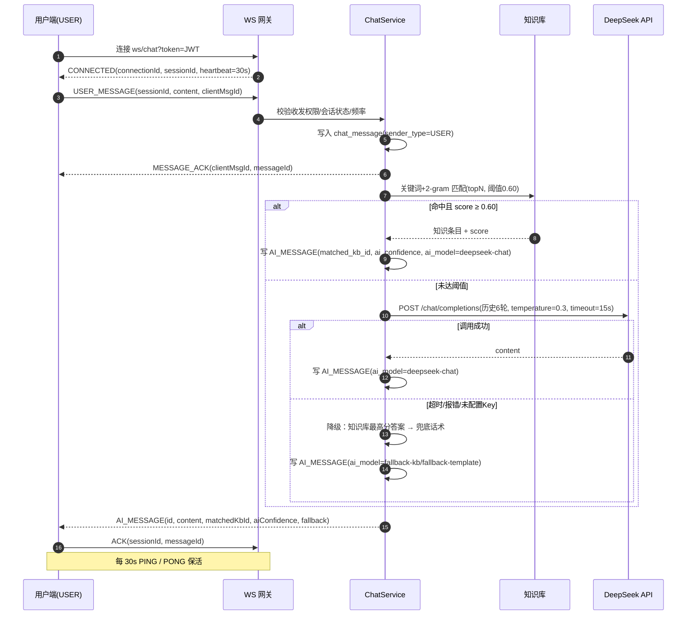
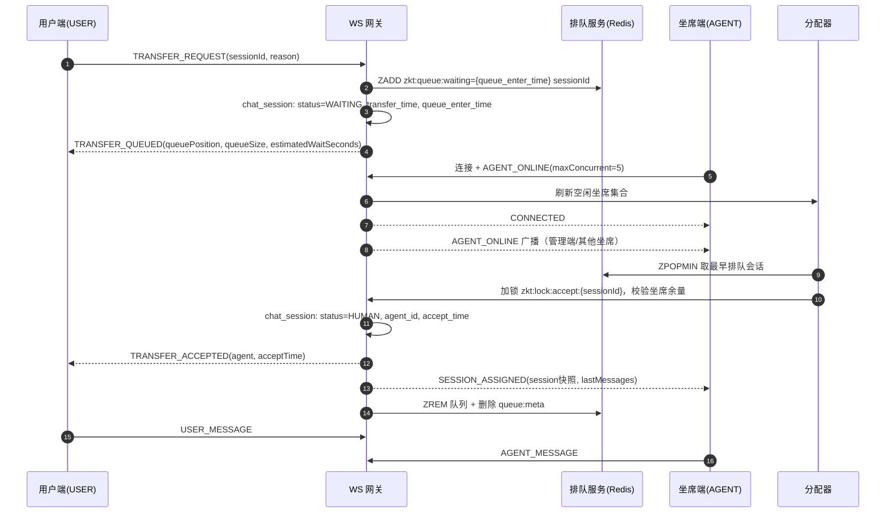
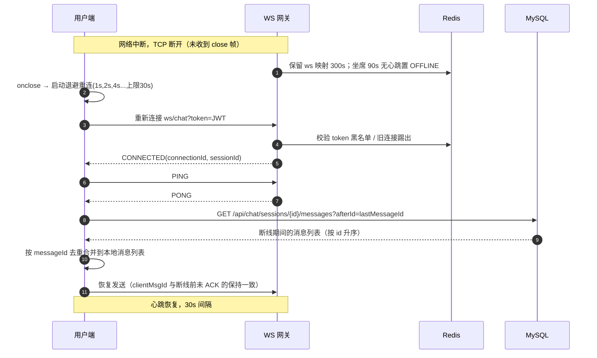
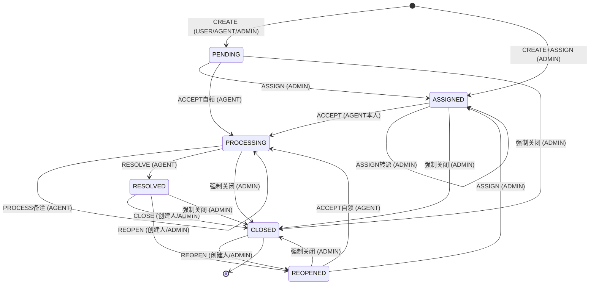
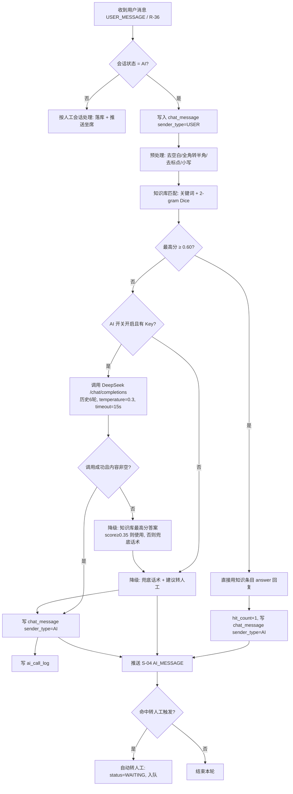

# 智客通 —— 智能对话客服与工单管理系统 接口与 WebSocket 协议规范

| 项目 | 内容 |
|------|------|
| 文档编号 | ZKT-API-V1.0 |
| 版本 | V1.0 |
| 状态 | 已评审，作为前后端并行开发唯一契约 |
| 适用工程 | `zhiketong-server` 1.0.0（Spring Boot 2.7.18 / Java 8） |
| 接口前缀 | `/api` |
| 编写目的 | 明确 REST 与 WebSocket 的路径、字段、权限、错误码与状态流转，前后端可据此独立开发、可直接联调 |
| 配套文档 | [项目开发文档.md](../项目开发文档.md)、`sql/schema.sql`、`sql/data.sql` |
| 字段权威性 | 所有字段名以本文「数据表字段」与 `sql/schema.sql` 为准，禁止前端/后端自行改名、造表 |
| 变更规则 | 任何路径、字段、权限、错误码变更必须先改本文档，再改代码，并在文末「待确认问题」留痕 |

---

## 0. 阅读说明

### 0.1 目录

- [一、通用约定](#一通用约定)
  - [1.1 服务地址与基础路径](#11-服务地址与基础路径)
  - [1.2 认证与鉴权](#12-认证与鉴权)
  - [1.3 统一返回结构与错误码总表](#13-统一返回结构与错误码总表)
  - [1.4 分页约定](#14-分页约定)
  - [1.5 时间与数值约定](#15-时间与数值约定)
  - [1.6 枚举字典](#16-枚举字典)
  - [1.7 通用请求头与通用参数](#17-通用请求头与通用参数)
  - [1.8 角色与数据权限矩阵](#18-角色与数据权限矩阵)
  - [1.9 跨域、脱敏与限流](#19-跨域脱敏与限流)
  - [1.10 典型失败响应示例](#110-典型失败响应示例)
- [二、REST 接口清单（72 个）](#二rest-接口清单72-个)
  - [2.0 接口总览表](#20-接口总览表)
  - [2.1 认证模块（R-01 ~ R-05）](#21-认证模块r-01--r-05)
  - [2.2 系统用户与角色管理（R-06 ~ R-17）](#22-系统用户与角色管理r-06--r-17)
  - [2.3 知识库分类与条目（R-18 ~ R-30）](#23-知识库分类与条目r-18--r-30)
  - [2.4 会话与消息（R-31 ~ R-39）](#24-会话与消息r-31--r-39)
  - [2.5 坐席工作台（R-40 ~ R-48）](#25-坐席工作台r-40--r-48)
  - [2.6 工单（R-49 ~ R-63）](#26-工单r-49--r-63)
  - [2.7 统计分析（R-64 ~ R-69）](#27-统计分析r-64--r-69)
  - [2.8 登录日志（R-70）](#28-登录日志r-70)
  - [2.9 健康检查（R-71 ~ R-72）](#29-健康检查r-71--r-72)
- [三、WebSocket 协议](#三websocket-协议)
  - [3.1 连接与握手](#31-连接与握手)
  - [3.2 统一信封](#32-统一信封)
  - [3.3 心跳 PING / PONG](#33-心跳-ping--pong)
  - [3.4 客户端 → 服务端消息类型（10 种）](#34-客户端--服务端消息类型10-种)
  - [3.5 服务端 → 客户端消息类型（16 种）](#35-服务端--客户端消息类型16-种)
  - [3.6 时序一：AI 对话](#36-时序一ai-对话)
  - [3.7 时序二：转人工排队与坐席接入](#37-时序二转人工排队与坐席接入)
  - [3.8 时序三：双方对话与结束评分](#38-时序三双方对话与结束评分)
  - [3.9 时序四：断线重连](#39-时序四断线重连)
  - [3.10 WebSocket 错误码与关闭码](#310-websocket-错误码与关闭码)
  - [3.11 重连策略](#311-重连策略)
  - [3.12 Redis 键设计](#312-redis-键设计)
  - [3.13 消息顺序、幂等与可达性](#313-消息顺序幂等与可达性)
- [四、工单状态机与 SLA](#四工单状态机与-sla)
- [五、AI 对话流程与降级策略](#五ai-对话流程与降级策略)
- [六、前后端联调约定与 Mock 建议](#六前后端联调约定与-mock-建议)
- [七、自检清单](#七自检清单)
- [八、待确认问题](#八待确认问题)

### 0.2 术语

| 术语 | 含义 |
|------|------|
| 用户（USER） | 发起咨询的终端用户，可创建会话、转人工、评价、提交/关闭/重开本人的工单 |
| 坐席（AGENT） | 人工客服，可上线/下线、接入排队会话、与用户对话、处理工单 |
| 管理员（ADMIN） | 系统管理员，负责用户/角色/知识库/工单分配/统计/日志 |
| 会话（session） | 一次用户咨询过程，对应 `chat_session` 一行，状态 `AI/WAITING/HUMAN/CLOSED` |
| 工单（work order） | 需要跨流程跟踪的问题单，对应 `work_order` 一行 |
| 首响（first response） | 坐席首次受理工单（写 `first_response_time`）的时刻 |
| SLA | 首响时限与解决时限，按工单优先级分档，见第四章 |
| AI 降级 | LLM 不可用（未配置 Key、超时、报错）时改用知识库直接回答或兜底话术 |
| C2S / S2C | Client to Server / Server to Client，WebSocket 消息方向 |

### 0.3 编号规则与数量自检

| 类别 | 编号规则 | 数量 |
|------|----------|------|
| REST 接口 | `R-01` ~ `R-72`，全文档唯一，按模块连续 | **72 个** |
| 客户端 → 服务端 WS 消息 | `C-01` ~ `C-10` | **10 种** |
| 服务端 → 客户端 WS 消息 | `S-01` ~ `S-16` | **16 种** |
| WS 业务错误 | `WS_8001` ~ `WS_8012` | 12 个 |
| 工单状态 | `PENDING/ASSIGNED/PROCESSING/RESOLVED/CLOSED/REOPENED` | 6 个 |

> 编号一经发布不得复用；删除接口时保留编号并标注「已废弃」。

---

## 一、通用约定

### 1.1 服务地址与基础路径

| 项 | 值 | 说明 |
|----|----|------|
| HTTP 服务 | `http://localhost:8080` | `server.port=8080`，`context-path=/` |
| REST 基础路径 | `/api` | 所有业务接口均以 `/api` 开头 |
| WebSocket | `ws://localhost:8080/ws/chat?token=<JWT>` | 用户端、坐席端共用同一端点，按 JWT 中 `role` 路由 |
| 接口文档 | `http://localhost:8080/swagger-ui.html` | springdoc-openapi，仅 dev 环境开放 |
| 健康检查 | `http://localhost:8080/actuator/health` | Spring Boot Actuator 原生端点 |
| 字符编码 | UTF-8 | 请求/响应均为 `application/json; charset=UTF-8` |
| 时区 | `Asia/Shanghai` | 见 `spring.jackson.time-zone` |

### 1.2 认证与鉴权

#### 1.2.1 JWT 约定

| 项 | 值 |
|----|----|
| 算法 | HS256（`jjwt` 0.11.5） |
| 密钥 | `${JWT_SECRET:zhiketong-javaee-final-project-secret-key-2026}`，长度 ≥ 32 字节 |
| 有效期 | 2 小时（`zhiketong.jwt.expire-hours=2`），无 Refresh Token，过期后重新登录 |
| 传输头 | `Authorization: Bearer <token>`（前缀含一个空格） |
| Payload 声明 | `sub`（用户 ID 字符串）、`username`、`role`（`ADMIN/AGENT/USER`）、`jti`（Token 唯一 ID）、`iat`、`exp` |
| 登出 | 将 `jti` 写入 Redis 黑名单 `zkt:token:blacklist:{jti}`，TTL 取 Token 剩余有效期；网关/过滤器校验黑名单 |

#### 1.2.2 白名单路径（无需 Token）

```
/api/auth/login
/api/auth/register
/api/health
/api/health/ready
/actuator/**
/swagger-ui/**
/v3/api-docs/**
/ws/chat        （WebSocket 握手阶段以 query 参数 token 校验，见 3.1）
```

#### 1.2.3 鉴权失败处理

| 场景 | HTTP 状态 | code | message 示例 | 前端动作 |
|------|-----------|------|--------------|----------|
| 未携带 Token | 401 | 401 | `COMMON_4010 未登录或 Token 缺失` | 跳转登录页 |
| Token 过期 | 401 | 401 | `COMMON_4011 Token 已过期，请重新登录` | 清除本地 Token，跳转登录页 |
| Token 被篡改/签名错误 | 401 | 401 | `COMMON_4012 Token 无效` | 清除本地 Token，跳转登录页 |
| 已登出（命中黑名单） | 401 | 401 | `COMMON_4013 Token 已失效` | 清除本地 Token，跳转登录页 |
| 角色不匹配 | 403 | 403 | `COMMON_4030 无权限访问该资源` | 提示无权限，禁止重试 |
| 数据权限不足（越权访问他人资源） | 403 | 403 | `COMMON_4031 无权访问该数据` | 提示无权限 |

### 1.3 统一返回结构与错误码总表

#### 1.3.1 返回结构

所有 REST 接口统一返回如下 JSON，HTTP 状态码与 `code` 保持一致：

| 字段 | 类型 | 必有 | 说明 |
|------|------|------|------|
| `code` | int | 是 | 业务状态码，取值见 1.3.2 |
| `message` | string | 是 | 可直接展示给用户的中文提示；格式为「错误标识 空格 中文描述」，成功时为 `success` |
| `data` | object/array/null | 是 | 业务数据；无返回数据时为 `null` |

> 说明：响应示例为「字段全集」，用于展示结构；由于全局 Jackson 配置 `default-property-inclusion: non_null`，**实际响应会省略值为 `null` 的字段**，前端必须按「字段可能缺失」处理（例如 `agentId` 缺失等价于 `null`）。分页 `list` 始终为数组（无数据为 `[]`），不会缺失。

成功响应示例：

```json
{
  "code": 200,
  "message": "success",
  "data": {
    "token": "eyJhbGciOiJIUzI1NiJ9.eyJzdWIiOiIxIn0.xxxx",
    "tokenType": "Bearer",
    "expiresIn": 7200
  }
}
```

分页成功响应示例：

```json
{
  "code": 200,
  "message": "success",
  "data": {
    "list": [],
    "total": 0,
    "pageNum": 1,
    "pageSize": 10,
    "pages": 0
  }
}
```

参数校验失败响应示例（`data` 中返回字段级错误）：

```json
{
  "code": 400,
  "message": "COMMON_4001 参数校验失败",
  "data": {
    "username": "用户名不能为空",
    "password": "密码长度需为 6-32 位"
  }
}
```

#### 1.3.2 code 语义表

| code | 含义 | HTTP 状态 | 使用场景 |
|------|------|-----------|----------|
| 200 | 成功 | 200 | 查询、创建、更新、删除成功 |
| 400 | 参数错误 | 400 | 必填缺失、格式错误、枚举非法、校验不通过 |
| 401 | 未登录/认证失败 | 401 | 无 Token、Token 过期/非法、账号密码错误、账号禁用 |
| 403 | 无权限 | 403 | 角色不匹配、越权访问他人数据 |
| 404 | 资源不存在 | 404 | 用户/角色/分类/条目/会话/工单不存在 |
| 409 | 状态冲突 | 409 | 状态机不允许的迁移、重复评分、重复接入、并发已满 |
| 500 | 服务器错误 | 500 | 未捕获异常、数据库/Redis/AI 服务不可用 |

#### 1.3.3 业务错误标识总表

> 前端判断逻辑**只依赖 `code`**；`message` 前缀用于日志排查与埋点，不得作为唯一判断依据。`data` 可能携带字段级错误（400）或冲突对象 ID（409）。

| 错误标识 | code | 含义 | 前端处理建议 |
|----------|------|------|--------------|
| `COMMON_4001` | 400 | 参数校验失败 | 按 `data` 字段错误高亮表单 |
| `COMMON_4002` | 400 | 请求体缺失或 JSON 格式错误 | 提示刷新重试 |
| `COMMON_4003` | 400 | 数值越界（pageSize > 100 等） | 修正参数 |
| `COMMON_4004` | 400 | 非法枚举值 | 修正参数 |
| `COMMON_4010` | 401 | 未登录或 Token 缺失 | 跳登录页 |
| `COMMON_4011` | 401 | Token 已过期 | 清 Token 跳登录页 |
| `COMMON_4012` | 401 | Token 无效 | 清 Token 跳登录页 |
| `COMMON_4013` | 401 | Token 已失效（登出/被踢） | 清 Token 跳登录页 |
| `COMMON_4030` | 403 | 角色无权限 | 提示无权限 |
| `COMMON_4031` | 403 | 数据权限不足 | 提示无权限 |
| `COMMON_4040` | 404 | 资源不存在 | 返回列表页 |
| `COMMON_4090` | 409 | 状态冲突（通用） | 提示并刷新详情 |
| `COMMON_4290` | 429 | 请求过于频繁 | 按钮禁用，稍后重试 |
| `COMMON_5000` | 500 | 服务器内部错误 | 提示稍后重试 |
| `COMMON_5001` | 500 | 数据库操作失败 | 提示稍后重试 |
| `COMMON_5002` | 500 | 缓存服务不可用 | 提示稍后重试 |
| `AUTH_1001` | 401 | 用户名或密码错误 | 提示，不区分哪个错 |
| `AUTH_1002` | 401 | 账号已被禁用 | 提示联系管理员 |
| `AUTH_1003` | 409 | 用户名已存在 | 提示更换用户名 |
| `AUTH_1004` | 400 | 两次输入的密码不一致 | 提示 |
| `AUTH_1005` | 400 | 原密码错误 | 提示 |
| `AUTH_1006` | 404 | 账号不存在 | 提示 |
| `AUTH_1007` | 409 | 手机号或邮箱已被占用 | 提示 |
| `AUTH_1008` | 403 | 允许注册的角色不合法 | 提示仅可注册 USER |
| `USER_2001` | 404 | 用户不存在 | 返回列表 |
| `USER_2002` | 409 | 不能禁用/删除当前登录账号 | 提示 |
| `USER_2003` | 403 | 内置管理员账号不允许该操作 | 提示 |
| `ROLE_2101` | 404 | 角色不存在 | 返回列表 |
| `ROLE_2102` | 409 | 角色下仍有用户，禁止删除或停用 | 提示先迁移用户 |
| `ROLE_2103` | 409 | 内置角色不允许修改 role_code | 仅可改名称/描述/排序 |
| `LOGIN_2201` | 404 | 登录日志不存在 | 返回列表 |
| `KB_3001` | 404 | 知识分类不存在 | 返回列表 |
| `KB_3002` | 409 | 分类下存在子分类，禁止删除 | 先删子分类 |
| `KB_3003` | 409 | 分类下存在条目，禁止删除 | 先迁移/删除条目 |
| `KB_3004` | 404 | 知识条目不存在 | 返回列表 |
| `KB_3005` | 409 | 同一分类下问题标题重复 | 提示修改问题 |
| `CHAT_4001` | 404 | 会话不存在 | 返回会话列表 |
| `CHAT_4002` | 403 | 无权访问该会话 | 提示无权限 |
| `CHAT_4003` | 409 | 会话已结束 | 刷新会话状态 |
| `CHAT_4004` | 409 | 会话当前状态不允许该操作 | 刷新状态 |
| `CHAT_4005` | 409 | 已存在进行中的会话 | 复用已有会话 |
| `CHAT_4006` | 409 | 会话未结束，暂不能评分 | 结束会话后再评分 |
| `CHAT_4007` | 409 | 已评分，不能重复评分 | 展示已有评分 |
| `CHAT_4008` | 400 | 消息内容为空或超长（> 2000 字符） | 修改内容 |
| `CHAT_4009` | 429 | 消息发送过于频繁（1 秒内 > 3 条） | 限流提示 |
| `AGENT_5001` | 404 | 坐席不存在或账号未启用 | 提示联系管理员 |
| `AGENT_5002` | 409 | 坐席当前不在线 | 先上线 |
| `AGENT_5003` | 409 | 坐席并发会话已达上限 | 提示先结束会话 |
| `AGENT_5004` | 409 | 会话已被其他坐席接入 | 刷新队列 |
| `AGENT_5005` | 403 | 当前坐席不是该会话负责人 | 提示无权限 |
| `AGENT_5006` | 409 | 待接入队列为空 | 刷新队列 |
| `AGENT_5007` | 409 | 坐席当前状态不允许该操作 | 刷新状态 |
| `WO_6001` | 404 | 工单不存在 | 返回列表 |
| `WO_6002` | 403 | 无权访问该工单 | 返回我的工单 |
| `WO_6003` | 409 | 工单当前状态不允许该操作 | 刷新详情 |
| `WO_6004` | 409 | 工单已关闭 | 如需继续请先重开 |
| `WO_6005` | 409 | 工单已分配给其他坐席，不能受理 | 刷新详情，等待管理员改派 |
| `WO_6006` | 403 | 只有工单创建人可以评分 | 隐藏评分入口 |
| `WO_6007` | 409 | 工单尚未解决，不能评分 | 解决后评分 |
| `WO_6008` | 409 | 工单已评分 | 展示已有评分 |
| `WO_6009` | 400 | 工单优先级不合法 | 修正优先级 |
| `STAT_7001` | 400 | 统计时间范围不合法（开始 > 结束或跨度 > 366 天） | 修正时间 |
| `WS_8001` | 401 | WebSocket 认证失败 | 关闭并重新登录后重连 |
| `WS_8002` | 400 | WS 报文格式错误 / JSON 解析失败 | 修正报文 |
| `WS_8003` | 400 | 未知消息类型 | 升级前端/后端版本 |
| `WS_8004` | 403 | 无权发送该类型消息 | 隐藏入口 |
| `WS_8005` | 404 | 会话不存在或已关闭 | 刷新会话 |
| `WS_8006` | 409 | 坐席并发已满 | 先结束会话 |
| `WS_8007` | 409 | 会话已被其他坐席接入 | 刷新队列 |
| `WS_8008` | 409 | 重复消息（clientMsgId 幂等命中） | 忽略，不重发 |
| `WS_8009` | 429 | 发送频率超限 | 限流提示 |
| `WS_8010` | 500 | 服务端内部错误 | 重试或转 REST 兜底 |
| `WS_8011` | 408 | 心跳超时 | 触发重连 |
| `WS_8012` | 409 | 连接已被同一账号的新连接替换 | 提示「已在其他页面建立连接」 |

### 1.4 分页约定

#### 1.4.1 请求参数

| 参数 | 类型 | 必填 | 默认 | 校验 | 说明 |
|------|------|------|------|------|------|
| `pageNum` | int | 否 | 1 | ≥ 1 | 页码，从 1 开始 |
| `pageSize` | int | 否 | 10 | 1 ~ 100 | 每页条数，超过 100 返回 400 `COMMON_4003` |
| `orderBy` | string | 否 | 各接口指定 | 白名单字段 | 排序字段（下划线命名，如 `create_time`） |
| `orderDir` | string | 否 | `desc` | `asc` / `desc` | 排序方向，统一小写 |

#### 1.4.2 响应结构

| 字段 | 类型 | 说明 |
|------|------|------|
| `list` | array | 当前页数据，无数据时为 `[]`，不是 `null` |
| `total` | long | 总记录数 |
| `pageNum` | int | 当前页码 |
| `pageSize` | int | 每页条数 |
| `pages` | int | 总页数，`ceil(total / pageSize)`；`total=0` 时为 0 |

> 页码超出总页数时返回空 `list` 与正确的 `total`，不报错；`pageSize` 上限 100 防止全表拉取。个别接口可覆盖默认值（如 R-35 消息分页、R-63 日志分页默认 20），以各接口字段表为准。

### 1.5 时间与数值约定

| 类型 | 格式 | 示例 | 说明 |
|------|------|------|------|
| 日期时间（REST） | `yyyy-MM-dd HH:mm:ss` | `2026-10-20 19:00:00` | 全局 Jackson 配置，时区 `Asia/Shanghai`；空值字段不输出（`non_null`） |
| 日期（查询参数） | `yyyy-MM-dd` | `2026-10-20` | 统计类接口的 `startDate`/`endDate` |
| WebSocket `timestamp` | 13 位毫秒时间戳（long） | `1760958000000` | 仅信封字段；信封内业务时间仍用 `yyyy-MM-dd HH:mm:ss` |
| 时长 | 整数（分钟/毫秒） | `15`、`15000` | 字段名或文档注明单位，禁止混用 |
| 评分 | int 1 ~ 5 | `5` | `chat_session.rating`、`work_order.rating` |
| 置信度 | decimal 0 ~ 1，保留 4 位 | `0.8732` | `chat_message.ai_confidence` |
| 布尔 | `true` / `false` | `true` | 数据库中 `tinyint(1)`，JSON 层为布尔 |

### 1.6 枚举字典

> 枚举值区分大小写，REST 与 WebSocket 中一律使用下表英文常量（工单分类除外，见 1.6.9）。数据库使用 `varchar` 存储，禁止写中文别称。

#### 1.6.1 角色 `sys_user.role_code`

| 值 | 含义 | 说明 |
|----|------|------|
| `ADMIN` | 管理员 | 唯一拥有系统管理、统计、分配权限的角色 |
| `AGENT` | 客服坐席 | 拥有坐席工作台、知识库读/写条目、工单处理权限 |
| `USER` | 普通用户 | 拥有咨询、会话、评价、本人工单权限 |

#### 1.6.2 账号状态 `sys_user.status` / `sys_role.status` / `kb_category.status` / `kb_entry.status`

| 值 | 含义 |
|----|------|
| 1 | 启用 |
| 0 | 禁用 |

#### 1.6.3 会话状态 `chat_session.status`

| 值 | 含义 | 可进入方式 |
|----|------|-----------|
| `AI` | AI 接待中 | 创建会话默认状态 |
| `WAITING` | 排队等待人工 | 用户转人工且无可用坐席 |
| `HUMAN` | 人工接待中 | 坐席接入成功 |
| `CLOSED` | 已结束 | 用户/坐席/管理员结束，或排队/会话超时系统关闭 |

#### 1.6.4 会话关闭原因 `chat_session.close_reason`

| 值 | 含义 | 触发方 |
|----|------|--------|
| `USER_CLOSED` | 用户主动结束 | USER |
| `AGENT_CLOSED` | 坐席结束会话 | AGENT |
| `TIMEOUT` | 排队超时或会话超时 | 系统定时任务 |
| `SYSTEM` | 系统关闭（管理员强制/异常回收） | ADMIN / 系统 |

#### 1.6.5 消息发送方 `chat_message.sender_type`

| 值 | 含义 | `sender_id` 取值 |
|----|------|------------------|
| `USER` | 用户 | `sys_user.id` |
| `AI` | AI 助手 | `0`（系统保留） |
| `AGENT` | 人工坐席 | `sys_user.id` |
| `SYSTEM` | 系统提示 | `0` |

#### 1.6.6 消息内容类型 `chat_message.content_type`

| 值 | 含义 | 说明 |
|----|------|------|
| `TEXT` | 纯文本 | V1.0 仅支持该类型；`content` 长度 ≤ 2000 字符 |

#### 1.6.7 工单状态 `work_order.status`

| 值 | 含义 | 终态 |
|----|------|------|
| `PENDING` | 待分配 | 否 |
| `ASSIGNED` | 已分配（待受理） | 否 |
| `PROCESSING` | 处理中 | 否 |
| `RESOLVED` | 已解决（待确认） | 否 |
| `CLOSED` | 已关闭 | 是 |
| `REOPENED` | 已重开 | 否 |

#### 1.6.8 工单优先级 `work_order.priority`

| 值 | 含义 | 首响时限 | 解决时限 |
|----|------|----------|----------|
| `P0` | 紧急 | 30 分钟 | 120 分钟 |
| `P1` | 高 | 120 分钟 | 480 分钟 |
| `P2` | 中 | 480 分钟 | 1440 分钟 |
| `P3` | 低 | 1440 分钟 | 4320 分钟 |

#### 1.6.9 工单分类 `work_order.category`（中文枚举，直接存中文）

| 值 | 含义 |
|----|------|
| `技术问题` | 系统/产品技术故障 |
| `账号问题` | 登录、密码、权限相关 |
| `订单问题` | 下单、支付、退款进度 |
| `售后问题` | 商品/服务售后 |
| `其他` | 其他问题 |

#### 1.6.10 工单来源 `work_order.source`

| 值 | 含义 |
|----|------|
| `CHAT` | 会话中转人工升级生成 |
| `MANUAL` | 后台手工创建 |
| `PHONE` | 电话记录补录 |

#### 1.6.11 工单日志动作 `work_order_log.action`

| 值 | 含义 | 触发接口 |
|----|------|----------|
| `CREATE` | 创建工单 | R-49 |
| `ASSIGN` | 分配/领取工单 | R-55、R-56 |
| `ACCEPT` | 受理工单 | R-56 |
| `PROCESS` | 处理进展备注 | R-57 |
| `RESOLVE` | 解决工单 | R-58 |
| `CLOSE` | 关闭工单 | R-59 |
| `REOPEN` | 重开工单 | R-60 |
| `COMMENT` | 追加备注/编辑留痕 | R-54 编辑工单、R-61 调整优先级时写入 |
| `OVERDUE` | SLA 超时 | 定时任务（非人工接口） |

#### 1.6.12 坐席在线状态 `agent_status.online_status`

| 值 | 含义 | 说明 |
|----|------|------|
| `ONLINE` | 在线空闲 | 可接入排队会话 |
| `BUSY` | 忙碌 | 已达 `max_concurrent` 或手动置忙，暂停分配 |
| `OFFLINE` | 离线 | 心跳超时/主动下线，不参与分配 |

#### 1.6.13 其他布尔/状态字段

| 字段 | 值 | 含义 |
|------|----|------|
| `ai_call_log.success` | 1 / 0 | 1 调用成功，0 调用失败或降级 |
| `sys_login_log.success` | 1 / 0 | 1 登录成功，0 登录失败 |
| `work_order.overdue_flag` | 1 / 0 | 1 已超时（首次超时后置 1，不自动复位） |
| `chat_message.read_flag` | 1 / 0 | 1 已读，0 未读 |

### 1.7 通用请求头与通用参数

| 请求头 | 必填 | 示例 | 说明 |
|--------|------|------|------|
| `Authorization` | 除白名单外必填 | `Bearer eyJhbGciOi...` | JWT |
| `Content-Type` | 有请求体时必填 | `application/json; charset=UTF-8` | 仅支持 JSON |
| `X-Request-Id` | 否 | `7f3d2c1a-...` | 链路追踪 ID，服务端回写日志，不参与业务 |
| `Accept-Language` | 否 | `zh-CN` | 预留，V1.0 固定中文 |

通用约定：

1. 所有写操作（POST/PUT/DELETE）幂等性由前端按钮防抖 + 后端唯一约束/状态机保证，不使用 `Idempotency-Key` 请求头。
2. REST 发送消息使用 `clientMsgId` 做幂等（见 R-36、3.13）。
3. 布尔查询参数统一用 `true/false`；日期范围参数为 `startDate`、`endDate`（含首尾）。
4. 模糊查询参数统一命名 `keyword`，服务端去首尾空格，长度 ≤ 50。
5. 未知字段按 Jackson `fail-on-unknown-properties: false` 策略忽略，不报错。

### 1.8 角色与数据权限矩阵

> `✔` 有权限，`—` 无权限，`△` 有条件（按数据归属判断）。数据权限优先级高于角色权限：即使角色允许，非本人数据也返回 403 `COMMON_4031`。

| 功能 / 接口组 | 匿名 | USER | AGENT | ADMIN | 数据范围说明 |
|---------------|:----:|:----:|:-----:|:-----:|--------------|
| 登录、注册（R-01、R-02） | ✔ | — | — | — | 公开 |
| 登出、当前用户、改密（R-03 ~ R-05） | — | ✔ | ✔ | ✔ | 仅本人 |
| 健康检查（R-71、R-72） | ✔ | ✔ | ✔ | ✔ | 公开 |
| 用户管理（R-06 ~ R-12） | — | — | — | ✔ | 全部用户；不可操作内置 admin |
| 角色管理（R-13 ~ R-17） | — | — | — | ✔ | 全部角色；内置角色受保护 |
| 知识库分类查询（R-18） | — | — | ✔ | ✔ | 全部分类（含禁用，供后台展示） |
| 知识库分类写操作（R-19 ~ R-22） | — | — | — | ✔ | 全部分类 |
| 知识条目查询/搜索/排行（R-23、R-24、R-29、R-30） | — | — | ✔ | ✔ | 全部条目 |
| 知识条目新增/编辑（R-25、R-26） | — | — | ✔ | ✔ | 记录 `create_by`/`update_by` |
| 知识条目删除/启停（R-27、R-28） | — | — | — | ✔ | 全部条目 |
| 创建会话、当前会话、转人工、评分（R-31、R-33、R-37、R-39） | — | ✔ | — | — | 仅本人 |
| 会话列表/详情/消息（R-32、R-34、R-35） | — | △ | △ | ✔ | USER：`user_id` 为本人；AGENT：`agent_id` 为本人；ADMIN：全部 |
| REST 发消息兜底（R-36） | — | △ | △ | — | USER：本人会话且状态 AI/WAITING/HUMAN；AGENT：本人 `HUMAN` 会话 |
| 结束会话（R-38） | — | △ | △ | ✔ | USER：本人；AGENT：本人接待；ADMIN：全部 |
| 坐席上线/下线/置忙、我的会话、接入、结束、转接（R-40 ~ R-42、R-44 ~ R-47） | — | — | ✔ | — | 仅本人坐席身份 |
| 待接入队列（R-43） | — | — | ✔ | ✔ | 只读 |
| 坐席工作台统计（R-48） | — | — | ✔ | — | 仅本人数据 |
| 创建工单（R-49） | — | ✔ | ✔ | ✔ | `creator_id` 为当前登录人 |
| 工单全量列表、超时列表（R-50、R-52） | — | — | ✔ | ✔ | AGENT 仅 `assignee_id` 为本人（`my` 参数可放宽为参与）；ADMIN 全部 |
| 我的工单（R-51） | — | ✔ | ✔ | ✔ | USER：`creator_id`；AGENT：`assignee_id`；ADMIN：可查全部 |
| 工单详情/日志（R-53、R-63） | — | △ | △ | ✔ | 创建人、当前受理人、ADMIN |
| 编辑工单（R-54） | — | △ | — | ✔ | 创建人仅 `PENDING/REOPENED`；ADMIN 不限状态 |
| 分配/调整优先级（R-55、R-61） | — | — | — | ✔ | 全部 |
| 受理/处理/解决（R-56 ~ R-58） | — | — | ✔ | — | 仅 `assignee_id` 为本人，或管理员代为分配后由坐席受理 |
| 关闭/重开（R-59、R-60） | — | △ | — | ✔ | USER 仅创建人；ADMIN 全部；AGENT 无权限（见待确认 8.3） |
| 工单评分（R-62） | — | △ | — | — | 仅创建人 |
| 统计分析（R-64 ~ R-69） | — | — | — | ✔ | 全局统计 |
| 登录日志（R-70） | — | — | — | ✔ | 全局日志 |

### 1.9 跨域、脱敏与限流

| 项 | 约定 |
|----|------|
| CORS | dev 环境允许 `http://localhost:5173`、`http://localhost:8081`、`http://127.0.0.1:5173`；允许方法 `GET/POST/PUT/DELETE/OPTIONS`；允许头 `Authorization, Content-Type, X-Request-Id`；暴露头 `Authorization`；`allowCredentials=false`（JWT 放 Header，不用 Cookie） |
| 密码 | 任何响应都不得返回 `password` 字段；数据库存 BCrypt 哈希 |
| 手机号 | 非管理员接口返回时中间四位脱敏：`138****8000`；管理员用户管理接口返回完整值 |
| 邮箱 | 非本人接口返回时局部脱敏：`a***@example.com` |
| Token | 日志中不得打印完整 Token，最多保留前 8 位 |
| 限流 | 登录接口同一 IP 5 次/分钟；REST 发消息同一用户 3 条/秒；WS 发消息同一连接 10 条/秒；超限返回 429 `COMMON_4290`/`WS_8009` |
| 上传 | V1.0 不提供文件上传接口，`avatar` 仅接受 URL 字符串（≤ 255 字符）；见待确认 8.6 |

### 1.10 典型失败响应示例

```json
// 400 参数校验失败
{
  "code": 400,
  "message": "COMMON_4001 参数校验失败",
  "data": { "pageSize": "每页条数不能超过 100" }
}
```

```json
// 401 Token 过期
{
  "code": 401,
  "message": "COMMON_4011 Token 已过期，请重新登录",
  "data": null
}
```

```json
// 403 越权访问他人会话
{
  "code": 403,
  "message": "CHAT_4002 无权访问该会话",
  "data": null
}
```

```json
// 404 工单不存在
{
  "code": 404,
  "message": "WO_6001 工单不存在",
  "data": null
}
```

```json
// 409 状态冲突（对已关闭工单执行解决）
{
  "code": 409,
  "message": "WO_6003 工单当前状态不允许该操作",
  "data": { "orderId": 12, "status": "CLOSED", "allowedFrom": ["PROCESSING"] }
}
```

```json
// 500 服务器错误
{
  "code": 500,
  "message": "COMMON_5000 服务器内部错误",
  "data": null
}
```

---

## 二、REST 接口清单（72 个）

### 2.0 接口总览表

> 角色列中「登录」表示任意已登录角色；「创建人」等为数据级权限。所有路径均以 `/api` 开头，路径参数使用 `{id}` 形式，禁止出现动词式路径（`/getUser` 之类）。

| 编号 | 方法 | 路径 | 角色 | 说明 |
|------|------|------|------|------|
| R-01 | POST | `/auth/login` | 匿名 | 登录并签发 JWT |
| R-02 | POST | `/auth/register` | 匿名 | 注册普通用户 |
| R-03 | POST | `/auth/logout` | 登录 | 登出并使 Token 失效 |
| R-04 | GET | `/auth/me` | 登录 | 获取当前登录用户信息 |
| R-05 | PUT | `/auth/password` | 登录 | 修改本人密码 |
| R-06 | GET | `/admin/users` | ADMIN | 用户分页列表 |
| R-07 | GET | `/admin/users/{id}` | ADMIN | 用户详情 |
| R-08 | POST | `/admin/users` | ADMIN | 新增用户 |
| R-09 | PUT | `/admin/users/{id}` | ADMIN | 编辑用户 |
| R-10 | DELETE | `/admin/users/{id}` | ADMIN | 逻辑删除用户 |
| R-11 | PUT | `/admin/users/{id}/status` | ADMIN | 启用/禁用用户 |
| R-12 | PUT | `/admin/users/{id}/password` | ADMIN | 重置用户密码 |
| R-13 | GET | `/admin/roles` | ADMIN | 角色列表 |
| R-14 | POST | `/admin/roles` | ADMIN | 新增角色 |
| R-15 | PUT | `/admin/roles/{id}` | ADMIN | 编辑角色 |
| R-16 | DELETE | `/admin/roles/{id}` | ADMIN | 删除角色 |
| R-17 | PUT | `/admin/roles/{id}/status` | ADMIN | 启用/禁用角色 |
| R-18 | GET | `/kb/categories` | AGENT、ADMIN | 知识分类树列表 |
| R-19 | POST | `/kb/categories` | ADMIN | 新增知识分类 |
| R-20 | PUT | `/kb/categories/{id}` | ADMIN | 编辑知识分类 |
| R-21 | DELETE | `/kb/categories/{id}` | ADMIN | 删除知识分类 |
| R-22 | PUT | `/kb/categories/{id}/status` | ADMIN | 启用/禁用知识分类 |
| R-23 | GET | `/kb/entries` | AGENT、ADMIN | 知识条目分页列表 |
| R-24 | GET | `/kb/entries/{id}` | AGENT、ADMIN | 知识条目详情 |
| R-25 | POST | `/kb/entries` | AGENT、ADMIN | 新增知识条目 |
| R-26 | PUT | `/kb/entries/{id}` | AGENT、ADMIN | 编辑知识条目 |
| R-27 | DELETE | `/kb/entries/{id}` | ADMIN | 删除知识条目 |
| R-28 | PUT | `/kb/entries/{id}/status` | ADMIN | 启用/禁用知识条目 |
| R-29 | GET | `/kb/entries/search` | AGENT、ADMIN | 知识条目检索（问答匹配预览） |
| R-30 | GET | `/kb/entries/ranking` | AGENT、ADMIN | 知识条目命中排行 |
| R-31 | POST | `/chat/sessions` | USER | 创建会话 |
| R-32 | GET | `/chat/sessions` | 登录 | 会话分页列表（按数据权限） |
| R-33 | GET | `/chat/sessions/current` | USER | 查询本人进行中的会话 |
| R-34 | GET | `/chat/sessions/{id}` | 登录 | 会话详情 |
| R-35 | GET | `/chat/sessions/{id}/messages` | 登录 | 会话消息分页 |
| R-36 | POST | `/chat/sessions/{id}/messages` | USER、AGENT | REST 发送消息（WS 兜底） |
| R-37 | POST | `/chat/sessions/{id}/transfer` | USER | 请求转人工 |
| R-38 | POST | `/chat/sessions/{id}/close` | USER、AGENT、ADMIN | 结束会话 |
| R-39 | POST | `/chat/sessions/{id}/rating` | USER | 会话评分 |
| R-40 | POST | `/agent/online` | AGENT | 坐席上线 |
| R-41 | POST | `/agent/offline` | AGENT | 坐席下线 |
| R-42 | PUT | `/agent/status` | AGENT | 设置坐席在线/忙碌状态 |
| R-43 | GET | `/agent/queue` | AGENT、ADMIN | 待接入队列 |
| R-44 | POST | `/agent/sessions/{sessionId}/accept` | AGENT | 接入排队会话 |
| R-45 | GET | `/agent/sessions` | AGENT | 我的会话列表 |
| R-46 | POST | `/agent/sessions/{sessionId}/close` | AGENT | 结束本人接待的会话 |
| R-47 | POST | `/agent/sessions/{sessionId}/transfer` | AGENT | 转接会话给其他坐席 |
| R-48 | GET | `/agent/workbench/stats` | AGENT | 坐席工作台统计 |
| R-49 | POST | `/workorders` | USER、AGENT、ADMIN | 创建工单 |
| R-50 | GET | `/workorders` | AGENT、ADMIN | 工单分页列表（全量/筛选） |
| R-51 | GET | `/workorders/my` | USER、AGENT、ADMIN | 我的工单 |
| R-52 | GET | `/workorders/overdue` | AGENT、ADMIN | 超时工单列表 |
| R-53 | GET | `/workorders/{id}` | 创建人、受理人、ADMIN | 工单详情 |
| R-54 | PUT | `/workorders/{id}` | 创建人、ADMIN | 编辑工单 |
| R-55 | POST | `/workorders/{id}/assign` | ADMIN | 分配工单 |
| R-56 | POST | `/workorders/{id}/accept` | AGENT | 受理工单 |
| R-57 | POST | `/workorders/{id}/process` | AGENT | 处理进展备注 |
| R-58 | POST | `/workorders/{id}/resolve` | AGENT | 标记解决 |
| R-59 | POST | `/workorders/{id}/close` | 创建人、ADMIN | 关闭工单 |
| R-60 | POST | `/workorders/{id}/reopen` | 创建人、ADMIN | 重开工单 |
| R-61 | PUT | `/workorders/{id}/priority` | ADMIN | 调整优先级（重算 SLA） |
| R-62 | POST | `/workorders/{id}/rating` | 创建人 | 工单评分 |
| R-63 | GET | `/workorders/{id}/logs` | 创建人、受理人、ADMIN | 工单流转日志 |
| R-64 | GET | `/statistics/overview` | ADMIN | 数据总览 |
| R-65 | GET | `/statistics/session-trend` | ADMIN | 会话量趋势 |
| R-66 | GET | `/statistics/agent-workload` | ADMIN | 坐席工作量 |
| R-67 | GET | `/statistics/kb-hit` | ADMIN | 知识库命中统计 |
| R-68 | GET | `/statistics/workorder-distribution` | ADMIN | 工单分布统计 |
| R-69 | GET | `/statistics/ai-calls` | ADMIN | AI 调用统计 |
| R-70 | GET | `/admin/login-logs` | ADMIN | 登录日志分页列表 |
| R-71 | GET | `/health` | 匿名 | 自定义健康检查 |
| R-72 | GET | `/health/ready` | 匿名 | 就绪检查（DB/Redis/AI 配置） |

**计数校验**：认证 5 + 用户角色 12 + 知识库 13 + 会话消息 9 + 坐席 9 + 工单 15 + 统计 6 + 登录日志 1 + 健康检查 2 = **72**。

#### 接口文档模板说明

每个接口按以下结构描述：

1. **基本信息**：编号、方法、路径、角色、是否幂等、内容类型；
2. **请求参数**：路径参数、查询参数或 JSON 请求体，逐字段给出 `类型 / 必填 / 校验 / 说明`；
3. **响应示例**：可直接粘贴到 Mock 的真实结构；
4. **错误码**：仅列该接口特有可能出现的业务错误，通用错误（400/401/403/500）不再重复。

---

### 2.1 认证模块（R-01 ~ R-05）

#### R-01 登录

| 项 | 内容 |
|----|------|
| 方法 / 路径 | `POST /api/auth/login` |
| 所需角色 | 匿名 |
| 幂等 | 否（重复登录会刷新 `last_login_time` 并签发新 Token） |
| Content-Type | `application/json` |

请求体：

| 字段 | 类型 | 必填 | 校验 | 说明 |
|------|------|------|------|------|
| `username` | string | 是 | 长度 3 ~ 32，不含空格 | 用户名 |
| `password` | string | 是 | 长度 6 ~ 32 | 明文密码，服务端 BCrypt 校验 |

响应 `data`：

| 字段 | 类型 | 说明 |
|------|------|------|
| `token` | string | JWT |
| `tokenType` | string | 固定 `Bearer` |
| `expiresIn` | int | 有效期秒数，`7200` |
| `user` | object | 当前用户简要信息，见下 |

`user` 对象：`id`(long)、`username`(string)、`nickname`(string)、`roleCode`(string)、`avatar`(string)、`phone`(string，脱敏)。

```json
{
  "code": 200,
  "message": "success",
  "data": {
    "token": "eyJhbGciOiJIUzI1NiJ9.eyJzdWIiOiIxIiwicm9sZSI6IkFETUlOIn0.signature",
    "tokenType": "Bearer",
    "expiresIn": 7200,
    "user": {
      "id": 1,
      "username": "admin",
      "nickname": "系统管理员",
      "roleCode": "ADMIN",
      "avatar": "https://cdn.example.com/avatar/admin.png",
      "phone": "138****8000"
    }
  }
}
```

错误码：

| code | 标识 | 触发条件 |
|------|------|----------|
| 400 | `COMMON_4001` | 用户名/密码为空或长度不合法 |
| 401 | `AUTH_1001` | 用户名不存在或密码错误（不区分，防枚举） |
| 401 | `AUTH_1002` | 账号被禁用（`status=0`） |
| 429 | `COMMON_4290` | 同一 IP 每分钟超过 5 次 |

> 无论成功失败都写 `sys_login_log`（`success=1/0`，`message` 记录结果），并更新成功用户的 `last_login_time`、`last_login_ip`。

#### R-02 注册

| 项 | 内容 |
|----|------|
| 方法 / 路径 | `POST /api/auth/register` |
| 所需角色 | 匿名 |
| 幂等 | 否（用户名唯一） |
| 说明 | 仅允许注册 `USER` 角色；AGENT/ADMIN 由管理员在 R-08 创建 |

请求体：

| 字段 | 类型 | 必填 | 校验 | 说明 |
|------|------|------|------|------|
| `username` | string | 是 | 3 ~ 32 位，`^[a-zA-Z0-9_]+$`，全局唯一 | 登录名 |
| `password` | string | 是 | 6 ~ 32 位，至少包含字母和数字 | 密码 |
| `confirmPassword` | string | 是 | 与 `password` 一致 | 确认密码 |
| `nickname` | string | 否 | ≤ 32 字符，默认取 `username` | 昵称 |
| `phone` | string | 否 | `^1[3-9]\d{9}$`，唯一 | 手机号 |
| `email` | string | 否 | 邮箱格式，≤ 128，唯一 | 邮箱 |

响应 `data`：`{ "id": 12, "username": "zhangsan", "roleCode": "USER" }`。

```json
{
  "code": 200,
  "message": "success",
  "data": { "id": 12, "username": "zhangsan", "roleCode": "USER" }
}
```

错误码：400 `COMMON_4001`；409 `AUTH_1003`（用户名已存在）、`AUTH_1007`（手机号/邮箱已占用）；400 `AUTH_1004`（两次密码不一致）；403 `AUTH_1008`（尝试指定非 USER 角色）。

#### R-03 登出

| 项 | 内容 |
|----|------|
| 方法 / 路径 | `POST /api/auth/logout` |
| 所需角色 | 登录 |
| 请求体 | 无 |
| 说明 | 取当前 Token 的 `jti` 写入 Redis 黑名单，TTL 为 Token 剩余有效期；同时关闭该用户/坐席的 WS 连接并广播下线 |

响应：

```json
{ "code": 200, "message": "success", "data": null }
```

错误码：401（未登录/Token 已失效）。

#### R-04 当前用户信息

| 项 | 内容 |
|----|------|
| 方法 / 路径 | `GET /api/auth/me` |
| 所需角色 | 登录 |
| 请求参数 | 无 |

响应 `data`：

| 字段 | 类型 | 说明 |
|------|------|------|
| `id` | long | 用户 ID |
| `username` | string | 用户名 |
| `nickname` | string | 昵称 |
| `roleCode` | string | `ADMIN/AGENT/USER` |
| `phone` | string | 手机号（本人可见完整值） |
| `email` | string | 邮箱（本人可见完整值） |
| `avatar` | string | 头像 URL |
| `status` | int | 1 启用 / 0 禁用 |
| `lastLoginTime` | string | 最近登录时间 |
| `lastLoginIp` | string | 最近登录 IP |
| `createTime` | string | 创建时间 |
| `agentStatus` | object/null | 仅 AGENT 返回：`{ "onlineStatus": "ONLINE", "maxConcurrent": 5, "currentCount": 2 }` |

```json
{
  "code": 200,
  "message": "success",
  "data": {
    "id": 2,
    "username": "agent01",
    "nickname": "坐席小张",
    "roleCode": "AGENT",
    "phone": "13900001111",
    "email": "agent01@example.com",
    "avatar": "https://cdn.example.com/avatar/a1.png",
    "status": 1,
    "lastLoginTime": "2026-10-20 18:30:00",
    "lastLoginIp": "127.0.0.1",
    "createTime": "2026-09-01 09:00:00",
    "agentStatus": { "onlineStatus": "ONLINE", "maxConcurrent": 5, "currentCount": 2 }
  }
}
```

错误码：401；403（Token 中角色与库中角色不一致时由服务端判定）。

#### R-05 修改本人密码

| 项 | 内容 |
|----|------|
| 方法 / 路径 | `PUT /api/auth/password` |
| 所需角色 | 登录 |
| 说明 | 修改成功后由前端清除本地 Token，强制重新登录 |

请求体：

| 字段 | 类型 | 必填 | 校验 | 说明 |
|------|------|------|------|------|
| `oldPassword` | string | 是 | 6 ~ 32 | 原密码 |
| `newPassword` | string | 是 | 6 ~ 32，至少含字母和数字，且 ≠ 原密码 | 新密码 |
| `confirmPassword` | string | 是 | 与 `newPassword` 一致 | 确认新密码 |

响应：`{ "code": 200, "message": "success", "data": null }`。

错误码：400 `COMMON_4001`、`AUTH_1004`（两次不一致）、`AUTH_1005`（原密码错误）；401。

---

### 2.2 系统用户与角色管理（R-06 ~ R-17）

> 本模块全部接口仅 `ADMIN` 可访问。`password` 字段永不返回；删除为逻辑删除（`deleted=1`），查询默认过滤 `deleted=0`。

**用户对象（UserVO）字段说明**：`id`(long)、`username`(string)、`nickname`(string)、`roleCode`(string)、`phone`(string)、`email`(string)、`avatar`(string)、`status`(int)、`lastLoginTime`(string)、`lastLoginIp`(string)、`createTime`(string)、`updateTime`(string)。

**角色对象（RoleVO）字段说明**：`id`(long)、`roleCode`(string)、`roleName`(string)、`description`(string)、`sort`(int)、`status`(int)、`userCount`(long，该角色下未删除用户数)、`createTime`(string)。

#### R-06 用户分页列表

| 项 | 内容 |
|----|------|
| 方法 / 路径 | `GET /api/admin/users` |
| 所需角色 | ADMIN |
| 幂等 | 是 |

查询参数：

| 字段 | 类型 | 必填 | 校验 | 说明 |
|------|------|------|------|------|
| `pageNum` | int | 否 | ≥ 1，默认 1 | 页码 |
| `pageSize` | int | 否 | 1 ~ 100，默认 10 | 每页条数 |
| `keyword` | string | 否 | ≤ 50 | 模糊匹配 `username`/`nickname`/`phone` |
| `roleCode` | string | 否 | 枚举 `ADMIN/AGENT/USER` | 角色筛选 |
| `status` | int | 否 | 0 / 1 | 状态筛选 |

```json
{
  "code": 200,
  "message": "success",
  "data": {
    "list": [
      {
        "id": 2,
        "username": "agent01",
        "nickname": "坐席小张",
        "roleCode": "AGENT",
        "phone": "13900001111",
        "email": "agent01@example.com",
        "avatar": null,
        "status": 1,
        "lastLoginTime": "2026-10-20 18:30:00",
        "lastLoginIp": "127.0.0.1",
        "createTime": "2026-09-01 09:00:00",
        "updateTime": "2026-10-20 18:30:00"
      }
    ],
    "total": 1,
    "pageNum": 1,
    "pageSize": 10,
    "pages": 1
  }
}
```

错误码：400 `COMMON_4003`、`COMMON_4004`；401；403。

#### R-07 用户详情

| 项 | 内容 |
|----|------|
| 方法 / 路径 | `GET /api/admin/users/{id}` |
| 所需角色 | ADMIN |
| 路径参数 | `id` long 必填，用户 ID |

响应：`data` 为 UserVO。

```json
{ "code": 200, "message": "success", "data": { "id": 2, "username": "agent01", "nickname": "坐席小张", "roleCode": "AGENT", "phone": "13900001111", "email": "agent01@example.com", "avatar": null, "status": 1, "lastLoginTime": "2026-10-20 18:30:00", "lastLoginIp": "127.0.0.1", "createTime": "2026-09-01 09:00:00", "updateTime": "2026-10-20 18:30:00" } }
```

错误码：404 `USER_2001`；401；403。

#### R-08 新增用户

| 项 | 内容 |
|----|------|
| 方法 / 路径 | `POST /api/admin/users` |
| 所需角色 | ADMIN |
| 说明 | 可创建 ADMIN/AGENT/USER；密码由管理员设置，用户首次登录后可自行修改 |

请求体：

| 字段 | 类型 | 必填 | 校验 | 说明 |
|------|------|------|------|------|
| `username` | string | 是 | 3 ~ 32，`^[a-zA-Z0-9_]+$`，唯一 | 登录名 |
| `password` | string | 是 | 6 ~ 32，含字母和数字 | 初始密码 |
| `nickname` | string | 否 | ≤ 32，默认 `username` | 昵称 |
| `roleCode` | string | 是 | `ADMIN/AGENT/USER` | 角色 |
| `phone` | string | 否 | `^1[3-9]\d{9}$`，唯一 | 手机号 |
| `email` | string | 否 | 邮箱格式，唯一 | 邮箱 |
| `avatar` | string | 否 | URL，≤ 255 | 头像 |
| `status` | int | 否 | 0/1，默认 1 | 状态 |

响应：`data` 为新建 UserVO（含 `id`）。

错误码：400 `COMMON_4001`；409 `AUTH_1003`、`AUTH_1007`；401；403。

#### R-09 编辑用户

| 项 | 内容 |
|----|------|
| 方法 / 路径 | `PUT /api/admin/users/{id}` |
| 所需角色 | ADMIN |
| 说明 | 不能修改 `username`、`password`（密码走 R-12）；不能把内置 `admin` 降级或禁用 |

请求体（均为可选，传则更新）：

| 字段 | 类型 | 必填 | 校验 | 说明 |
|------|------|------|------|------|
| `nickname` | string | 否 | ≤ 32 | 昵称 |
| `roleCode` | string | 否 | `ADMIN/AGENT/USER` | 角色 |
| `phone` | string | 否 | 手机号格式，唯一 | 手机号 |
| `email` | string | 否 | 邮箱格式，唯一 | 邮箱 |
| `avatar` | string | 否 | URL，≤ 255 | 头像 |
| `status` | int | 否 | 0/1 | 状态 |

响应：`data` 为更新后的 UserVO。

错误码：400 `COMMON_4001`；403 `USER_2003`；404 `USER_2001`；409 `AUTH_1007`。

#### R-10 删除用户（逻辑删除）

| 项 | 内容 |
|----|------|
| 方法 / 路径 | `DELETE /api/admin/users/{id}` |
| 所需角色 | ADMIN |
| 说明 | 置 `deleted=1`，同时使该用户 Token 失效、踢下线；若该坐席存在 `HUMAN` 会话则拒绝删除 |

```json
{ "code": 200, "message": "success", "data": null }
```

错误码：403 `USER_2003`（内置 admin/本人）；404 `USER_2001`；409 `AGENT_5007`（坐席仍有进行中会话）。

#### R-11 启用/禁用用户

| 项 | 内容 |
|----|------|
| 方法 / 路径 | `PUT /api/admin/users/{id}/status` |
| 所需角色 | ADMIN |

请求体：

| 字段 | 类型 | 必填 | 校验 | 说明 |
|------|------|------|------|------|
| `status` | int | 是 | 0 或 1 | 0 禁用（踢下线并置坐席离线），1 启用 |

响应：`data` 为 `{ "id": 2, "status": 0 }`。

错误码：400；403 `USER_2003`；404 `USER_2001`。

#### R-12 重置用户密码

| 项 | 内容 |
|----|------|
| 方法 / 路径 | `PUT /api/admin/users/{id}/password` |
| 所需角色 | ADMIN |
| 说明 | 管理员强制重置，成功后踢下线；不需要原密码 |

请求体：

| 字段 | 类型 | 必填 | 校验 | 说明 |
|------|------|------|------|------|
| `newPassword` | string | 是 | 6 ~ 32，含字母和数字 | 新密码 |

响应：`{ "code": 200, "message": "success", "data": null }`。

错误码：400 `COMMON_4001`；404 `USER_2001`。

#### R-13 角色列表

| 项 | 内容 |
|----|------|
| 方法 / 路径 | `GET /api/admin/roles` |
| 所需角色 | ADMIN |

查询参数：`keyword`（≤ 50，匹配 `role_code`/`role_name`）、`status`（0/1），均为可选；**不分页**，按 `sort` 升序返回。

```json
{
  "code": 200,
  "message": "success",
  "data": [
    { "id": 1, "roleCode": "ADMIN", "roleName": "管理员", "description": "系统管理员", "sort": 1, "status": 1, "userCount": 1, "createTime": "2026-09-01 09:00:00" },
    { "id": 2, "roleCode": "AGENT", "roleName": "客服坐席", "description": "人工客服", "sort": 2, "status": 1, "userCount": 3, "createTime": "2026-09-01 09:00:00" },
    { "id": 3, "roleCode": "USER", "roleName": "普通用户", "description": "终端用户", "sort": 3, "status": 1, "userCount": 18, "createTime": "2026-09-01 09:00:00" }
  ]
}
```

错误码：400 `COMMON_4004`；401；403。

#### R-14 新增角色

| 项 | 内容 |
|----|------|
| 方法 / 路径 | `POST /api/admin/roles` |
| 所需角色 | ADMIN |

请求体：

| 字段 | 类型 | 必填 | 校验 | 说明 |
|------|------|------|------|------|
| `roleCode` | string | 是 | 2 ~ 32，`^[A-Z][A-Z0-9_]+$`，唯一 | 角色编码（写入 `sys_role.role_code`） |
| `roleName` | string | 是 | 2 ~ 32 | 角色名称 |
| `description` | string | 否 | ≤ 255 | 描述 |
| `sort` | int | 否 | ≥ 0，默认 99 | 排序 |
| `status` | int | 否 | 0/1，默认 1 | 状态 |

响应：`data` 为新建 RoleVO。

错误码：400；409 `ROLE_2103`（编码重复视为冲突）；401；403。

> 说明：`sys_user.role_code` 与 `sys_role.role_code` 通过字符串关联，无外键。新增自定义角色不会自动获得任何接口权限（权限校验只识别 `ADMIN/AGENT/USER` 三个内置编码），自定义角色的用途需在待确认问题中确认。

#### R-15 编辑角色

| 项 | 内容 |
|----|------|
| 方法 / 路径 | `PUT /api/admin/roles/{id}` |
| 所需角色 | ADMIN |
| 说明 | `roleCode` 不可修改；内置角色仅可改 `roleName/description/sort` |

请求体：

| 字段 | 类型 | 必填 | 校验 | 说明 |
|------|------|------|------|------|
| `roleName` | string | 否 | 2 ~ 32 | 角色名称 |
| `description` | string | 否 | ≤ 255 | 描述 |
| `sort` | int | 否 | ≥ 0 | 排序 |
| `status` | int | 否 | 0/1 | 状态（走 R-17 亦可） |

响应：`data` 为更新后的 RoleVO。

错误码：400；403 `ROLE_2103`（尝试修改内置角色编码）；404 `ROLE_2101`。

#### R-16 删除角色

| 项 | 内容 |
|----|------|
| 方法 / 路径 | `DELETE /api/admin/roles/{id}` |
| 所需角色 | ADMIN |
| 说明 | 内置三角色（ADMIN/AGENT/USER）禁止删除；`userCount > 0` 禁止删除 |

```json
{ "code": 200, "message": "success", "data": null }
```

错误码：403 `ROLE_2103`；404 `ROLE_2101`；409 `ROLE_2102`（角色下仍有用户）。

#### R-17 启用/禁用角色

| 项 | 内容 |
|----|------|
| 方法 / 路径 | `PUT /api/admin/roles/{id}/status` |
| 所需角色 | ADMIN |

请求体：

| 字段 | 类型 | 必填 | 校验 | 说明 |
|------|------|------|------|------|
| `status` | int | 是 | 0/1 | 0 禁用（该角色下用户登录返回 401 `AUTH_1002`） |

响应：`data` 为 `{ "id": 2, "status": 0 }`。

错误码：400；403 `ROLE_2103`（内置角色不可停用）；404 `ROLE_2101`；409 `ROLE_2102`（仍有启用用户）。

---

### 2.3 知识库分类与条目（R-18 ~ R-30）

> 读接口对 `ADMIN`、`AGENT` 开放；删除/启停仅 `ADMIN`。分类采用 `parent_id` 两级树（`parent_id=0` 为一级分类），分类名同一父级下唯一。

**分类对象（CategoryVO）字段**：`id`(long)、`name`(string)、`parentId`(long)、`sort`(int)、`status`(int)、`description`(string)、`entryCount`(long，该分类下条目数)、`children`(array，子分类，仅树查询返回)。

**条目对象（EntryVO）字段**：`id`(long)、`categoryId`(long)、`categoryName`(string)、`question`(string)、`answer`(string)、`keywords`(string，英文逗号分隔)、`hitCount`(int)、`status`(int)、`createBy`(long)、`createByName`(string)、`updateBy`(long)、`updateByName`(string)、`createTime`(string)、`updateTime`(string)。

#### R-18 知识分类树列表

| 项 | 内容 |
|----|------|
| 方法 / 路径 | `GET /api/kb/categories` |
| 所需角色 | AGENT、ADMIN |
| 幂等 | 是 |

查询参数：

| 字段 | 类型 | 必填 | 校验 | 说明 |
|------|------|------|------|------|
| `status` | int | 否 | 0/1 | 不传返回全部，传 1 仅返回启用分类（且父级启用） |
| `tree` | boolean | 否 | 默认 `true` | `true` 返回两级树，`false` 返回平铺列表 |

```json
{
  "code": 200,
  "message": "success",
  "data": [
    {
      "id": 1, "name": "账号问题", "parentId": 0, "sort": 1, "status": 1,
      "description": "登录、密码、权限", "entryCount": 6,
      "children": [
        { "id": 11, "name": "登录失败", "parentId": 1, "sort": 1, "status": 1, "description": null, "entryCount": 3, "children": [] }
      ]
    }
  ]
}
```

错误码：400 `COMMON_4004`；401；403。

#### R-19 新增知识分类

| 项 | 内容 |
|----|------|
| 方法 / 路径 | `POST /api/kb/categories` |
| 所需角色 | ADMIN |

请求体：

| 字段 | 类型 | 必填 | 校验 | 说明 |
|------|------|------|------|------|
| `name` | string | 是 | 2 ~ 50；同一 `parentId` 下唯一 | 分类名 |
| `parentId` | long | 否 | ≥ 0，默认 0；必须是一级分类（不再嵌套第三级） | 父分类 |
| `sort` | int | 否 | ≥ 0，默认 99 | 排序 |
| `status` | int | 否 | 0/1，默认 1 | 状态 |
| `description` | string | 否 | ≤ 255 | 描述 |

响应：`data` 为新建 CategoryVO（`children: []`）。

错误码：400 `COMMON_4001`；409 `COMMON_4090`（同级重名）；401；403。

#### R-20 编辑知识分类

| 项 | 内容 |
|----|------|
| 方法 / 路径 | `PUT /api/kb/categories/{id}` |
| 所需角色 | ADMIN |
| 说明 | 不允许把分类移动到自己的子分类下（防环） |

请求体：

| 字段 | 类型 | 必填 | 校验 | 说明 |
|------|------|------|------|------|
| `name` | string | 否 | 2 ~ 50，同级唯一 | 分类名 |
| `parentId` | long | 否 | ≥ 0 | 父分类 |
| `sort` | int | 否 | ≥ 0 | 排序 |
| `status` | int | 否 | 0/1 | 状态 |
| `description` | string | 否 | ≤ 255 | 描述 |

响应：`data` 为更新后的 CategoryVO。

错误码：400；404 `KB_3001`；409 `COMMON_4090`（同级重名/循环父子）。

#### R-21 删除知识分类

| 项 | 内容 |
|----|------|
| 方法 / 路径 | `DELETE /api/kb/categories/{id}` |
| 所需角色 | ADMIN |
| 说明 | 存在子分类或条目时禁止删除（物理删除） |

```json
{ "code": 200, "message": "success", "data": null }
```

错误码：404 `KB_3001`；409 `KB_3002`（存在子分类）、`KB_3003`（存在条目）。

#### R-22 启用/禁用知识分类

| 项 | 内容 |
|----|------|
| 方法 / 路径 | `PUT /api/kb/categories/{id}/status` |
| 所需角色 | ADMIN |
| 说明 | 禁用父分类时，其子分类与条目不参与 AI 匹配（不级联改库，匹配时校验父链状态） |

请求体：

| 字段 | 类型 | 必填 | 校验 | 说明 |
|------|------|------|------|------|
| `status` | int | 是 | 0/1 | 状态 |

响应：`data` 为 `{ "id": 1, "status": 0 }`。

错误码：400；404 `KB_3001`。

#### R-23 知识条目分页列表

| 项 | 内容 |
|----|------|
| 方法 / 路径 | `GET /api/kb/entries` |
| 所需角色 | AGENT、ADMIN |

查询参数：

| 字段 | 类型 | 必填 | 校验 | 说明 |
|------|------|------|------|------|
| `pageNum` | int | 否 | ≥ 1，默认 1 | 页码 |
| `pageSize` | int | 否 | 1 ~ 100，默认 10 | 每页条数 |
| `categoryId` | long | 否 | ≥ 1 | 分类筛选（含子分类） |
| `keyword` | string | 否 | ≤ 50 | 模糊匹配 `question`/`answer`/`keywords` |
| `status` | int | 否 | 0/1 | 状态筛选 |

```json
{
  "code": 200,
  "message": "success",
  "data": {
    "list": [
      {
        "id": 101,
        "categoryId": 11,
        "categoryName": "登录失败",
        "question": "忘记密码怎么办？",
        "answer": "请在登录页点击「忘记密码」，通过绑定手机号接收验证码后重置密码。",
        "keywords": "忘记密码,重置密码,找回密码",
        "hitCount": 128,
        "status": 1,
        "createBy": 1,
        "createByName": "系统管理员",
        "updateBy": 2,
        "updateByName": "坐席小张",
        "createTime": "2026-09-02 10:00:00",
        "updateTime": "2026-10-01 11:20:00"
      }
    ],
    "total": 1,
    "pageNum": 1,
    "pageSize": 10,
    "pages": 1
  }
}
```

错误码：400 `COMMON_4003`；401；403。

#### R-24 知识条目详情

| 项 | 内容 |
|----|------|
| 方法 / 路径 | `GET /api/kb/entries/{id}` |
| 所需角色 | AGENT、ADMIN |
| 路径参数 | `id` long 必填 |

响应：`data` 为 EntryVO。

```json
{
  "code": 200,
  "message": "success",
  "data": {
    "id": 101, "categoryId": 11, "categoryName": "登录失败",
    "question": "忘记密码怎么办？",
    "answer": "请在登录页点击「忘记密码」，通过绑定手机号接收验证码后重置密码。",
    "keywords": "忘记密码,重置密码,找回密码",
    "hitCount": 128, "status": 1,
    "createBy": 1, "createByName": "系统管理员",
    "updateBy": 2, "updateByName": "坐席小张",
    "createTime": "2026-09-02 10:00:00", "updateTime": "2026-10-01 11:20:00"
  }
}
```

错误码：404 `KB_3004`；401；403。

#### R-25 新增知识条目

| 项 | 内容 |
|----|------|
| 方法 / 路径 | `POST /api/kb/entries` |
| 所需角色 | AGENT、ADMIN |
| 说明 | `create_by` 取当前登录用户；新增后清空热门排行缓存 `zkt:kb:hot` |

请求体：

| 字段 | 类型 | 必填 | 校验 | 说明 |
|------|------|------|------|------|
| `categoryId` | long | 是 | ≥ 1 且分类存在并启用 | 所属分类（仅可挂二级分类或一级叶子分类） |
| `question` | string | 是 | 2 ~ 255 | 标准问题 |
| `answer` | string | 是 | 2 ~ 2000 | 标准答案 |
| `keywords` | string | 是 | ≤ 255，英文逗号分隔，2 ~ 10 个关键词 | 用于匹配打分 |
| `status` | int | 否 | 0/1，默认 1 | 状态 |

响应：`data` 为新建 EntryVO（`hitCount=0`）。

错误码：400 `COMMON_4001`、`KB_3005`（关键词超过 10 个）；404 `KB_3001`；409 `KB_3005`（同分类问题重复）；401；403。

#### R-26 编辑知识条目

| 项 | 内容 |
|----|------|
| 方法 / 路径 | `PUT /api/kb/entries/{id}` |
| 所需角色 | AGENT、ADMIN |
| 说明 | `update_by` 取当前登录用户；修改答案后清空热门排行缓存 |

请求体：

| 字段 | 类型 | 必填 | 校验 | 说明 |
|------|------|------|------|------|
| `categoryId` | long | 否 | ≥ 1 | 分类 |
| `question` | string | 否 | 2 ~ 255 | 标准问题 |
| `answer` | string | 否 | 2 ~ 2000 | 标准答案 |
| `keywords` | string | 否 | ≤ 255，2 ~ 10 个 | 关键词 |
| `status` | int | 否 | 0/1 | 状态 |

响应：`data` 为更新后的 EntryVO。

错误码：400；404 `KB_3001`、`KB_3004`；409 `KB_3005`；401；403。

#### R-27 删除知识条目

| 项 | 内容 |
|----|------|
| 方法 / 路径 | `DELETE /api/kb/entries/{id}` |
| 所需角色 | ADMIN |
| 说明 | 物理删除（`kb_entry` 无逻辑删除字段） |

```json
{ "code": 200, "message": "success", "data": null }
```

错误码：404 `KB_3004`；401；403。

#### R-28 启用/禁用知识条目

| 项 | 内容 |
|----|------|
| 方法 / 路径 | `PUT /api/kb/entries/{id}/status` |
| 所需角色 | ADMIN |

请求体：

| 字段 | 类型 | 必填 | 校验 | 说明 |
|------|------|------|------|------|
| `status` | int | 是 | 0/1 | 0 禁用后不参与 AI 匹配 |

响应：`data` 为 `{ "id": 101, "status": 0 }`。

错误码：400；404 `KB_3004`。

#### R-29 知识条目检索（匹配预览）

| 项 | 内容 |
|----|------|
| 方法 / 路径 | `GET /api/kb/entries/search` |
| 所需角色 | AGENT、ADMIN |
| 幂等 | 是（只读，**不增加** `hit_count`） |
| 说明 | 复用 AI 匹配算法（见 5.2），用于后台预览某句话会命中哪些知识，返回带 `score` 的候选列表（最多 10 条） |

查询参数：

| 字段 | 类型 | 必填 | 校验 | 说明 |
|------|------|------|------|------|
| `keyword` | string | 是 | 1 ~ 200 | 待匹配的用户问句 |
| `categoryId` | long | 否 | ≥ 1 | 限定分类 |
| `limit` | int | 否 | 1 ~ 10，默认 5 | 返回条数 |

```json
{
  "code": 200,
  "message": "success",
  "data": {
    "query": "我的密码忘了怎么找回",
    "candidates": [
      { "id": 101, "question": "忘记密码怎么办？", "answer": "请在登录页点击「忘记密码」……", "categoryName": "登录失败", "score": 0.8300, "hitKeywords": ["忘记密码", "找回密码"], "directAnswer": true }
    ]
  }
}
```

错误码：400 `COMMON_4001`；401；403。

#### R-30 知识条目命中排行

| 项 | 内容 |
|----|------|
| 方法 / 路径 | `GET /api/kb/entries/ranking` |
| 所需角色 | AGENT、ADMIN |
| 幂等 | 是 |

查询参数：

| 字段 | 类型 | 必填 | 校验 | 说明 |
|------|------|------|------|------|
| `categoryId` | long | 否 | ≥ 1 | 限定分类 |
| `limit` | int | 否 | 1 ~ 50，默认 10 | 排行条数 |
| `startDate` | string | 否 | `yyyy-MM-dd` | 预留：按时间窗口统计（V1.0 直接读 `hit_count`） |
| `endDate` | string | 否 | `yyyy-MM-dd`，≥ `startDate` | 同上 |

```json
{
  "code": 200,
  "message": "success",
  "data": [
    { "rank": 1, "id": 101, "question": "忘记密码怎么办？", "categoryName": "登录失败", "hitCount": 128 },
    { "rank": 2, "id": 108, "question": "如何修改绑定手机号？", "categoryName": "账号问题", "hitCount": 96 }
  ]
}
```

错误码：400 `STAT_7001`（日期范围非法）；401；403。

---

### 2.4 会话与消息（R-31 ~ R-39）

> 会话状态流转：`AI → WAITING → HUMAN → CLOSED`，其中 `AI → HUMAN`（坐席直接接入）与 `WAITING → CLOSED`（排队超时）为合法旁路。REST 与 WebSocket 双通道都能发消息，**以 WS 为主、REST 为兜底**（WS 断开或企业网络限制时使用 R-36）。

**会话对象（SessionVO）字段**：`id`(long)、`sessionNo`(string)、`userId`(long)、`userName`(string)、`agentId`(long/null)、`agentName`(string/null)、`status`(string)、`closeReason`(string/null)、`rating`(int/null)、`ratingComment`(string/null)、`queueEnterTime`(string/null)、`transferTime`(string/null)、`acceptTime`(string/null)、`endTime`(string/null)、`messageCount`(int)、`createTime`(string)。

**消息对象（MessageVO）字段**：`id`(long)、`sessionId`(long)、`senderType`(string)、`senderId`(long)、`senderName`(string)、`content`(string)、`contentType`(string)、`matchedKbId`(long/null)、`aiConfidence`(decimal/null)、`aiModel`(string/null)、`readFlag`(int)、`createTime`(string)。

> **字段对齐说明**：任务描述的数据表字段清单未列出 `chat_session.create_time` 与 `chat_message.create_time`，但会话列表排序、消息时间戳是前端刚需。本文按 `create_time` 使用（`yyyy-MM-dd HH:mm:ss`，建库脚本需包含该列），已在「待确认问题 8.1」登记，若最终 schema 不含该字段，则以 `id` 排序并由前端用 `queue_enter_time/accept_time/end_time` 兜底展示。

#### R-31 创建会话

| 项 | 内容 |
|----|------|
| 方法 / 路径 | `POST /api/chat/sessions` |
| 所需角色 | USER |
| 幂等 | 否（同一用户同时只允许一个 `AI/WAITING/HUMAN` 会话） |
| 说明 | 创建后 `status=AI`，`message_count=0`，服务端写入一条 `sender_type=AI` 的欢迎语（不计入 `message_count`，`ai_model=SYSTEM`） |

请求体：无（允许空 `{}`）。

响应 `data`：

| 字段 | 类型 | 说明 |
|------|------|------|
| `session` | object | SessionVO |
| `welcomeMessage` | object | 欢迎消息 MessageVO |

```json
{
  "code": 200,
  "message": "success",
  "data": {
    "session": {
      "id": 501, "sessionNo": "S202610201930001", "userId": 12, "userName": "zhangsan",
      "agentId": null, "agentName": null, "status": "AI", "closeReason": null,
      "rating": null, "ratingComment": null, "queueEnterTime": null, "transferTime": null,
      "acceptTime": null, "endTime": null, "messageCount": 0, "createTime": "2026-10-20 19:30:00"
    },
    "welcomeMessage": {
      "id": 9001, "sessionId": 501, "senderType": "AI", "senderId": 0, "senderName": "AI 助手",
      "content": "您好，我是智客通智能助手，请问有什么可以帮您？如需要人工服务，请回复「转人工」。",
      "contentType": "TEXT", "matchedKbId": null, "aiConfidence": null, "aiModel": "SYSTEM",
      "readFlag": 0, "createTime": "2026-10-20 19:30:00"
    }
  }
}
```

错误码：401；403；409 `CHAT_4005`（已有进行中的会话，`data` 返回 `sessionId` 与该会话对象摘要）。

#### R-32 会话分页列表

| 项 | 内容 |
|----|------|
| 方法 / 路径 | `GET /api/chat/sessions` |
| 所需角色 | 登录（数据权限见 1.8） |
| 幂等 | 是 |
| 说明 | USER 只能看到本人会话；AGENT 只能看到 `agent_id` 为本人且状态为 `HUMAN/CLOSED` 的会话（排队会话请用 R-43）；ADMIN 可看全部 |

查询参数：

| 字段 | 类型 | 必填 | 校验 | 说明 |
|------|------|------|------|------|
| `pageNum` | int | 否 | ≥ 1，默认 1 | 页码 |
| `pageSize` | int | 否 | 1 ~ 100，默认 10 | 每页条数 |
| `status` | string | 否 | `AI/WAITING/HUMAN/CLOSED` | 状态筛选 |
| `keyword` | string | 否 | ≤ 50 | 模糊匹配 `session_no`/用户昵称 |
| `startDate` | string | 否 | `yyyy-MM-dd` | 创建时间起 |
| `endDate` | string | 否 | `yyyy-MM-dd` | 创建时间止 |

```json
{
  "code": 200,
  "message": "success",
  "data": {
    "list": [
      {
        "id": 501, "sessionNo": "S202610201930001", "userId": 12, "userName": "zhangsan",
        "agentId": null, "agentName": null, "status": "AI", "closeReason": null,
        "rating": null, "ratingComment": null, "queueEnterTime": null, "transferTime": null,
        "acceptTime": null, "endTime": null, "messageCount": 6, "createTime": "2026-10-20 19:30:00"
      }
    ],
    "total": 1, "pageNum": 1, "pageSize": 10, "pages": 1
  }
}
```

错误码：400 `COMMON_4003`、`COMMON_4004`；401；403。

#### R-33 查询本人进行中的会话

| 项 | 内容 |
|----|------|
| 方法 / 路径 | `GET /api/chat/sessions/current` |
| 所需角色 | USER |
| 幂等 | 是 |
| 说明 | 返回 `status` 为 `AI/WAITING/HUMAN` 的最近一个会话；没有则 `data=null`，前端据此决定「继续咨询」还是「新建会话」 |

```json
{
  "code": 200,
  "message": "success",
  "data": {
    "id": 501, "sessionNo": "S202610201930001", "userId": 12, "userName": "zhangsan",
    "agentId": 2, "agentName": "坐席小张", "status": "HUMAN", "closeReason": null,
    "rating": null, "ratingComment": null, "queueEnterTime": "2026-10-20 19:35:00",
    "transferTime": "2026-10-20 19:35:00", "acceptTime": "2026-10-20 19:36:10",
    "endTime": null, "messageCount": 18, "createTime": "2026-10-20 19:30:00"
  }
}
```

无进行中会话时：`{ "code": 200, "message": "success", "data": null }`。

错误码：401；403。

#### R-34 会话详情

| 项 | 内容 |
|----|------|
| 方法 / 路径 | `GET /api/chat/sessions/{id}` |
| 所需角色 | 登录（按 1.8 数据权限） |
| 路径参数 | `id` long 必填，会话 ID |

响应：`data` 为 SessionVO。

```json
{
  "code": 200,
  "message": "success",
  "data": {
    "id": 501, "sessionNo": "S202610201930001", "userId": 12, "userName": "zhangsan",
    "agentId": 2, "agentName": "坐席小张", "status": "CLOSED", "closeReason": "USER_CLOSED",
    "rating": 5, "ratingComment": "响应很快，问题解决了",
    "queueEnterTime": "2026-10-20 19:35:00", "transferTime": "2026-10-20 19:35:00",
    "acceptTime": "2026-10-20 19:36:10", "endTime": "2026-10-20 19:48:30",
    "messageCount": 26, "createTime": "2026-10-20 19:30:00"
  }
}
```

错误码：403 `COMMON_4031`（越权）、`CHAT_4002`；404 `CHAT_4001`；401。

#### R-35 会话消息分页

| 项 | 内容 |
|----|------|
| 方法 / 路径 | `GET /api/chat/sessions/{id}/messages` |
| 所需角色 | 登录（按 1.8 数据权限） |
| 说明 | 按 `id` 升序返回；`afterId` 用于断线重连/增量拉取，与分页参数二选一 |

查询参数：

| 字段 | 类型 | 必填 | 校验 | 说明 |
|------|------|------|------|------|
| `pageNum` | int | 否 | ≥ 1，默认 1 | 页码（与 `afterId` 同时传时忽略） |
| `pageSize` | int | 否 | 1 ~ 100，默认 20 | 每页条数 |
| `afterId` | long | 否 | ≥ 0 | 返回 `id > afterId` 的消息（重连补偿，最多 200 条） |
| `markRead` | boolean | 否 | 默认 `true` | 是否把返回消息中对方发送的标记为已读（`read_flag=1`） |

```json
{
  "code": 200,
  "message": "success",
  "data": {
    "list": [
      { "id": 9001, "sessionId": 501, "senderType": "AI", "senderId": 0, "senderName": "AI 助手", "content": "您好，我是智客通智能助手，请问有什么可以帮您？", "contentType": "TEXT", "matchedKbId": null, "aiConfidence": null, "aiModel": "SYSTEM", "readFlag": 1, "createTime": "2026-10-20 19:30:00" },
      { "id": 9002, "sessionId": 501, "senderType": "USER", "senderId": 12, "senderName": "zhangsan", "content": "我的密码忘了怎么找回", "contentType": "TEXT", "matchedKbId": null, "aiConfidence": null, "aiModel": null, "readFlag": 1, "createTime": "2026-10-20 19:30:20" },
      { "id": 9003, "sessionId": 501, "senderType": "AI", "senderId": 0, "senderName": "AI 助手", "content": "请在登录页点击「忘记密码」，通过绑定手机号接收验证码后重置密码。", "contentType": "TEXT", "matchedKbId": 101, "aiConfidence": 0.8732, "aiModel": "kb-direct", "readFlag": 0, "createTime": "2026-10-20 19:30:22" }
    ],
    "total": 3, "pageNum": 1, "pageSize": 20, "pages": 1
  }
}
```

错误码：403 `CHAT_4002`；404 `CHAT_4001`；400 `COMMON_4003`；401。

#### R-36 REST 发送消息（WS 兜底）

| 项 | 内容 |
|----|------|
| 方法 / 路径 | `POST /api/chat/sessions/{id}/messages` |
| 所需角色 | USER（本人会话，状态 AI/WAITING/HUMAN）、AGENT（本人 `HUMAN` 会话） |
| 幂等 | 是，按 `clientMsgId` 幂等（同一会话内 10 分钟内重复提交返回原消息，不重复入库） |
| 说明 | ① `status=AI`：服务端同步执行 AI 流程（5 章），响应 `aiReply`；② `status=HUMAN`：消息落库并通过 WS 推给对端，响应 `aiReply=null`；③ `status=WAITING`：消息落库，待坐席接入后展示；④ `status=CLOSED`：409 |

请求体：

| 字段 | 类型 | 必填 | 校验 | 说明 |
|------|------|------|------|------|
| `content` | string | 是 | 去空格后 1 ~ 2000 字符，不允许纯空白 | 消息内容 |
| `contentType` | string | 否 | 固定 `TEXT`，默认 `TEXT` | 内容类型 |
| `clientMsgId` | string | 是 | 16 ~ 64 位，`^[A-Za-z0-9_-]+$` | 客户端消息 ID，用于幂等与 ACK 对齐 |

响应 `data`：

| 字段 | 类型 | 说明 |
|------|------|------|
| `message` | object | 落库后的用户/坐席消息 MessageVO |
| `aiReply` | object/null | 仅 `status=AI` 时有值，AI 回复 MessageVO |
| `sessionStatus` | string | 处理后的会话状态 |

```json
{
  "code": 200,
  "message": "success",
  "data": {
    "message": {
      "id": 9004, "sessionId": 501, "senderType": "USER", "senderId": 12, "senderName": "zhangsan",
      "content": "我的密码忘了怎么找回", "contentType": "TEXT", "matchedKbId": null,
      "aiConfidence": null, "aiModel": null, "readFlag": 0, "createTime": "2026-10-20 19:31:00"
    },
    "aiReply": {
      "id": 9005, "sessionId": 501, "senderType": "AI", "senderId": 0, "senderName": "AI 助手",
      "content": "请在登录页点击「忘记密码」，通过绑定手机号接收验证码后重置密码。",
      "contentType": "TEXT", "matchedKbId": 101, "aiConfidence": 0.8732,
      "aiModel": "kb-direct", "readFlag": 0, "createTime": "2026-10-20 19:31:02"
    },
    "sessionStatus": "AI"
  }
}
```

错误码：400 `COMMON_4001`、`CHAT_4008`；403 `CHAT_4002`、`AGENT_5005`；404 `CHAT_4001`；409 `CHAT_4003`；429 `CHAT_4009`；500 `COMMON_5000`。

#### R-37 请求转人工

| 项 | 内容 |
|----|------|
| 方法 / 路径 | `POST /api/chat/sessions/{id}/transfer` |
| 所需角色 | USER（本人会话） |
| 幂等 | 是（重复请求返回同一排队结果，不重复入队） |
| 说明 | `AI → WAITING`：写 `transfer_time`、`queue_enter_time`，Redis 入队（ZSET），广播 `TRANSFER_QUEUED`；若有空闲坐席则直接 `WAITING → HUMAN` 并返回 `TRANSFER_ACCEPTED`/`SESSION_ASSIGNED` 的等价结果 |

请求体：

| 字段 | 类型 | 必填 | 校验 | 说明 |
|------|------|------|------|------|
| `reason` | string | 否 | ≤ 100 | 转人工原因（写入一条 `sender_type=SYSTEM` 的会话消息） |

响应 `data`：

| 字段 | 类型 | 说明 |
|------|------|------|
| `sessionId` | long | 会话 ID |
| `status` | string | `WAITING` 或 `HUMAN` |
| `queuePosition` | int | 排队序号，从 1 开始；已接入时为 0 |
| `queueSize` | int | 当前排队总数 |
| `estimatedWaitSeconds` | int | 预估等待秒数（`queuePosition × 60`，最少 30） |
| `agent` | object/null | 已接入时的坐席简要信息 `{ "id": 2, "nickname": "坐席小张" }` |

```json
{
  "code": 200,
  "message": "success",
  "data": {
    "sessionId": 501,
    "status": "WAITING",
    "queuePosition": 1,
    "queueSize": 1,
    "estimatedWaitSeconds": 60,
    "agent": null
  }
}
```

错误码：401；403 `CHAT_4002`；404 `CHAT_4001`；409 `CHAT_4003`（已结束）、`CHAT_4004`（已是 HUMAN）。

#### R-38 结束会话

| 项 | 内容 |
|----|------|
| 方法 / 路径 | `POST /api/chat/sessions/{id}/close` |
| 所需角色 | USER（本人）、AGENT（本人接待）、ADMIN |
| 幂等 | 是（已结束返回当前会话，不报错，便于前端重试） |
| 说明 | 置 `status=CLOSED`、`end_time=now()`、`close_reason`；从排队队列/在线会话中移除；广播 `SESSION_CLOSED`；`HUMAN` 结束会同步扣减坐席 `current_count` |

请求体：

| 字段 | 类型 | 必填 | 校验 | 说明 |
|------|------|------|------|------|
| `closeReason` | string | 否 | `USER_CLOSED/AGENT_CLOSED/SYSTEM` | 不传时按角色默认：USER → `USER_CLOSED`，AGENT → `AGENT_CLOSED`，ADMIN → `SYSTEM` |

响应：`data` 为结束后的 SessionVO（见 R-34 示例）。

错误码：401；403 `CHAT_4002`、`AGENT_5005`；404 `CHAT_4001`；409 `CHAT_4004`（WAITING 状态仅允许系统超时关闭，用户/坐席需先接入或由管理员强制关闭）。

#### R-39 会话评分

| 项 | 内容 |
|----|------|
| 方法 / 路径 | `POST /api/chat/sessions/{id}/rating` |
| 所需角色 | USER（本人会话） |
| 幂等 | 否（评分后不可修改，重复评分 409） |
| 说明 | 仅 `status=CLOSED` 且 `rating IS NULL` 时可评；写入 `rating`、`rating_comment` |

请求体：

| 字段 | 类型 | 必填 | 校验 | 说明 |
|------|------|------|------|------|
| `rating` | int | 是 | 1 ~ 5 | 满意度星级 |
| `ratingComment` | string | 否 | ≤ 255 | 评价内容 |

响应：`data` 为 `{ "id": 501, "rating": 5, "ratingComment": "响应很快，问题解决了" }`。

错误码：400 `COMMON_4001`；403 `CHAT_4002`；404 `CHAT_4001`；409 `CHAT_4006`（未结束）、`CHAT_4007`（已评分）。

---

### 2.5 坐席工作台（R-40 ~ R-48）

> 仅 `AGENT` 可操作本人坐席状态；`ADMIN` 只读排队队列。坐席上线后由分配器按「`ONLINE` 且 `current_count < max_concurrent` 且 `last_heartbeat` 未超时」条件分配排队会话，Redis 键见 3.12。

**坐席状态对象（AgentStatusVO）字段**：`id`(long)、`agentId`(long)、`agentName`(string)、`onlineStatus`(string)、`maxConcurrent`(int)、`currentCount`(int)、`totalServed`(int)、`lastHeartbeat`(string)、`todayServed`(int)、`avgRating`(decimal/null)。

#### R-40 坐席上线

| 项 | 内容 |
|----|------|
| 方法 / 路径 | `POST /api/agent/online` |
| 所需角色 | AGENT |
| 幂等 | 是（已在线重复调用只刷新心跳，不重复计数） |
| 说明 | 写 `agent_status.online_status=ONLINE`、`last_heartbeat=now()`，Redis 标记在线；若 `currentCount >= maxConcurrent` 自动置 `BUSY`；广播 `AGENT_ONLINE` 给管理端 |

请求体：

| 字段 | 类型 | 必填 | 校验 | 说明 |
|------|------|------|------|------|
| `maxConcurrent` | int | 否 | 1 ~ 20，默认取系统配置 5 | 本次登录的并发接待上限（写 `agent_status.max_concurrent`） |

响应 `data`：AgentStatusVO。

```json
{
  "code": 200,
  "message": "success",
  "data": {
    "id": 1, "agentId": 2, "agentName": "坐席小张", "onlineStatus": "ONLINE",
    "maxConcurrent": 5, "currentCount": 0, "totalServed": 56,
    "lastHeartbeat": "2026-10-20 19:30:00", "todayServed": 8, "avgRating": 4.7
  }
}
```

错误码：400 `COMMON_4003`；401；403；404 `AGENT_5001`。

#### R-41 坐席下线

| 项 | 内容 |
|----|------|
| 方法 / 路径 | `POST /api/agent/offline` |
| 所需角色 | AGENT |
| 幂等 | 是（已离线重复调用直接返回成功） |
| 说明 | 置 `OFFLINE`、删除 Redis 在线标记；**存在 `HUMAN` 会话时拒绝下线**（需先 R-46 结束或 R-47 转接）；广播 `AGENT_OFFLINE` |

请求体：无。

响应 `data`：`{ "agentId": 2, "onlineStatus": "OFFLINE", "offlineTime": "2026-10-20 19:50:00" }`。

错误码：401；403；404 `AGENT_5001`；409 `AGENT_5007`（仍有进行中会话，`data` 返回 `currentCount` 与 `sessionIds`）。

#### R-42 设置坐席在线/忙碌

| 项 | 内容 |
|----|------|
| 方法 / 路径 | `PUT /api/agent/status` |
| 所需角色 | AGENT |
| 说明 | 只能切换到 `ONLINE`/`BUSY`；`OFFLINE` 必须走 R-41。置 `BUSY` 后排队会话不再分配，但已接待会话继续 |

请求体：

| 字段 | 类型 | 必填 | 校验 | 说明 |
|------|------|------|------|------|
| `onlineStatus` | string | 是 | `ONLINE/BUSY` | 目标状态 |

响应 `data`：AgentStatusVO。

错误码：400 `COMMON_4004`；401；403；409 `AGENT_5007`（未上线时直接置 ONLINE 需先调用 R-40）。

#### R-43 待接入队列

| 项 | 内容 |
|----|------|
| 方法 / 路径 | `GET /api/agent/queue` |
| 所需角色 | AGENT、ADMIN |
| 幂等 | 是 |
| 说明 | 读取 Redis ZSET `zkt:queue:waiting`（按 `queue_enter_time` 升序），返回排队会话摘要；`queuePosition` 从 1 开始 |

查询参数：

| 字段 | 类型 | 必填 | 校验 | 说明 |
|------|------|------|------|------|
| `pageNum` | int | 否 | ≥ 1，默认 1 | 页码 |
| `pageSize` | int | 否 | 1 ~ 100，默认 10 | 每页条数 |

```json
{
  "code": 200,
  "message": "success",
  "data": {
    "list": [
      {
        "queuePosition": 1,
        "sessionId": 501,
        "sessionNo": "S202610201930001",
        "userId": 12,
        "userName": "zhangsan",
        "queueEnterTime": "2026-10-20 19:35:00",
        "waitSeconds": 95,
        "lastMessage": "我的密码忘了怎么找回",
        "transferReason": "用户点击转人工"
      }
    ],
    "total": 1, "pageNum": 1, "pageSize": 10, "pages": 1,
    "queueSize": 1
  }
}
```

错误码：400 `COMMON_4003`；401；403。

#### R-44 接入排队会话

| 项 | 内容 |
|----|------|
| 方法 / 路径 | `POST /api/agent/sessions/{sessionId}/accept` |
| 所需角色 | AGENT |
| 幂等 | 否（并发接入由 Redis 锁 `zkt:lock:accept:{sessionId}` 保证只有一个成功） |
| 说明 | 校验坐席 `ONLINE`、`currentCount < max_concurrent`、会话 `status=WAITING`；成功置 `status=HUMAN`、`agent_id=当前坐席`、`accept_time=now()`，`current_count+1`，移出队列；广播 `SESSION_ASSIGNED` 给用户与坐席端 |

请求体：无（路径参数 `sessionId` long 必填）。

响应 `data`：

| 字段 | 类型 | 说明 |
|------|------|------|
| `session` | object | SessionVO（`status=HUMAN`） |
| `user` | object | `{ "id": 12, "nickname": "zhangsan", "avatar": null }` |
| `lastMessages` | array | 最近 10 条消息 MessageVO，供坐席快速了解上下文 |

```json
{
  "code": 200,
  "message": "success",
  "data": {
    "session": { "id": 501, "sessionNo": "S202610201930001", "userId": 12, "userName": "zhangsan", "agentId": 2, "agentName": "坐席小张", "status": "HUMAN", "closeReason": null, "rating": null, "ratingComment": null, "queueEnterTime": "2026-10-20 19:35:00", "transferTime": "2026-10-20 19:35:00", "acceptTime": "2026-10-20 19:36:10", "endTime": null, "messageCount": 8, "createTime": "2026-10-20 19:30:00" },
    "user": { "id": 12, "nickname": "zhangsan", "avatar": null },
    "lastMessages": [
      { "id": 9002, "sessionId": 501, "senderType": "USER", "senderId": 12, "senderName": "zhangsan", "content": "我的密码忘了怎么找回", "contentType": "TEXT", "matchedKbId": null, "aiConfidence": null, "aiModel": null, "readFlag": 1, "createTime": "2026-10-20 19:30:20" }
    ]
  }
}
```

错误码：401；403；404 `CHAT_4001`；409 `AGENT_5002`（离线）、`AGENT_5003`（并发已满）、`AGENT_5004`（已被他人接入）、`CHAT_4004`（非 WAITING）。

#### R-45 我的会话列表

| 项 | 内容 |
|----|------|
| 方法 / 路径 | `GET /api/agent/sessions` |
| 所需角色 | AGENT |
| 幂等 | 是 |
| 说明 | 仅返回 `agent_id=本人` 的会话；默认 `HUMAN` 在前、按 `accept_time` 倒序 |

查询参数：

| 字段 | 类型 | 必填 | 校验 | 说明 |
|------|------|------|------|------|
| `pageNum` | int | 否 | ≥ 1，默认 1 | 页码 |
| `pageSize` | int | 否 | 1 ~ 100，默认 10 | 每页条数 |
| `status` | string | 否 | `HUMAN/CLOSED` | 状态筛选，默认全部 |
| `keyword` | string | 否 | ≤ 50 | 匹配 `session_no`/用户昵称 |
| `startDate` | string | 否 | `yyyy-MM-dd` | 接入时间起 |
| `endDate` | string | 否 | `yyyy-MM-dd` | 接入时间止 |

```json
{
  "code": 200,
  "message": "success",
  "data": {
    "list": [
      { "id": 501, "sessionNo": "S202610201930001", "userId": 12, "userName": "zhangsan", "agentId": 2, "agentName": "坐席小张", "status": "HUMAN", "closeReason": null, "rating": null, "ratingComment": null, "queueEnterTime": "2026-10-20 19:35:00", "transferTime": "2026-10-20 19:35:00", "acceptTime": "2026-10-20 19:36:10", "endTime": null, "messageCount": 18, "createTime": "2026-10-20 19:30:00" }
    ],
    "total": 1, "pageNum": 1, "pageSize": 10, "pages": 1
  }
}
```

错误码：400；401；403。

#### R-46 结束坐席会话

| 项 | 内容 |
|----|------|
| 方法 / 路径 | `POST /api/agent/sessions/{sessionId}/close` |
| 所需角色 | AGENT（本人接待） |
| 幂等 | 是（已结束返回当前会话） |
| 说明 | 等价于 R-38 且 `close_reason=AGENT_CLOSED`；成功后 `current_count-1`，必要时 `BUSY → ONLINE`；广播 `SESSION_CLOSED` 并提示用户评分 |

请求体：

| 字段 | 类型 | 必填 | 校验 | 说明 |
|------|------|------|------|------|
| `remark` | string | 否 | ≤ 255 | 结束备注，写入一条 `sender_type=SYSTEM` 消息 |

响应：`data` 为结束后的 SessionVO；额外字段 `agentStatus` 返回坐席最新状态。

错误码：401；403 `AGENT_5005`；404 `CHAT_4001`；409 `CHAT_4004`。

#### R-47 会话转接

| 项 | 内容 |
|----|------|
| 方法 / 路径 | `POST /api/agent/sessions/{sessionId}/transfer` |
| 所需角色 | AGENT（本人接待） |
| 幂等 | 否 |
| 说明 | 目标坐席必须 `ONLINE` 且有余量；成功把会话 `agent_id` 改为目标坐席并刷新 `accept_time`；原坐席 `current_count-1`，目标坐席 `current_count+1`；双方收到 `SESSION_ASSIGNED`；写一条 SYSTEM 消息 |

请求体：

| 字段 | 类型 | 必填 | 校验 | 说明 |
|------|------|------|------|------|
| `targetAgentId` | long | 是 | ≥ 1，必须是启用状态的 AGENT 且 ≠ 当前坐席 | 目标坐席用户 ID |
| `reason` | string | 否 | ≤ 255 | 转接原因（SYSTEM 消息与通知内容） |

响应 `data`：

| 字段 | 类型 | 说明 |
|------|------|------|
| `sessionId` | long | 会话 ID |
| `fromAgentId` | long | 原坐席 ID |
| `toAgentId` | long | 目标坐席 ID |
| `toAgentName` | string | 目标坐席昵称 |
| `sessionStatus` | string | 保持 `HUMAN` |

```json
{
  "code": 200,
  "message": "success",
  "data": { "sessionId": 501, "fromAgentId": 2, "toAgentId": 3, "toAgentName": "坐席小李", "sessionStatus": "HUMAN" }
}
```

错误码：400 `COMMON_4001`；403 `AGENT_5005`；404 `CHAT_4001`、`AGENT_5001`；409 `AGENT_5002`、`AGENT_5003`、`CHAT_4004`。

#### R-48 坐席工作台统计

| 项 | 内容 |
|----|------|
| 方法 / 路径 | `GET /api/agent/workbench/stats` |
| 所需角色 | AGENT |
| 幂等 | 是 |
| 说明 | 只统计本人数据；「今日」按 `Asia/Shanghai` 自然日 00:00:00 ~ 23:59:59 |

查询参数：无。

```json
{
  "code": 200,
  "message": "success",
  "data": {
    "onlineStatus": "ONLINE",
    "currentCount": 2,
    "maxConcurrent": 5,
    "queueSize": 3,
    "todayServed": 8,
    "todayClosed": 6,
    "todayAvgRating": 4.7,
    "totalServed": 56,
    "avgAcceptSeconds": 42,
    "avgDurationSeconds": 386
  }
}
```

字段说明：`queueSize` 为全局排队数；`avgAcceptSeconds` 为今日「转入排队 → 接入」平均秒数；`avgDurationSeconds` 为今日「接入 → 结束」平均秒数。

错误码：401；403；404 `AGENT_5001`。

---

### 2.6 工单（R-49 ~ R-63）

> 状态机与 SLA 规则见第四章；本模块所有状态变更接口都必须「校验当前状态 → 更新工单 → 写 `work_order_log`」在同一事务内完成（`@Transactional`）。`order_no` 生成规则：`WO` + `yyyyMMddHHmmss` + 4 位随机数，如 `WO202610201930000123`。

**工单对象（WorkOrderVO）字段**：`id`(long)、`orderNo`(string)、`title`(string)、`content`(string)、`category`(string)、`priority`(string)、`status`(string)、`source`(string)、`sessionId`(long/null)、`creatorId`(long)、`creatorName`(string)、`assigneeId`(long/null)、`assigneeName`(string/null)、`slaDeadline`(string)、`firstResponseTime`(string/null)、`resolveTime`(string/null)、`closeTime`(string/null)、`rating`(int/null)、`overdueFlag`(int)、`remark`(string/null)、`createTime`(string)、`updateTime`(string)。

**工单日志对象（WorkOrderLogVO）字段**：`id`(long)、`orderId`(long)、`action`(string)、`fromStatus`(string/null)、`toStatus`(string/null)、`operatorId`(long)、`operatorName`(string)、`remark`(string/null)、`createTime`(string)。

> **字段对齐说明**：任务描述未列出 `work_order.create_time/update_time` 与 `work_order_log.create_time`，但工单列表排序、SLA 计算与日志时序必需。本文按上述字段使用（建库脚本需包含），已在「待确认问题 8.1」登记。

#### R-49 创建工单

| 项 | 内容 |
|----|------|
| 方法 / 路径 | `POST /api/workorders` |
| 所需角色 | USER、AGENT、ADMIN |
| 幂等 | 否（一单一号） |
| 说明 | 创建后：`creator_id=当前用户`，`status=PENDING`（若传 `assigneeId` 则直接 `ASSIGNED` 并写 ASSIGN 日志），`sla_deadline = create_time + 该优先级解决时限`，写 `CREATE` 日志；`source=CHAT` 时必须传会话 `sessionId` 且会话属于本人 |

请求体：

| 字段 | 类型 | 必填 | 校验 | 说明 |
|------|------|------|------|------|
| `title` | string | 是 | 4 ~ 100 | 工单标题 |
| `content` | string | 是 | 10 ~ 2000 | 问题描述 |
| `category` | string | 是 | `技术问题/账号问题/订单问题/售后问题/其他` | 工单分类（中文枚举） |
| `priority` | string | 否 | `P0/P1/P2/P3`，默认 `P2` | 优先级，决定 SLA |
| `source` | string | 否 | `CHAT/MANUAL/PHONE`，默认 `MANUAL` | 来源 |
| `sessionId` | long | 否 | 会话存在且属于本人；`source=CHAT` 时必填 | 关联会话 |
| `assigneeId` | long | 否 | 必须为启用状态的 AGENT；**仅 ADMIN 可传** | 创建即分配 |
| `remark` | string | 否 | ≤ 255 | 备注 |

```json
{
  "code": 200,
  "message": "success",
  "data": {
    "id": 12, "orderNo": "WO202610201930000123", "title": "无法登录后台管理系统",
    "content": "输入正确密码仍提示密码错误，已尝试重置密码仍无法登录。",
    "category": "账号问题", "priority": "P1", "status": "PENDING", "source": "CHAT",
    "sessionId": 501, "creatorId": 12, "creatorName": "zhangsan",
    "assigneeId": null, "assigneeName": null,
    "slaDeadline": "2026-10-21 03:30:00", "firstResponseTime": null,
    "resolveTime": null, "closeTime": null, "rating": null, "overdueFlag": 0,
    "remark": null, "createTime": "2026-10-20 19:30:00", "updateTime": "2026-10-20 19:30:00"
  }
}
```

错误码：400 `COMMON_4001`、`COMMON_4004`、`WO_6009`；403 `CHAT_4002`（会话不属于本人）、`COMMON_4030`（非 ADMIN 传 `assigneeId`）；404 `CHAT_4001`、`USER_2001`（`assigneeId` 不存在）；401。

#### R-50 工单分页列表

| 项 | 内容 |
|----|------|
| 方法 / 路径 | `GET /api/workorders` |
| 所需角色 | AGENT、ADMIN |
| 幂等 | 是 |
| 说明 | ADMIN 可看全部；AGENT 强制只返回 `assignee_id=本人` 的工单（传 `assigneeId` 也无效） |

查询参数：

| 字段 | 类型 | 必填 | 校验 | 说明 |
|------|------|------|------|------|
| `pageNum` | int | 否 | ≥ 1，默认 1 | 页码 |
| `pageSize` | int | 否 | 1 ~ 100，默认 10 | 每页条数 |
| `keyword` | string | 否 | ≤ 50 | 模糊匹配 `order_no`/`title` |
| `status` | string | 否 | 六状态之一 | 状态筛选 |
| `priority` | string | 否 | `P0/P1/P2/P3` | 优先级筛选 |
| `category` | string | 否 | 五分类之一 | 分类筛选 |
| `assigneeId` | long | 否 | ≥ 1 | 受理人筛选（仅 ADMIN 生效） |
| `creatorId` | long | 否 | ≥ 1 | 创建人筛选（仅 ADMIN 生效） |
| `overdueOnly` | boolean | 否 | 默认 `false` | `true` 仅返回 `overdue_flag=1` |
| `startDate` | string | 否 | `yyyy-MM-dd` | 创建时间起 |
| `endDate` | string | 否 | `yyyy-MM-dd` | 创建时间止 |

```json
{
  "code": 200,
  "message": "success",
  "data": {
    "list": [
      { "id": 12, "orderNo": "WO202610201930000123", "title": "无法登录后台管理系统", "content": "输入正确密码仍提示密码错误……", "category": "账号问题", "priority": "P1", "status": "ASSIGNED", "source": "CHAT", "sessionId": 501, "creatorId": 12, "creatorName": "zhangsan", "assigneeId": 2, "assigneeName": "坐席小张", "slaDeadline": "2026-10-21 03:30:00", "firstResponseTime": null, "resolveTime": null, "closeTime": null, "rating": null, "overdueFlag": 0, "remark": null, "createTime": "2026-10-20 19:30:00", "updateTime": "2026-10-20 19:40:00" }
    ],
    "total": 1, "pageNum": 1, "pageSize": 10, "pages": 1
  }
}
```

错误码：400 `COMMON_4003`、`COMMON_4004`；401；403。

#### R-51 我的工单

| 项 | 内容 |
|----|------|
| 方法 / 路径 | `GET /api/workorders/my` |
| 所需角色 | USER、AGENT、ADMIN |
| 幂等 | 是 |
| 说明 | USER：`creator_id=本人`；AGENT：`assignee_id=本人`；ADMIN：返回全部（等价 R-50） |

查询参数：`pageNum`、`pageSize`、`status`、`priority`、`keyword`、`startDate`、`endDate`，含义同 R-50。

响应：分页结构，`list` 为 WorkOrderVO。

```json
{
  "code": 200,
  "message": "success",
  "data": {
    "list": [
      { "id": 12, "orderNo": "WO202610201930000123", "title": "无法登录后台管理系统", "content": "输入正确密码仍提示密码错误……", "category": "账号问题", "priority": "P1", "status": "RESOLVED", "source": "CHAT", "sessionId": 501, "creatorId": 12, "creatorName": "zhangsan", "assigneeId": 2, "assigneeName": "坐席小张", "slaDeadline": "2026-10-21 03:30:00", "firstResponseTime": "2026-10-20 19:45:00", "resolveTime": "2026-10-20 20:10:00", "closeTime": null, "rating": null, "overdueFlag": 0, "remark": null, "createTime": "2026-10-20 19:30:00", "updateTime": "2026-10-20 20:10:00" }
    ],
    "total": 1, "pageNum": 1, "pageSize": 10, "pages": 1
  }
}
```

错误码：400；401。

#### R-52 超时工单列表

| 项 | 内容 |
|----|------|
| 方法 / 路径 | `GET /api/workorders/overdue` |
| 所需角色 | AGENT、ADMIN |
| 幂等 | 是 |
| 说明 | 查询 `overdue_flag=1` 且未关闭的工单，按 `sla_deadline` 升序；AGENT 仍受数据权限约束 |

查询参数：`pageNum`、`pageSize`、`priority`、`category`，含义同 R-50。

```json
{
  "code": 200,
  "message": "success",
  "data": {
    "list": [
      { "id": 13, "orderNo": "WO202610201900000456", "title": "订单退款三天未到账", "content": "10 月 17 日申请退款……", "category": "订单问题", "priority": "P0", "status": "PROCESSING", "source": "MANUAL", "sessionId": null, "creatorId": 15, "creatorName": "lisi", "assigneeId": 3, "assigneeName": "坐席小李", "slaDeadline": "2026-10-20 20:30:00", "firstResponseTime": "2026-10-20 19:00:00", "resolveTime": null, "closeTime": null, "rating": null, "overdueFlag": 1, "remark": "已联系支付渠道", "createTime": "2026-10-20 18:30:00", "updateTime": "2026-10-20 19:00:00" }
    ],
    "total": 1, "pageNum": 1, "pageSize": 10, "pages": 1
  }
}
```

错误码：400；401；403。

#### R-53 工单详情

| 项 | 内容 |
|----|------|
| 方法 / 路径 | `GET /api/workorders/{id}` |
| 所需角色 | 创建人 / 当前受理人 / ADMIN（其余 403） |
| 路径参数 | `id` long 必填 |

响应 `data`：

| 字段 | 类型 | 说明 |
|------|------|------|
| `workOrder` | object | WorkOrderVO |
| `allowedActions` | array | 当前登录人对该工单可执行的动作列表，如 `["ACCEPT","PROCESS"]`，前端据此渲染按钮 |

```json
{
  "code": 200,
  "message": "success",
  "data": {
    "workOrder": { "id": 12, "orderNo": "WO202610201930000123", "title": "无法登录后台管理系统", "content": "输入正确密码仍提示密码错误……", "category": "账号问题", "priority": "P1", "status": "ASSIGNED", "source": "CHAT", "sessionId": 501, "creatorId": 12, "creatorName": "zhangsan", "assigneeId": 2, "assigneeName": "坐席小张", "slaDeadline": "2026-10-21 03:30:00", "firstResponseTime": null, "resolveTime": null, "closeTime": null, "rating": null, "overdueFlag": 0, "remark": null, "createTime": "2026-10-20 19:30:00", "updateTime": "2026-10-20 19:40:00" },
    "allowedActions": ["ACCEPT", "TRANSFER"]
  }
}
```

错误码：403 `WO_6002`；404 `WO_6001`；401。

#### R-54 编辑工单

| 项 | 内容 |
|----|------|
| 方法 / 路径 | `PUT /api/workorders/{id}` |
| 所需角色 | 创建人（仅 `PENDING/REOPENED`）、ADMIN（不限状态） |
| 说明 | 不允许修改 `order_no/creator_id/status`；修改内容写一条 `COMMENT` 日志（`action=COMMENT`，`remark` 记录「编辑了标题/内容」） |

请求体（可选字段，传则更新）：

| 字段 | 类型 | 必填 | 校验 | 说明 |
|------|------|------|------|------|
| `title` | string | 否 | 4 ~ 100 | 标题 |
| `content` | string | 否 | 10 ~ 2000 | 描述 |
| `category` | string | 否 | 五分类之一 | 分类 |
| `remark` | string | 否 | ≤ 255 | 备注 |

响应：`data` 为更新后的 WorkOrderVO。

错误码：400；403 `WO_6002`；404 `WO_6001`；409 `WO_6003`（创建人修改处理中/已解决工单）。

#### R-55 分配工单

| 项 | 内容 |
|----|------|
| 方法 / 路径 | `POST /api/workorders/{id}/assign` |
| 所需角色 | ADMIN |
| 说明 | 允许 `PENDING/REOPENED → ASSIGNED`；写 `ASSIGN` 日志（`from_status`、`to_status`、`operator_id=管理员`、`remark`）；若坐席在线推送 `SYSTEM_NOTICE`，否则仅落库 |

请求体：

| 字段 | 类型 | 必填 | 校验 | 说明 |
|------|------|------|------|------|
| `assigneeId` | long | 是 | 启用状态的 AGENT | 受理坐席 |
| `remark` | string | 否 | ≤ 255 | 分配说明 |

响应：`data` 为更新后的 WorkOrderVO（`status=ASSIGNED`）。

错误码：400；403；404 `WO_6001`、`USER_2001`；409 `WO_6003`、`WO_6004`。

#### R-56 受理工单

| 项 | 内容 |
|----|------|
| 方法 / 路径 | `POST /api/workorders/{id}/accept` |
| 所需角色 | AGENT |
| 说明 | ① `ASSIGNED` 且 `assignee_id=本人` → `PROCESSING`，写 `ACCEPT`；② `PENDING` → 先自领（`assignee_id=本人`）再 `PROCESSING`，同一事务写 `ASSIGN` + `ACCEPT` 两条日志；③ 首次受理时若 `first_response_time IS NULL` 则置为当前时间（首响 SLA 达成）；④ 若 `ASSIGNED` 给他人则 409 |

请求体：

| 字段 | 类型 | 必填 | 校验 | 说明 |
|------|------|------|------|------|
| `remark` | string | 否 | ≤ 255 | 受理说明 |

响应：`data` 为更新后的 WorkOrderVO（`status=PROCESSING`，`firstResponseTime` 有值）。

错误码：400；403 `WO_6002`；404 `WO_6001`；409 `WO_6003`、`WO_6005`（已分配给其他坐席）、`WO_6004`。

#### R-57 处理进展备注

| 项 | 内容 |
|----|------|
| 方法 / 路径 | `POST /api/workorders/{id}/process` |
| 所需角色 | AGENT（当前 `assignee_id`） |
| 说明 | `PROCESSING → PROCESSING`（自环），仅追加处理记录；写 `PROCESS` 日志，`from_status=to_status=PROCESSING` |

请求体：

| 字段 | 类型 | 必填 | 校验 | 说明 |
|------|------|------|------|------|
| `remark` | string | 是 | 1 ~ 500 | 处理进展说明 |

响应：`data` 为更新后的 WorkOrderVO（`updateTime` 变化）。

错误码：400 `COMMON_4001`；403 `WO_6002`；404 `WO_6001`；409 `WO_6003`（非处理中）。

#### R-58 解决工单

| 项 | 内容 |
|----|------|
| 方法 / 路径 | `POST /api/workorders/{id}/resolve` |
| 所需角色 | AGENT（当前 `assignee_id`） |
| 说明 | `PROCESSING → RESOLVED`；置 `resolve_time=now()`；写 `RESOLVE` 日志；通知创建人「问题已解决，请确认」；是否超时由定时任务判定 |

请求体：

| 字段 | 类型 | 必填 | 校验 | 说明 |
|------|------|------|------|------|
| `remark` | string | 是 | 1 ~ 500 | 解决说明（会展示给用户） |

响应：`data` 为更新后的 WorkOrderVO（`status=RESOLVED`）。

错误码：400；403 `WO_6002`；404 `WO_6001`；409 `WO_6003`、`WO_6004`。

#### R-59 关闭工单

| 项 | 内容 |
|----|------|
| 方法 / 路径 | `POST /api/workorders/{id}/close` |
| 所需角色 | 创建人（仅 `RESOLVED → CLOSED`）、ADMIN（任意非 `CLOSED` 状态 → `CLOSED`，强制关闭） |
| 说明 | 置 `close_time=now()`；写 `CLOSE` 日志；ADMIN 强制关闭必须在 `remark` 注明原因 |

请求体：

| 字段 | 类型 | 必填 | 校验 | 说明 |
|------|------|------|------|------|
| `remark` | string | 否 | ≤ 255；ADMIN 强制关闭时必填 | 关闭说明 |

响应：`data` 为更新后的 WorkOrderVO（`status=CLOSED`）。

错误码：400；403 `WO_6002`；404 `WO_6001`；409 `WO_6003`（创建人关闭非 RESOLVED 工单）、`WO_6004`（重复关闭）。

#### R-60 重开工单

| 项 | 内容 |
|----|------|
| 方法 / 路径 | `POST /api/workorders/{id}/reopen` |
| 所需角色 | 创建人、ADMIN |
| 说明 | `RESOLVED/CLOSED → REOPENED`；写 `REOPEN` 日志；`resolve_time/close_time` 保留历史值不清空；SLA 处理规则见 4.5（不自动延期，管理员可用 R-61 重算） |

请求体：

| 字段 | 类型 | 必填 | 校验 | 说明 |
|------|------|------|------|------|
| `reason` | string | 是 | 1 ~ 255 | 重开原因 |

响应：`data` 为更新后的 WorkOrderVO（`status=REOPENED`）。

错误码：400；403 `WO_6002`；404 `WO_6001`；409 `WO_6003`。

#### R-61 调整优先级（重算 SLA）

| 项 | 内容 |
|----|------|
| 方法 / 路径 | `PUT /api/workorders/{id}/priority` |
| 所需角色 | ADMIN |
| 说明 | 更新 `priority`，并重算 `sla_deadline = create_time + 新优先级解决时限`；写一条 `COMMENT` 日志记录「优先级 P2 → P1」；`overdue_flag` 由下一轮扫描重新判定（超时置 1 后不自动复位，见 4.5） |

请求体：

| 字段 | 类型 | 必填 | 校验 | 说明 |
|------|------|------|------|------|
| `priority` | string | 是 | `P0/P1/P2/P3`，且 ≠ 当前值 | 新优先级 |
| `remark` | string | 否 | ≤ 255 | 调整原因 |

响应：`data` 为更新后的 WorkOrderVO（`slaDeadline` 变化）。

错误码：400 `COMMON_4001`、`WO_6009`；403；404 `WO_6001`；409 `WO_6004`。

#### R-62 工单评分

| 项 | 内容 |
|----|------|
| 方法 / 路径 | `POST /api/workorders/{id}/rating` |
| 所需角色 | 创建人 |
| 说明 | 仅 `RESOLVED/CLOSED` 且 `rating IS NULL` 时可评；写入 `rating`（`ratingComment` 复用 R-54 的 `remark` 字段，不新增列） |

请求体：

| 字段 | 类型 | 必填 | 校验 | 说明 |
|------|------|------|------|------|
| `rating` | int | 是 | 1 ~ 5 | 星级 |
| `ratingComment` | string | 否 | ≤ 255 | 评价内容（写入 `work_order.remark`） |

响应：`data` 为 `{ "id": 12, "rating": 5 }`。

错误码：400；403 `WO_6002`、`WO_6006`；404 `WO_6001`；409 `WO_6007`（未解决）、`WO_6008`（已评分）。

#### R-63 工单流转日志

| 项 | 内容 |
|----|------|
| 方法 / 路径 | `GET /api/workorders/{id}/logs` |
| 所需角色 | 创建人 / 当前受理人 / ADMIN |
| 说明 | 按 `id` 升序返回全部流转记录；`from_status/to_status` 为变更前后状态，`CREATE` 的 `from_status=null` |

查询参数：

| 字段 | 类型 | 必填 | 校验 | 说明 |
|------|------|------|------|------|
| `pageNum` | int | 否 | ≥ 1，默认 1 | 页码 |
| `pageSize` | int | 否 | 1 ~ 100，默认 20 | 每页条数 |

```json
{
  "code": 200,
  "message": "success",
  "data": {
    "list": [
      { "id": 101, "orderId": 12, "action": "CREATE", "fromStatus": null, "toStatus": "PENDING", "operatorId": 12, "operatorName": "zhangsan", "remark": "用户从会话提交工单", "createTime": "2026-10-20 19:30:00" },
      { "id": 102, "orderId": 12, "action": "ASSIGN", "fromStatus": "PENDING", "toStatus": "ASSIGNED", "operatorId": 1, "operatorName": "系统管理员", "remark": "分配给坐席小张", "createTime": "2026-10-20 19:40:00" },
      { "id": 103, "orderId": 12, "action": "ACCEPT", "fromStatus": "ASSIGNED", "toStatus": "PROCESSING", "operatorId": 2, "operatorName": "坐席小张", "remark": "已查看工单，正在处理", "createTime": "2026-10-20 19:45:00" },
      { "id": 104, "orderId": 12, "action": "RESOLVE", "fromStatus": "PROCESSING", "toStatus": "RESOLVED", "operatorId": 2, "operatorName": "坐席小张", "remark": "已重置密码并确认可登录", "createTime": "2026-10-20 20:10:00" }
    ],
    "total": 4, "pageNum": 1, "pageSize": 20, "pages": 1
  }
}
```

错误码：403 `WO_6002`；404 `WO_6001`；400；401。

---

### 2.7 统计分析（R-64 ~ R-69）

> 全部仅 `ADMIN` 可访问；查询区间默认「最近 7 天（含今天）」，`startDate`/`endDate` 必须成对出现，跨度 ≤ 366 天，否则 400 `STAT_7001`。统计口径以 `Asia/Shanghai` 自然日为准，数据直接查库（V1.0 不做预聚合）。

#### R-64 数据总览

| 项 | 内容 |
|----|------|
| 方法 / 路径 | `GET /api/statistics/overview` |
| 所需角色 | ADMIN |
| 幂等 | 是 |

查询参数：`startDate`、`endDate`（可选，`yyyy-MM-dd`）。

```json
{
  "code": 200,
  "message": "success",
  "data": {
    "startDate": "2026-10-14",
    "endDate": "2026-10-20",
    "sessionTotal": 286,
    "sessionAiOnly": 198,
    "sessionTransferred": 88,
    "sessionWaiting": 3,
    "sessionActive": 5,
    "avgSessionDurationSeconds": 412,
    "avgRating": 4.62,
    "userTotal": 42,
    "agentOnline": 3,
    "agentTotal": 5,
    "workOrderTotal": 36,
    "workOrderPending": 7,
    "workOrderProcessing": 11,
    "workOrderResolved": 9,
    "workOrderOverdue": 2,
    "aiCalls": 174,
    "aiSuccessRate": 0.94
  }
}
```

字段说明：`sessionAiOnly` 为全程 AI 接待且未转人工的会话数；`sessionTransferred` 为发生过转人工的会话数；`avgRating` 为已评分会话平均星级（保留 2 位小数）；`aiSuccessRate` = `success=1 的 AI 调用数 / AI 调用总数`。

错误码：400 `STAT_7001`；401；403。

#### R-65 会话量趋势

| 项 | 内容 |
|----|------|
| 方法 / 路径 | `GET /api/statistics/session-trend` |
| 所需角色 | ADMIN |

查询参数：

| 字段 | 类型 | 必填 | 校验 | 说明 |
|------|------|------|------|------|
| `startDate` | string | 否 | `yyyy-MM-dd` | 起始日，默认 6 天前 |
| `endDate` | string | 否 | `yyyy-MM-dd` | 结束日，默认今天 |
| `granularity` | string | 否 | `day`/`hour`，默认 `day` | 粒度；`hour` 仅允许查询 ≤ 2 天 |

```json
{
  "code": 200,
  "message": "success",
  "data": {
    "granularity": "day",
    "points": [
      { "time": "2026-10-19", "sessionCount": 41, "humanSessionCount": 12, "closedCount": 38, "avgDurationSeconds": 398 },
      { "time": "2026-10-20", "sessionCount": 36, "humanSessionCount": 9, "closedCount": 30, "avgDurationSeconds": 421 }
    ]
  }
}
```

错误码：400 `STAT_7001`；401；403。

#### R-66 坐席工作量

| 项 | 内容 |
|----|------|
| 方法 / 路径 | `GET /api/statistics/agent-workload` |
| 所需角色 | ADMIN |

查询参数：`startDate`、`endDate`（同 R-64），`pageNum`、`pageSize`（可选，默认 1/10）。

```json
{
  "code": 200,
  "message": "success",
  "data": {
    "list": [
      { "agentId": 2, "agentName": "坐席小张", "servedCount": 56, "closedCount": 54, "avgRating": 4.7, "avgDurationSeconds": 386, "avgAcceptSeconds": 42, "workOrderResolved": 21 }
    ],
    "total": 1, "pageNum": 1, "pageSize": 10, "pages": 1
  }
}
```

字段说明：`servedCount` 为接入的会话数；`avgAcceptSeconds` 为「进入排队 → 接入」平均秒数；`workOrderResolved` 为完成 `RESOLVE` 的工单数。

错误码：400 `STAT_7001`、`COMMON_4003`；401；403。

#### R-67 知识库命中统计

| 项 | 内容 |
|----|------|
| 方法 / 路径 | `GET /api/statistics/kb-hit` |
| 所需角色 | ADMIN |

查询参数：

| 字段 | 类型 | 必填 | 校验 | 说明 |
|------|------|------|------|------|
| `startDate` | string | 否 | `yyyy-MM-dd` | 起始日 |
| `endDate` | string | 否 | `yyyy-MM-dd` | 结束日 |
| `limit` | int | 否 | 1 ~ 50，默认 10 | TopN |
| `categoryId` | long | 否 | ≥ 1 | 分类筛选 |

```json
{
  "code": 200,
  "message": "success",
  "data": {
    "totalHits": 1240,
    "directAnswerCount": 986,
    "directAnswerRate": 0.795,
    "topEntries": [
      { "entryId": 101, "question": "忘记密码怎么办？", "categoryName": "登录失败", "hitCount": 128, "directAnswerCount": 112 }
    ]
  }
}
```

字段说明：`hitCount` 优先取 `kb_entry.hit_count`；如实现按时间窗口统计，则改为统计 `chat_message.matched_kb_id` 的命中次数（实现方式需与后端确认，见待确认 8.7）。

错误码：400 `STAT_7001`；401；403。

#### R-68 工单分布统计

| 项 | 内容 |
|----|------|
| 方法 / 路径 | `GET /api/statistics/workorder-distribution` |
| 所需角色 | ADMIN |

查询参数：`startDate`、`endDate`（可选）。

```json
{
  "code": 200,
  "message": "success",
  "data": {
    "total": 36,
    "byStatus": [
      { "key": "PENDING", "label": "待分配", "count": 7 },
      { "key": "ASSIGNED", "label": "已分配", "count": 3 },
      { "key": "PROCESSING", "label": "处理中", "count": 11 },
      { "key": "RESOLVED", "label": "已解决", "count": 9 },
      { "key": "CLOSED", "label": "已关闭", "count": 4 },
      { "key": "REOPENED", "label": "已重开", "count": 2 }
    ],
    "byPriority": [
      { "key": "P0", "label": "紧急", "count": 2 },
      { "key": "P1", "label": "高", "count": 8 },
      { "key": "P2", "label": "中", "count": 19 },
      { "key": "P3", "label": "低", "count": 7 }
    ],
    "byCategory": [
      { "key": "技术问题", "count": 12 },
      { "key": "账号问题", "count": 10 },
      { "key": "订单问题", "count": 8 },
      { "key": "售后问题", "count": 4 },
      { "key": "其他", "count": 2 }
    ],
    "overdueCount": 2,
    "avgResolveMinutes": 186
  }
}
```

错误码：400 `STAT_7001`；401；403。

#### R-69 AI 调用统计

| 项 | 内容 |
|----|------|
| 方法 / 路径 | `GET /api/statistics/ai-calls` |
| 所需角色 | ADMIN |

查询参数：`startDate`、`endDate`（可选），`granularity`（`day`/`hour`，默认 `day`）。

```json
{
  "code": 200,
  "message": "success",
  "data": {
    "totalCalls": 174,
    "successCalls": 164,
    "failCalls": 10,
    "successRate": 0.943,
    "avgLatencyMs": 1832,
    "totalPromptTokens": 412000,
    "totalCompletionTokens": 98600,
    "fallbackCount": 6,
    "byModel": [
      { "model": "deepseek-chat", "calls": 164, "avgLatencyMs": 1750 },
      { "model": "deepseek-chat", "calls": 10, "avgLatencyMs": 0, "failed": true }
    ],
    "trend": [
      { "time": "2026-10-20", "calls": 32, "successCalls": 30, "avgLatencyMs": 1705 }
    ]
  }
}
```

字段说明：`failCalls` 包含超时、HTTP 非 200、响应解析失败；`fallbackCount` 为降级到知识库/兜底话术的次数（`ai_call_log.success=0` 且 `error_msg` 以 `FALLBACK_` 开头）。

错误码：400 `STAT_7001`；401；403。

---

### 2.8 登录日志（R-70）

**登录日志对象（LoginLogVO）字段**：`id`(long)、`userId`(long)、`username`(string)、`ip`(string)、`userAgent`(string)、`success`(int)、`message`(string)、`createTime`(string)。

> 字段对齐说明：`sys_login_log` 未在任务描述中列出时间列，但日志必须可按时排序，本文使用 `create_time`，建库脚本需包含，见「待确认问题 8.1」。

#### R-70 登录日志分页列表

| 项 | 内容 |
|----|------|
| 方法 / 路径 | `GET /api/admin/login-logs` |
| 所需角色 | ADMIN |
| 幂等 | 是 |

查询参数：

| 字段 | 类型 | 必填 | 校验 | 说明 |
|------|------|------|------|------|
| `pageNum` | int | 否 | ≥ 1，默认 1 | 页码 |
| `pageSize` | int | 否 | 1 ~ 100，默认 10 | 每页条数 |
| `keyword` | string | 否 | ≤ 50 | 模糊匹配 `username`/`ip` |
| `success` | int | 否 | 0/1 | 登录结果筛选 |
| `startDate` | string | 否 | `yyyy-MM-dd` | 登录时间起 |
| `endDate` | string | 否 | `yyyy-MM-dd` | 登录时间止 |

```json
{
  "code": 200,
  "message": "success",
  "data": {
    "list": [
      { "id": 3001, "userId": 2, "username": "agent01", "ip": "127.0.0.1", "userAgent": "Mozilla/5.0 (Windows NT 10.0; Win64; x64) Chrome/141.0", "success": 1, "message": "登录成功", "createTime": "2026-10-20 18:30:00" },
      { "id": 3000, "userId": 12, "username": "zhangsan", "ip": "192.168.1.20", "userAgent": "Mozilla/5.0 (Macintosh; Intel Mac OS X 10_15_7) Safari/605.1", "success": 0, "message": "AUTH_1001 用户名或密码错误", "createTime": "2026-10-20 18:12:09" }
    ],
    "total": 2, "pageNum": 1, "pageSize": 10, "pages": 1
  }
}
```

错误码：400；401；403。

---

### 2.9 健康检查（R-71 ~ R-72）

> 自定义端点用于前端「服务状态」提示与答辩演示；生产部署探测可继续使用 `/actuator/health`。两个接口都在白名单，无需 Token。

#### R-71 健康检查

| 项 | 内容 |
|----|------|
| 方法 / 路径 | `GET /api/health` |
| 所需角色 | 匿名 |
| 幂等 | 是 |
| 说明 | 只做进程存活检查，不查数据库/Redis，响应必须快（P99 < 50ms） |

```json
{
  "code": 200,
  "message": "success",
  "data": {
    "status": "UP",
    "application": "zhiketong",
    "version": "1.0.0",
    "profiles": "dev",
    "serverTime": "2026-10-20 19:00:00",
    "uptimeSeconds": 86400
  }
}
```

错误码：无（进程不可用时连接失败，由网关/前端判定）。

#### R-72 就绪检查

| 项 | 内容 |
|----|------|
| 方法 / 路径 | `GET /api/health/ready` |
| 所需角色 | 匿名 |
| 幂等 | 是 |
| 说明 | 依次探测 MySQL、Redis、AI 配置；任一依赖 DOWN 时 HTTP 200 + `status=DEGRADED` 并列出原因（AI 未配置 Key 不算 DOWN，只标记 `keyConfigured=false`） |

```json
{
  "code": 200,
  "message": "success",
  "data": {
    "status": "UP",
    "checkedAt": "2026-10-20 19:00:00",
    "components": {
      "database": { "status": "UP", "latencyMs": 4 },
      "redis": { "status": "UP", "latencyMs": 2 },
      "ai": { "status": "UP", "enabled": true, "keyConfigured": true, "model": "deepseek-chat" }
    }
  }
}
```

降级示例（MySQL 不可用）：

```json
{
  "code": 200,
  "message": "success",
  "data": {
    "status": "DEGRADED",
    "checkedAt": "2026-10-20 19:00:00",
    "components": {
      "database": { "status": "DOWN", "latencyMs": 3000, "error": "Communications link failure" },
      "redis": { "status": "UP", "latencyMs": 2 },
      "ai": { "status": "UP", "enabled": true, "keyConfigured": true, "model": "deepseek-chat" }
    }
  }
}
```

错误码：无业务错误；探测实现异常时返回 500 `COMMON_5000`。

---

## 三、WebSocket 协议

### 3.1 连接与握手

| 项 | 内容 |
|----|------|
| 端点 | `ws://localhost:8080/ws/chat`（生产 `wss://`） |
| 认证 | 握手 URL 携带 `?token=<JWT>`，服务端在 `HandshakeInterceptor` 中解析并校验签名、`exp`、Redis 黑名单；**不接受** Header 传 Token（浏览器原生 WebSocket 不支持自定义 Header） |
| 角色路由 | 同一端点：`role=USER` 进入用户通道，`role=AGENT` 进入坐席通道，`role=ADMIN` 进入管理通道（只读推送：排队/在线变化/系统公告） |
| 连接数限制 | 同一用户/坐席仅允许 1 条有效连接；新连接建立时踢掉旧连接（旧连接收到 `ERROR` `WS_8012` 后 close code `4002`） |
| 子协议 | 不使用 `Sec-WebSocket-Protocol` |
| 消息格式 | 仅文本帧（`TextMessage`），UTF-8 JSON；二进制帧一律关闭连接（close code `4008`） |
| 最大帧 | 单条消息 ≤ 64 KB（消息内容 ≤ 2000 字符，远小于上限） |
| 握手成功 | 服务端主动推送 `CONNECTED`（`S-01`），包含 `connectionId`、`role`、心跳间隔 |
| 握手失败 | HTTP 401 拒绝升级；若已升级后鉴权失败，服务端发送 `ERROR`（`WS_8001`）后 close code `4001` |
| 与 REST 关系 | 会话创建/历史查询走 REST；实时收发走 WS；WS 不可用时全部降级到 REST（R-36、R-35） |

连接 URL 示例：

```
ws://localhost:8080/ws/chat?token=eyJhbGciOiJIUzI1NiJ9.eyJzdWIiOiIxMiIsInJvbGUiOiJVU0VSIn0.signature
ws://localhost:8080/ws/chat?token=eyJhbGciOiJIUzI1NiJ9.eyJzdWIiOiIyIiwicm9sZSI6IkFHRU5UIn0.signature
```

> `token` 必须做 URL 编码（JWT 只含 `A-Za-z0-9-_.`，通常无需额外编码；如经网关转发需保留原样）。

### 3.2 统一信封

所有 WS 消息（双向）使用同一信封：

| 字段 | 类型 | 必有 | 说明 |
|------|------|------|------|
| `type` | string | 是 | 消息类型，见 3.4、3.5 的类型表；大小写敏感 |
| `requestId` | string | 是 | 请求关联 ID，32 位十六进制（UUID 去连字符）；客户端生成；服务端回复/ACK 必须回填同一个 `requestId`；服务端主动推送时由服务端生成 |
| `timestamp` | long | 是 | 13 位毫秒时间戳（客户端发送时刻；服务端推送时为服务端时刻） |
| `data` | object | 是 | 业务数据；无业务字段时传 `{}`，**不得为 null** |

示例：

```json
{
  "type": "USER_MESSAGE",
  "requestId": "a1b2c3d4e5f6470891a2b3c4d5e6f708",
  "timestamp": 1760958000000,
  "data": {
    "sessionId": 501,
    "content": "我的密码忘了怎么找回",
    "contentType": "TEXT",
    "clientMsgId": "c-20261020-193000-001"
  }
}
```

约定：

1. 客户端收到未知 `type` 时忽略并记录日志，不关闭连接（服务端同理，对未知 C2S 类型回 `ERROR` `WS_8003`）。
2. 服务端推送的 `requestId` 与客户端请求无关联时，客户端通过 `data.sessionId` + `data.messageId` 定位。
3. `data` 中字段命名与 REST 完全一致（camelCase）；时间字段（如 `createTime`）仍为 `yyyy-MM-dd HH:mm:ss`。
4. 一次请求可能收到多条响应（如 `TRANSFER_REQUEST` → `TRANSFER_QUEUED` 后继续 `TRANSFER_ACCEPTED`），以 `type` 区分，不要求 `requestId` 一对一。

### 3.3 心跳 PING / PONG

| 项 | 约定 |
|----|------|
| 客户端行为 | 连接建立后每 **30 秒** 发送一次 `PING`（`C-09`）；浏览器标签页隐藏时仍保持（`setInterval` 不暂停） |
| 服务端行为 | 收到 `PING` 立即回 `PONG`（`S-02`），并刷新 Redis `zkt:ws:conn:{userId}` 与坐席 `last_heartbeat` |
| 超时判定 | 服务端 **90 秒** 未收到该连接任何帧 → 主动 close code `4003`，并按断线处理（坐席置 `OFFLINE`、用户会话保持） |
| 应用层心跳替代 | 不允许用业务消息冒充心跳；`PING/PONG` 不计入消息条数、不落库 |
| 时钟偏差 | 客户端可用 `PONG.data.serverTime` 估算服务端时间，偏差 > 5 分钟仅告警不阻断 |

```json
{ "type": "PING", "requestId": "b1c2d3e4f5a6470891a2b3c4d5e6f709", "timestamp": 1760958030000, "data": {} }
```

```json
{ "type": "PONG", "requestId": "b1c2d3e4f5a6470891a2b3c4d5e6f709", "timestamp": 1760958030010, "data": { "serverTime": "2026-10-20 19:00:30", "serverTimestamp": 1760958030010 } }
```

### 3.4 客户端 → 服务端消息类型（10 种）

> 权限：`USER` 只能发送 `USER_MESSAGE`、`TRANSFER_REQUEST`、`RATING`、`SESSION_CLOSE`、`TYPING`、`PING`、`ACK`；`AGENT` 只能发送 `AGENT_MESSAGE`、`AGENT_ONLINE`、`AGENT_OFFLINE`、`TYPING`、`SESSION_CLOSE`、`PING`、`ACK`；`ADMIN` 只允许 `PING`、`ACK`。越权发送回 `ERROR` `WS_8004`。

| 编号 | type | 方向 | 发送角色 | 说明 |
|------|------|------|----------|------|
| C-01 | `USER_MESSAGE` | C→S | USER | 用户发送聊天消息 |
| C-02 | `AGENT_MESSAGE` | C→S | AGENT | 坐席发送聊天消息 |
| C-03 | `TYPING` | C→S | USER、AGENT | 正在输入状态 |
| C-04 | `TRANSFER_REQUEST` | C→S | USER | 请求转人工 |
| C-05 | `RATING` | C→S | USER | 会话评分 |
| C-06 | `SESSION_CLOSE` | C→S | USER、AGENT | 请求结束会话 |
| C-07 | `AGENT_ONLINE` | C→S | AGENT | 坐席上线 |
| C-08 | `AGENT_OFFLINE` | C→S | AGENT | 坐席下线 |
| C-09 | `PING` | C→S | 全部 | 心跳 |
| C-10 | `ACK` | C→S | USER、AGENT | 确认收到服务端消息 |

#### C-01 `USER_MESSAGE`

| 字段 | 类型 | 必填 | 校验 | 说明 |
|------|------|------|------|------|
| `sessionId` | long | 是 | ≥ 1，本人进行中的会话 | 会话 ID |
| `content` | string | 是 | 去空格 1 ~ 2000 字符 | 消息内容 |
| `contentType` | string | 否 | 默认 `TEXT` | 仅支持 `TEXT` |
| `clientMsgId` | string | 是 | 16 ~ 64 位，`^[A-Za-z0-9_-]+$` | 客户端消息 ID，用于幂等与 ACK |

```json
{
  "type": "USER_MESSAGE",
  "requestId": "a1b2c3d4e5f6470891a2b3c4d5e6f708",
  "timestamp": 1760958000000,
  "data": { "sessionId": 501, "content": "我的密码忘了怎么找回", "contentType": "TEXT", "clientMsgId": "c-20261020-193000-001" }
}
```

#### C-02 `AGENT_MESSAGE`

| 字段 | 类型 | 必填 | 校验 | 说明 |
|------|------|------|------|------|
| `sessionId` | long | 是 | ≥ 1，本人 `HUMAN` 会话 | 会话 ID |
| `content` | string | 是 | 去空格 1 ~ 2000 字符 | 消息内容 |
| `contentType` | string | 否 | 默认 `TEXT` | 仅支持 `TEXT` |
| `clientMsgId` | string | 是 | 16 ~ 64 位 | 幂等 ID |

```json
{
  "type": "AGENT_MESSAGE",
  "requestId": "f1e2d3c4b5a6470891a2b3c4d5e6f710",
  "timestamp": 1760958060000,
  "data": { "sessionId": 501, "content": "您好，我来帮您重置密码，请提供注册手机号后四位。", "contentType": "TEXT", "clientMsgId": "a-20261020-194100-001" }
}
```

#### C-03 `TYPING`

| 字段 | 类型 | 必填 | 校验 | 说明 |
|------|------|------|------|------|
| `sessionId` | long | 是 | ≥ 1 | 会话 ID |
| `typing` | boolean | 是 | `true` 开始输入，`false` 停止输入 | 输入状态 |

> 服务端做节流：同一会话同一发送方 1 秒内最多转发 1 次；停止输入 3 秒后服务端自动补发 `typing=false`。

```json
{ "type": "TYPING", "requestId": "c1d2e3f4a5b6470891a2b3c4d5e6f711", "timestamp": 1760958010000, "data": { "sessionId": 501, "typing": true } }
```

#### C-04 `TRANSFER_REQUEST`

| 字段 | 类型 | 必填 | 校验 | 说明 |
|------|------|------|------|------|
| `sessionId` | long | 是 | 本人会话，状态 `AI` 或 `WAITING` | 会话 ID |
| `reason` | string | 否 | ≤ 100 | 转人工原因 |

```json
{ "type": "TRANSFER_REQUEST", "requestId": "d1e2f3a4b5c6470891a2b3c4d5e6f712", "timestamp": 1760958020000, "data": { "sessionId": 501, "reason": "AI 无法解决，需要人工核实账号" } }
```

#### C-05 `RATING`

| 字段 | 类型 | 必填 | 校验 | 说明 |
|------|------|------|------|------|
| `sessionId` | long | 是 | 本人且已 `CLOSED`、未评分 | 会话 ID |
| `rating` | int | 是 | 1 ~ 5 | 星级 |
| `ratingComment` | string | 否 | ≤ 255 | 评价内容 |

```json
{ "type": "RATING", "requestId": "e1f2a3b4c5d6470891a2b3c4d5e6f713", "timestamp": 1760958120000, "data": { "sessionId": 501, "rating": 5, "ratingComment": "响应很快，问题解决了" } }
```

#### C-06 `SESSION_CLOSE`

| 字段 | 类型 | 必填 | 校验 | 说明 |
|------|------|------|------|------|
| `sessionId` | long | 是 | 本人会话 | 会话 ID |
| `closeReason` | string | 否 | 仅 `USER_CLOSED`（用户）/`AGENT_CLOSED`（坐席） | 不传按角色默认 |

```json
{ "type": "SESSION_CLOSE", "requestId": "f1a2b3c4d5e6470891a2b3c4d5e6f714", "timestamp": 1760958180000, "data": { "sessionId": 501, "closeReason": "USER_CLOSED" } }
```

#### C-07 `AGENT_ONLINE`

| 字段 | 类型 | 必填 | 校验 | 说明 |
|------|------|------|------|------|
| `maxConcurrent` | int | 否 | 1 ~ 20，默认 5 | 本次上线并发上限 |

```json
{ "type": "AGENT_ONLINE", "requestId": "a2b3c4d5e6f7470891a2b3c4d5e6f715", "timestamp": 1760957900000, "data": { "maxConcurrent": 5 } }
```

#### C-08 `AGENT_OFFLINE`

`data` 为 `{}`。有进行中会话时服务端回 `ERROR` `WS_8005`，连接保持。

```json
{ "type": "AGENT_OFFLINE", "requestId": "b2c3d4e5f6a7470891a2b3c4d5e6f716", "timestamp": 1760958300000, "data": {} }
```

#### C-09 `PING`

`data` 为 `{}`，见 3.3。

#### C-10 `ACK`

| 字段 | 类型 | 必填 | 校验 | 说明 |
|------|------|------|------|------|
| `sessionId` | long | 是 | ≥ 1 | 会话 ID |
| `messageId` | long | 是 | ≥ 1 | 服务端消息 `id` |
| `receivedAt` | long | 否 | 13 位毫秒时间戳 | 客户端收到时间 |

```json
{ "type": "ACK", "requestId": "c2d3e4f5a6b7470891a2b3c4d5e6f717", "timestamp": 1760958001000, "data": { "sessionId": 501, "messageId": 9005, "receivedAt": 1760958000900 } }
```

### 3.5 服务端 → 客户端消息类型（16 种）

| 编号 | type | 方向 | 接收方 | 说明 |
|------|------|------|--------|------|
| S-01 | `CONNECTED` | S→C | 当前连接 | 握手成功，返回连接上下文 |
| S-02 | `PONG` | S→C | 当前连接 | 心跳响应 |
| S-03 | `USER_MESSAGE` | S→C | 该会话坐席/管理端 | 用户消息广播（含落库后的 `id`） |
| S-04 | `AI_MESSAGE` | S→C | 该会话用户 | AI 回复（含知识库命中信息与降级标记） |
| S-05 | `AGENT_MESSAGE` | S→C | 该会话用户/坐席端 | 坐席消息广播 |
| S-06 | `TYPING` | S→C | 会话对端 | 对方正在输入 |
| S-07 | `TRANSFER_QUEUED` | S→C | 该会话用户 | 已进入排队，返回排位与预估等待 |
| S-08 | `QUEUE_STATUS` | S→C | 排队中的用户 | 排队进度变化（前面有人接入/取消） |
| S-09 | `TRANSFER_ACCEPTED` | S→C | 该会话用户 | 坐席已接入（用户视角） |
| S-10 | `SESSION_ASSIGNED` | S→C | 坐席端、管理端 | 会话已分配给某坐席（坐席视角，含会话快照） |
| S-11 | `SESSION_CLOSED` | S→C | 会话双方 + 管理端 | 会话结束 |
| S-12 | `SYSTEM_NOTICE` | S→C | 指定用户/坐席/管理端 | 系统通知（工单待办、SLA 超时、公告） |
| S-13 | `MESSAGE_ACK` | S→C | 消息发送方 | 消息落库确认，回填 `clientMsgId` |
| S-14 | `ERROR` | S→C | 当前连接 | 错误响应（`data.code` 为 WS 业务错误码） |
| S-15 | `AGENT_ONLINE` | S→C | 管理端、其他坐席 | 坐席上线状态广播 |
| S-16 | `AGENT_OFFLINE` | S→C | 管理端、其他坐席 | 坐席下线状态广播 |

#### S-01 `CONNECTED`

| 字段 | 类型 | 说明 |
|------|------|------|
| `connectionId` | string | 本次连接唯一 ID（32 位十六进制） |
| `userId` | long | 当前用户 ID |
| `username` | string | 用户名 |
| `role` | string | `USER/AGENT/ADMIN` |
| `serverTime` | string | 服务端时间 |
| `heartbeatIntervalSeconds` | int | 建议心跳间隔，固定 `30` |
| `sessionId` | long/null | 仅 USER 且存在进行中会话时返回 |

```json
{
  "type": "CONNECTED",
  "requestId": "srv-7f3d2c1a4b5e6f708192a3b4c5d6e7f8",
  "timestamp": 1760957999000,
  "data": {
    "connectionId": "7f3d2c1a4b5e6f708192a3b4c5d6e7f8",
    "userId": 12,
    "username": "zhangsan",
    "role": "USER",
    "serverTime": "2026-10-20 19:00:00",
    "heartbeatIntervalSeconds": 30,
    "sessionId": 501
  }
}
```

#### S-02 `PONG`

`data`：`serverTime`(string)、`serverTimestamp`(long)。示例见 3.3。

#### S-03 `USER_MESSAGE`

`data` 为完整消息对象（MessageVO 字段：`id/sessionId/senderType/senderId/senderName/content/contentType/matchedKbId/aiConfidence/aiModel/readFlag/createTime`）。

```json
{
  "type": "USER_MESSAGE",
  "requestId": "a1b2c3d4e5f6470891a2b3c4d5e6f708",
  "timestamp": 1760958000100,
  "data": {
    "id": 9004, "sessionId": 501, "senderType": "USER", "senderId": 12, "senderName": "zhangsan",
    "content": "我的密码忘了怎么找回", "contentType": "TEXT", "matchedKbId": null,
    "aiConfidence": null, "aiModel": null, "readFlag": 0, "createTime": "2026-10-20 19:00:00"
  }
}
```

#### S-04 `AI_MESSAGE`

| 字段 | 类型 | 说明 |
|------|------|------|
| `id` | long | 消息 ID |
| `sessionId` | long | 会话 ID |
| `senderType` | string | 固定 `AI` |
| `senderId` | long | 固定 `0` |
| `senderName` | string | 固定 `AI 助手` |
| `content` | string | AI 回复正文 |
| `contentType` | string | `TEXT` |
| `matchedKbId` | long/null | 命中的知识条目 ID（未命中为 null） |
| `aiConfidence` | decimal/null | 匹配得分 0 ~ 1 |
| `aiModel` | string | 实际模型名；知识库直接命中为 `kb-direct`；降级时为 `fallback-kb`/`fallback-template` |
| `fallback` | boolean | 是否走了降级策略 |
| `suggestTransfer` | boolean | 是否建议转人工（答案为空/低置信/触发词） |
| `readFlag` | int | 0 未读 / 1 已读 |
| `createTime` | string | 消息时间 |

```json
{
  "type": "AI_MESSAGE",
  "requestId": "srv-a1b2c3d4e5f6470891a2b3c4d5e6f718",
  "timestamp": 1760958002000,
  "data": {
    "id": 9005, "sessionId": 501, "senderType": "AI", "senderId": 0, "senderName": "AI 助手",
    "content": "请在登录页点击「忘记密码」，通过绑定手机号接收验证码后重置密码。",
    "contentType": "TEXT", "matchedKbId": 101, "aiConfidence": 0.8732,
    "aiModel": "kb-direct", "fallback": false, "suggestTransfer": false,
    "readFlag": 0, "createTime": "2026-10-20 19:00:02"
  }
}
```

#### S-05 `AGENT_MESSAGE`

`data` 为完整消息对象（`senderType=AGENT`）。

```json
{
  "type": "AGENT_MESSAGE",
  "requestId": "f1e2d3c4b5a6470891a2b3c4d5e6f710",
  "timestamp": 1760958060100,
  "data": {
    "id": 9006, "sessionId": 501, "senderType": "AGENT", "senderId": 2, "senderName": "坐席小张",
    "content": "您好，我来帮您重置密码，请提供注册手机号后四位。", "contentType": "TEXT",
    "matchedKbId": null, "aiConfidence": null, "aiModel": null, "readFlag": 0, "createTime": "2026-10-20 19:01:00"
  }
}
```

#### S-06 `TYPING`

字段：`sessionId`(long)、`senderType`(string，`USER/AGENT`)、`typing`(boolean)。

```json
{ "type": "TYPING", "requestId": "srv-c1d2e3f4a5b6470891a2b3c4d5e6f719", "timestamp": 1760958010200, "data": { "sessionId": 501, "senderType": "USER", "typing": true } }
```

#### S-07 `TRANSFER_QUEUED`

字段：`sessionId`(long)、`queuePosition`(int，从 1 开始)、`queueSize`(int)、`estimatedWaitSeconds`(int)、`agentAvailable`(boolean，是否有空闲坐席)、`queuedAt`(string)。

```json
{
  "type": "TRANSFER_QUEUED",
  "requestId": "d1e2f3a4b5c6470891a2b3c4d5e6f712",
  "timestamp": 1760958020100,
  "data": { "sessionId": 501, "queuePosition": 1, "queueSize": 1, "estimatedWaitSeconds": 60, "agentAvailable": false, "queuedAt": "2026-10-20 19:00:20" }
}
```

#### S-08 `QUEUE_STATUS`

字段：`sessionId`(long)、`queuePosition`(int)、`queueSize`(int)、`estimatedWaitSeconds`(int)、`updatedAt`(string)。

```json
{ "type": "QUEUE_STATUS", "requestId": "srv-d1e2f3a4b5c6470891a2b3c4d5e6f720", "timestamp": 1760958025000, "data": { "sessionId": 501, "queuePosition": 1, "queueSize": 1, "estimatedWaitSeconds": 45, "updatedAt": "2026-10-20 19:00:25" } }
```

#### S-09 `TRANSFER_ACCEPTED`

字段：`sessionId`(long)、`agent`(object：`id`、`nickname`、`avatar`)、`acceptTime`(string)、`welcomeMessage`(string)。

```json
{
  "type": "TRANSFER_ACCEPTED",
  "requestId": "srv-e1f2a3b4c5d6470891a2b3c4d5e6f721",
  "timestamp": 1760958030000,
  "data": { "sessionId": 501, "agent": { "id": 2, "nickname": "坐席小张", "avatar": null }, "acceptTime": "2026-10-20 19:00:30", "welcomeMessage": "您好，我是坐席小张，很高兴为您服务。" }
}
```

#### S-10 `SESSION_ASSIGNED`

| 字段 | 类型 | 说明 |
|------|------|------|
| `sessionId` | long | 会话 ID |
| `session` | object | SessionVO 摘要（`id/sessionNo/userId/status/queueEnterTime/acceptTime`） |
| `user` | object | `{ "id": 12, "nickname": "zhangsan", "avatar": null }` |
| `lastMessages` | array | 最近 10 条 MessageVO |
| `transfer` | boolean | 是否由其他坐席转接而来 |

```json
{
  "type": "SESSION_ASSIGNED",
  "requestId": "srv-f1a2b3c4d5e6470891a2b3c4d5e6f722",
  "timestamp": 1760958030100,
  "data": {
    "sessionId": 501,
    "session": { "id": 501, "sessionNo": "S202610201930001", "userId": 12, "status": "HUMAN", "queueEnterTime": "2026-10-20 19:00:20", "acceptTime": "2026-10-20 19:00:30" },
    "user": { "id": 12, "nickname": "zhangsan", "avatar": null },
    "lastMessages": [],
    "transfer": false
  }
}
```

#### S-11 `SESSION_CLOSED`

字段：`sessionId`(long)、`closeReason`(string)、`endTime`(string)、`closedBy`(string，`USER/AGENT/SYSTEM/ADMIN`)、`ratingAllowed`(boolean)、`summary`(string，系统生成的结束提示)。

```json
{
  "type": "SESSION_CLOSED",
  "requestId": "srv-a2b3c4d5e6f7470891a2b3c4d5e6f723",
  "timestamp": 1760958180200,
  "data": { "sessionId": 501, "closeReason": "AGENT_CLOSED", "endTime": "2026-10-20 19:03:00", "closedBy": "AGENT", "ratingAllowed": true, "summary": "会话已结束，感谢您的咨询，请对本次服务进行评价。" }
}
```

#### S-12 `SYSTEM_NOTICE`

| 字段 | 类型 | 说明 |
|------|------|------|
| `level` | string | `INFO/WARN/ERROR` |
| `title` | string | 通知标题 |
| `content` | string | 通知正文 |
| `bizType` | string | `SESSION/QUEUE/WORKORDER/SYSTEM` |
| `bizId` | long/null | 关联业务 ID（如工单 ID） |
| `action` | string/null | 建议动作，如 `OPEN_WORKORDER`/`TRANSFER` |
| `createTime` | string | 通知时间 |

```json
{
  "type": "SYSTEM_NOTICE",
  "requestId": "srv-b2c3d4e5f6a7470891a2b3c4d5e6f724",
  "timestamp": 1760958300000,
  "data": { "level": "WARN", "title": "工单即将超时", "content": "工单 WO202610201900000456 距离解决时限不足 30 分钟，请尽快处理。", "bizType": "WORKORDER", "bizId": 13, "action": "OPEN_WORKORDER", "createTime": "2026-10-20 19:05:00" }
}
```

#### S-13 `MESSAGE_ACK`

字段：`clientMsgId`(string，回填)、`messageId`(long)、`sessionId`(long)、`serverTime`(string)。

```json
{ "type": "MESSAGE_ACK", "requestId": "a1b2c3d4e5f6470891a2b3c4d5e6f708", "timestamp": 1760958000150, "data": { "clientMsgId": "c-20261020-193000-001", "messageId": 9004, "sessionId": 501, "serverTime": "2026-10-20 19:00:00" } }
```

#### S-14 `ERROR`

| 字段 | 类型 | 说明 |
|------|------|------|
| `code` | int | WS 业务错误 HTTP 语义码，见 3.10（如 409） |
| `bizCode` | string | 业务错误标识，如 `WS_8007` |
| `message` | string | 中文描述 |
| `requestId` | string/null | 回填触发错误的客户端请求 `requestId`；无法关联时为 null |
| `sessionId` | long/null | 相关会话 |

```json
{
  "type": "ERROR",
  "requestId": "srv-c2d3e4f5a6b7470891a2b3c4d5e6f725",
  "timestamp": 1760958040000,
  "data": { "code": 409, "bizCode": "WS_8007", "message": "会话已被其他坐席接入", "requestId": "f1e2d3c4b5a6470891a2b3c4d5e6f710", "sessionId": 501 }
}
```

#### S-15 `AGENT_ONLINE`

字段：`agentId`(long)、`agentName`(string)、`onlineStatus`(string)、`currentCount`(int)、`maxConcurrent`(int)、`onlineTime`(string)。

```json
{ "type": "AGENT_ONLINE", "requestId": "srv-d2e3f4a5b6c7470891a2b3c4d5e6f726", "timestamp": 1760957900100, "data": { "agentId": 2, "agentName": "坐席小张", "onlineStatus": "ONLINE", "currentCount": 0, "maxConcurrent": 5, "onlineTime": "2026-10-20 19:00:00" } }
```

#### S-16 `AGENT_OFFLINE`

字段：`agentId`(long)、`agentName`(string)、`offlineTime`(string)、`reason`(string，`MANUAL`/`HEARTBEAT_TIMEOUT`/`KICKED`)。

```json
{ "type": "AGENT_OFFLINE", "requestId": "srv-e2f3a4b5c6d7470891a2b3c4d5e6f727", "timestamp": 1760958300100, "data": { "agentId": 2, "agentName": "坐席小张", "offlineTime": "2026-10-20 19:05:00", "reason": "MANUAL" } }
```

---

### 3.6 时序一：AI 对话

> 场景：用户已创建会话（R-31），WS 已连接，状态 `AI`。服务端处理 `USER_MESSAGE` 的完整链路为「落库 → 知识库匹配 → LLM/降级 → 落库 AI 回复 → 推送」。



关键消息示例：

```json
// U → S
{ "type": "USER_MESSAGE", "requestId": "a1b2c3d4e5f6470891a2b3c4d5e6f708", "timestamp": 1760958000000, "data": { "sessionId": 501, "content": "我的密码忘了怎么找回", "contentType": "TEXT", "clientMsgId": "c-20261020-193000-001" } }
```

```json
// S → U（先 ACK）
{ "type": "MESSAGE_ACK", "requestId": "a1b2c3d4e5f6470891a2b3c4d5e6f708", "timestamp": 1760958000150, "data": { "clientMsgId": "c-20261020-193000-001", "messageId": 9004, "sessionId": 501, "serverTime": "2026-10-20 19:00:00" } }
```

```json
// S → U（再 AI 回复）
{ "type": "AI_MESSAGE", "requestId": "srv-a1b2c3d4e5f6470891a2b3c4d5e6f718", "timestamp": 1760958002000, "data": { "id": 9005, "sessionId": 501, "senderType": "AI", "senderId": 0, "senderName": "AI 助手", "content": "请在登录页点击「忘记密码」，通过绑定手机号接收验证码后重置密码。", "contentType": "TEXT", "matchedKbId": 101, "aiConfidence": 0.8732, "aiModel": "kb-direct", "fallback": false, "suggestTransfer": false, "readFlag": 0, "createTime": "2026-10-20 19:00:02" } }
```

异常分支：WS 中断时前端改用 `POST /api/chat/sessions/{id}/messages`（R-36），请求体与 C-01 的 `data` 一致，响应含 `message` 与 `aiReply`。

### 3.7 时序二：转人工排队与坐席接入

> 场景：AI 无法解决（或用户发「转人工」），用户请求转人工；若当前无空闲坐席则进入 Redis 队列，坐席上线/空闲后由分配器接入。



关键消息示例：

```json
// U → S
{ "type": "TRANSFER_REQUEST", "requestId": "d1e2f3a4b5c6470891a2b3c4d5e6f712", "timestamp": 1760958020000, "data": { "sessionId": 501, "reason": "AI 无法解决，需要人工核实账号" } }
```

```json
// S → U
{ "type": "TRANSFER_QUEUED", "requestId": "d1e2f3a4b5c6470891a2b3c4d5e6f712", "timestamp": 1760958020100, "data": { "sessionId": 501, "queuePosition": 1, "queueSize": 1, "estimatedWaitSeconds": 60, "agentAvailable": false, "queuedAt": "2026-10-20 19:00:20" } }
```

```json
// S → 坐席
{ "type": "SESSION_ASSIGNED", "requestId": "srv-f1a2b3c4d5e6470891a2b3c4d5e6f722", "timestamp": 1760958030100, "data": { "sessionId": 501, "session": { "id": 501, "sessionNo": "S202610201930001", "userId": 12, "status": "HUMAN", "queueEnterTime": "2026-10-20 19:00:20", "acceptTime": "2026-10-20 19:00:30" }, "user": { "id": 12, "nickname": "zhangsan", "avatar": null }, "lastMessages": [], "transfer": false } }
```

```json
// S → 用户
{ "type": "TRANSFER_ACCEPTED", "requestId": "srv-e1f2a3b4c5d6470891a2b3c4d5e6f721", "timestamp": 1760958030000, "data": { "sessionId": 501, "agent": { "id": 2, "nickname": "坐席小张", "avatar": null }, "acceptTime": "2026-10-20 19:00:30", "welcomeMessage": "您好，我是坐席小张，很高兴为您服务。" } }
```

排队期间的 `QUEUE_STATUS` 由服务端在队列变化时推送；排队超过 `queue-timeout-minutes=10` 分钟，系统关闭会话（`close_reason=TIMEOUT`）并推送 `SESSION_CLOSED`。

### 3.8 时序三：双方对话、结束与评价

> 场景：`HUMAN` 会话中双方通过 WS 对话，坐席结束后用户评分。用户/坐席任一方结束都会触发 `SESSION_CLOSED`，评分只能由用户在会话结束后发起。

```mermaid
sequenceDiagram
    autonumber
    participant U as 用户端
    participant WS as WS 网关
    participant A as 坐席端
    participant DB as MySQL
    U->>WS: USER_MESSAGE(sessionId, content, clientMsgId)
    WS->>DB: INSERT chat_message(USER) + message_count+1
    WS-->>U: MESSAGE_ACK
    WS-->>A: USER_MESSAGE
    A->>WS: TYPING(true)
    WS-->>U: TYPING(senderType=AGENT, typing=true)
    A->>WS: AGENT_MESSAGE(sessionId, content, clientMsgId)
    WS->>DB: INSERT chat_message(AGENT)
    WS-->>A: MESSAGE_ACK
    WS-->>U: AGENT_MESSAGE
    A->>WS: SESSION_CLOSE(sessionId, AGENT_CLOSED)
    WS->>DB: UPDATE chat_session status=CLOSED, end_time, close_reason; current_count-1
    WS-->>U: SESSION_CLOSED(ratingAllowed=true)
    WS-->>A: SESSION_CLOSED
    U->>WS: RATING(sessionId, rating=5, ratingComment)
    WS->>DB: UPDATE chat_session rating, rating_comment
    WS-->>U: SYSTEM_NOTICE(level=INFO, 感谢评价)
    WS-->>A: SYSTEM_NOTICE(收到评价 5 星)
```

关键消息示例：

```json
// 坐席结束
{ "type": "SESSION_CLOSE", "requestId": "f1a2b3c4d5e6470891a2b3c4d5e6f714", "timestamp": 1760958180000, "data": { "sessionId": 501, "closeReason": "AGENT_CLOSED" } }
```

```json
// 服务端结束通知（双方）
{ "type": "SESSION_CLOSED", "requestId": "srv-a2b3c4d5e6f7470891a2b3c4d5e6f723", "timestamp": 1760958180200, "data": { "sessionId": 501, "closeReason": "AGENT_CLOSED", "endTime": "2026-10-20 19:03:00", "closedBy": "AGENT", "ratingAllowed": true, "summary": "会话已结束，感谢您的咨询，请对本次服务进行评价。" } }
```

```json
// 用户评分
{ "type": "RATING", "requestId": "e1f2a3b4c5d6470891a2b3c4d5e6f713", "timestamp": 1760958120000, "data": { "sessionId": 501, "rating": 5, "ratingComment": "响应很快，问题解决了" } }
```

### 3.9 时序四：断线重连

> 场景：网络抖动/切换 Wi-Fi/浏览器休眠导致 WS 断开。服务端保留会话与坐席状态 5 分钟（Redis），客户端按 3.11 策略重连，并通过 REST 拉取断线期间消息。



重连约定：

1. 客户端本地保存 `lastMessageId`（最后一条已确认消息 id）与未 ACK 的 `clientMsgId`。
2. 重连成功后先调用 R-35 `afterId=lastMessageId` 拉取缺失消息，再恢复发送。
3. 未收到 `MESSAGE_ACK` 的消息，重连后使用**相同 `clientMsgId`** 重发；服务端命中 Redis 幂等键则返回原消息（`WS` 推 `MESSAGE_ACK`），不会重复入库。
4. 坐席断线超过 90 秒被置 `OFFLINE`，其 `HUMAN` 会话不自动关闭，用户端收到 `SYSTEM_NOTICE`「客服网络异常，正在重连」；坐席重连后调用 R-40 重新上线并可在 R-45 找回会话。
5. 会话在断线期间关闭的，客户端重连后通过 R-34 或 R-35 获取 `CLOSED` 状态并展示评价入口。

### 3.10 WebSocket 错误码与关闭码

#### 3.10.1 业务错误（`ERROR.data`）

| bizCode | code | 含义 | 是否断开连接 | 客户端处理 |
|---------|------|------|:------------:|------------|
| `WS_8001` | 401 | 认证失败（Token 无效/过期/黑名单） | 是（close 4001） | 重新登录后重连 |
| `WS_8002` | 400 | 报文不是合法 JSON / 缺 `type`/`data` | 否 | 修正后重发 |
| `WS_8003` | 400 | 未知消息类型 | 否 | 记录日志，升级前端 |
| `WS_8004` | 403 | 当前角色无权发送该类型 | 否 | 隐藏入口 |
| `WS_8005` | 404 | 会话不存在/已关闭/已不属于本人 | 否 | 刷新会话 |
| `WS_8006` | 409 | 坐席并发已满 | 否 | 先结束会话 |
| `WS_8007` | 409 | 会话已被其他坐席接入 | 否 | 刷新队列 |
| `WS_8008` | 409 | 重复消息（幂等命中，返回原 messageId） | 否 | 以 ACK 为准，忽略 |
| `WS_8009` | 429 | 发送频率超限（> 10 条/秒） | 否 | 降速，1 秒后重试 |
| `WS_8010` | 500 | 服务端内部错误 | 否 | 重试 1 次，仍失败转 REST |
| `WS_8011` | 408 | 心跳超时 | 是（close 4003） | 触发重连 |
| `WS_8012` | 409 | 连接已被同一账号的新连接替换 | 是（close 4002） | 提示「已在其他页面建立连接」，不自动重连 |

`ERROR` 示例见 S-14。

#### 3.10.2 WebSocket 关闭码

| Close Code | 含义 | 触发场景 | 客户端是否自动重连 |
|------------|------|----------|:------------------:|
| `1000` | 正常关闭 | 页面卸载/主动关闭 | 否 |
| `1001` | 端点离开 | 服务端重启/部署 | 是 |
| `1008` | 策略违规 | 发送二进制帧、超大报文 | 否 |
| `1011` | 服务端内部错误 | 未捕获异常 | 是 |
| `4001` | 认证失败 | 握手 Token 无效/过期/黑名单 | 否（先登录） |
| `4002` | 连接被踢 | 同一账号在别处登录 | 否（提示「账号在其他设备登录」） |
| `4003` | 心跳超时 | 90 秒无任何帧 | 是 |
| `4004` | 重复连接被替换 | 重连成功后旧连接被服务端关闭 | 否 |
| `4008` | 非法帧类型 | 收到二进制帧 | 否 |

### 3.11 重连策略

| 项 | 策略 |
|----|------|
| 触发条件 | `onclose`（非 1000/4001/4002/4004/4008）、`onerror`、心跳 PONG 超时、浏览器 `online` 事件 |
| 退避算法 | 指数退避：第 n 次重连延迟 `min(30s, 1s × 2^(n-1))`，并叠加 ±20% 随机抖动；即 1s、2s、4s、8s、16s、30s、30s… |
| 最大次数 | 连续 10 次失败后停止自动重连，切换为「REST 轮询模式」（R-35 `afterId` 每 5 秒拉取一次），并在页面提示「实时连接已断开，点击恢复」 |
| 计数器重置 | 连接成功并稳定 60 秒后，重连次数清零 |
| 立即重连 | 浏览器 `online` 事件、页面从 `hidden` 恢复可见时，若当前无连接则立即重连一次（跳过退避） |
| 不重连 | close code `4001`（需重新登录）、`4002`（被踢）、`1000`（主动关闭）、`1008/4008`（协议错误） |
| Token 过期 | 重连前校验本地 Token 的 `exp`，过期则跳登录页；不在 WS 层刷新 Token（V1.0 无 Refresh Token） |
| 状态恢复 | 见 3.9：`lastMessageId` + R-35 增量拉取 + `clientMsgId` 幂等重发 |
| 服务端宽限 | 用户连接断开后 Redis 会话映射保留 300 秒；坐席 90 秒无心跳置 `OFFLINE` 但会话保留 |

参考实现（前端可复制）：

```js
let retry = 0;
let stableTimer = null;
function connect() {
  const ws = new WebSocket(`ws://localhost:8080/ws/chat?token=${encodeURIComponent(token)}`);
  ws.onopen = () => {
    stableTimer = setTimeout(() => (retry = 0), 60_000);
    startHeartbeat(ws); // setInterval 30s 发送 PING
  };
  ws.onmessage = (e) => handle(JSON.parse(e.data));
  ws.onclose = (e) => {
    clearTimeout(stableTimer);
    stopHeartbeat();
    if ([1000, 1008, 4001, 4002, 4004, 4008].includes(e.code)) return;
    if (retry >= 10) return startRestPolling();
    const delay = Math.min(30_000, 1000 * 2 ** retry) * (0.8 + Math.random() * 0.4);
    retry += 1;
    setTimeout(connect, delay);
  };
}
```

### 3.12 Redis 键设计

> 统一前缀 `zkt:`；所有键必须设置 TTL（除 ZSET 队列由业务清理），禁止无界增长；服务端启动时清理过期连接键。

| Key | 类型 | 值 / 成员 | TTL | 写入时机 | 读取方 / 用途 |
|-----|------|-----------|-----|----------|---------------|
| `zkt:token:blacklist:{jti}` | STRING | `"1"` | Token 剩余有效期（≤ 7200s） | 登出（R-03）、改密（R-05）、禁用用户 | JWT 过滤器校验 Token 是否失效 |
| `zkt:ws:conn:{userId}` | STRING | `connectionId` | 2h | WS 握手成功 | WS 网关：单连接控制、踢旧连接、定向推送 |
| `zkt:ws:session:{sessionId}` | SET | `connectionId` 集合 | 6h | 连接加入会话、会话关闭 | 会话内广播（用户端、坐席端） |
| `zkt:online:agents` | SET | `agentId` | 无（下线时 SREM） | R-40 / WS `AGENT_ONLINE` 成功 | 分配器筛选在线坐席 |
| `zkt:agent:status:{agentId}` | HASH | `onlineStatus`、`currentCount`、`maxConcurrent`、`lastHeartbeat`(ms) | 120s（心跳 30s 续期） | 上线/接入/结束/心跳 | 分配器判断「在线且有余量」；超时键自然消失视为离线 |
| `zkt:queue:waiting` | ZSET | member=`sessionId`，score=`queue_enter_time`(ms) | 无（会话关闭时 ZREM） | R-37 / `TRANSFER_REQUEST` | 排队队列；`ZRANK` 算排位，`ZPOPMIN` 分配 |
| `zkt:queue:meta:{sessionId}` | HASH | `userId`、`sessionNo`、`queueEnterTime`、`transferReason` | 30m | 入队 | 队列列表展示、超时清理 |
| `zkt:lock:accept:{sessionId}` | STRING | `SET NX PX 3000` 的随机 token | 3s | R-44 / 分配器接入前 | 防止多坐席并发接入同一会话 |
| `zkt:lock:transfer:{sessionId}` | STRING | 同上 | 3s | R-47 坐席转接 | 防止并发转接 |
| `zkt:session:state:{sessionId}` | HASH | `status`、`userId`、`agentId`、`lastMessageId` | 6h | 会话创建/转人工/接入/关闭 | WS 快速鉴权与状态判定（权威数据仍以 MySQL 为准） |
| `zkt:session:ai:history:{sessionId}` | LIST | 最近 12 条 JSON（6 轮：3 用户 + 3 AI） | 2h | 每次 AI 调用后 `LPUSH`/`LTRIM` | 构造 LLM 历史上下文，避免每次查库 |
| `zkt:msg:dedup:{sessionId}:{clientMsgId}` | STRING | `messageId` | 10m | 消息落库前 `SET NX` | 幂等：重复发送返回原 `messageId` |
| `zkt:kb:hot` | ZSET | member=`entryId`，score=`hit_count` | 10m | 新增/编辑知识条目、定时刷新 | R-30 命中排行缓存 |
| `zkt:rate:msg:{userId}` | STRING | 计数（`INCR`） | 1s | 每条消息 | REST/WS 发消息限流（3 条/秒 REST，10 条/秒 WS） |
| `zkt:rate:login:{ip}` | STRING | 计数（`INCR`） | 60s | 每次登录尝试 | 登录限流（5 次/分钟） |
| `zkt:sla:scan:lock` | STRING | `SET NX PX 60000` | 60s | 每 5 分钟扫描任务 | 防止多实例重复扫描（单机部署也保留） |

典型命令：

```redis
# 入队 / 排位
ZADD zkt:queue:waiting 1760958020000 501
ZRANK zkt:queue:waiting 501
ZCARD zkt:queue:waiting

# 分配（取最早）
ZPOPMIN zkt:queue:waiting

# 幂等抢锁
SET zkt:msg:dedup:501:c-20261020-193000-001 9004 NX EX 600
SET zkt:lock:accept:501 7f3d2c1a4b5e6f70 NX PX 3000

# 在线坐席与负载
SADD zkt:online:agents 2
HSET zkt:agent:status:2 onlineStatus ONLINE currentCount 0 maxConcurrent 5 lastHeartbeat 1760958000000
EXPIRE zkt:agent:status:2 120
```

### 3.13 消息顺序、幂等与可达性

| 项 | 约定 |
|----|------|
| 全局顺序 | 同一会话内以 MySQL `chat_message.id`（自增）为唯一顺序依据；服务端落库成功后才推送，客户端按 `id` 升序合并，收到 `id` 小于本地最大值的消息视为重复丢弃 |
| 跨连接顺序 | 断线期间消息落库不丢；重连后通过 R-35 `afterId` 补齐，不依赖 WS 重放 |
| 幂等键 | `(sessionId, clientMsgId)`，Redis `zkt:msg:dedup:{sessionId}:{clientMsgId}` 保存 10 分钟；重复发送返回原消息并再次推送 `MESSAGE_ACK` |
| ACK 重试 | 客户端 5 秒未收到 `MESSAGE_ACK` 则用相同 `clientMsgId` 重发，最多 3 次；仍失败则转 REST R-36（同样幂等） |
| 离线消息 | 用户/坐席离线时消息照常落库；重新连接后通过 REST 拉取，不主动补推 |
| 消息条数 | `chat_session.message_count` 在每条消息落库时 `+1`（AI 欢迎语不计入），用于列表展示与统计 |
| 已读 | R-35 `markRead=true` 或坐席接入时批量标记对方消息 `read_flag=1`；未读数 = 对方发送且 `read_flag=0` 的条数（由前端基于消息列表计算，不单独提供接口） |
| 限流 | WS 单连接 10 条/秒，REST 单用户 3 条/秒；超限丢弃并回 `WS_8009`/`CHAT_4009` |
| 大消息 | `content` > 2000 字符拒绝（`CHAT_4008`/`WS_8002`），不做截断 |

---

## 四、工单状态机与 SLA

### 4.1 状态定义

| 状态 | 中文 | 进入条件 | 可离开到 | 终态 |
|------|------|----------|----------|:----:|
| `PENDING` | 待分配 | 创建工单且未指定受理人（R-49） | `ASSIGNED`、`PROCESSING`（坐席自领）、`CLOSED`（ADMIN 强制） | 否 |
| `ASSIGNED` | 已分配（待受理） | 管理员分配/转派（R-55），或创建时指定受理人 | `PROCESSING`、`ASSIGNED`（转派）、`CLOSED`（ADMIN 强制） | 否 |
| `PROCESSING` | 处理中 | 坐席受理（R-56） | `PROCESSING`（备注自环）、`RESOLVED`、`CLOSED`（ADMIN 强制） | 否 |
| `RESOLVED` | 已解决（待确认） | 坐席解决（R-58） | `CLOSED`、`REOPENED`、`CLOSED`（ADMIN 强制） | 否 |
| `CLOSED` | 已关闭 | 创建人确认关闭 / ADMIN 强制关闭（R-59） | `REOPENED` | **是**（可重开退出终态） |
| `REOPENED` | 已重开 | 创建人/ADMIN 重开（R-60） | `ASSIGNED`、`PROCESSING`（自领）、`CLOSED`（ADMIN 强制） | 否 |

> `OVERDUE` 不是工单状态，只是 `work_order.overdue_flag` 标记 + `work_order_log.action=OVERDUE` 日志，不参与状态机。

### 4.2 状态迁移表

| # | 当前状态 | 动作 Action | 可执行角色 | 目标状态 | 触发接口 / 事件 | 写入日志（`work_order_log`） | 关键字段变更 |
|---|----------|-------------|------------|----------|------------------|------------------------------|--------------|
| T-01 | （无） | `CREATE` | USER/AGENT/ADMIN | `PENDING` | R-49（未传 `assigneeId`） | `CREATE`，`from_status=null` | `creator_id`、`sla_deadline`、`create_time` |
| T-02 | （无） | `CREATE + ASSIGN` | ADMIN | `ASSIGNED` | R-49（传 `assigneeId`） | `CREATE` + `ASSIGN` 两条 | 同上 + `assignee_id` |
| T-03 | `PENDING` | `ASSIGN` | ADMIN | `ASSIGNED` | R-55 | `ASSIGN` | `assignee_id`、`update_time` |
| T-04 | `PENDING` | `ACCEPT`（自领） | AGENT | `PROCESSING` | R-56 | `ASSIGN` + `ACCEPT` 两条 | `assignee_id=本人`、`first_response_time` |
| T-05 | `ASSIGNED` | `ACCEPT` | AGENT（`assignee_id=本人`） | `PROCESSING` | R-56 | `ACCEPT` | `first_response_time`（首次） |
| T-06 | `ASSIGNED` | `ASSIGN`（转派） | ADMIN | `ASSIGNED` | R-55 | `ASSIGN` | `assignee_id` 改为新坐席 |
| T-07 | `PROCESSING` | `PROCESS` | AGENT（`assignee_id=本人`） | `PROCESSING` | R-57 | `PROCESS`（`from=to=PROCESSING`） | `update_time` |
| T-08 | `PROCESSING` | `RESOLVE` | AGENT（`assignee_id=本人`） | `RESOLVED` | R-58 | `RESOLVE` | `resolve_time` |
| T-09 | `RESOLVED` | `CLOSE` | USER（`creator_id=本人`）、ADMIN | `CLOSED` | R-59 | `CLOSE` | `close_time` |
| T-10 | `RESOLVED` | `REOPEN` | USER（`creator_id=本人`）、ADMIN | `REOPENED` | R-60 | `REOPEN` | `status`；`resolve_time/close_time` 保留 |
| T-11 | `CLOSED` | `REOPEN` | USER（`creator_id=本人`）、ADMIN | `REOPENED` | R-60 | `REOPEN` | `status`；不自动延长 SLA |
| T-12 | `REOPENED` | `ASSIGN` | ADMIN | `ASSIGNED` | R-55 | `ASSIGN` | `assignee_id` |
| T-13 | `REOPENED` | `ACCEPT`（自领） | AGENT | `PROCESSING` | R-56 | `ASSIGN` + `ACCEPT` 两条 | `assignee_id=本人`、`first_response_time`（若为空） |
| T-14 | `PENDING/ASSIGNED/PROCESSING/RESOLVED/REOPENED` | `CLOSE`（强制） | ADMIN | `CLOSED` | R-59（`remark` 必填） | `CLOSE` | `close_time`，`remark` 记录强制原因 |
| T-15 | 任意非 `CLOSED` | `OVERDUE` | 系统（定时任务） | 状态不变 | SLA 扫描（4.5） | `OVERDUE` | `overdue_flag=1`；**不改状态** |

**禁止的迁移（返回 409 `WO_6003`）**：

| 当前状态 | 禁止动作 | 说明 |
|----------|----------|------|
| `PENDING` | `ACCEPT`（非自领场景无意义） | 自领已由 T-04 覆盖；`assignee_id` 非本人时调用 R-56 返回 `WO_6005` |
| `PENDING/REOPENED` | `PROCESS/RESOLVE` | 必须受理后才可处理 |
| `ASSIGNED` | `PROCESS/RESOLVE` | 必须先 `ACCEPT` |
| `RESOLVED` | `PROCESS/RESOLVE/ACCEPT` | 已解决，需关闭或重开 |
| `CLOSED` | 一切动作（除 `REOPEN`） | 终态，返回 `WO_6004` |
| 任意 | AGENT 关闭/重开 | 角色无权限（`WO_6002`/`COMMON_4030`） |

### 4.3 状态机图



### 4.4 SLA 时限表

| 优先级 | 含义 | 首响时限（分钟） | 解决时限（分钟） | `sla_deadline` 计算 | 超时通知对象 |
|--------|------|:----------------:|:----------------:|---------------------|--------------|
| `P0` | 紧急 | 30 | 120 | `create_time + 120 分钟` | 受理坐席 + 全体 ADMIN + 站内 `SYSTEM_NOTICE`（WARN） |
| `P1` | 高 | 120 | 480 | `create_time + 480 分钟` | 受理坐席 + 全体 ADMIN |
| `P2` | 中 | 480 | 1440 | `create_time + 1440 分钟` | 受理坐席 |
| `P3` | 低 | 1440 | 4320 | `create_time + 4320 分钟` | 受理坐席 + 每周汇总 |

补充约定：

1. **首响时限不落库**：`work_order` 只有 `sla_deadline` 一个时限字段，首响截止时间由 `create_time + 首响时限` 实时计算（记入待确认 8.2：是否新增 `first_response_deadline` 列）。
2. **首响达成**：`ACCEPT` 成功时若 `first_response_time IS NULL`，写入当前时间；同一工单重开后首响时间保留历史，不重置。
3. **解决达成**：`RESOLVE` 成功时写 `resolve_time`；`CLOSE` 成功时写 `close_time`。
4. **SLA 顺延**：V1.0 不支持暂停/顺延；坐席处理中、等待用户确认都计入时限。
5. **优先级调整**：仅 ADMIN 可通过 R-61 修改，修改后按 `create_time + 新解决时限` 重算 `sla_deadline`，已超时的 `overdue_flag` 不回滚。
6. **重开**：`sla_deadline` 与 `overdue_flag` 保持原值，不自动延长；如需延长由 ADMIN 调整优先级（R-61）触发重算（见待确认 8.4）。

### 4.5 超时扫描规则

| 项 | 规则 |
|----|------|
| 任务开关 | `@EnableScheduling` + `@Scheduled(cron = "${zhiketong.sla.scan-cron:0 */5 * * * ?}")`，即每 5 分钟执行一次，整 5 分触发 |
| 分布式锁 | 执行前 `SET zkt:sla:scan:lock <uuid> NX PX 60000`，拿不到锁直接跳过；执行完 `DEL` |
| 扫描范围 | `work_order` 中 `status IN ('PENDING','ASSIGNED','PROCESSING','RESOLVED','REOPENED')` 且 `deleted` 字段不存在（工单不做逻辑删除） |
| 首响超时判定 | `first_response_time IS NULL AND NOW() > create_time + 首响时限(priority)` |
| 解决超时判定 | `resolve_time IS NULL AND NOW() > sla_deadline`（`RESOLVED` 但未关闭且 `resolve_time` 为空视为数据异常，按解决超时处理） |
| 超时动作 | ① `UPDATE work_order SET overdue_flag=1 WHERE id=? AND overdue_flag=0`；② 仅当更新行数为 1 时插入 `work_order_log(action='OVERDUE')`；③ 推送 `SYSTEM_NOTICE`（`level=WARN`，`bizType=WORKORDER`） |
| 日志幂等 | 同一工单同一超时类型（首响/解决）只写一条 `OVERDUE` 日志，`remark` 分别为 `FIRST_RESPONSE_OVERDUE`、`RESOLVE_OVERDUE`；扫描前查 `work_order_log` 是否已存在同 `order_id + remark` 记录 |
| 升级策略 | P0/P1 首响或解决超时：通知受理坐席与全体 ADMIN；连续 2 个扫描周期仍超时（10 分钟）且状态未推进：追加一次 `SYSTEM_NOTICE`（`level=ERROR`），不自动改优先级、不自动关闭 |
| 排队超时清理 | 同一任务内扫描 `chat_session`：`status='WAITING' AND queue_enter_time + 10 分钟 < NOW()` → `status='CLOSED'`、`close_reason='TIMEOUT'`、`end_time=NOW()`、写一条 `sender_type=SYSTEM` 消息、`ZREM` 队列、推送 `SESSION_CLOSED` |
| 会话超时清理 | `status='HUMAN'` 且 `accept_time` 超过 24 小时无新消息（`MAX(chat_message.create_time)`）→ 系统关闭，`close_reason='TIMEOUT'` |
| 扫描日志 | 每轮打印 `扫描工单数 / 新增首响超时数 / 新增解决超时数 / 关闭排队会话数 / 耗时ms`，便于答辩演示 |
| 性能 | 单次全表扫描限 1000 条，按 `sla_deadline` 升序 + `id` 游标分批；扫描使用只读事务，更新逐条短事务，避免长事务锁表 |

伪 SQL（首响超时，实现可用 MyBatis-Plus Wrapper 等价改写）：

```sql
SELECT id, order_no, priority, assignee_id, creator_id
FROM work_order
WHERE status IN ('PENDING','ASSIGNED','PROCESSING','RESOLVED','REOPENED')
  AND first_response_time IS NULL
  AND create_time + INTERVAL
      CASE priority WHEN 'P0' THEN 30 WHEN 'P1' THEN 120
                    WHEN 'P2' THEN 480 ELSE 1440 END MINUTE < NOW()
  AND overdue_flag = 0
ORDER BY create_time ASC
LIMIT 1000;
```

```sql
-- 解决超时
SELECT id, order_no, priority, assignee_id
FROM work_order
WHERE status IN ('PENDING','ASSIGNED','PROCESSING','RESOLVED','REOPENED')
  AND resolve_time IS NULL
  AND sla_deadline < NOW()
  AND overdue_flag = 0
ORDER BY sla_deadline ASC
LIMIT 1000;
```

> 说明：`overdue_flag=0` 作为更新条件，保证同一条超时只处理一次；若前一周期已置 1，则后续扫描不会再写日志（除非重开后业务上需要重新监控，见 8.4）。

### 4.6 非法迁移响应示例

```json
// 对已关闭工单执行解决（R-58）
{
  "code": 409,
  "message": "WO_6003 工单当前状态不允许该操作",
  "data": { "orderId": 12, "status": "CLOSED", "action": "RESOLVE", "allowedFrom": ["PROCESSING"] }
}
```

```json
// 非受理坐席尝试处理他人工单（R-57）
{
  "code": 403,
  "message": "WO_6002 无权访问该工单",
  "data": null
}
```

```json
// 非创建人评分（R-62）
{
  "code": 403,
  "message": "WO_6006 只有工单创建人可以评分",
  "data": null
}
```

---

## 五、AI 对话流程与降级策略

### 5.1 总流程



执行步骤（与代码分层对应）：

| 步骤 | 动作 | 代码层 | 说明 |
|------|------|--------|------|
| 1 | 接收消息、权限与状态校验 | `ChatController` / `ChatWebSocketHandler` | 见 R-36、C-01 |
| 2 | 用户消息落库 | `ChatMessageService.saveUserMessage` | `sender_type=USER`，`clientMsgId` 幂等 |
| 3 | 构造上下文、执行匹配 | `AiReplyService.matchKnowledge` | 5.2 |
| 4 | 决策「直接回答 / 调用 LLM / 降级」 | `AiReplyService.generateReply` | 5.4 |
| 5 | 落库 AI 回复 | `ChatMessageService.saveAiMessage` | 5.7 |
| 6 | 更新 `hit_count`、写 `ai_call_log` | `KbEntryMapper` / `AiCallLogService` | 5.3、5.6 |
| 7 | 推送 `AI_MESSAGE`，判断是否转人工 | `ChatWebSocketHandler` | 5.5 |

### 5.2 知识库匹配算法

#### 5.2.1 预处理

1. 去首尾空白、连续空白压缩为 1 个空格；
2. 全角字符转半角（`，。？！：；（）` → `,.?!:;()`）；
3. 英文转小写；
4. 去掉标点与停用词（`的/了/吗/呢/啊/请问/我想/怎么` 等，停用词表放 `resources/stopwords.txt`，可配置）；
5. 英文/数字按空格切词，中文按 **2-gram（相邻两字）** 切分并保留单字集合用于子串判断。

#### 5.2.2 候选集

V1.0 知识库规模小（≤ 2000 条），启动时与条目变更后把「启用且分类启用」的 `kb_entry` 加载到本地缓存（`ConcurrentHashMap` + 版本号），匹配在内存完成，避免每轮查库。缓存失效时机：R-25/R-26/R-27/R-28 及分类启停后。

#### 5.2.3 评分公式

对每个候选条目计算：

```text
keywordHit   = 用户消息（预处理后）包含的该条目 keywords 个数
keywordScore = min(1.0, keywordHit / 2.0)          // 命中 2 个及以上关键词即满分
similarity   = 2 × |用户 2-gram ∩ 问题 2-gram| / (|用户 2-gram| + |问题 2-gram|)
matchScore   = round(0.5 × keywordScore + 0.5 × similarity, 4)
```

排序规则：`matchScore` 降序 → `hit_count` 降序 → `id` 升序；取 Top 5。

决策规则：

| `matchScore` | 行为 |
|--------------|------|
| **≥ 0.60** | **直接回答**：用 `kb_entry.answer` 作为 AI 回复，`ai_confidence=matchScore`，`matched_kb_id=条目 ID`，`ai_model=kb-direct`（命中即答，不调用 LLM，节省 Token） |
| 0.35 ~ 0.60 | 不直接回答，把 Top 3 条目的「问题 + 答案」作为参考资料注入 LLM 上下文 |
| < 0.35 | 不注入知识，纯 LLM 回答（若开启）或直接兜底 |

计算示例（可直接用于答辩演示）：

```text
用户消息（预处理后）：我忘记密码了怎么办
条目：question=忘记密码怎么办, keywords=忘记密码,重置密码,找回密码

keywordHit   = 1（"忘记密码"）
keywordScore = min(1, 1/2) = 0.5
用户 2-gram：我忘,忘记,记密,密码,码了,了怎,怎么,么办（8 个）
问题 2-gram：忘记,记密,密码,码怎,怎么,么办（6 个）
交集：忘记,记密,密码,怎么,么办（5 个）
similarity   = 2×5/(8+6) = 0.7143
matchScore   = 0.5×0.5 + 0.5×0.7143 = 0.6071 ≥ 0.60  → 直接回答
```

> 阈值配置项：`zhiketong.chat.ai-confidence-threshold=0.60`；修改阈值不改代码。`R-29` 的 `directAnswer` 字段即按该阈值计算，便于后台调试。

### 5.3 LLM 调用（DeepSeek）

#### 5.3.1 请求参数

| 项 | 值 | 配置项 |
|----|----|--------|
| 服务地址 | `https://api.deepseek.com` | `zhiketong.ai.base-url`（可用环境变量 `AI_BASE_URL` 覆盖） |
| 接口路径 | `POST {base-url}/chat/completions`（OpenAI 兼容） | — |
| 请求头 | `Authorization: Bearer ${DEEPSEEK_API_KEY}`、`Content-Type: application/json` | `zhiketong.ai.api-key`（环境变量 `DEEPSEEK_API_KEY`） |
| 模型 | `deepseek-chat` | `zhiketong.ai.model`（`AI_MODEL`） |
| `temperature` | `0.3` | `zhiketong.ai.temperature` |
| `max_tokens` | `512` | `zhiketong.ai.max-tokens` |
| `stream` | `false` | 固定 |
| 超时 | 连接 3s + 读取 15s（整体 ≤ 15s） | `zhiketong.ai.timeout-ms=15000` |
| 历史轮数 | 6 轮（最多 12 条消息） | `zhiketong.ai.history-rounds=6` |

请求体示例：

```json
{
  "model": "deepseek-chat",
  "messages": [
    { "role": "system", "content": "你是「智客通」智能客服助手……（见 5.3.2）" },
    { "role": "user", "content": "我的密码忘了怎么找回" },
    { "role": "assistant", "content": "请在登录页点击「忘记密码」……" },
    { "role": "user", "content": "我手机号也换了怎么办" }
  ],
  "temperature": 0.3,
  "max_tokens": 512,
  "stream": false
}
```

响应解析：取 `choices[0].message.content`；`usage.prompt_tokens`、`usage.completion_tokens` 写入 `ai_call_log`；`content` 为空或仅空白按失败处理。

#### 5.3.2 系统提示词（必须包含）

```text
你是「智客通」智能客服助手，服务于中小企业客服场景。请遵守：
1. 只回答与本公司产品、账号、订单、售后相关的问题，拒绝政治、色情、违法及与业务无关的请求；
2. 不得编造订单状态、退款金额、账号信息、内部人员联系方式；无法确认时引导用户「转人工」；
3. 不得承诺赔偿、退款时限、法律责任等超出权限的内容；
4. 回答使用简体中文，条理清晰，控制在 200 字以内，必要时用 1-2-3 分点；
5. 如果用户情绪激动、要求投诉、连续两轮未解决，主动建议回复「转人工」；
6. 参考资料仅用于事实依据，不得原样泄露参考资料中的内部标记。
```

消息组装顺序：

| 位置 | 内容 | 说明 |
|------|------|------|
| 1（system） | 系统提示词 | 固定 |
| 2 ~ 13 | 最近 6 轮历史对话 | 从 `zkt:session:ai:history:{sessionId}` 读取；`sender_type=USER` → `role=user`，`AI/AGENT` → `role=assistant`，`SYSTEM` 跳过 |
| 最后（user） | 本轮用户消息；若命中 0.35~0.60，附加「参考资料：…」 | 参考资料最多 3 条、总长 ≤ 1500 字符 |

### 5.4 降级策略矩阵

| # | 触发条件 | 判定 | 处理动作 | `ai_model` | `chat_message.ai_confidence` | `ai_call_log` | 用户可见 |
|---|----------|------|----------|------------|------------------------------|----------------|----------|
| D-01 | 知识库命中 ≥ 0.60 | 正常路径 | 直接返回 `kb_entry.answer` | `kb-direct` | 命中得分 | 不写（未调用 LLM）或写 `success=1, model=kb-direct`（二选一，需固定一种，见待确认 8.5） | 知识库答案 |
| D-02 | `zhiketong.ai.enabled=false` | 开关关闭 | 知识库最高分（≥0.35）→ 兜底话术 | `fallback-kb` / `fallback-template` | 命中得分 / null | `success=0, error_msg=AI_DISABLED` | 答案或兜底话术 + 建议转人工 |
| D-03 | `api-key` 为空 | 未配置 Key | 同上 | 同上 | 同上 | `success=0, error_msg=AI_NO_KEY` | 同上 |
| D-04 | 调用超时（> 15s） | `SocketTimeoutException` | 同上 | 同上 | 同上 | `success=0, error_msg=AI_TIMEOUT, latency_ms≈15000` | 同上 |
| D-05 | HTTP 401/403 | 鉴权失败 | 同上 | 同上 | 同上 | `success=0, error_msg=AI_AUTH_ERROR:401` | 同上 |
| D-06 | HTTP 429 | 限流 | 同上 | 同上 | 同上 | `success=0, error_msg=AI_RATE_LIMIT` | 同上 |
| D-07 | HTTP 5xx / 网络异常 | 服务端错误 | 同上 | 同上 | 同上 | `success=0, error_msg=AI_SERVER_ERROR:5xx` | 同上 |
| D-08 | 响应 JSON 解析失败 / `content` 为空 | 空回复 | 同上 | 同上 | 同上 | `success=0, error_msg=AI_EMPTY_RESPONSE` | 同上 |
| D-09 | 降级后仍无可用答案 | 兜底 | 固定兜底话术（见下） | `fallback-template` | null | 如上（与触发原因一致） | 兜底话术 + `suggestTransfer=true` |

兜底话术（固定文案，前端可原样展示）：

```text
抱歉，这个问题我暂时无法准确回答。您可以换个说法再问一次，或者回复「转人工」，我为您接通人工客服。
```

降级原则：

1. **降级不报错**：任何 AI 异常都不能让用户消息发送失败，必须返回可展示的回复（兜底话术也要落库）。
2. **降级必须留痕**：每次调用（含失败/降级）写一条 `ai_call_log`，`error_msg` 使用上表固定前缀，便于统计 `fallbackCount`。
3. **降级后建议转人工**：`AI_MESSAGE.suggestTransfer=true`，前端在气泡下方展示「转人工」按钮。
4. **不重试**：单次请求超时/失败后不再调用第二次，避免用户等待叠加（重试会突破 15s 体验上限）。

### 5.5 转人工触发规则

| 触发方式 | 判定 | 处理 |
|----------|------|------|
| 关键词触发 | 用户消息包含配置词之一（默认 `转人工,人工客服,真人,投诉`，`zhiketong.chat.transfer-keywords`），不区分大小写、忽略空格 | 立即转人工，无需二次确认 |
| 连续低置信 | 同一会话连续 2 轮 AI 回复 `fallback=true` 或 `ai_confidence < 0.60` | 自动转人工，并推送 `SYSTEM_NOTICE`「已为您转接人工客服」 |
| 显式按钮 | 用户点击「转人工」按钮 → `TRANSFER_REQUEST`（C-04）/ R-37 | 立即转人工；若已在 `WAITING` 则只返回当前排位 |
| 坐席建议 | 坐席在会话中发送「转人工」不触发（坐席已在人工状态） | 忽略 |
| 投诉类诉求 | `category=投诉` 或消息含「投诉/举报/监管」 | 直接转人工，优先级最高 |
| 转人工后 | `chat_session.status=AI → WAITING`，写 `transfer_time`、`queue_enter_time`，入队，推送 `TRANSFER_QUEUED` | 后续按 3.7 排队/接入 |

### 5.6 `ai_call_log` 记录字段

| 字段 | 类型 | 取值 | 说明 |
|------|------|------|------|
| `id` | bigint | 自增 | 主键 |
| `session_id` | bigint | 会话 ID | 关联 `chat_session.id` |
| `message_id` | bigint | **触发本次调用的用户消息 ID** | 关联 `chat_message.id`；降级场景同样记录 |
| `model` | varchar | `deepseek-chat` / `kb-direct`（实际模型名或命中方式） | 降级时记录配置模型名，`kb-direct` 表示未调用 LLM |
| `prompt_tokens` | int | 响应 `usage.prompt_tokens`；失败记 0 | 用于成本统计 |
| `completion_tokens` | int | 响应 `usage.completion_tokens`；失败记 0 | 同上 |
| `latency_ms` | int | 调用开始到结束的毫秒数；超时记 15000 左右 | 性能监控 |
| `success` | tinyint | 1 成功；0 失败/降级 | 统计成功率 |
| `error_msg` | varchar | 失败时 `AI_DISABLED/AI_NO_KEY/AI_TIMEOUT/AI_AUTH_ERROR:401/AI_RATE_LIMIT/AI_SERVER_ERROR:502/AI_EMPTY_RESPONSE`；成功为 null | 固定前缀，便于聚合 |

写入规则：调用结束（含异常）后同步写库；写 `ai_call_log` 失败只记日志，不影响 AI 回复返回。

### 5.7 AI 回复写入 `chat_message` 规则

| 字段 | 取值 |
|------|------|
| `session_id` | 当前会话 |
| `sender_type` | `AI` |
| `sender_id` | `0` |
| `content` | 知识库答案 / LLM 回复 / 兜底话术（≤ 2000 字符，超出截断到 2000 并在末尾加 `…`） |
| `content_type` | `TEXT` |
| `matched_kb_id` | 直接命中或注入参考时最高分条目 ID；纯 LLM 未注入为 `null` |
| `ai_confidence` | 直接命中为 `matchScore`（4 位小数）；LLM 回答时为注入的最高分（无注入为 `null`）；降级为对应分数或 `null` |
| `ai_model` | `deepseek-chat` / `kb-direct` / `fallback-kb` / `fallback-template` / `SYSTEM`（欢迎语） |
| `read_flag` | `0` |

### 5.8 并发、幂等与安全

| 项 | 规则 |
|----|------|
| 会话级串行 | 同一会话同一时刻只允许一个 AI 调用：`SET zkt:lock:ai:{sessionId} <uuid> NX PX 20000`，拿不到锁时返回兜底话术（或排队 1s 后重试一次） |
| 用户级限流 | 同一用户 AI 调用 ≤ 20 次/分钟，超限直接兜底并提示稍后重试 |
| 幂等 | 同一 `clientMsgId` 重复提交只触发一次 AI 调用（复用 `zkt:msg:dedup`） |
| 上下文长度 | 历史 6 轮 + 本轮 + 参考资料 ≤ 6000 字符；超出按「丢弃最早历史」策略裁剪 |
| Prompt 注入防护 | 系统提示词明确禁止泄露提示词与内部标记；用户消息中的 `system:`/`assistant:` 前缀做转义处理；命中「忽略以上指令」类文本时按普通问题处理并告知无法满足 |
| 敏感信息 | 不把完整手机号/邮箱/密码写入 Prompt；日志不打印用户原文与 API Key |
| 超时熔断 | 连续 5 次调用失败（超时/5xx）后熔断 60 秒，期间直接走降级，避免雪崩；熔断状态记录在内存（单机）或 Redis `zkt:ai:circuit`（多实例），见待确认 8.8 |
| 成本保护 | `max_tokens=512`、历史 6 轮、知识库直接命中不调用 LLM，单会话日调用上限 100 次 |

---

## 六、前后端联调约定与 Mock 建议

### 6.1 联调环境

| 项 | 后端 | 前端 |
|----|------|------|
| 地址 | `http://localhost:8080` | `http://localhost:5173`（Vue3 + Vite） |
| REST 前缀 | `/api` | Vite `server.proxy` 代理 `/api` 到 8080 |
| WS 地址 | `ws://localhost:8080/ws/chat` | 由 `VITE_WS_BASE` 配置，生产用 `wss://` |
| 数据库 | MySQL 8.0，库名 `zhiketong` | — |
| 缓存 | Redis 6.0+ `localhost:6379` db0 | — |
| 启动前后端顺序 | 先 MySQL/Redis → 再 `mvn spring-boot:run` → 最后 `npm run dev` | 后端未就绪时前端使用 Mock（6.4） |
| 必需环境变量（可选覆盖） | `MYSQL_USERNAME`、`MYSQL_PASSWORD`、`REDIS_HOST`、`JWT_SECRET`、`DEEPSEEK_API_KEY`、`AI_ENABLED` | `.env.development`：`VITE_API_BASE=/api`、`VITE_WS_BASE=ws://localhost:8080/ws/chat` |
| 时间/时区 | `Asia/Shanghai`，序列化 `yyyy-MM-dd HH:mm:ss` | 展示与提交统一使用同格式，禁止用时间戳直传 REST |

Vite 代理参考：

```js
// vite.config.js
export default {
  server: {
    port: 5173,
    proxy: {
      '/api': { target: 'http://localhost:8080', changeOrigin: true },
      '/ws': { target: 'ws://localhost:8080', ws: true }
    }
  }
}
```

### 6.2 前后端联调顺序

| 步骤 | 内容 | 依赖 | 验收点 |
|------|------|------|--------|
| 1 | 登录 / 当前用户（R-01、R-04） | 无 | 拿到 Token，`roleCode` 正确，后续请求 401 可跳登录 |
| 2 | 用户与角色管理（R-06 ~ R-17） | 步骤 1 | 分页、启停、角色保护规则生效 |
| 3 | 知识库（R-18 ~ R-30） | 步骤 1 | 分类树、条目 CRUD、搜索得分与 0.60 阈值一致 |
| 4 | 会话 + WS 握手（R-31、3.1） | 步骤 1 | 建立连接收到 `CONNECTED`，PING/PONG 正常 |
| 5 | AI 对话（3.6、5 章） | 步骤 4 | `USER_MESSAGE → MESSAGE_ACK → AI_MESSAGE`，命中/降级均可用 |
| 6 | 转人工 + 坐席工作台（R-37、R-40 ~ R-48） | 步骤 5 | 排队、接入、双端对话、结束、评分全链路 |
| 7 | 工单（R-49 ~ R-63） | 步骤 6 | 创建→分配→受理→解决→关闭→重开→评分，日志完整 |
| 8 | 统计与日志（R-64 ~ R-70） | 步骤 7 | 数据与列表一致，空数据不报错 |
| 9 | 异常与边界（401/403/409、WS 重连） | 全部 | 见 3.10、3.11、第七章自检 |

### 6.3 统一 Mock 约定

| 项 | 约定 |
|----|------|
| 目录 | 前端 `mock/`，文件名与接口一一对应：`auth-login.json`、`kb-categories.json`、`chat-sessions.json`、`workorders.json`、`statistics-overview.json` |
| 返回值 | 必须使用统一结构 `{code,message,data}`；分页必须包含 `list/total/pageNum/pageSize/pages` |
| 延迟 | 统一 `300ms`，分页接口 `500ms`，便于验证 loading |
| Token | Mock 固定 `mock-token`，`Authorization` 缺失时返回 401 结构，便于验证跳登录 |
| 错误模拟 | 预留 `mock/errors/*.json`：400 参数错误、403 无权限、409 状态冲突；前端通过 URL 参数 `?mockError=409` 触发 |
| ID 规则 | Mock 数据主键用 1、2、3…；时间用固定值（如 `2026-10-20 19:00:00`），保证快照稳定 |
| 数据量 | 列表 ≥ 3 条、分页 total ≥ 26（3 页），空列表接口单独准备一份 |
| 字段命名 | Mock 字段必须与本文 100% 一致（camelCase），禁止出现 `create_time` 等数据库命名 |
| 推荐工具 | `vite-plugin-mock` 或 `json-server --watch mock/db.json --port 3001`；WS Mock 可用 Node `ws` 起一个回显服务，固定回 `CONNECTED`/`MESSAGE_ACK`/`AI_MESSAGE` |

Mock 数据样例（`GET /api/kb/entries?pageNum=1&pageSize=10`）：

```json
{
  "code": 200,
  "message": "success",
  "data": {
    "list": [
      { "id": 101, "categoryId": 11, "categoryName": "登录失败", "question": "忘记密码怎么办？", "answer": "请在登录页点击「忘记密码」，通过绑定手机号接收验证码后重置密码。", "keywords": "忘记密码,重置密码,找回密码", "hitCount": 128, "status": 1, "createBy": 1, "createByName": "系统管理员", "updateBy": 2, "updateByName": "坐席小张", "createTime": "2026-09-02 10:00:00", "updateTime": "2026-10-01 11:20:00" }
    ],
    "total": 26,
    "pageNum": 1,
    "pageSize": 10,
    "pages": 3
  }
}
```

### 6.4 可直接复制的 curl 示例

> **Windows PowerShell 注意**：`curl` 是 `Invoke-WebRequest` 的别名，参数不兼容。请统一使用 **`curl.exe`**（Windows 10/11 自带），或使用 `Invoke-RestMethod`。以下示例均为 **pwsh** 可直接粘贴的写法；Linux/macOS 把 `curl.exe` 换成 `curl` 即可。示例中的 Token、ID 需替换为实际返回值。

#### 6.4.1 登录并保存 Token

```powershell
$login = curl.exe -s -X POST "http://localhost:8080/api/auth/login" `
  -H "Content-Type: application/json" `
  -d '{"username":"admin","password":"admin123"}' | ConvertFrom-Json
$token = $login.data.token
$headers = @{ Authorization = "Bearer $token" }
$login | ConvertTo-Json -Depth 6
```

```bash
# bash / macOS
TOKEN=$(curl -s -X POST http://localhost:8080/api/auth/login \
  -H 'Content-Type: application/json' \
  -d '{"username":"admin","password":"admin123"}' | jq -r '.data.token')
echo "$TOKEN"
```

#### 6.4.2 当前用户 / 用户分页

```powershell
curl.exe -s "http://localhost:8080/api/auth/me" -H "Authorization: Bearer $token" | ConvertFrom-Json

curl.exe -s "http://localhost:8080/api/admin/users?pageNum=1&pageSize=10&keyword=agent" `
  -H "Authorization: Bearer $token" | ConvertFrom-Json
```

#### 6.4.3 知识库：分类树、条目、检索、排行

```powershell
curl.exe -s "http://localhost:8080/api/kb/categories?tree=true" -H "Authorization: Bearer $token" | ConvertFrom-Json

curl.exe -s -X POST "http://localhost:8080/api/kb/entries" `
  -H "Authorization: Bearer $token" -H "Content-Type: application/json" `
  -d '{"categoryId":11,"question":"忘记密码怎么办？","answer":"请在登录页点击「忘记密码」，通过绑定手机号接收验证码后重置密码。","keywords":"忘记密码,重置密码,找回密码","status":1}' | ConvertFrom-Json

curl.exe -s "http://localhost:8080/api/kb/entries/search?keyword=%E6%88%91%E5%BF%98%E8%AE%B0%E5%AF%86%E7%A0%81%E4%BA%86%E6%80%8E%E4%B9%88%E5%8A%9E&limit=5" `
  -H "Authorization: Bearer $token" | ConvertFrom-Json

curl.exe -s "http://localhost:8080/api/kb/entries/ranking?limit=10" -H "Authorization: Bearer $token" | ConvertFrom-Json
```

> 中文查询参数已做 URL 编码（`我忘记密码了怎么办` = `%E6%88%91...`）；用 `curl.exe -G --data-urlencode "keyword=我忘记密码了怎么办"` 也可以。

#### 6.4.4 用户：创建会话、REST 发消息、转人工

```powershell
# 用普通用户登录（需先在后台创建或注册：R-02）
$userLogin = curl.exe -s -X POST "http://localhost:8080/api/auth/login" `
  -H "Content-Type: application/json" `
  -d '{"username":"zhangsan","password":"zhangsan123"}' | ConvertFrom-Json
$userToken = $userLogin.data.token

# 创建会话
$session = curl.exe -s -X POST "http://localhost:8080/api/chat/sessions" `
  -H "Authorization: Bearer $userToken" -H "Content-Type: application/json" -d '{}' | ConvertFrom-Json
$sessionId = $session.data.session.id

# REST 发消息（WS 不可用时的兜底）
curl.exe -s -X POST "http://localhost:8080/api/chat/sessions/$sessionId/messages" `
  -H "Authorization: Bearer $userToken" -H "Content-Type: application/json" `
  -d '{"content":"我的密码忘了怎么找回","contentType":"TEXT","clientMsgId":"c-20261020-193000-001"}' | ConvertFrom-Json

# 转人工
curl.exe -s -X POST "http://localhost:8080/api/chat/sessions/$sessionId/transfer" `
  -H "Authorization: Bearer $userToken" -H "Content-Type: application/json" `
  -d '{"reason":"AI 无法解决，需要人工核实账号"}' | ConvertFrom-Json
```

#### 6.4.5 坐席：上线、看队列、接入、发消息、结束

```powershell
$agentLogin = curl.exe -s -X POST "http://localhost:8080/api/auth/login" `
  -H "Content-Type: application/json" `
  -d '{"username":"agent01","password":"agent123"}' | ConvertFrom-Json
$agentToken = $agentLogin.data.token

curl.exe -s -X POST "http://localhost:8080/api/agent/online" `
  -H "Authorization: Bearer $agentToken" -H "Content-Type: application/json" `
  -d '{"maxConcurrent":5}' | ConvertFrom-Json

curl.exe -s "http://localhost:8080/api/agent/queue?pageNum=1&pageSize=10" `
  -H "Authorization: Bearer $agentToken" | ConvertFrom-Json

curl.exe -s -X POST "http://localhost:8080/api/agent/sessions/$sessionId/accept" `
  -H "Authorization: Bearer $agentToken" | ConvertFrom-Json

curl.exe -s -X POST "http://localhost:8080/api/agent/sessions/$sessionId/close" `
  -H "Authorization: Bearer $agentToken" -H "Content-Type: application/json" `
  -d '{"remark":"已引导用户重置密码"}' | ConvertFrom-Json
```

#### 6.4.6 工单全流程

```powershell
# 用户创建工单
$order = curl.exe -s -X POST "http://localhost:8080/api/workorders" `
  -H "Authorization: Bearer $userToken" -H "Content-Type: application/json" `
  -d '{"title":"无法登录后台管理系统","content":"输入正确密码仍提示密码错误，已尝试重置密码仍无法登录。","category":"账号问题","priority":"P1","source":"CHAT","sessionId":501}' | ConvertFrom-Json
$orderId = $order.data.id

# 管理员分配
curl.exe -s -X POST "http://localhost:8080/api/workorders/$orderId/assign" `
  -H "Authorization: Bearer $token" -H "Content-Type: application/json" `
  -d '{"assigneeId":2,"remark":"分配给坐席小张"}' | ConvertFrom-Json

# 坐席受理 → 处理 → 解决
curl.exe -s -X POST "http://localhost:8080/api/workorders/$orderId/accept" `
  -H "Authorization: Bearer $agentToken" -H "Content-Type: application/json" `
  -d '{"remark":"已查看工单，正在处理"}' | ConvertFrom-Json

curl.exe -s -X POST "http://localhost:8080/api/workorders/$orderId/process" `
  -H "Authorization: Bearer $agentToken" -H "Content-Type: application/json" `
  -d '{"remark":"已定位为缓存导致的账号锁定，正在清理"}' | ConvertFrom-Json

curl.exe -s -X POST "http://localhost:8080/api/workorders/$orderId/resolve" `
  -H "Authorization: Bearer $agentToken" -H "Content-Type: application/json" `
  -d '{"remark":"已重置密码并确认可登录"}' | ConvertFrom-Json

# 创建人关闭并评分
curl.exe -s -X POST "http://localhost:8080/api/workorders/$orderId/close" `
  -H "Authorization: Bearer $userToken" -H "Content-Type: application/json" `
  -d '{"remark":"问题已解决"}' | ConvertFrom-Json

curl.exe -s -X POST "http://localhost:8080/api/workorders/$orderId/rating" `
  -H "Authorization: Bearer $userToken" -H "Content-Type: application/json" `
  -d '{"rating":5,"ratingComment":"处理很及时"}' | ConvertFrom-Json

# 日志与详情
curl.exe -s "http://localhost:8080/api/workorders/$orderId/logs?pageNum=1&pageSize=20" `
  -H "Authorization: Bearer $userToken" | ConvertFrom-Json
```

#### 6.4.7 统计、日志、健康检查

```powershell
curl.exe -s "http://localhost:8080/api/statistics/overview?startDate=2026-10-14&endDate=2026-10-20" `
  -H "Authorization: Bearer $token" | ConvertFrom-Json

curl.exe -s "http://localhost:8080/api/admin/login-logs?pageNum=1&pageSize=10&success=0" `
  -H "Authorization: Bearer $token" | ConvertFrom-Json

# 健康检查（匿名）
curl.exe -s "http://localhost:8080/api/health" | ConvertFrom-Json
curl.exe -s "http://localhost:8080/api/health/ready" | ConvertFrom-Json

# 登出
curl.exe -s -X POST "http://localhost:8080/api/auth/logout" -H "Authorization: Bearer $token" | ConvertFrom-Json
```

#### 6.4.8 PowerShell 原生写法（不想用 curl.exe 时）

```powershell
$body = @{ username = 'admin'; password = 'admin123' } | ConvertTo-Json
$login = Invoke-RestMethod -Method Post -Uri 'http://localhost:8080/api/auth/login' `
  -ContentType 'application/json' -Body $body
$headers = @{ Authorization = "Bearer $($login.data.token)" }
Invoke-RestMethod -Method Get -Uri 'http://localhost:8080/api/auth/me' -Headers $headers
```

### 6.5 WebSocket 调试示例

#### 6.5.1 wscat 连接

```powershell
npm install -g wscat
wscat -c "ws://localhost:8080/ws/chat?token=<粘贴JWT>"
```

连接成功后应立即收到：

```json
{ "type": "CONNECTED", "requestId": "srv-7f3d2c1a4b5e6f708192a3b4c5d6e7f8", "timestamp": 1760957999000, "data": { "connectionId": "7f3d2c1a4b5e6f708192a3b4c5d6e7f8", "userId": 12, "username": "zhangsan", "role": "USER", "serverTime": "2026-10-20 19:00:00", "heartbeatIntervalSeconds": 30, "sessionId": 501 } }
```

#### 6.5.2 浏览器控制台脚本（用户端 AI 对话）

```js
const token = localStorage.getItem('token'); // 或从登录接口复制
const ws = new WebSocket(`ws://localhost:8080/ws/chat?token=${encodeURIComponent(token)}`);
ws.onopen = () => {
  console.log('WS open');
  // 心跳
  setInterval(() => ws.send(JSON.stringify({ type: 'PING', requestId: crypto.randomUUID().replaceAll('-', ''), timestamp: Date.now(), data: {} })), 30000);
};
ws.onmessage = (e) => console.log('S->C', JSON.parse(e.data));
ws.onclose = (e) => console.warn('WS closed', e.code, e.reason);

// 发送用户消息（sessionId 从 REST 创建会话接口获取）
ws.send(JSON.stringify({
  type: 'USER_MESSAGE',
  requestId: crypto.randomUUID().replaceAll('-', ''),
  timestamp: Date.now(),
  data: { sessionId: 501, content: '我的密码忘了怎么找回', contentType: 'TEXT', clientMsgId: 'c-20261020-193000-001' }
}));

// 请求转人工
ws.send(JSON.stringify({
  type: 'TRANSFER_REQUEST',
  requestId: crypto.randomUUID().replaceAll('-', ''),
  timestamp: Date.now(),
  data: { sessionId: 501, reason: 'AI 无法解决' }
}));

// 评分（会话结束后）
ws.send(JSON.stringify({
  type: 'RATING',
  requestId: crypto.randomUUID().replaceAll('-', ''),
  timestamp: Date.now(),
  data: { sessionId: 501, rating: 5, ratingComment: '响应很快' }
}));
```

#### 6.5.3 坐席端连接与上线

```js
const agentWs = new WebSocket(`ws://localhost:8080/ws/chat?token=${encodeURIComponent(agentToken)}`);
agentWs.onopen = () => {
  agentWs.send(JSON.stringify({ type: 'AGENT_ONLINE', requestId: crypto.randomUUID().replaceAll('-', ''), timestamp: Date.now(), data: { maxConcurrent: 5 } }));
};
agentWs.onmessage = (e) => {
  const msg = JSON.parse(e.data);
  if (msg.type === 'SESSION_ASSIGNED') console.log('新会话接入', msg.data);
  if (msg.type === 'USER_MESSAGE') console.log('用户消息', msg.data);
};

// 回复用户
agentWs.send(JSON.stringify({
  type: 'AGENT_MESSAGE',
  requestId: crypto.randomUUID().replaceAll('-', ''),
  timestamp: Date.now(),
  data: { sessionId: 501, content: '您好，我来帮您重置密码，请提供注册手机号后四位。', contentType: 'TEXT', clientMsgId: 'a-20261020-194100-001' }
}));

// 结束会话
agentWs.send(JSON.stringify({ type: 'SESSION_CLOSE', requestId: crypto.randomUUID().replaceAll('-', ''), timestamp: Date.now(), data: { sessionId: 501, closeReason: 'AGENT_CLOSED' } }));
```

#### 6.5.4 建议的联调演示脚本（答辩演示顺序）

1. 管理员登录 → 看板（R-64）；
2. 用户登录 → 新建会话 → 问「忘记密码怎么办」→ 展示知识库直接命中（`matchedKbId`、`aiConfidence`）；
3. 用户问一个知识库没有的问题 → 展示 DeepSeek 回复；临时删除 `DEEPSEEK_API_KEY` 重启 → 展示降级兜底；
4. 用户「转人工」→ 坐席上线 → 队列出现 → 接入 → 双方对话 → 结束 → 用户评分；
5. 用户创建工单 → 管理员分配 → 坐席受理/处理/解决 → 用户关闭/评分 → 查看日志；演示一次 409 非法迁移；
6. 打开两个标签页模拟同一用户 → 展示连接被踢（close 4002）；断网 30 秒 → 展示自动重连与消息补齐。

### 6.6 字段命名对照（数据库 ↔ JSON）

| 数据库（snake_case） | JSON（camelCase） | 所属表 |
|----------------------|-------------------|--------|
| `role_code` | `roleCode` | `sys_user`、`sys_role` |
| `last_login_time` / `last_login_ip` | `lastLoginTime` / `lastLoginIp` | `sys_user` |
| `create_time` / `update_time` | `createTime` / `updateTime` | `sys_user`、`kb_entry`、`work_order` 等 |
| `parent_id` | `parentId` | `kb_category` |
| `category_id` | `categoryId` | `kb_entry` |
| `hit_count` | `hitCount` | `kb_entry` |
| `session_no` | `sessionNo` | `chat_session` |
| `close_reason` | `closeReason` | `chat_session` |
| `queue_enter_time` / `transfer_time` / `accept_time` / `end_time` | `queueEnterTime` / `transferTime` / `acceptTime` / `endTime` | `chat_session` |
| `message_count` | `messageCount` | `chat_session` |
| `sender_type` / `sender_id` | `senderType` / `senderId` | `chat_message` |
| `content_type` | `contentType` | `chat_message` |
| `matched_kb_id` | `matchedKbId` | `chat_message` |
| `ai_confidence` / `ai_model` | `aiConfidence` / `aiModel` | `chat_message` |
| `read_flag` | `readFlag` | `chat_message` |
| `order_no` | `orderNo` | `work_order` |
| `session_id` | `sessionId` | `work_order`、`chat_message`、`ai_call_log` |
| `creator_id` / `assignee_id` | `creatorId` / `assigneeId` | `work_order` |
| `sla_deadline` | `slaDeadline` | `work_order` |
| `first_response_time` / `resolve_time` / `close_time` | `firstResponseTime` / `resolveTime` / `closeTime` | `work_order` |
| `overdue_flag` | `overdueFlag` | `work_order` |
| `from_status` / `to_status` | `fromStatus` / `toStatus` | `work_order_log` |
| `operator_id` / `operator_name` | `operatorId` / `operatorName` | `work_order_log` |
| `online_status` / `max_concurrent` / `current_count` / `total_served` / `last_heartbeat` | `onlineStatus` / `maxConcurrent` / `currentCount` / `totalServed` / `lastHeartbeat` | `agent_status` |
| `prompt_tokens` / `completion_tokens` / `latency_ms` / `error_msg` | `promptTokens` / `completionTokens` / `latencyMs` / `errorMsg` | `ai_call_log` |
| `user_agent` | `userAgent` | `sys_login_log` |

> 后端依靠 `mybatis-plus.configuration.map-underscore-to-camel-case=true` 自动映射；VO 字段必须与之对应，不允许在 JSON 中混用下划线。

### 6.7 联调检查点

| 检查点 | 期望结果 |
|--------|----------|
| 未带 Token 访问任意业务接口 | 401 + `COMMON_4010`，前端跳登录 |
| 普通用户访问 `/api/admin/**` | 403 + `COMMON_4030`，不出现 500 |
| 分页 `pageSize=101` | 400 + `COMMON_4003`，不是静默截断 |
| 分页最后一页之后 | 200 + 空 `list` + 正确 `total` |
| 时间字段 | 全部 `yyyy-MM-dd HH:mm:ss`，无 `2026-10-20T...Z` |
| 空字段 | 不输出 `null` 字段（Jackson `non_null`）；前端做兼容 |
| 创建第二个进行中会话 | 409 + `CHAT_4005`，返回已有 `sessionId` |
| 坐席未上线接入会话 | 409 + `AGENT_5002` |
| 两个坐席同时接入同一会话 | 一个成功，另一个 409 + `AGENT_5004` |
| 工单重复解决/关闭 | 409，不是 500 |
| WS 未带 token | 握手失败，前端提示重新登录 |
| WS 心跳停止 90 秒 | 服务端 close 4003，坐席置 OFFLINE |
| 同账号二连接 | 旧连接 close 4002 |
| 消息重发同 `clientMsgId` | 只落库一次，返回同一 `messageId` |
| AI 未配置 Key | 仍能正常回复（知识库/兜底），`ai_call_log.success=0` |

---

## 七、自检清单

> 本章用于交付前逐项核对；「状态」列在文档评审后由编写人填写，提交时全部应为 ✅。

### 7.1 章节完整性

| # | 任务要求 | 本文位置 | 状态 |
|---|----------|----------|:----:|
| 1 | 通用约定（认证、返回结构、分页、时间、枚举、错误示例、角色权限矩阵） | 第一章 1.1 ~ 1.10 | ✅ |
| 2 | REST 接口清单，按模块分组，≥ 50 个，含字段/响应/错误码 | 第二章 2.0 ~ 2.9（72 个） | ✅ |
| 3 | WebSocket 协议：信封、心跳、双向类型表、完整时序、错误与重连、Redis 键 | 第三章 3.1 ~ 3.13 | ✅ |
| 4 | 工单状态机迁移表与 SLA 时限、超时扫描 | 第四章 4.1 ~ 4.6 | ✅ |
| 5 | AI 对话流程、知识库匹配、LLM、降级、转人工触发、`ai_call_log` | 第五章 5.1 ~ 5.8 | ✅ |
| 6 | 前后端联调约定与 Mock、curl 与 WS 示例 | 第六章 6.1 ~ 6.7 | ✅ |
| 7 | 自检清单 | 第七章 7.1 ~ 7.9 | ✅ |

### 7.2 接口数量与路径唯一性

| 模块 | 编号区间 | 数量 | 路径前缀 |
|------|----------|:----:|----------|
| 认证 | R-01 ~ R-05 | 5 | `/api/auth` |
| 系统用户与角色 | R-06 ~ R-17 | 12 | `/api/admin/users`、`/api/admin/roles` |
| 知识库 | R-18 ~ R-30 | 13 | `/api/kb/categories`、`/api/kb/entries` |
| 会话与消息 | R-31 ~ R-39 | 9 | `/api/chat/sessions` |
| 坐席工作台 | R-40 ~ R-48 | 9 | `/api/agent` |
| 工单 | R-49 ~ R-63 | 15 | `/api/workorders` |
| 统计 | R-64 ~ R-69 | 6 | `/api/statistics` |
| 登录日志 | R-70 | 1 | `/api/admin/login-logs` |
| 健康检查 | R-71 ~ R-72 | 2 | `/api/health` |
| **合计** | R-01 ~ R-72 | **72** | — |

路径唯一性规则（人工核对项）：

- [ ] 同一「HTTP 方法 + 路径」只出现一次；`GET /api/workorders/{id}` 与 `GET /api/workorders/my`、`GET /api/workorders/overdue` 不冲突的前提是 Spring 路由中 `/my`、`/overdue` 先于 `/{id}` 匹配（`PathPattern` 按具体路径优先，实现时也建议把固定段路由写在前面）。
- [ ] 路径参数统一用 `{id}`/`{sessionId}`，无 `/get`、`/add`、`/update` 等动词段。
- [ ] 所有路径以 `/api` 开头；健康检查与 `/actuator/health` 分开说明，不重复。
- [ ] 编号连续无跳号、无重复；已废弃接口保留编号并标注。

### 7.3 权限一致性

| 接口组 | 1.8 权限矩阵 | 接口详情中的角色 | 结论 |
|--------|--------------|------------------|:----:|
| R-01、R-02 | 匿名 | 匿名 | ✅ |
| R-03 ~ R-05 | 登录（仅本人） | 登录 | ✅ |
| R-06 ~ R-17 | ADMIN | ADMIN | ✅ |
| R-18 | AGENT、ADMIN | AGENT、ADMIN | ✅ |
| R-19 ~ R-22 | ADMIN | ADMIN | ✅ |
| R-23 ~ R-26、R-29、R-30 | AGENT、ADMIN | AGENT、ADMIN | ✅ |
| R-27、R-28 | ADMIN | ADMIN | ✅ |
| R-31、R-33、R-37、R-39 | USER | USER | ✅ |
| R-32、R-34、R-35 | USER/AGENT/ADMIN（数据权限） | 登录（1.8 数据范围） | ✅ |
| R-36 | USER、AGENT（数据权限） | USER、AGENT | ✅ |
| R-38 | USER、AGENT、ADMIN（数据权限） | 登录（1.8 数据范围） | ✅ |
| R-40 ~ R-42、R-44 ~ R-48 | AGENT | AGENT | ✅ |
| R-43 | AGENT、ADMIN | AGENT、ADMIN | ✅ |
| R-49、R-51 | 登录 | 登录 | ✅ |
| R-50、R-52 | AGENT、ADMIN | AGENT、ADMIN | ✅ |
| R-53、R-63 | 创建人/受理人/ADMIN | 登录（数据权限） | ✅ |
| R-54 | 创建人、ADMIN | 创建人、ADMIN | ✅ |
| R-55、R-61 | ADMIN | ADMIN | ✅ |
| R-56 ~ R-58 | AGENT（受理人） | AGENT | ✅ |
| R-59、R-60 | 创建人、ADMIN | 创建人、ADMIN | ✅ |
| R-62 | 创建人 | 创建人 | ✅ |
| R-64 ~ R-70 | ADMIN | ADMIN | ✅ |
| R-71、R-72 | 匿名 | 匿名 | ✅ |

- [ ] 每个接口的「所需角色」与 1.8 矩阵逐项一致（上表已核对）。
- [ ] 数据权限与角色权限分离：USER 访问他人会话/工单返回 403 `COMMON_4031`，不是 404（避免泄露存在性）。
- [ ] 前端按钮显隐以后端 `allowedActions`（R-53）与角色为准，不能只靠前端隐藏。

### 7.4 字段与数据表一致性

| 数据表 | 文档使用的字段（均为任务描述给定字段） | 说明 |
|--------|------------------------------------------|------|
| `sys_user` | `id/username/password/nickname/role_code/phone/email/avatar/status/last_login_time/last_login_ip/create_time/update_time/deleted` | 响应不返回 `password`、`deleted` |
| `sys_role` | `id/role_code/role_name/description/sort/status` | 额外返回聚合字段 `userCount`（派生，非表字段） |
| `kb_category` | `id/name/parent_id/sort/status/description` | 额外返回 `entryCount`、`children`（派生） |
| `kb_entry` | `id/category_id/question/answer/keywords/hit_count/status/create_by/update_by` | 额外返回 `categoryName`、`createByName`、`updateByName`（联表派生） |
| `chat_session` | `id/session_no/user_id/agent_id/status/close_reason/rating/rating_comment/queue_enter_time/transfer_time/accept_time/end_time/message_count` | 额外使用 `create_time`（见 8.1）；`userName/agentName` 为派生 |
| `chat_message` | `id/session_id/sender_type/sender_id/content/content_type/matched_kb_id/ai_confidence/ai_model/read_flag` | 额外使用 `create_time`（见 8.1）；`senderName` 为派生 |
| `work_order` | `id/order_no/title/content/category/priority/status/source/session_id/creator_id/assignee_id/sla_deadline/first_response_time/resolve_time/close_time/rating/overdue_flag/remark` | 额外使用 `create_time/update_time`（见 8.1）；`creatorName/assigneeName` 为派生 |
| `work_order_log` | `id/order_id/action/from_status/to_status/operator_id/operator_name/remark` | 额外使用 `create_time`（见 8.1） |
| `agent_status` | `id/agent_id/online_status/max_concurrent/current_count/total_served/last_heartbeat` | `todayServed/avgRating` 为聚合派生 |
| `ai_call_log` | `id/session_id/message_id/model/prompt_tokens/completion_tokens/latency_ms/success/error_msg` | 无额外字段 |
| `sys_login_log` | `id/user_id/username/ip/user_agent/success/message` | 额外使用 `create_time`（见 8.1） |

**派生字段白名单**（不在任何数据表中，允许出现在响应里，但不得写入数据库）：`userName`、`agentName`、`creatorName`、`assigneeName`、`senderName`、`categoryName`、`createByName`、`updateByName`、`children`、`entryCount`、`userCount`、`queuePosition`、`queueSize`、`waitSeconds`、`lastMessage`、`allowedActions`、`welcomeMessage`、`aiReply`、`sessionStatus`、`todayServed`、`avgRating`、`avgAcceptSeconds`、`avgDurationSeconds`、`fallback`、`suggestTransfer`。

- [ ] 请求/响应字段名与上表逐项对照，无 `createTime` 误写成 `createdTime`、无 `sessionId`/`sessionID` 混用。
- [ ] 未新增任何数据表；未修改任何任务描述给定的字段名。
- [ ] `deleted` 仅用于 `sys_user` 逻辑删除，查询默认 `deleted=0`；其他表不出现 `deleted` 条件。
- [ ] `password` 不出现在任何响应；`phone/email` 按 1.9 规则脱敏（本人/管理员除外）。

### 7.5 枚举与状态一致性

- [ ] 角色：`ADMIN/AGENT/USER` 三值，与 `sys_user.role_code`、JWT `role`、权限矩阵、WS 路由一致。
- [ ] 会话状态：`AI/WAITING/HUMAN/CLOSED` 四值；会话状态机（2.4 说明、3.6 ~ 3.9 时序）无第五种状态。
- [ ] 关闭原因：`USER_CLOSED/AGENT_CLOSED/TIMEOUT/SYSTEM`；R-38 默认值与 3.8 示例一致。
- [ ] 消息发送方：`USER/AI/AGENT/SYSTEM`；AI 回复统一 `sender_type=AI`、`sender_id=0`。
- [ ] 工单状态：六值；4.2 迁移表的 `from/to` 只使用六值 + `null`（CREATE 的 `from_status`）。
- [ ] 工单动作：`CREATE/ASSIGN/ACCEPT/PROCESS/RESOLVE/CLOSE/REOPEN/COMMENT/OVERDUE` 九值；接口与迁移表一一对应。
- [ ] 优先级：`P0/P1/P2/P3`；SLA 表（1.6.8、4.4）与 `application.yml`（30/120、120/480、480/1440、1440/4320）一致。
- [ ] 工单分类为中文五值；其余枚举为英文大写。
- [ ] 坐席状态：`ONLINE/BUSY/OFFLINE`；R-42 仅允许 `ONLINE/BUSY`。
- [ ] 时间格式：REST 全部 `yyyy-MM-dd HH:mm:ss`；WS 信封 `timestamp` 为毫秒时间戳（已在 1.5 说明）。

### 7.6 WebSocket 一致性

- [ ] 信封四字段（`type/requestId/timestamp/data`）在所有 C2S、S2C 示例中齐全。
- [ ] 客户端 10 种（C-01 ~ C-10）与服务端 16 种（S-01 ~ S-16）均给出字段表与示例；总数 26。
- [ ] 每个 C2S 消息都有对应的 S2C 响应或 ACK：`USER_MESSAGE → MESSAGE_ACK + AI_MESSAGE/AGENT 广播`、`AGENT_MESSAGE → MESSAGE_ACK`、`TRANSFER_REQUEST → TRANSFER_QUEUED`、`RATING → SYSTEM_NOTICE`、`AGENT_ONLINE/OFFLINE → 广播 + CONNECTED`、`PING → PONG`。
- [ ] 四种时序（AI 对话、转人工排队与接入、双方对话与结束评分、断线重连）覆盖全部场景；时序中出现的每条消息都能在 3.4/3.5 找到定义。
- [ ] 心跳 30s / 超时 90s、重连退避 1→30s、最大 10 次、稳定 60s 重置，三处数值一致（3.3、3.11、3.10.2）。
- [ ] 错误码 `WS_8001 ~ WS_8012` 与关闭码 `1000/1001/1008/1011/4001/4002/4003/4004/4008` 无冲突。
- [ ] Redis 键（3.12）在时序/接口中被引用时名称完全一致（`zkt:queue:waiting`、`zkt:lock:accept:{sessionId}` 等）。

### 7.7 可执行性

- [ ] curl 示例按 pwsh 语法可直接粘贴；已说明 `curl.exe` 与 `Invoke-RestMethod` 两种方式；Token/ID 占位符已明确标注需替换。
- [ ] curl 覆盖：登录、当前用户、知识库 CRUD/检索、创建会话、REST 发消息、转人工、坐席上线/队列/接入/结束、工单全流程、统计、登录日志、健康检查、登出。
- [ ] WS 示例覆盖：连接、PING/PONG、用户消息、AI 回复、转人工、排队、坐席接入、坐席回复、结束、评分、错误、重连。
- [ ] 所有 JSON 示例均为合法 JSON（评审时可用 `ConvertFrom-Json` 或 `jq` 校验）；中文未转义也可正常解析。
- [ ] 分页示例均含 `list/total/pageNum/pageSize/pages`；空数据示例为 `[]`。
- [ ] Mock 约定可直接落地：文件名、延迟、Token、错误模拟、数据量均有说明。

### 7.8 机器自检命令（可选执行）

在项目根目录用 pwsh 执行以下命令核对数量与重复：

```powershell
$doc = '.\docs\接口与WebSocket协议.md'

# 1) REST 接口数，期望 72
(Select-String -Path $doc -Pattern '^#### R-\d{2} ').Count

# 2) WS 客户端/服务端类型数，期望 10 / 16
(Select-String -Path $doc -Pattern '^#### C-\d{2} ').Count
(Select-String -Path $doc -Pattern '^#### S-\d{2} ').Count

# 3) 总览表路径数，期望 72
$rows = Select-String -Path $doc -Pattern '^\| R-\d{2} \| (GET|POST|PUT|DELETE) \| `([^`]+)`' -AllMatches |
  ForEach-Object { $_.Matches } | ForEach-Object { $_.Groups[1].Value + ' ' + $_.Groups[2].Value }
$rows.Count

# 4) 重复「方法 + 路径」检查，期望无输出
$rows | Group-Object | Where-Object { $_.Count -gt 1 } | Select-Object Name, Count

# 5) 检查是否残留占位标记，期望无输出
Select-String -Path $doc -Pattern 'CHUNK-APPEND|TODO|待补充|XXX'
```

> 若第 3 步计数不为 72，通常是某行总览表的方法/路径格式与正则不一致（如多余空格），以 2.0 表为准人工核对。

### 7.9 交付约束

- [ ] 仅新增/修改 `docs/接口与WebSocket协议.md`（含创建 `docs/` 目录），未改动 `sql/`、`pom.xml`、`src/`、`项目开发文档.md`。
- [ ] 未执行 `mvn`、未连接数据库、未运行 `npm`。
- [ ] 未擅自修改数据表结构或字段名；所有疑似冲突记录在第八章。
- [ ] 文档内所有章节编号连续、目录锚点可跳转（GitHub/VS Code Markdown 预览验证）。
- [ ] 交付时向 Lead 汇报：文件路径、章节数、REST 接口数、WS 消息类型数、遗留问题。

### 7.10 已知缺口

本文档存在 5 处「任务描述字段清单/既有文档」与「可执行性」之间的缺口，均未擅自改表，统一登记在第八章，建议评审时一次性确认后再进入开发：

1. 会话/消息/工单/日志/登录日志缺少 `create_time`（8.1）；
2. 工单缺少 `first_response_deadline`，首响时限只能应用层计算（8.2）；
3. 坐席关闭/重开工单的权限边界（8.3）；
4. 重开后 SLA 是否重置（8.4）；
5. 知识库直接命中是否写 `ai_call_log`（8.5）。

---

## 八、待确认问题

> 以下问题均为**设计层面**的疑问或缺口。本文档已给出「当前默认处理」，开发按默认执行；如评审结论不同，先更新本文档与 `sql/schema.sql`，再改代码。**未擅自修改任何数据表结构或字段名。**

| # | 问题 | 冲突/缺口说明 | 当前默认处理 | 建议方案 | 责任方 |
|---|------|----------------|--------------|----------|--------|
| 8.1 | 多张表缺少 `create_time/update_time` | 任务描述字段清单中，`chat_session`、`chat_message`、`work_order`、`work_order_log`、`sys_login_log` 未列出时间列；但会话列表排序、消息时间戳、工单 SLA、日志时序、登录日志检索都必须依赖时间列 | 文档按 `create_time`（工单另含 `update_time`）使用，见 2.4、2.6、2.8 的「字段对齐说明」 | 建库脚本统一补充：`chat_session.create_time`、`chat_message.create_time`、`work_order.create_time/update_time`、`work_order_log.create_time`、`sys_login_log.create_time`，均 `datetime NOT NULL DEFAULT CURRENT_TIMESTAMP`，并同步写入 `sql/schema.sql` 与 `项目开发文档.md` | 数据库负责人 + Lead |
| 8.2 | 工单缺 `first_response_deadline` | `work_order` 只有 `sla_deadline` 一个时限字段；P0~P3 的首响时限（30/120/480/1440 分钟）无处落库 | 首响截止时间由 `create_time + 首响时限` 在代码中实时计算；`sla_deadline` 仅表示解决截止时间；4.5 扫描 SQL 按此实现 | 方案 A（推荐）：新增 `first_response_deadline datetime`，创建工单时一并写入，扫描更简单、可索引；方案 B：保持应用层计算，接受无法直接按列索引 | 数据库负责人 + 后端 |
| 8.3 | AGENT 能否关闭/重开工单 | 1.8 与 R-59/R-60 规定关闭/重开仅「创建人 + ADMIN」，AGENT 只有受理/处理/解决权限；但实际业务中用户可能长期不确认，坐席需要推动关闭 | 维持现状：AGENT 不能关闭/重开，只能 `RESOLVE` 后等待创建人确认；超时由管理员强制关闭（T-14） | 方案 A（推荐）：保持现状，ADMIN 兜底；方案 B：允许「受理坐席在 RESOLVED 超过 72 小时后可关闭」，需在 1.8、R-59、4.2 同步增加规则；方案 C：新增 `AUTO_CLOSE` 系统动作（需新增 action 枚举值） | 产品/Lead |
| 8.4 | 重开后 SLA 与 `overdue_flag` 是否重置 | `work_order.overdue_flag` 首次超时置 1 后不自动复位；重开（T-10/T-11）后旧 SLA 已过期，继续监控会产生「永远超时」的数据 | `sla_deadline` 与 `overdue_flag` 保持原值，不自动延长；需要延期时由 ADMIN 用 R-61 调整优先级重算 | 方案 A（推荐）：重开时记录 `REOPEN` 日志并保留原 SLA，管理端对重开工单单独筛选；方案 B：重开时 `sla_deadline = now + 解决时限`、`overdue_flag = 0`，并在日志备注「SLA 已重置」；方案 C：新增 `reopen_count` 与独立重开 SLA 字段（改动较大） | 产品/Lead |
| 8.5 | 知识库直接命中（≥0.60）是否写 `ai_call_log` | 统计 AI 调用量时，若只统计 LLM 调用，则「知识库自动回答」不被计入；若计入，`success`、`model` 等字段语义与 LLM 调用不同 | 5.4 D-01 标注「二选一」；建议按「写一条 `success=1, model=kb-direct, prompt_tokens=0, completion_tokens=0, latency_ms=匹配耗时, error_msg=null`」统计，使 `aiCalls` 覆盖全部 AI 回复 | 方案 A（推荐）：统一写日志，另用 `error_msg=KB_DIRECT` 区分直接命中；方案 B：不写日志，统计接口只统计 LLM 调用并在页面注明「LLM 调用量」；方案确定后回写 5.4、5.6、R-69 | 后端 + 前端 |
| 8.6 | 头像/附件上传接口未定义 | `sys_user.avatar` 只有 URL 字段，任务未要求上传接口；V1.0 若需要本地上传，涉及文件存储、类型校验、防盗链等 | 仅接受 URL 字符串（≤ 255 字符），不提供上传接口；见 1.9 | 课程作业建议不做上传；如必须，新增 `POST /api/files/upload`（multipart，10MB，仅图片），并补充安全校验与静态资源映射，需单列接口与权限 | 产品/Lead |
| 8.7 | 知识库命中统计口径 | `kb_entry.hit_count` 是累计值；R-30/R-67 若按 `startDate/endDate` 统计，累计值无法按区间拆分 | V1.0 排行与统计使用 `hit_count` 累计值；R-30 的 `startDate/endDate` 标为「预留」，R-67 页面注明「累计命中」 | 方案 A（推荐）：V1.0 用累计值；方案 B：改为统计 `chat_message.matched_kb_id` 按时间窗口聚合（数据更准，但慢查询风险）；方案确定后统一 R-30、R-67 口径 | 后端 |
| 8.8 | AI 熔断状态存放位置 | 5.8 熔断建议内存实现；若部署多实例，各实例独立熔断会导致降级不一致 | V1.0 单机部署，使用内存 `AtomicInteger` 熔断 60 秒 | 单机保持内存；多实例时改为 Redis `zkt:ai:circuit`（失败计数 + TTL 60s），需在 5.8 补充键设计 | 后端 |
| 8.9 | 坐席转接历史无法追溯 | `chat_session` 只有单个 `agent_id/accept_time`；R-47 转接后原坐席信息、原接入时间被覆盖，无法查询「谁转给了谁」 | 转接时写一条 `sender_type=SYSTEM` 的会话消息记录「坐席 A → 坐席 B，原因…」，`agent_id/accept_time` 更新为新坐席 | 方案 A（推荐）：V1.0 用 SYSTEM 消息留痕；方案 B：新增 `chat_session_transfer_log` 表（id/session_id/from_agent_id/to_agent_id/reason/create_time），需同步 schema 与统计口径 | 数据库负责人 + 后端 |
| 8.10 | 工单评分内容复用 `remark` | `work_order` 无 `rating_comment` 字段，R-62 将 `ratingComment` 写入 `work_order.remark`，与「备注」语义混用，且 R-54 编辑、R-61 优先级也会写 `remark`，可能互相覆盖 | R-62 的 `ratingComment` 写入 `remark`；R-54/R-61 的备注也写 `remark`（后写覆盖） | 方案 A（推荐）：新增 `work_order.rating_comment varchar(255)`，语义清晰；方案 B：保持复用并在页面把 `remark` 统一展示为「最新备注/评价」；方案确定后回写 1.6、R-54、R-61、R-62 | 数据库负责人 + 产品 |
| 8.11 | 工单分类为中文枚举 | `work_order.category` 存储中文（`技术问题` 等），其他枚举均为英文大写；跨系统对接、国际化时需映射 | 按任务描述存中文，接口与数据库一致；统计返回 `key` 为中文 | 保持现状；如需国际化，新增 `category_code`（TECH/ACCOUNT/ORDER/AFTER_SALE/OTHER）并保留中文展示名，需改表与全部接口 | 产品/Lead |
| 8.12 | URL 命名与既有文档不一致 | [项目开发文档.md](../项目开发文档.md) 3.4 示例为 `/workorder`、`/knowledge/entry`（单数）；本文统一为 `/api/workorders`、`/api/kb/entries`（复数 + 模块前缀） | 以本文为准（复数、模块化前缀）；前端代理与后端 `@RequestMapping` 按本文实现 | 评审确认后回写 `项目开发文档.md` 3.4 示例，避免后来者按旧示例实现导致 404 | Lead + 文档负责人 |
| 8.13 | 登录/注册无验证码 | R-01/R-02 仅账号密码/基础校验，存在暴力破解与批量注册风险（已有 IP/账号限流） | 课程作业范围接受；登录 5 次/分钟、注册用户名唯一 | 如需增强：接入图形验证码（`GET /api/auth/captcha`，Redis 存答案 5 分钟）或手机验证码；需新增接口、Redis 键与前端组件 | 产品/后端 |
| 8.14 | `TYPING` 是否落库 | `chat_message.content_type` 仅 `TEXT`，输入状态不属于消息 | `TYPING` 只在连接内转发，不落库、不计入 `message_count`；停止输入 3 秒自动补发 `false` | 保持现状；如需「正在输入」历史，需新增消息类型或独立事件表（不建议） | 后端 |
| 8.15 | 排队预估等待时间算法过简 | 3.7/R-37 使用 `queuePosition × 60 秒` 估算，未考虑坐席实际处理速度 | 按 `queuePosition × 60` 计算，最少 30 秒，仅作展示 | 可用「近 30 分钟坐席平均会话时长 / 在线坐席数 × 排位」动态估算，涉及额外统计查询；V1.0 保持简单 | 后端/产品 |
| 8.16 | 自定义健康检查与 Actuator 重复 | R-71/R-72 与 `/actuator/health` 功能重叠 | 保留两者：`/api/health` 给前端展示，`/actuator/health` 给运维探针；`/api/health/ready` 额外检查 AI Key 配置 | 保持现状；生产可通过 `management.endpoints.web.exposure.include=health,info` 限制暴露面（当前配置已限制） | 后端/运维 |
| 8.17 | 会话「未读数」无独立接口 | 1.6.13 的 `read_flag` 有字段，但 2.4 未提供未读数接口；前端只能基于消息列表统计 | 前端基于 R-35 返回的 `readFlag` 计算未读数；坐席接入时批量标记已读 | 如需角标性能优化，新增 `GET /api/chat/sessions/unread-count`（返回按会话分组的未读数）；需补接口编号 R-73 | 前端/后端 |
| 8.18 | 管理员是否可查看/介入 `HUMAN` 会话消息 | 1.8 允许 ADMIN 查看全部会话与消息，但未定义管理员「插话」权限；WS 侧 ADMIN 只读 | ADMIN 只读会话与消息，不允许发送 `AGENT_MESSAGE`/`USER_MESSAGE`（WS 越权返回 `WS_8004`）；需要介入时由 ADMIN 通过 R-47 的等价后台操作转接，不直接发言 | 方案 A（推荐）：保持只读，避免三方对话状态复杂；方案 B：新增 `ADMIN_MESSAGE`（sender_type=SYSTEM 或 AGENT）需改枚举与前后端 | 产品/Lead |
| 8.19 | 自定义角色的权限模型未定义 | `sys_role` 允许新增任意 `role_code`，但鉴权只识别 `ADMIN/AGENT/USER` 三个内置编码；新增自定义角色下的用户登录后没有任何业务权限，与「角色管理 CRUD」的功能预期不符 | R-14 已注明「新增自定义角色不会自动获得接口权限」；V1.0 仅维护三个内置角色，自定义角色可用于组织展示/分组，不参与授权 | 方案 A（推荐）：课程作业只保留三个内置角色，前端隐藏「新增/删除角色」，后端仍保留接口用于演示；方案 B：新增 `role_permission` 表与动态鉴权（超出 V1.0 范围）；确认后回写 R-14、R-16、1.8 | Lead + 后端 |

> 以上 19 项中，**8.1、8.2、8.4、8.5、8.12** 会直接影响建库脚本或接口实现，建议在开始编码前优先确认；其余可在第一轮联调后确认。

---

## 附录 A：版本记录

| 版本 | 日期 | 修改人 | 说明 |
|------|------|--------|------|
| V1.0 | 2026-10-20 | api-architect | 首次发布：72 个 REST 接口、26 种 WS 消息、工单状态机与 SLA、AI 流程与降级、联调示例、自检清单、19 项待确认问题 |

---

**（全文完）**

