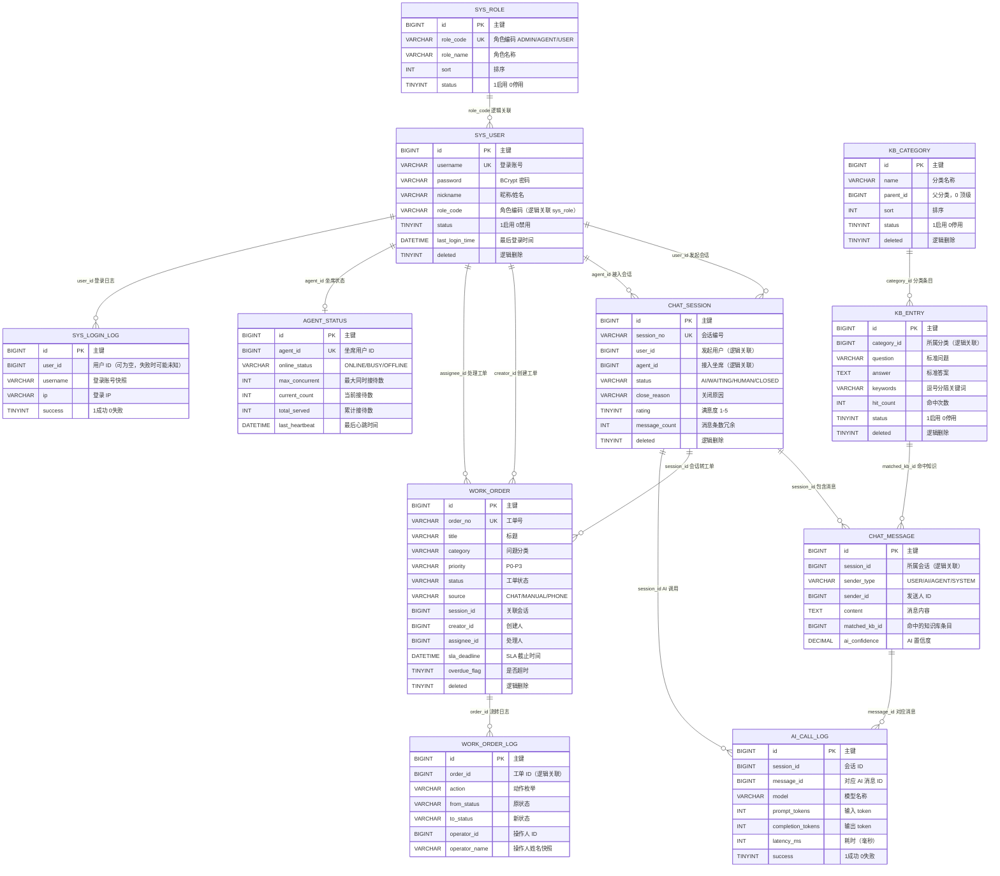

# 智客通 —— 数据库设计文档

> 项目：智客通 —— 智能对话客服与工单管理系统（Java EE 期末作业）
> 数据库：MySQL 8.0（兼容 5.7+），库名 `zhiketong`，字符集 `utf8mb4` / `utf8mb4_unicode_ci`
> 文档版本：v1.0（2026-10-20）
> 对应脚本：`sql/01_schema.sql`（建库建表）、`sql/02_data.sql`（演示种子数据）
> 维护角色：db-architect（数据库落地与设计文档）

---

## 0. 交付物与初始化方式

### 0.1 交付物

| 文件 | 作用 | 说明 |
| --- | --- | --- |
| `sql/01_schema.sql` | 建库 + 建 11 张表 | 会先 `DROP TABLE IF EXISTS` 再重建，仅用于开发/演示环境 |
| `sql/02_data.sql` | 演示种子数据 | 可重复执行：先 `TRUNCATE` 11 张表，再插入数据；最后重建 `message_count` 一致性 |
| `docs/数据库设计.md` | 本文档 | 设计原则、ER 图、表字典、索引、枚举、Redis 键、统计 SQL、性能建议 |

### 0.2 执行方式

```bash
# Windows PowerShell，密码通过环境变量传入，不写入脚本
$env:MYSQL_PWD='246790'
& 'F:\MySQL\MySQL Server 8.0\bin\mysql.exe' -uroot --default-character-set=utf8mb4 -e "source sql/01_schema.sql"
& 'F:\MySQL\MySQL Server 8.0\bin\mysql.exe' -uroot --default-character-set=utf8mb4 -e "source sql/02_data.sql"
Remove-Item Env:MYSQL_PWD
```

### 0.3 实测结果（2026-10-20 已实际执行并验证）

| 表名 | 实测行数 | 表名 | 实测行数 |
| --- | ---: | --- | ---: |
| `sys_role` | 3 | `sys_user` | 6 |
| `agent_status` | 2 | `kb_category` | 5 |
| `kb_entry` | 20 | `chat_session` | 10 |
| `chat_message` | 44 | `work_order` | 14 |
| `work_order_log` | 52 | `ai_call_log` | 19 |
| `sys_login_log` | 13 | **合计** | **188** |

- `SHOW TABLES`：**11 张**，与设计一致；
- 逻辑关联校验（孤儿数据）：消息→会话、会话→用户、工单→创建人/处理人、工单日志→工单、AI 日志→消息、工单→会话、知识库→分类，**8 项全部为 0 条孤儿**；
- 演示账号密码哈希 `$2a$10$ZXY2J5c1lFzryZBQtffBNuASALRF5sjxZAhx57euXnV5Dc12Wkmqy` 已用项目同版本 `spring-security-crypto 5.7.11` 的 `BCrypt.checkpw` 校验：明文 `123456` 校验通过，错误密码校验为 `false`。

---

## 1. 设计原则

### 1.1 无物理外键，逻辑关联由应用层保证

教学项目中不创建 `FOREIGN KEY` 约束，原因：

1. 便于分库分表、数据归档与单元测试造数，避免外键导致的插入顺序依赖；
2. 避免高并发写场景下外键检查带来的额外锁与性能损耗；
3. 关联一致性由 Service 层事务 + 业务校验保证。

约定：所有关联字段统一命名为 `xxx_id` 并在注释中说明指向的表，例如 `chat_session.user_id → sys_user.id`、`work_order_log.order_id → work_order.id`。种子数据中通过固定 ID 保证关联正确，验证阶段用 `LEFT JOIN ... WHERE 右表.id IS NULL` 检查孤儿数据。

### 1.2 逻辑删除

带业务语义的主数据表（`sys_user`、`kb_category`、`kb_entry`、`chat_session`、`work_order`）使用 `deleted TINYINT NOT NULL DEFAULT 0` 逻辑删除：`0` 未删除、`1` 已删除。

- 查询统一追加 `deleted = 0`（MyBatis-Plus 用 `@TableLogic` 自动拼接）；
- 日志类表（`chat_message`、`work_order_log`、`ai_call_log`、`sys_login_log`）与状态表（`agent_status`）**不做逻辑删除**，只追加不改写；
- 注意：`sys_user.username` 是唯一索引，逻辑删除后账号名仍被占用，如业务需要复用账号，建议删除时把 `username` 改写为 `username_deleted_{id}`，或使用 `(username, deleted)` 复合唯一索引。

### 1.3 统一审计字段

| 字段 | 类型 | 含义 | 使用范围 |
| --- | --- | --- | --- |
| `create_time` | `DATETIME` | 创建时间 | 除日志表的极少数表外，全部业务表 |
| `update_time` | `DATETIME` | 更新时间，`ON UPDATE CURRENT_TIMESTAMP` 自动维护 | 主数据表 |
| `create_by` / `update_by` | `BIGINT` | 创建人/更新人 ID | 知识库条目 `kb_entry` |
| `operator_id` / `operator_name` | `BIGINT` / `VARCHAR(50)` | 操作人 ID 与姓名快照 | 工单流转日志 `work_order_log` |

时间字段由数据库默认值与 `ON UPDATE` 维护，实体层不再做自动填充，减少应用与数据库双写不一致的风险。

### 1.4 时间类型

- 统一使用 `DATETIME`（不用 `TIMESTAMP`，避免 2038 问题与隐式时区转换）；
- 业务时区统一为东八区（`Asia/Shanghai`），JDBC 连接串显式指定 `serverTimezone=Asia/Shanghai`；
- 统计按“天”聚合时使用 `DATE(create_time)`，禁止对 `create_time` 做函数运算后再比较范围（会破坏索引），范围查询用 `create_time >= ? AND create_time < ?`。

### 1.5 存储引擎与字符集

- 引擎统一 `InnoDB`（事务、行锁、崩溃恢复）；
- 字符集 `utf8mb4`，排序规则 `utf8mb4_unicode_ci`，支持中文、Emoji 与生僻字；
- 表与字段均写 `COMMENT`，字段注释直接描述枚举取值，降低联调歧义。

### 1.6 主键与编号

- 全部表使用 `BIGINT AUTO_INCREMENT` 代理主键；
- 对外展示用业务编号：会话 `session_no`（`CS + yyyyMMddHHmmss + 4 位随机`）、工单 `order_no`（`WO + yyyyMMddHHmmss + 4 位随机`），均建唯一索引；
- 业务编号由应用生成，数据库唯一索引兜底防重。

### 1.7 适度冗余与快照

| 冗余字段 | 位置 | 目的 |
| --- | --- | --- |
| `message_count` | `chat_session` | 会话列表页免 `COUNT(*)`，由消息落库事务或定时任务维护 |
| `agent_id` | `chat_session` | 会话与坐席的当前绑定，便于“我的会话”查询，避免反查消息 |
| `operator_name` | `work_order_log` | 操作人姓名快照，人员改名或离职后日志仍可读 |
| `overdue_flag` | `work_order` | 超时扫描任务写标记，统计与列表筛选无需实时计算 SLA |
| `rating` | `chat_session` / `work_order` | 满意度独立字段，避免与评分明细表关联 |

---

## 2. 实体关系图（ER）

### 2.1 mermaid erDiagram



> 说明：mermaid 中所有关系均为**逻辑关联**，数据库中不存在真实外键约束；`CHAT_SESSION` 与 `SYS_USER` 之间存在两条不同语义的关联（用户发起、坐席接入），用关系标签区分。

### 2.2 关系说明

| 关系 | 基数 | 关联字段 | 说明 |
| --- | --- | --- | --- |
| 角色 → 用户 | 1 : N | `sys_user.role_code = sys_role.role_code` | 按角色编码关联，`role_code` 有唯一索引 |
| 用户 → 会话 | 1 : N | `chat_session.user_id` | 一个用户可发起多个会话 |
| 坐席 → 会话 | 1 : N | `chat_session.agent_id` | 只有 `HUMAN` / 部分 `CLOSED` 会话有坐席 |
| 会话 → 消息 | 1 : N | `chat_message.session_id` | 消息按 `id` 递增即时间顺序 |
| 分类 → 条目 | 1 : N | `kb_entry.category_id` | 二级分类预留 `parent_id` |
| 条目 → 消息 | 1 : N | `chat_message.matched_kb_id` | AI 命中知识库时回填 |
| 会话 → 工单 | 1 : N | `work_order.session_id` | 会话转工单，允许为空（电话/手工来源） |
| 用户 → 工单 | 1 : N | `creator_id` / `assignee_id` | 创建人与处理人可以是同一人或不同人 |
| 工单 → 日志 | 1 : N | `work_order_log.order_id` | 每次状态流转写一条，`CREATE` 必有 |
| 坐席 → 状态 | 1 : 1 | `agent_status.agent_id`（唯一索引） | 坐席的持久化状态与累计统计 |
| 会话/消息 → AI 日志 | 1 : N | `ai_call_log.session_id` / `message_id` | 一次 AI 调用一条，失败时 `message_id` 可为空 |

---

## 3. 表字典

### 3.1 `sys_role` 系统角色表

| 字段 | 类型 | 可空 | 默认值 | 说明 |
| --- | --- | :---: | --- | --- |
| `id` | `BIGINT` | 否 | AUTO_INCREMENT | 主键 |
| `role_code` | `VARCHAR(32)` | 否 | - | 角色编码：`ADMIN` / `AGENT` / `USER`，唯一 |
| `role_name` | `VARCHAR(64)` | 否 | - | 角色名称 |
| `description` | `VARCHAR(255)` | 是 | `NULL` | 角色说明 |
| `sort` | `INT` | 否 | `0` | 排序号，越小越靠前 |
| `status` | `TINYINT` | 否 | `1` | 状态：1 启用 / 0 停用 |
| `create_time` | `DATETIME` | 否 | `CURRENT_TIMESTAMP` | 创建时间 |
| `update_time` | `DATETIME` | 否 | `CURRENT_TIMESTAMP`（ON UPDATE） | 更新时间 |

### 3.2 `sys_user` 系统用户表

| 字段 | 类型 | 可空 | 默认值 | 说明 |
| --- | --- | :---: | --- | --- |
| `id` | `BIGINT` | 否 | AUTO_INCREMENT | 主键 |
| `username` | `VARCHAR(50)` | 否 | - | 登录账号，唯一 |
| `password` | `VARCHAR(100)` | 否 | - | 密码，BCrypt 哈希（60 位） |
| `nickname` | `VARCHAR(50)` | 否 | - | 昵称/姓名 |
| `role_code` | `VARCHAR(32)` | 否 | `'USER'` | 角色编码：`ADMIN` / `AGENT` / `USER` |
| `phone` | `VARCHAR(20)` | 是 | `NULL` | 手机号 |
| `email` | `VARCHAR(100)` | 是 | `NULL` | 邮箱 |
| `avatar` | `VARCHAR(255)` | 是 | `NULL` | 头像地址 |
| `status` | `TINYINT` | 否 | `1` | 状态：1 启用 / 0 禁用 |
| `last_login_time` | `DATETIME` | 是 | `NULL` | 最后登录时间 |
| `last_login_ip` | `VARCHAR(64)` | 是 | `NULL` | 最后登录 IP |
| `create_time` | `DATETIME` | 否 | `CURRENT_TIMESTAMP` | 创建时间 |
| `update_time` | `DATETIME` | 否 | `CURRENT_TIMESTAMP`（ON UPDATE） | 更新时间 |
| `deleted` | `TINYINT` | 否 | `0` | 逻辑删除：0 未删除 / 1 已删除 |

### 3.3 `kb_category` 知识库分类表

| 字段 | 类型 | 可空 | 默认值 | 说明 |
| --- | --- | :---: | --- | --- |
| `id` | `BIGINT` | 否 | AUTO_INCREMENT | 主键 |
| `name` | `VARCHAR(64)` | 否 | - | 分类名称 |
| `parent_id` | `BIGINT` | 否 | `0` | 父分类 ID，`0` 表示顶级 |
| `sort` | `INT` | 否 | `0` | 排序号 |
| `status` | `TINYINT` | 否 | `1` | 状态：1 启用 / 0 停用 |
| `description` | `VARCHAR(255)` | 是 | `NULL` | 分类说明 |
| `create_time` | `DATETIME` | 否 | `CURRENT_TIMESTAMP` | 创建时间 |
| `update_time` | `DATETIME` | 否 | `CURRENT_TIMESTAMP`（ON UPDATE） | 更新时间 |
| `deleted` | `TINYINT` | 否 | `0` | 逻辑删除 |

### 3.4 `kb_entry` 知识库条目表

| 字段 | 类型 | 可空 | 默认值 | 说明 |
| --- | --- | :---: | --- | --- |
| `id` | `BIGINT` | 否 | AUTO_INCREMENT | 主键 |
| `category_id` | `BIGINT` | 否 | - | 所属分类 ID，逻辑关联 `kb_category.id` |
| `question` | `VARCHAR(255)` | 否 | - | 标准问题 |
| `answer` | `TEXT` | 否 | - | 标准答案（2-5 句可直接回复用户的中文答案） |
| `keywords` | `VARCHAR(255)` | 否 | `''` | 关键词，英文逗号分隔，用于模糊匹配打分 |
| `hit_count` | `INT` | 否 | `0` | 累计命中次数（命中排行依据） |
| `status` | `TINYINT` | 否 | `1` | 状态：1 启用 / 0 停用 |
| `create_by` | `BIGINT` | 是 | `NULL` | 创建人 ID |
| `update_by` | `BIGINT` | 是 | `NULL` | 更新人 ID |
| `create_time` | `DATETIME` | 否 | `CURRENT_TIMESTAMP` | 创建时间 |
| `update_time` | `DATETIME` | 否 | `CURRENT_TIMESTAMP`（ON UPDATE） | 更新时间 |
| `deleted` | `TINYINT` | 否 | `0` | 逻辑删除 |

### 3.5 `chat_session` 客服会话表

| 字段 | 类型 | 可空 | 默认值 | 说明 |
| --- | --- | :---: | --- | --- |
| `id` | `BIGINT` | 否 | AUTO_INCREMENT | 主键 |
| `session_no` | `VARCHAR(32)` | 否 | - | 会话编号：`CS + yyyyMMddHHmmss + 4 位随机`，唯一 |
| `user_id` | `BIGINT` | 否 | - | 发起用户 ID |
| `agent_id` | `BIGINT` | 是 | `NULL` | 接入坐席 ID，AI 阶段为空 |
| `status` | `VARCHAR(20)` | 否 | `'AI'` | 状态：`AI` / `WAITING` / `HUMAN` / `CLOSED` |
| `close_reason` | `VARCHAR(32)` | 是 | `NULL` | 关闭原因：`USER_CLOSED` / `AGENT_CLOSED` / `TIMEOUT` / `SYSTEM` |
| `rating` | `TINYINT` | 是 | `NULL` | 满意度评分 1-5 |
| `rating_comment` | `VARCHAR(255)` | 是 | `NULL` | 评价内容 |
| `queue_enter_time` | `DATETIME` | 是 | `NULL` | 进入排队时间 |
| `transfer_time` | `DATETIME` | 是 | `NULL` | 请求转人工时间 |
| `accept_time` | `DATETIME` | 是 | `NULL` | 坐席接入时间 |
| `end_time` | `DATETIME` | 是 | `NULL` | 会话结束时间 |
| `message_count` | `INT` | 否 | `0` | 消息条数冗余，由脚本/事务维护 |
| `create_time` | `DATETIME` | 否 | `CURRENT_TIMESTAMP` | 创建时间 |
| `update_time` | `DATETIME` | 否 | `CURRENT_TIMESTAMP`（ON UPDATE） | 更新时间 |
| `deleted` | `TINYINT` | 否 | `0` | 逻辑删除 |

### 3.6 `chat_message` 聊天消息表

| 字段 | 类型 | 可空 | 默认值 | 说明 |
| --- | --- | :---: | --- | --- |
| `id` | `BIGINT` | 否 | AUTO_INCREMENT | 主键，递增即消息顺序 |
| `session_id` | `BIGINT` | 否 | - | 所属会话 ID |
| `sender_type` | `VARCHAR(16)` | 否 | - | 发送方：`USER` / `AI` / `AGENT` / `SYSTEM` |
| `sender_id` | `BIGINT` | 是 | `NULL` | 发送人 ID（AI / SYSTEM 为空） |
| `content` | `TEXT` | 否 | - | 消息内容 |
| `content_type` | `VARCHAR(16)` | 否 | `'TEXT'` | 内容类型，当前只支持 `TEXT` |
| `matched_kb_id` | `BIGINT` | 是 | `NULL` | 命中的知识库条目 ID |
| `ai_confidence` | `DECIMAL(5,4)` | 是 | `NULL` | AI 置信度 0.0000-1.0000 |
| `ai_model` | `VARCHAR(64)` | 是 | `NULL` | AI 模型名称，如 `deepseek-chat` |
| `read_flag` | `TINYINT` | 否 | `0` | 已读标记：0 未读 / 1 已读 |
| `create_time` | `DATETIME` | 否 | `CURRENT_TIMESTAMP` | 发送时间 |

### 3.7 `work_order` 工单表

| 字段 | 类型 | 可空 | 默认值 | 说明 |
| --- | --- | :---: | --- | --- |
| `id` | `BIGINT` | 否 | AUTO_INCREMENT | 主键 |
| `order_no` | `VARCHAR(32)` | 否 | - | 工单号：`WO + yyyyMMddHHmmss + 4 位随机`，唯一 |
| `title` | `VARCHAR(120)` | 否 | - | 工单标题 |
| `content` | `TEXT` | 否 | - | 问题描述 |
| `category` | `VARCHAR(32)` | 否 | `'其他'` | 分类：技术问题 / 账号问题 / 订单问题 / 售后问题 / 其他 |
| `priority` | `VARCHAR(10)` | 否 | `'P2'` | 优先级：`P0` / `P1` / `P2` / `P3` |
| `status` | `VARCHAR(20)` | 否 | `'PENDING'` | 状态：`PENDING` / `ASSIGNED` / `PROCESSING` / `RESOLVED` / `CLOSED` / `REOPENED` |
| `source` | `VARCHAR(20)` | 否 | `'CHAT'` | 来源：`CHAT` / `MANUAL` / `PHONE` |
| `session_id` | `BIGINT` | 是 | `NULL` | 关联会话 ID，电话/手工来源为空 |
| `creator_id` | `BIGINT` | 否 | - | 创建人 ID |
| `assignee_id` | `BIGINT` | 是 | `NULL` | 处理人（坐席）ID |
| `sla_deadline` | `DATETIME` | 是 | `NULL` | SLA 解决截止时间 |
| `first_response_time` | `DATETIME` | 是 | `NULL` | 首次响应时间 |
| `resolve_time` | `DATETIME` | 是 | `NULL` | 解决时间 |
| `close_time` | `DATETIME` | 是 | `NULL` | 关闭时间 |
| `rating` | `TINYINT` | 是 | `NULL` | 满意度 1-5 |
| `overdue_flag` | `TINYINT` | 否 | `0` | 是否超时：0 否 / 1 是 |
| `remark` | `VARCHAR(255)` | 是 | `NULL` | 备注 |
| `create_time` | `DATETIME` | 否 | `CURRENT_TIMESTAMP` | 创建时间 |
| `update_time` | `DATETIME` | 否 | `CURRENT_TIMESTAMP`（ON UPDATE） | 更新时间 |
| `deleted` | `TINYINT` | 否 | `0` | 逻辑删除 |

### 3.8 `work_order_log` 工单流转日志表

| 字段 | 类型 | 可空 | 默认值 | 说明 |
| --- | --- | :---: | --- | --- |
| `id` | `BIGINT` | 否 | AUTO_INCREMENT | 主键 |
| `order_id` | `BIGINT` | 否 | - | 工单 ID |
| `action` | `VARCHAR(32)` | 否 | - | 动作：`CREATE` / `ASSIGN` / `ACCEPT` / `PROCESS` / `RESOLVE` / `CLOSE` / `REOPEN` / `COMMENT` / `OVERDUE` |
| `from_status` | `VARCHAR(20)` | 是 | `NULL` | 原状态，创建时为空 |
| `to_status` | `VARCHAR(20)` | 是 | `NULL` | 新状态 |
| `operator_id` | `BIGINT` | 是 | `NULL` | 操作人 ID，系统动作为空 |
| `operator_name` | `VARCHAR(50)` | 是 | `NULL` | 操作人名称快照 |
| `remark` | `VARCHAR(500)` | 是 | `NULL` | 备注 |
| `create_time` | `DATETIME` | 否 | `CURRENT_TIMESTAMP` | 操作时间 |

### 3.9 `agent_status` 坐席状态表

| 字段 | 类型 | 可空 | 默认值 | 说明 |
| --- | --- | :---: | --- | --- |
| `id` | `BIGINT` | 否 | AUTO_INCREMENT | 主键 |
| `agent_id` | `BIGINT` | 否 | - | 坐席用户 ID，唯一 |
| `online_status` | `VARCHAR(16)` | 否 | `'OFFLINE'` | 在线状态：`ONLINE` / `BUSY` / `OFFLINE` |
| `max_concurrent` | `INT` | 否 | `5` | 最大同时接待数 |
| `current_count` | `INT` | 否 | `0` | 当前接待数 |
| `total_served` | `INT` | 否 | `0` | 累计接待数 |
| `last_heartbeat` | `DATETIME` | 是 | `NULL` | 最后心跳时间 |
| `create_time` | `DATETIME` | 否 | `CURRENT_TIMESTAMP` | 创建时间 |
| `update_time` | `DATETIME` | 否 | `CURRENT_TIMESTAMP`（ON UPDATE） | 更新时间 |

### 3.10 `ai_call_log` AI 调用日志表

| 字段 | 类型 | 可空 | 默认值 | 说明 |
| --- | --- | :---: | --- | --- |
| `id` | `BIGINT` | 否 | AUTO_INCREMENT | 主键 |
| `session_id` | `BIGINT` | 是 | `NULL` | 会话 ID |
| `message_id` | `BIGINT` | 是 | `NULL` | 对应 AI 回复消息 ID，失败时可为空 |
| `model` | `VARCHAR(64)` | 是 | `NULL` | 模型名称 |
| `prompt_tokens` | `INT` | 否 | `0` | 输入 token 数 |
| `completion_tokens` | `INT` | 否 | `0` | 输出 token 数 |
| `latency_ms` | `INT` | 否 | `0` | 调用耗时（毫秒） |
| `success` | `TINYINT` | 否 | `1` | 是否成功：1 是 / 0 否 |
| `error_msg` | `VARCHAR(500)` | 是 | `NULL` | 失败原因（超时、限流、未配置 Key 等） |
| `create_time` | `DATETIME` | 否 | `CURRENT_TIMESTAMP` | 调用时间 |

### 3.11 `sys_login_log` 登录日志表

| 字段 | 类型 | 可空 | 默认值 | 说明 |
| --- | --- | :---: | --- | --- |
| `id` | `BIGINT` | 否 | AUTO_INCREMENT | 主键 |
| `user_id` | `BIGINT` | 是 | `NULL` | 用户 ID，账号不存在或禁用时可为空 |
| `username` | `VARCHAR(50)` | 是 | `NULL` | 登录账号快照 |
| `ip` | `VARCHAR(64)` | 是 | `NULL` | 登录 IP |
| `user_agent` | `VARCHAR(255)` | 是 | `NULL` | 浏览器 UA |
| `success` | `TINYINT` | 否 | `1` | 是否成功：1 是 / 0 否 |
| `message` | `VARCHAR(255)` | 是 | `NULL` | 结果说明，如“登录失败：密码错误” |
| `create_time` | `DATETIME` | 否 | `CURRENT_TIMESTAMP` | 登录时间 |

---

## 4. 索引设计

### 4.1 索引清单

| 表 | 索引名 | 类型 | 字段 | 作用 |
| --- | --- | --- | --- | --- |
| `sys_role` | `PRIMARY` | 聚簇 | `id` | 主键 |
| `sys_role` | `uk_role_code` | 唯一 | `role_code` | 角色编码唯一，权限判断按编码查询 |
| `sys_user` | `PRIMARY` | 聚簇 | `id` | 主键 |
| `sys_user` | `uk_username` | 唯一 | `username` | 登录名唯一，登录查询走该索引 |
| `sys_user` | `idx_role_code` | 普通 | `role_code` | 按角色筛选用户（坐席列表） |
| `sys_user` | `idx_status` | 普通 | `status` | 启用/禁用筛选 |
| `sys_user` | `idx_create_time` | 普通 | `create_time` | 注册趋势统计 |
| `kb_category` | `PRIMARY` | 聚簇 | `id` | 主键 |
| `kb_category` | `idx_parent_id` | 普通 | `parent_id` | 分类树按父节点加载 |
| `kb_category` | `idx_sort` | 普通 | `sort` | 分类排序 |
| `kb_entry` | `PRIMARY` | 聚簇 | `id` | 主键 |
| `kb_entry` | `idx_category_id` | 普通 | `category_id` | 按分类分页查询条目 |
| `kb_entry` | `idx_status` | 普通 | `status` | 只检索启用条目 |
| `kb_entry` | `idx_hit_count` | 普通 | `hit_count` | 命中排行 TopN 排序 |
| `chat_session` | `PRIMARY` | 聚簇 | `id` | 主键 |
| `chat_session` | `uk_session_no` | 唯一 | `session_no` | 会话编号唯一，按编号查询 |
| `chat_session` | `idx_user_id` | 联合 | `user_id, create_time` | “我的会话”按用户 + 时间倒序分页 |
| `chat_session` | `idx_agent_id` | 联合 | `agent_id, status` | 坐席工作台“进行中会话”查询 |
| `chat_session` | `idx_status_queue` | 联合 | `status, queue_enter_time` | 排队队列按状态 + 进入时间取最早等待 |
| `chat_session` | `idx_create_time` | 普通 | `create_time` | 会话趋势统计 |
| `chat_message` | `PRIMARY` | 聚簇 | `id` | 主键，自增即消息顺序 |
| `chat_message` | `idx_session_id` | 联合 | `session_id, id` | 会话消息分页（按会话 + 消息 ID 游标） |
| `chat_message` | `idx_create_time` | 普通 | `create_time` | 消息量趋势统计 |
| `work_order` | `PRIMARY` | 聚簇 | `id` | 主键 |
| `work_order` | `uk_order_no` | 唯一 | `order_no` | 工单号唯一，按单号查询 |
| `work_order` | `idx_status_time` | 联合 | `status, create_time` | 工单列表按状态 + 时间排序分页 |
| `work_order` | `idx_assignee` | 联合 | `assignee_id, status` | “我的工单”、坐席工作量统计 |
| `work_order` | `idx_creator` | 普通 | `creator_id` | 我创建的工单 |
| `work_order` | `idx_sla` | 联合 | `sla_deadline, overdue_flag` | SLA 超时扫描任务 |
| `work_order` | `idx_create_time` | 普通 | `create_time` | 工单趋势统计 |
| `work_order_log` | `PRIMARY` | 聚簇 | `id` | 主键 |
| `work_order_log` | `idx_order_id` | 联合 | `order_id, id` | 某工单的流转日志按时间正序 |
| `work_order_log` | `idx_create_time` | 普通 | `create_time` | 操作量趋势统计 |
| `agent_status` | `PRIMARY` | 聚簇 | `id` | 主键 |
| `agent_status` | `uk_agent_id` | 唯一 | `agent_id` | 一个坐席一条状态记录 |
| `agent_status` | `idx_online_status` | 普通 | `online_status` | 在线坐席列表 |
| `ai_call_log` | `PRIMARY` | 聚簇 | `id` | 主键 |
| `ai_call_log` | `idx_create_time` | 普通 | `create_time` | AI 调用趋势与成功率统计 |
| `ai_call_log` | `idx_session_id` | 普通 | `session_id` | 按会话查 AI 调用明细 |
| `sys_login_log` | `PRIMARY` | 聚簇 | `id` | 主键 |
| `sys_login_log` | `idx_user_id` | 联合 | `user_id, create_time` | 某用户的登录历史 |
| `sys_login_log` | `idx_create_time` | 普通 | `create_time` | 登录日志按时间倒序、趋势统计 |

### 4.2 索引设计说明

1. **唯一索引优先**：`username`、`role_code`、`session_no`、`order_no`、`agent_id` 都建唯一索引，既是业务约束也是查询入口；
2. **联合索引遵循最左前缀**：`idx_user_id(user_id, create_time)` 支持 `WHERE user_id = ? ORDER BY create_time DESC`，避免额外排序；`idx_agent_id(agent_id, status)` 支持坐席工作台按状态过滤；
3. **排队查询**：`idx_status_queue(status, queue_enter_time)` 让 `WHERE status = 'WAITING' ORDER BY queue_enter_time ASC LIMIT 1` 直接命中索引；
4. **消息分页**：`idx_session_id(session_id, id)` 支持 `WHERE session_id = ? AND id > ? ORDER BY id LIMIT n` 的游标分页，深分页性能稳定；
5. **统计与超时扫描**：`idx_create_time` 支撑按天聚合；`idx_sla(sla_deadline, overdue_flag)` 支撑 `WHERE overdue_flag = 0 AND sla_deadline < NOW()` 扫描；
6. **避免过度索引**：日志类表只保留查询必需的索引，写入性能优先；统计类接口建议配合 Redis 缓存或定时汇总表，而不是每次全表扫描。

---

## 5. 枚举字典

### 5.1 角色 `sys_role.role_code` / `sys_user.role_code`

| 编码 | 名称 | 权限概览 |
| --- | --- | --- |
| `ADMIN` | 管理员 | 用户/坐席管理、知识库维护、工单调度与统计、查看登录日志 |
| `AGENT` | 客服坐席 | 工作台上下线、接入排队会话、处理工单 |
| `USER` | 普通用户 | 与 AI 对话、转人工、提交与查看自己的工单 |

### 5.2 会话状态 `chat_session.status`

| 编码 | 含义 | 可迁移到 |
| --- | --- | --- |
| `AI` | 智能客服接待中 | `WAITING`（转人工）、`CLOSED`（用户结束） |
| `WAITING` | 已转人工，排队等待坐席 | `HUMAN`（坐席接入）、`CLOSED`（用户取消） |
| `HUMAN` | 人工坐席接待中 | `CLOSED` |
| `CLOSED` | 会话已结束（终态） | - |

### 5.3 关闭原因 `chat_session.close_reason`

| 编码 | 含义 |
| --- | --- |
| `USER_CLOSED` | 用户主动结束 |
| `AGENT_CLOSED` | 坐席结束会话 |
| `TIMEOUT` | 长时间无响应，系统超时关闭 |
| `SYSTEM` | 系统异常或会话被强制关闭 |

### 5.4 消息发送方 `chat_message.sender_type`

| 编码 | 含义 | `sender_id` |
| --- | --- | --- |
| `USER` | 普通用户 | 用户 ID |
| `AI` | 智能客服 | `NULL` |
| `AGENT` | 人工坐席 | 坐席用户 ID |
| `SYSTEM` | 系统提示（转接、结束等） | `NULL` |

### 5.5 工单状态 `work_order.status`

| 编码 | 含义 | 说明 |
| --- | --- | --- |
| `PENDING` | 待分配 | 新建工单初始状态 |
| `ASSIGNED` | 已分配 | 管理员指派处理人后 |
| `PROCESSING` | 处理中 | 坐席受理后 |
| `RESOLVED` | 已解决 | 等待用户确认或关闭 |
| `CLOSED` | 已关闭 | 终态 |
| `REOPENED` | 已重开 | 用户对结果不满意，再次打开 |

### 5.6 优先级 `work_order.priority` 与 SLA

| 编码 | 含义 | 首次响应时限 | 解决时限 |
| --- | --- | --- | --- |
| `P0` | 紧急（系统不可用、资金问题） | 30 分钟 | 2 小时 |
| `P1` | 高（核心功能受阻） | 2 小时 | 8 小时 |
| `P2` | 中（一般功能问题） | 8 小时 | 24 小时 |
| `P3` | 低（咨询、建议） | 24 小时 | 72 小时 |

`work_order.sla_deadline` 按创建时间 + 解决时限计算，超时扫描任务把 `overdue_flag` 置 1 并写 `OVERDUE` 日志。

### 5.7 工单动作 `work_order_log.action`

| 编码 | 含义 | 典型状态迁移 |
| --- | --- | --- |
| `CREATE` | 创建工单 | `NULL → PENDING` |
| `ASSIGN` | 分配处理人 | `PENDING → ASSIGNED` |
| `ACCEPT` | 坐席受理 | `ASSIGNED → PROCESSING` |
| `PROCESS` | 处理中备注/进展 | `PROCESSING → PROCESSING` |
| `RESOLVE` | 标记解决 | `PROCESSING → RESOLVED` |
| `CLOSE` | 关闭工单 | `RESOLVED → CLOSED` |
| `REOPEN` | 重新打开 | `RESOLVED/CLOSED → REOPENED` |
| `COMMENT` | 追加备注 | 状态不变 |
| `OVERDUE` | 超时标记（系统动作） | 状态不变，`operator_id` 为空 |

### 5.8 工单来源 `work_order.source`

| 编码 | 含义 |
| --- | --- |
| `CHAT` | 由客服会话转入 |
| `MANUAL` | 用户或客服在工单中心手工创建 |
| `PHONE` | 电话客服代客创建 |

### 5.9 坐席在线状态 `agent_status.online_status`

| 编码 | 含义 | 是否可分配新会话 |
| --- | --- | :---: |
| `ONLINE` | 在线空闲 | 是（且 `current_count < max_concurrent`） |
| `BUSY` | 忙碌（已满或勿扰） | 否 |
| `OFFLINE` | 离线 | 否 |

### 5.10 其他

| 字段 | 取值 |
| --- | --- |
| `chat_message.content_type` | `TEXT`（当前仅文本，预留 `IMAGE` / `FILE`） |
| `sys_user.status` | 1 启用 / 0 禁用 |
| `sys_role.status`、`kb_category.status`、`kb_entry.status` | 1 启用 / 0 停用 |
| `chat_message.read_flag` | 0 未读 / 1 已读 |
| 各处 `deleted` | 0 未删除 / 1 已删除 |
| 各处 `success`（AI 调用/登录） | 1 成功 / 0 失败 |
| 各处 `overdue_flag` | 0 未超时 / 1 已超时 |

---

## 6. 演示账号与种子数据

### 6.1 演示账号（密码统一为 `123456`）

| ID | 账号 | 初始密码 | 角色 | 昵称 | 状态 | 用途 |
| ---: | --- | --- | --- | --- | --- | --- |
| 1 | `admin` | 123456 | ADMIN | 系统管理员 | 启用 | 管理端全部功能、工单调度、统计 |
| 2 | `agent01` | 123456 | AGENT | 张客服 | 启用 | 坐席工作台、在线接待（`agent_status`：ONLINE） |
| 3 | `agent02` | 123456 | AGENT | 李客服 | 启用 | 坐席工作台（`agent_status`：OFFLINE，可演示上线） |
| 4 | `user01` | 123456 | USER | 王小明 | 启用 | 用户端咨询、转人工、提交工单 |
| 5 | `user02` | 123456 | USER | 陈小红 | 启用 | 用户端咨询、排队演示 |
| 6 | `user03` | 123456 | USER | 赵小刚 | **禁用** | 权限测试：登录应返回“账号已被禁用” |

密码存储为 BCrypt 哈希：`$2a$10$ZXY2J5c1lFzryZBQtffBNuASALRF5sjxZAhx57euXnV5Dc12Wkmqy`（已实测校验通过）。
对应 SQL 字面量中 `$` 无需转义，直接单引号包裹即可。

### 6.2 种子数据特征

| 数据 | 数量 | 设计说明 |
| --- | ---: | --- |
| 角色 | 3 | 覆盖三种角色 |
| 用户 | 6 | 三角色，1 个禁用账号用于权限测试 |
| 坐席状态 | 2 | 1 在线（可分配）、1 离线（可演示上线） |
| 知识库分类 | 5 | 账号与登录、订单与支付、产品使用、售后与退款、其他 |
| 知识库条目 | 20 | 每类 4 条，关键词贴近真实问法，9 条 `hit_count > 50` |
| 会话 | 10 | `AI` 2、`WAITING` 2（排队时间 ≤10 分钟）、`HUMAN` 2、`CLOSED` 4（均带评分） |
| 消息 | 44 | 每会话 3-7 条，USER/AI/AGENT/SYSTEM 混合，含 `matched_kb_id`、`ai_confidence` |
| 工单 | 14 | 6 种状态全覆盖、P0/P1/P2/P3 全覆盖、5 个分类、3 种来源、4 条 `overdue_flag=1` |
| 工单日志 | 52 | 每单 2-5 条，`CREATE` 必有，动作与状态迁移匹配 |
| AI 调用日志 | 19 | 成功 12、失败 7（超时/限流/无 Key/空响应），`latency_ms` 300-4000 |
| 登录日志 | 13 | 成功 10、失败 3（密码错误、验证码过期、账号禁用） |

所有时间字段用 `NOW() - INTERVAL n DAY/HOUR/MINUTE` 生成，任何日期执行脚本，数据都落在最近 7 天，趋势图、今日统计不会为空。

---

## 7. Redis 键设计

JavaEE 作业中 Redis 可选；若启用，Redis 承担“在线状态、排队队列、令牌黑名单、会话-坐席绑定”等高频临时数据，MySQL 仍是权威数据源。

| Key | 类型 | TTL | 值/成员 | 用途 | 典型操作 |
| --- | --- | --- | --- | --- | --- |
| `zk:agent:online` | Hash | 心跳 60s，TTL 5 分钟 | field=`agentId`，value=`ONLINE/BUSY/OFFLINE` | 坐席在线状态实时视图，排队分配时筛选可用坐席 | `HSET` / `HGETALL` / `HDEL` |
| `zk:agent:load:{agentId}` | String（计数器） | 30 分钟（与在线状态同生命周期） | 当前接待会话数 | 负载均衡：接入 `INCR`、结束 `DECR`，结合 `max_concurrent` 判断可分配 | `INCR` / `DECR` / `GET` |
| `zk:queue:waiting` | ZSet | 24 小时（可续期） | member=`sessionId`，score=进入排队时间毫秒戳 | 转人工排队队列，先到先服务；坐席接入 `ZPOPMIN` 取最早 | `ZADD` / `ZRANGE` / `ZPOPMIN` / `ZREM` |
| `zk:token:blacklist:{jti}` | String | JWT 剩余有效期（≤ 2 小时） | `1` 或注销时间 | 退出登录、改密、被禁用后使旧令牌立即失效 | `SETEX` / `EXISTS` |
| `zk:session:agent:{sessionId}` | String | 24 小时，会话结束时删除 | value=`agentId` | 会话与坐席的快速绑定查询（断线重连、消息路由） | `SETEX` / `GET` / `DEL` |

补充约定：

1. 所有键统一前缀 `zk:`，按“业务:对象:标识”命名，便于 `SCAN` 清理与 Redis 监控；
2. 在线状态以 Redis 为准，`agent_status` 表异步落库用于统计与重启恢复；
3. 服务端 WebSocket 心跳（PING/PONG）与 Redis 心跳 TTL 配合，超时自动摘除在线状态；
4. 令牌黑名单 TTL 不应超过 JWT 有效期，避免无效键长期占用内存。

---

## 8. 关键统计 SQL

> 以下 SQL 均已在 `zhiketong` 库中实际执行验证，结果取自 2026-10-20 的演示数据。

### 8.1 今日概览（会话 / 工单 / 消息）

```sql
SELECT
  (SELECT COUNT(*) FROM chat_session WHERE DATE(create_time) = CURDATE()) AS today_sessions,
  (SELECT COUNT(*) FROM work_order  WHERE DATE(create_time) = CURDATE()) AS today_orders,
  (SELECT COUNT(*) FROM chat_message WHERE DATE(create_time) = CURDATE()) AS today_messages;
```

实测：`today_sessions = 4`、`today_orders = 6`、`today_messages = 14`。

### 8.2 近 7 天趋势（前端折线图数据源）

```sql
WITH RECURSIVE days AS (
  SELECT CURDATE() - INTERVAL 6 DAY AS d
  UNION ALL
  SELECT d + INTERVAL 1 DAY FROM days WHERE d < CURDATE()
)
SELECT d AS stat_date,
       (SELECT COUNT(*) FROM chat_session s WHERE DATE(s.create_time) = d) AS sessions,
       (SELECT COUNT(*) FROM work_order  o WHERE DATE(o.create_time) = d) AS orders,
       (SELECT COUNT(*) FROM chat_message m WHERE DATE(m.create_time) = d) AS messages
FROM days;
```

实测（2026-10-14 ~ 10-20，每天都有数据）：

| 日期 | 会话 | 工单 | 消息 |
| --- | ---: | ---: | ---: |
| 2026-10-14 | 1 | 1 | 4 |
| 2026-10-15 | 1 | 2 | 4 |
| 2026-10-16 | 1 | 2 | 7 |
| 2026-10-17 | 1 | 1 | 5 |
| 2026-10-18 | 1 | 1 | 4 |
| 2026-10-19 | 1 | 1 | 6 |
| 2026-10-20 | 4 | 6 | 14 |

### 8.3 AI 独立解决率

口径：**已结束会话中，未接入人工坐席（`agent_id IS NULL`）即关闭的会话占比**，衡量 AI 独立闭环能力。

```sql
SELECT COUNT(*) AS closed_total,
       SUM(CASE WHEN agent_id IS NULL THEN 1 ELSE 0 END) AS ai_closed,
       ROUND(SUM(CASE WHEN agent_id IS NULL THEN 1 ELSE 0 END) * 100 / COUNT(*), 2) AS ai_solved_rate_pct
FROM chat_session
WHERE status = 'CLOSED';
```

实测：`closed_total = 4`、`ai_closed = 1`、`ai_solved_rate_pct = 25.00`。

### 8.4 平均满意度评分

```sql
SELECT ROUND(AVG(rating), 2) AS avg_session_rating,
       COUNT(rating) AS rated_sessions
FROM chat_session
WHERE rating IS NOT NULL;
```

实测：`avg_session_rating = 4.25`（共 4 个已评分会话）。

### 8.5 坐席工作量统计

```sql
SELECT u.id,
       u.nickname,
       COUNT(o.id) AS total_orders,
       SUM(CASE WHEN o.status IN ('RESOLVED', 'CLOSED') THEN 1 ELSE 0 END) AS finished_orders,
       SUM(CASE WHEN o.overdue_flag = 1 THEN 1 ELSE 0 END) AS overdue_orders
FROM sys_user u
LEFT JOIN work_order o ON o.assignee_id = u.id
WHERE u.role_code = 'AGENT'
GROUP BY u.id, u.nickname;
```

实测：

| 坐席 | 处理工单 | 已完成 | 超时 |
| --- | ---: | ---: | ---: |
| 张客服（id=2） | 6 | 2 | 3 |
| 李客服（id=3） | 5 | 3 | 0 |

### 8.6 知识库命中 Top10

```sql
SELECT id, question, hit_count
FROM kb_entry
WHERE status = 1 AND deleted = 0
ORDER BY hit_count DESC, id
LIMIT 10;
```

实测 Top5：忘记密码 186、支付失败 152、联系人工客服 145、修改登录密码 121、申请退款 98（完整 20 条数据中 9 条 `hit_count > 50`）。

### 8.7 工单超时统计

```sql
SELECT SUM(overdue_flag = 1) AS overdue_total,
       SUM(overdue_flag = 0) AS normal_total,
       ROUND(SUM(overdue_flag = 1) * 100 / COUNT(*), 2) AS overdue_rate_pct
FROM work_order
WHERE deleted = 0;
```

实测：`overdue_total = 4`、`normal_total = 10`、`overdue_rate_pct = 28.57`。

超时扫描任务等价 SQL（定时任务每分钟执行，命中 `idx_sla`）：

```sql
SELECT id, order_no, priority, sla_deadline
FROM work_order
WHERE overdue_flag = 0
  AND deleted = 0
  AND status NOT IN ('RESOLVED', 'CLOSED')
  AND sla_deadline IS NOT NULL
  AND sla_deadline < NOW();
```

### 8.8 AI 调用质量统计

```sql
SELECT COUNT(*) AS ai_calls,
       SUM(success = 1) AS success_cnt,
       ROUND(SUM(success = 1) * 100 / COUNT(*), 2) AS success_rate_pct,
       ROUND(AVG(latency_ms), 0) AS avg_latency_ms,
       SUM(prompt_tokens) AS prompt_tokens,
       SUM(completion_tokens) AS completion_tokens
FROM ai_call_log
WHERE create_time >= CURDATE() - INTERVAL 7 DAY;
```

实测：`ai_calls = 19`、`success_cnt = 12`、`avg_latency_ms = 1372`、`prompt_tokens = 3390`、`completion_tokens = 1441`。

### 8.9 工单分布统计（饼图 / 柱状图数据源）

```sql
-- 按状态
SELECT status, COUNT(*) AS cnt FROM work_order WHERE deleted = 0 GROUP BY status;
-- 按优先级
SELECT priority, COUNT(*) AS cnt FROM work_order WHERE deleted = 0 GROUP BY priority;
-- 按分类
SELECT category, COUNT(*) AS cnt FROM work_order WHERE deleted = 0 GROUP BY category;
```

实测：状态 PENDING 3 / ASSIGNED 2 / PROCESSING 3 / RESOLVED 2 / CLOSED 3 / REOPENED 1；
优先级 P0 2 / P1 3 / P2 5 / P3 4；
分类 其他 3 / 技术问题 5 / 账号问题 2 / 订单问题 2 / 售后问题 2。

### 8.10 会话-消息关联查询（验证用）

```sql
SELECT s.id, s.status, s.agent_id, s.rating, s.message_count,
       COUNT(m.id) AS real_msg_cnt
FROM chat_session s
LEFT JOIN chat_message m ON m.session_id = s.id
GROUP BY s.id, s.status, s.agent_id, s.rating, s.message_count
ORDER BY s.id;
```

实测：10 条会话的 `message_count` 与 `COUNT(m.id)` **全部一致**（4、4、7、5、4、6、5、3、3、3）。

### 8.11 工单-日志关联查询（验证用）

```sql
SELECT o.id, o.order_no, o.status, o.priority, COUNT(l.id) AS log_cnt
FROM work_order o
LEFT JOIN work_order_log l ON l.order_id = o.id
GROUP BY o.id, o.order_no, o.status, o.priority
ORDER BY o.id;
```

实测：14 条工单分别有 2-5 条流转日志，`CREATE` 全覆盖。

---

## 9. 数据量与性能注意事项

### 9.1 数据量预估（按日活 500 会话 / 80 工单估算）

| 表 | 日增量 | 年增量（约） | 说明 |
| --- | ---: | ---: | --- |
| `chat_session` | 500 | 18 万 | 增长平稳 |
| `chat_message` | 5 000 | 180 万 | 最大表，是优化重点 |
| `work_order` | 80 | 3 万 | 中等 |
| `work_order_log` | 200 | 7 万 | 只追加 |
| `ai_call_log` | 5 000 | 180 万 | 与消息量同量级 |
| `sys_login_log` | 300 | 11 万 | 只追加 |
| `kb_entry` | 少量 | 千级 | 主数据，变动少 |
| `sys_user` / `sys_role` / `kb_category` / `agent_status` | 极少 | 千级以内 | 小表常驻内存 |

### 9.2 查询与索引建议

1. **分页统一走索引**：列表页使用 `ORDER BY create_time DESC` 时配合 `idx_create_time`；消息表用 `(session_id, id)` 游标分页，避免 `LIMIT 100000, 20` 深分页；
2. **统计走缓存**：今日会话/工单、趋势图等高 QPS 统计接口建议 Redis 缓存 30-60 秒，或由定时任务写入汇总表；
3. **避免 `SELECT *`**：消息表 `content` 为 `TEXT`，列表页只查必要字段，详情页再加载内容；
4. **函数避免作用于索引列**：统计近 7 天用 `create_time >= CURDATE() - INTERVAL 7 DAY`，而不是 `DATE(create_time) >= ...`；
5. **联合索引顺序**：等值列在前、排序列在后，如 `(status, queue_enter_time)`、`(assignee_id, status)`。

### 9.3 大表与归档

- `chat_message`、`ai_call_log` 增长最快：可按 `create_time` 月分区（`PARTITION BY RANGE (TO_DAYS(create_time))`），或冷热分离，把 6 个月前的数据归档到历史库；
- `sys_login_log` 只保留 3-6 个月，历史数据备份后清理；
- 归档脚本分批删除（每批 1 000-5 000 行，`LIMIT` + 主键范围），避免长事务与锁表；
- 会话结束后消息不再变更，归档安全。

### 9.4 一致性与并发

- 会话结束、工单流转必须在事务内同时更新主表 + 写日志，保证“状态与日志”一致；
- `chat_session.message_count` 建议在消息落库的同一事务中 `UPDATE ... SET message_count = message_count + 1`，或由定时任务校准（本项目的种子脚本已做一次性校准）；
- 排队分配使用 Redis `ZPOPMIN` 或数据库行锁 `SELECT ... FOR UPDATE` 保证一个会话只被一个坐席接入；
- 工单状态迁移用“带原状态条件的更新”防并发覆盖：`UPDATE work_order SET status = ? WHERE id = ? AND status = ?`。

### 9.5 逻辑删除注意

- 所有查询必须带 `deleted = 0`，避免脏数据参与统计；
- 唯一索引（`username`、`session_no`、`order_no`）不受逻辑删除影响，删除后编号不可复用，需按业务约定处理；
- 统计 SQL 中显式加 `WHERE deleted = 0`，防止历史删除数据影响报表。

### 9.6 安全与运维

- 数据库账号 `root` 仅用于本地演示，生产环境应创建最小权限业务账号，密码走环境变量/配置中心，禁止写入 SQL 与代码仓库；
- 密码只存 BCrypt 哈希，禁止明文与可逆加密；
- 登录日志记录 IP 与 UA，便于审计；
- 每日全量备份 + binlog 增量备份；建库脚本与种子脚本纳入版本管理；
- 演示环境执行 `02_data.sql` 会清空业务表，禁止在生产库执行。

### 9.7 演示与作业验收提示

1. 先执行 `01_schema.sql` 再执行 `02_data.sql`，顺序不能颠倒；
2. 启动后端后，用 `admin / 123456` 登录管理端、`agent01 / 123456` 登录坐席端、`user01 / 123456` 登录用户端验证权限；
3. 用 `user03 / 123456` 验证禁用账号登录失败；
4. 排队演示：用 `user02` 发起转人工，坐席端应看到 2 条 `WAITING` 会话；
5. 统计页面应能展示近 7 天趋势、AI 独立解决率、平均评分、知识库命中 Top10、工单超时数等图表。

---

## 附录 A：初始化实测记录

```text
$ mysql -uroot --default-character-set=utf8mb4 -e "source sql/01_schema.sql"   # exit 0
$ mysql -uroot --default-character-set=utf8mb4 -e "source sql/02_data.sql"     # exit 0

SHOW TABLES;                       -- 11 张
SELECT COUNT(*) FROM information_schema.tables
 WHERE table_schema = 'zhiketong'; -- 11

-- 关键校验
chat_session.message_count 与 chat_message 实际条数：10/10 一致
work_order_log 每单条数：2-5 条，CREATE 动作 14/14 覆盖
孤儿数据检查（消息/会话/工单/日志/AI 日志/知识库分类）：8 项全部为 0
BCrypt.checkpw("123456", "$2a$10$ZXY2...") = true
BCrypt.checkpw("wrong",  "$2a$10$ZXY2...") = false
```

## 附录 B：字段命名规范速查

| 命名 | 含义 | 示例 |
| --- | --- | --- |
| `xxx_id` | 逻辑关联 ID | `user_id`、`agent_id`、`order_id` |
| `xxx_no` | 业务编号（唯一） | `session_no`、`order_no` |
| `xxx_time` | 时间点 | `create_time`、`accept_time`、`sla_deadline` |
| `xxx_flag` | 0/1 标记 | `overdue_flag`、`read_flag` |
| `xxx_status` | 状态编码 | `status`、`online_status` |
| `xxx_type` | 类型编码 | `sender_type`、`content_type` |
| `xxx_count` | 计数 | `message_count`、`hit_count` |
| `deleted` | 逻辑删除 | 0 未删除 / 1 已删除 |
