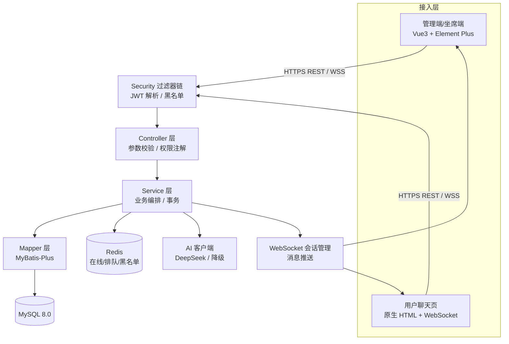
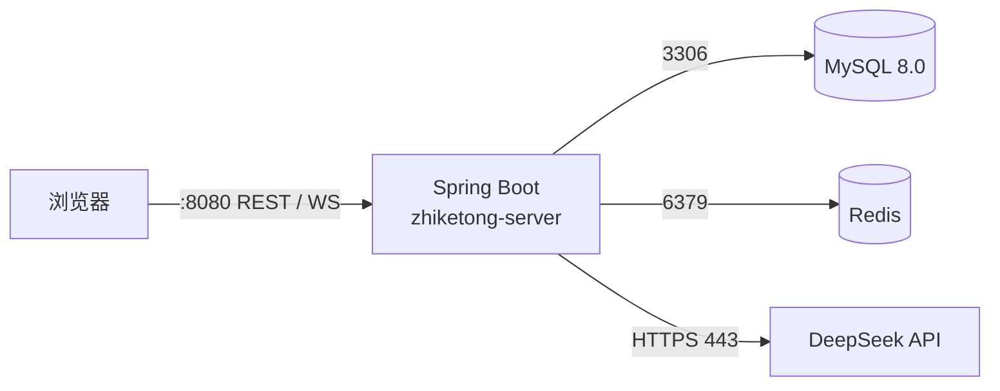
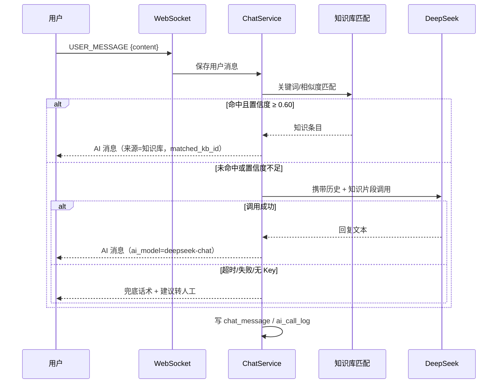
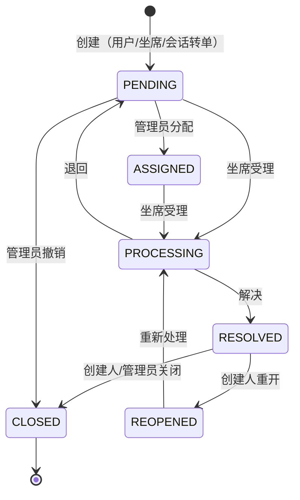

# 智客通 —— 智能对话客服与工单管理系统 项目开发文档

> 版本：**V2.0（开工版）**
> 更新日期：2026-10-20
> 课程：JavaEE 期末大作业
> 状态：文档评审完成，工程骨架已落地并通过启动验证，可按第 12 章里程碑开始功能开发
>
> 配套文档：[数据库设计](docs/数据库设计.md) · [接口与 WebSocket 协议](docs/接口与WebSocket协议.md) · [README](README.md)

---

## 0. 文档修订记录

| 版本 | 日期 | 修订人 | 说明 |
|------|------|--------|------|
| V1.0 | 2026-10-20 | 项目组 | 初稿：项目定位、模块清单、技术栈、命名/代码/事务/接口规范（89 行） |
| V2.0 | 2026-10-20 | 项目组 | 开工版：补需求规格、架构、数据库、接口、WebSocket、页面、状态机、里程碑、测试验收、风险；修正技术栈与包名；落地可运行骨架与数据库 |

---

## 1. 文档评审结论（V1.0 → V2.0）

### 1.1 V1.0 存在的问题

V1.0 是一份合格的「立项说明」，但达不到「开发执行依据」的要求，主要问题：

| # | 问题 | 影响 |
|---|------|------|
| 1 | 没有数据库设计（表、字段、索引、ER） | 无法建库，实体/接口字段各写各的 |
| 2 | 没有接口清单（只有返回格式规范） | 前后端无法并行，联调靠猜 |
| 3 | 没有 WebSocket 协议（消息类型、时序、重连、排队） | 双端对话与转人工无法实现 |
| 4 | 没有工单状态机与 SLA 规则 | 状态随意流转，日志无法追溯 |
| 5 | 没有 AI 流程、知识库匹配、失败降级、Key 管理 | 断网/无 Key 时演示直接失败 |
| 6 | 没有页面清单与路由 | 前端无法开工 |
| 7 | 包名规范 `com.campus.service.模块名` 含歧义（service 既是层又是模块前缀） | 包结构混乱 |
| 8 | 技术栈与本机环境不符（JDK 8、Redis 3.0、MySQL 连接器坐标、无接口文档组件） | 构建/启动踩坑 |
| 9 | 没有里程碑、任务拆解、验收标准 | 无法排期与分工 |
| 10 | 没有测试计划与答辩演示脚本 | 验收与答辩临时抱佛脚 |
| 11 | 没有风险与降级预案 | AI/Redis 故障时无兜底 |
| 12 | 角色权限只有一句话，没有权限矩阵与数据权限 | 越权风险 |
| 13 | 没有编号规则（会话号/工单号） | 数据不可读、演示不专业 |
| 14 | 没有统计口径定义 | 看板数字说不清 |
| 15 | 没有交付物清单与文档索引 | 提交材料遗漏 |

### 1.2 V2.0 补齐的内容

- 第 3 章：需求规格（模块功能清单 + 用户故事 + 非功能需求 + 不做清单）
- 第 5～6 章：系统架构、分层职责、核心流程（AI 对话 / 转人工 / 工单 / SLA）
- 第 7 章：数据库设计摘要（11 张表，完整字典见配套文档，DDL 已可执行）
- 第 8 章：接口与 WebSocket 协议摘要（72 个 REST 接口、10 类上行 / 16 类下行消息）
- 第 9 章：前端页面清单、路由、组件与交互规范
- 第 10 章：开发规范 V2（分层、校验、事务、日志、安全、并发、Git、评审清单）
- 第 12 章：M0～M7 里程碑、任务拆解与分工建议
- 第 13 章：测试用例矩阵、验收标准、答辩演示脚本
- 第 14 章：风险登记与降级预案
- 同时落地：`sql/`（建库建表 + 种子数据）、`src/`（可启动后端骨架）、`docs/`（两份明细文档）、`README.md`

### 1.3 关键设计决策（ADR）

| 决策 | 结论 | 理由 |
|------|------|------|
| 数据库外键 | 不建物理外键，靠 Service 事务 + 索引 + 逻辑删除 | 教学项目简化迁移；避免删除/归档受限 |
| 角色模型 | 固定三角色 ADMIN / AGENT / USER，保留 `sys_role` 表 | 满足课程要求，避免过度设计 RBAC |
| 鉴权 | JWT（HS256，2h）+ Redis 登出黑名单 | 无状态、易扩展 WebSocket；登出可失效 |
| 数据存储 | 业务数据全量 MySQL；Redis 仅在线状态、排队、黑名单、缓存 | 避免缓存与库不一致带来的演示风险 |
| AI 接入 | OpenAI 兼容协议，默认 DeepSeek；知识库优先、LLM 补充、失败降级 | 可换供应商；断网/无 Key 仍可演示 |
| 前端形态 | 管理端/坐席端 Vue3 + Element Plus；用户端原生 HTML + WebSocket | 管理端提效；用户端轻量、启动快 |
| 时间类型 | 统一 `LocalDateTime`，格式 `yyyy-MM-dd HH:mm:ss` | 避免时区/时间戳混乱 |
| 编号规则 | 会话 `CSyyyyMMddHHmmss+4随机`，工单 `WOyyyyMMddHHmmss+4随机` | 可读、可检索、演示友好 |

---

## 2. 项目概述

### 2.1 项目名称与定位

**智客通 —— 智能对话客服与工单管理系统**

面向中小企业的一站式智能客服解决方案：以 **AI 智能对话 + 知识库自助解答 + 工单闭环流转 + 人工坐席兜底** 为核心，覆盖用户咨询全流程，降低人工客服成本、提升问题解决效率与用户服务体验。

### 2.2 目标用户与角色

| 角色 | 编码 | 使用端 | 核心诉求 |
|------|------|--------|----------|
| 普通用户 | `USER` | 用户聊天页 | 快速得到答案；必要时转人工；可提交/跟踪工单 |
| 客服坐席 | `AGENT` | 坐席工作台 | 接收排队会话、与用户对话、创建/处理工单 |
| 系统管理员 | `ADMIN` | 管理后台 | 知识库维护、工单调度、用户/角色管理、数据看板 |

### 2.3 业务闭环

```
用户提问 → 知识库命中（秒回） → 未命中/不满意 → AI 大模型回答
        → 仍无法解决/要求转人工 → 排队 → 坐席接入 → 人工解决
        → 需要跟进 → 创建工单 → 分配/处理/解决/关闭 → 满意度评价
        → 全过程沉淀统计（会话量、AI 解决率、工单时效、知识命中率）
```

### 2.4 术语表

| 术语 | 说明 |
|------|------|
| 会话 Session | 用户与系统（AI/坐席）的一次完整咨询过程 |
| 转人工 | 用户请求由人工坐席接管当前会话 |
| 排队队列 | 等待坐席接入的会话集合，Redis ZSet 按入队时间排序 |
| 坐席负载 | 坐席当前接待中的会话数 / 最大并发数 |
| 知识条目 | 一条「标准问题 + 标准答案 + 关键词」 |
| 工单 Work Order | 需要跨角色跟进的问题记录，具备状态机与 SLA |
| SLA | 服务时限：首次响应时限 + 解决时限，按优先级区分 |
| AI 独立解决率 | 未转人工即关闭的会话数 / 已关闭会话数 |
| 满意度 | 用户对会话或工单的 1～5 星评分 |

### 2.5 交付范围（V1.0）与不做清单

**交付范围**

- 用户聊天页：AI 对话、知识库自助、转人工、结束评价
- 坐席工作台：上下线、排队列表、接入/结束、双端对话、快捷回复
- 知识库管理：分类、条目 CRUD、启停、搜索、命中排行
- 工单管理：创建、分配、受理、处理、解决、关闭、重开、流转日志、SLA 超时
- 统计分析：核心指标看板、趋势、坐席工作量、工单分布、知识命中、AI 调用
- 系统管理：用户管理、角色管理、登录日志、权限控制

**V1.0 不做（明确边界）**

- 多租户 / 多企业隔离
- 文件与图片上传、富文本消息
- 支付、订单、物流等外部业务系统对接
- 语音客服、电话呼叫
- 细粒度按钮级权限配置（角色固定）
- 生产级集群、消息队列、分布式锁（课程项目用 Redis 基础能力替代）

---

## 3. 需求规格

### 3.1 功能需求总览

优先级：P0 必须（答辩演示核心） / P1 应该（完整度） / P2 可选（加分）。

| 编号 | 模块 | 功能点 | 优先级 | 使用角色 |
|------|------|--------|--------|----------|
| F-01 | 认证 | 登录 / 注册 / 登出 / 当前用户 / 改密 | P0 | 全部 |
| F-02 | 系统管理 | 用户分页查询、新增、编辑、启停、重置密码 | P0 | ADMIN |
| F-03 | 系统管理 | 角色列表与用户角色分配 | P1 | ADMIN |
| F-04 | 系统管理 | 登录日志分页查询 | P1 | ADMIN |
| F-05 | 知识库 | 分类增删改查、启停、排序 | P0 | ADMIN |
| F-06 | 知识库 | 条目增删改查、启停、关键词维护、批量导入（可选） | P0 | ADMIN |
| F-07 | 知识库 | 关键词搜索、命中次数 Top10 | P0 | ADMIN |
| F-08 | 智能对话 | 创建会话、消息持久化、会话列表/详情 | P0 | USER |
| F-09 | 智能对话 | 知识库匹配（阈值直接回答）、AI 大模型回答 | P0 | USER |
| F-10 | 智能对话 | 转人工触发（关键词/按钮/负反馈） | P0 | USER |
| F-11 | 智能对话 | 会话结束、满意度评分 | P0 | USER |
| F-12 | 坐席工作台 | 上线/下线/忙碌、心跳 | P0 | AGENT |
| F-13 | 坐席工作台 | 待接入队列、接入会话、我的会话 | P0 | AGENT |
| F-14 | 坐席工作台 | 双端实时消息、输入中提示、结束会话 | P0 | AGENT |
| F-15 | 工单 | 创建工单（用户/坐席/会话转工单） | P0 | USER/AGENT |
| F-16 | 工单 | 分页查询、详情、流转日志 | P0 | 全部 |
| F-17 | 工单 | 分配、受理、处理、解决、关闭、重开 | P0 | ADMIN/AGENT |
| F-18 | 工单 | SLA 时限计算、超时扫描与标记 | P1 | 系统 |
| F-19 | 统计 | 今日会话/消息/工单、AI 解决率、平均评分、在线坐席 | P0 | ADMIN |
| F-20 | 统计 | 7 日趋势、工单状态/优先级/分类分布、坐席工作量、知识命中 Top10 | P1 | ADMIN |
| F-21 | 统计 | AI 调用次数/成功率/平均耗时 | P1 | ADMIN |
| F-22 | 用户体验 | 空状态、加载态、错误提示、断线重连 | P1 | 全部 |
| F-23 | 安全 | JWT 鉴权、接口权限、数据权限（本人/本组）、密码 BCrypt | P0 | 全部 |

### 3.2 关键用户故事

| 编号 | 故事 |
|------|------|
| US-01 | 作为用户，我打开聊天页输入「怎么退款」，系统 3 秒内给出退款流程答案，我不需要等待人工 |
| US-02 | 作为用户，问题没解决时我点击「转人工」，能看到排队位次，坐席接入后实时对话 |
| US-03 | 作为用户，对话结束后我可以给 1～5 星评价并留言 |
| US-04 | 作为坐席，我上线后看到排队列表，接入用户并能看到历史消息与用户信息 |
| US-05 | 作为坐席，我把复杂问题转成工单，选择优先级与分类，后续在工单列表继续跟进 |
| US-06 | 作为管理员，我维护知识库，发布后用户端立即能命中 |
| US-07 | 作为管理员，我在看板看到今日会话量、AI 解决率、工单超时数，判断服务压力 |
| US-08 | 作为管理员，我禁用某个账号后，该账号无法登录 |

### 3.3 非功能需求

| 类别 | 指标 |
|------|------|
| 性能 | 普通接口 P95 < 300ms；AI 首次回复 < 10s（含模型耗时）；WebSocket 消息端到端 < 1s（本地） |
| 并发 | 演示环境支持 50 并发用户、10 坐席同时在线；AI 调用线程池隔离 |
| 可用性 | AI/Redis 故障时核心流程可降级（AI 回退知识库/兜底话术；Redis 故障时鉴权主流程不受影响） |
| 安全 | 密码 BCrypt；JWT 签名与过期校验；登出黑名单；接口角色校验；越权数据校验；参数校验；SQL 注入防护 |
| 可维护性 | 分层清晰；统一 Result/异常；关键流程有注释；接口文档与数据库文档同步 |
| 兼容性 | Chrome/Edge 最新版；JDK 8；MySQL 8.0；Redis 3.0+（基础命令） |
| 可观测性 | 请求日志、登录日志、AI 调用日志、工单流转日志、健康检查 |

### 3.4 约束与假设

- 开发机为 Windows + JDK 8，**不能升级到 Spring Boot 3**（需 JDK 17）。
- 本机 Redis 为 3.0.504（较旧），仅使用 String/Hash/ZSet/Set/EXPIRE 等基础命令；不使用 Redis 6 特性（ACL、RESP3、Streams）。
- AI 需外网与 API Key；无 Key 时演示降级路径。
- 课程周期内按第 12 章排期执行，单人开发时按 1.5～2 倍工时估算。

---

## 4. 技术栈与选型

### 4.1 最终技术栈（已在本机验证）

| 层级 | 技术 | 实际版本 | 说明 |
|------|------|----------|------|
| 运行环境 | JDK | 1.8.0_202 | 本机唯一 JDK；决定框架上限 |
| 基础框架 | Spring Boot | 2.7.18 | 最后支持 Java 8 的 2.7 线 |
| Web 层 | Spring MVC | 5.3.31 | RESTful 接口 |
| 实时通信 | Spring WebSocket | 5.3.31 | 用户/坐席双端对话 |
| 安全 | Spring Security | 5.7.11 | 无状态 JWT 鉴权 |
| 持久层 | MyBatis-Plus | 3.5.3.2 | 通用 CRUD + 分页插件 |
| 数据库 | MySQL | 8.0.45 | 业务数据 |
| 连接池 | HikariCP | 4.0.3 | Spring Boot 默认 |
| 缓存 | Redis | 3.0.504（本机） | 在线状态、排队、黑名单；生产建议 6+ |
| Redis 客户端 | Lettuce | 6.1.x（Spring Data Redis 2.7） | 已兼容 Redis 3.0 基础命令 |
| 鉴权令牌 | jjwt | 0.11.5 | HS256 |
| 密码加密 | BCrypt | spring-security-crypto 5.7.11 | 强度 10 |
| 接口文档 | springdoc-openapi | 1.7.0 | Swagger UI |
| 参数校验 | Hibernate Validator | 6.2.x | JSR-380 |
| AI | DeepSeek（OpenAI 兼容） | deepseek-chat | 可通过配置换供应商 |
| 构建 | Maven | 3.9.13 | 本地仓库重定向到工程 `.m2repo` |
| 前端（计划） | Vue 3 + Vite + Element Plus + ECharts + Axios | - | 管理端/坐席端 |
| 用户端（计划） | 原生 HTML/CSS/JS + WebSocket | - | 轻量聊天页 |

### 4.2 选型说明

- **Spring Boot 2.7.18**：JDK 8 约束下的最稳妥选择；3.x 需 JDK 17，本机不具备。
- **MyBatis-Plus 3.5.3.2**：课程要求 MyBatis 系；MP 提供分页、逻辑删除、条件构造器，减少样板 SQL。
- **JWT + Spring Security**：无状态、适配 WebSocket 握手；登出用 Redis 黑名单补齐「Token 立即失效」。
- **Redis 3.0 兼容**：本机服务较旧，已实测 `PING`、`SET/GET`、`HSET`、`ZADD` 等基础命令可用；为避免踩坑，V1.0 不使用 Stream、Lua 之外的复杂特性（排队分配如需原子性，使用 `SETNX` + 简单校验）。
- **springdoc 1.7.0**：Spring Boot 2.7 + springfox 不兼容，选 springdoc；启动后 `/swagger-ui.html` 可直接演示。
- **DeepSeek**：OpenAI 兼容协议，接入成本低；知识库优先策略减少 token 消耗与幻觉。

### 4.3 关键依赖（pom.xml）

```xml
<parent>spring-boot-starter-parent 2.7.18</parent>
spring-boot-starter-web / validation / websocket / security / data-redis / aop / actuator
mybatis-plus-boot-starter 3.5.3.2
com.mysql:mysql-connector-j 8.0.33
jjwt-api / jjwt-impl / jjwt-jackson 0.11.5
springdoc-openapi-ui 1.7.0
lombok（provided）
spring-boot-starter-test + spring-security-test（test）
```

> 构建说明：本机 `D:\Maven\maven-repository` 受权限限制，工程通过 `.mvn/maven.config` 将本地仓库指向 `.m2repo`；在普通机器上删除该配置即可使用用户默认仓库。

---

## 5. 系统架构

### 5.1 分层架构



职责边界：

| 层 | 职责 | 禁止 |
|----|------|------|
| Controller | 接收参数、`@Valid` 校验、权限注解、调用 Service、组装 Result | 写业务逻辑、直接调 Mapper |
| Service | 业务规则、状态机、事务、调用多个 Mapper/AI/Redis | 处理 HTTP 对象、返回 Result |
| Mapper | 单表 CRUD（BaseMapper）、复杂统计 XML | 写业务判断 |
| Entity | 表映射 | 业务方法 |
| DTO/VO | 入参/出参 | 暴露 Entity 敏感字段（password） |

### 5.2 后端包结构（已落地）

```
com.zhiketong
├─ ZhiketongApplication.java      启动类（@MapperScan / @EnableScheduling / @EnableAsync）
├─ common/                        Result、ResultCode、PageResult、BusinessException、
│                                 GlobalExceptionHandler、Constants、util.IpUtils
├─ config/                        MybatisPlusConfig、RedisConfig、JacksonConfig、
│                                 SecurityConfig、WebSocketConfig、OpenApiConfig、
│                                 properties/{Jwt,Ai,Chat,Sla}Properties
├─ security/                      JwtTokenUtil、JwtToken、LoginUser、SecurityUtils、
│                                 JwtAuthenticationFilter、JwtHandshakeInterceptor、
│                                 RestAuthenticationEntryPoint、RestAccessDeniedHandler
├─ controller/                    AuthController、HealthController、AiController
├─ service/                       AuthService（后续按模块拆分）
├─ ai/                            AiChatService、DeepSeekAiChatService、AiMessage、AiConfig
├─ websocket/                     ChatWebSocketHandler、WebSocketSessionManager、WsMessage
├─ entity/                        11 实体 + BaseEntity
├─ mapper/                        11 Mapper
├─ enums/                         9 枚举（角色、会话、工单、动作等）
└─ dto/                           LoginRequest/Response、RegisterRequest、UserVO、
                                  ChangePasswordRequest、AiChatRequest/Response
```

### 5.3 前端架构（V1.0 计划）

```
frontend/
├─ admin/                 # Vue3 + Vite + Element Plus 管理端 / 坐席端
│  ├─ src/api/            # Axios 封装与接口模块
│  ├─ src/router/         # 路由与守卫（按角色）
│  ├─ src/stores/         # Pinia：用户、权限、字典
│  ├─ src/layouts/        # 侧边栏 + 顶栏布局
│  ├─ src/views/          # 登录、看板、知识库、工单、坐席、系统管理
│  └─ src/components/     # 表格、状态标签、图表、聊天组件
└─ user-chat/             # 原生 HTML/CSS/JS 用户聊天页（后端静态资源托管）
```

### 5.4 运行时部署



- 开发期：`mvn spring-boot:run`，前端 Vite 开发服务器代理 `/api`、`/ws` 到 8080。
- 演示期：`mvn package` 生成 `target/zhiketong-server.jar`，前端打包产物放入 `src/main/resources/static` 或由 Nginx 托管。

### 5.5 关键链路

1. **登录**：`POST /api/auth/login` → AuthService 校验 BCrypt → 签发 JWT → 更新 last_login → 写登录日志 → 返回 token + 用户信息。
2. **鉴权**：请求头 `Authorization: Bearer <token>` → JwtAuthenticationFilter 解析 → 校验 Redis 黑名单 → 写入 SecurityContext（`ROLE_<roleCode>`）→ Controller `@PreAuthorize` 判定。
3. **AI 对话**：WebSocket `USER_MESSAGE` → 保存用户消息 → 知识库匹配（≥0.60 直接回答）→ 未命中调用 LLM（超时 15s）→ 保存 AI 消息 → 推送用户 → 写 ai_call_log。
4. **转人工**：`TRANSFER_REQUEST` → 会话置 WAITING + 入 Redis 队列 → 通知在线坐席 → 坐席接入 → 绑定 agent_id → 双方消息路由。
5. **工单**：状态变更动作统一走 `WorkOrderService`，校验迁移合法性 → 更新工单 + 写 `work_order_log`（同一事务）。

---

## 6. 核心业务流程

### 6.1 AI 对话流程



**知识库匹配算法**

1. 对用户文本按标点/空格分词，过滤停用词；
2. 每条启用条目计算得分：`score = 0.7 × 关键词命中率 + 0.3 × 问题文本相似度`（关键词取自 `keywords` 逗号分隔列表，问题相似度用字符二元组 Jaccard）；
3. 取最高分条目；`score ≥ 0.60` 直接返回标准答案；`0.30 ≤ score < 0.60` 作为 LLM 上下文参考；`< 0.30` 不注入；
4. 命中后 `hit_count + 1`（原子 SQL），消息记录 `matched_kb_id` 与 `ai_confidence`。

**转人工触发**：命中 `zhiketong.chat.transfer-keywords`（转人工/人工客服/真人/投诉）、用户点击按钮、连续 2 次负反馈、AI 调用失败。

**口径补充**：知识库直接命中**不写** `ai_call_log`（该表只记录大模型调用）；命中信息写入 `chat_message.matched_kb_id` 与 `ai_confidence`，统计「知识命中率」时以消息表为准。

### 6.2 转人工与排队

- 会话状态：`AI`（智能接待）→ `WAITING`（排队）→ `HUMAN`（人工接待）→ `CLOSED`。
- 入队：`ZADD zk:queue:waiting <时间戳> <sessionId>`，会话记录 `queue_enter_time`、`transfer_time`，返回排队位次。
- 坐席接入：校验坐席 `ONLINE` 且 `current_count < max_concurrent`；`ZPOPMIN` 取最早会话；`SETNX zk:session:agent:{sessionId}` 防并发抢占；绑定 `agent_id`、`accept_time`，状态置 `HUMAN`，双方推送 `SESSION_ASSIGNED`。
- 超时：定时任务扫描 WAITING 超过 10 分钟的会话，推送提示并以 `TIMEOUT` 关闭；用户可重新发起。
- 结束：`CLOSED` + `close_reason` + `end_time`，坐席负载 -1、累计接待 +1，用户可评分。

### 6.3 坐席工作台

- 上线：更新 `agent_status.online_status=ONLINE`，Redis `HSET zk:agent:online {agentId} ONLINE`，开始 30s 心跳（WebSocket PING 或 REST 心跳）。
- 工作台三栏：左侧「待接入队列 + 我的会话」，中间「对话区」，右侧「用户信息 + 历史工单 + 快捷回复」。
- 快捷回复：V1.0 使用前端静态短语，后续可配置化。
- 离线：停止接单并提示；当前会话处理完才可离线。

### 6.4 工单状态机



规则：

- 每次迁移必须校验「当前状态 + 动作 + 操作角色」，非法迁移返回 `409`；
- 状态更新与 `work_order_log` 写入**同一事务**；
- 首次受理写入 `first_response_time`；解决写 `resolve_time`；关闭写 `close_time`；
- 创建时按优先级计算 `sla_deadline = create_time + resolve-minutes`；
- 优先级：`P0` 紧急（30 分钟首响 / 2 小时解决）、`P1` 高（2h / 8h）、`P2` 中（8h / 24h）、`P3` 低（24h / 72h）。
- 首响截止时间**不单独落库**，由应用层按 `create_time + 首响时限` 计算并判断；库中只保留 `first_response_time` 实际首响时间与 `sla_deadline` 解决截止时间。
- 重开规则：`RESOLVED → REOPENED` 时 `overdue_flag` 重置为 0，`sla_deadline` 按重开时刻 + 优先级解决时限重新计算；历史超时通过 `work_order_log` 的 `OVERDUE` 记录保留，不覆盖。
- `chat_message`、`work_order_log`、`ai_call_log`、`sys_login_log` 属于日志表，按设计**没有** `update_time` 与 `deleted`，只保留 `create_time`，避免无意义的更新审计。

### 6.5 SLA 超时扫描

- `@Scheduled(cron = "0 */5 * * * ?")` 每 5 分钟执行；
- 扫描未关闭且 `sla_deadline < now` 且 `overdue_flag = 0` 的工单，置 `overdue_flag = 1`，写 `OVERDUE` 日志并推送负责人；
- 首响超时：`ASSIGNED/PROCESSING` 且 `first_response_time` 为空且超过首响时限，记录日志提醒。

### 6.6 编号规则

| 对象 | 规则 | 示例 |
|------|------|------|
| 会话号 | `CS` + `yyyyMMddHHmmss` + 4 位随机 | `CS202610201930251234` |
| 工单号 | `WO` + `yyyyMMddHHmmss` + 4 位随机 | `WO202610201935428877` |

数据库唯一索引兜底，生成冲突时重试。

---

## 7. 数据库设计（摘要）

### 7.1 设计原则

1. 单库 `zhiketong`，`utf8mb4`，InnoDB；
2. 主键统一 `BIGINT AUTO_INCREMENT`；业务编号单独字段 + 唯一索引；
3. 统一审计字段：`create_time`、`update_time`（DB 默认值维护）；
4. 业务主表逻辑删除 `deleted`（0/1），MyBatis-Plus `@TableLogic`；日志类表不删除；
5. 不建物理外键，服务层事务 + 索引保证；
6. 金额/比率用 `DECIMAL`，状态/角色用 `VARCHAR` 存编码（可读性优先）。

### 7.2 表清单（11 张）

| # | 表 | 说明 | 关键字段 |
|---|----|------|----------|
| 1 | `sys_role` | 角色字典 | role_code、role_name |
| 2 | `sys_user` | 用户（三角色共用） | username、password(BCrypt)、role_code、status |
| 3 | `kb_category` | 知识库分类 | name、parent_id、sort |
| 4 | `kb_entry` | 知识库条目 | category_id、question、answer、keywords、hit_count |
| 5 | `chat_session` | 会话 | session_no、user_id、agent_id、status、队列/接入/结束时间、rating |
| 6 | `chat_message` | 消息 | session_id、sender_type、content、matched_kb_id、ai_confidence |
| 7 | `work_order` | 工单 | order_no、priority、status、assignee_id、sla_deadline、overdue_flag |
| 8 | `work_order_log` | 工单流转日志 | order_id、action、from_status、to_status、operator |
| 9 | `agent_status` | 坐席状态 | agent_id、online_status、max_concurrent、current_count |
| 10 | `ai_call_log` | AI 调用日志 | model、tokens、latency_ms、success、error_msg |
| 11 | `sys_login_log` | 登录日志 | username、ip、user_agent、success |

> 完整表字典、ER 图、索引说明、统计 SQL 见 [docs/数据库设计.md](docs/数据库设计.md)；DDL 见 [sql/01_schema.sql](sql/01_schema.sql)，演示数据见 [sql/02_data.sql](sql/02_data.sql)（已执行验证：11 张表，20 条知识、10 会话、44 消息、14 工单、52 条工单日志、19 条 AI 日志、13 条登录日志）。

### 7.3 索引策略

- 唯一索引：`sys_user.username`、`chat_session.session_no`、`work_order.order_no`；
- 高频查询：`chat_message(session_id, id)`、`chat_session(user_id, create_time)`、`work_order(status, create_time)`、`work_order(assignee_id, status)`、`work_order(sla_deadline, overdue_flag)`；
- 统计查询：`create_time` 单列索引，避免全表扫描；
- 查询规范：禁止 `SELECT *`（MP 默认按实体列），统计 SQL 必须走索引并 `EXPLAIN` 验证。

### 7.4 Redis 键设计

| 键 | 类型 | TTL | 用途 |
|----|------|-----|------|
| `zk:token:blacklist:{jti}` | String | 剩余 Token 有效期 | 登出后 Token 立即失效 |
| `zk:agent:online` | Hash | 心跳续期 | 坐席在线状态（agentId → ONLINE/OFFLINE） |
| `zk:agent:load:{agentId}` | String | 会话结束清除 | 坐席当前接待数 |
| `zk:queue:waiting` | ZSet | 无（会话关闭/接入时移除） | 等待接入队列（score=入队时间戳） |
| `zk:session:agent:{sessionId}` | String | 会话结束清除 | 会话与坐席绑定，防重复接入 |

### 7.5 统计口径

| 指标 | 口径 |
|------|------|
| 今日会话数 | `chat_session.create_time` 在今日 |
| AI 独立解决率 | `CLOSED` 且 `agent_id IS NULL` 的会话数 / 已关闭会话数 |
| 平均满意度 | `chat_session.rating` / `work_order.rating` 平均值（排除空） |
| 平均首响时长 | `first_response_time - create_time`（工单）/ `accept_time - transfer_time`（会话） |
| 工单超时数 | `overdue_flag = 1` 且 `status != CLOSED` |
| 知识命中率 | 有 `matched_kb_id` 的 AI 消息数 / AI 消息总数 |
| 坐席工作量 | 按 `agent_id` 统计接待会话数、解决工单数、平均评分 |

---

## 8. 接口与 WebSocket（摘要）

### 8.1 通用约定

- 基础路径 `/api`；认证头 `Authorization: Bearer <token>`；
- 统一返回 `{code, message, data}`：200 成功 / 400 参数错误 / 401 未登录 / 403 无权限 / 404 不存在 / 409 状态冲突 / 500 服务器错误；
- 分页参数 `pageNum`（从 1 开始）、`pageSize`（默认 10，上限 100），返回 `{list, total, pageNum, pageSize, pages}`；
- 时间格式 `yyyy-MM-dd HH:mm:ss`；金额/评分数字；
- 权限矩阵：ADMIN 全量；AGENT 会话/工单处理；USER 仅本人数据。

### 8.2 接口规模

| 模块 | 接口数 | 示例 |
|------|--------|------|
| 认证 | 5 | 登录、注册、登出、当前用户、改密 |
| 系统用户/角色 | 12 | 用户分页、增改、启停、重置密码、角色列表、分配角色 |
| 知识库 | 13 | 分类 CRUD、条目 CRUD、启停、搜索、命中排行 |
| 会话与消息 | 9 | 创建会话、列表、详情、消息分页、REST 发消息、转人工、结束、评分 |
| 坐席工作台 | 9 | 上下线、心跳、排队列表、接入、我的会话、结束 |
| 工单 | 15 | 创建、分页、详情、分配、受理、处理、解决、关闭、重开、日志 |
| 统计 | 6 | 概览、趋势、坐席工作量、知识命中、工单分布、AI 调用 |
| 登录日志 | 1 | 分页查询 |
| 健康检查 | 2 | 健康状态、版本 |
| **合计** | **72** | 详见配套协议文档 |

### 8.3 WebSocket 协议摘要

- 连接：`ws://localhost:8080/ws/chat?token=<JWT>`（握手阶段校验 Token、黑名单、角色）；
- 信封：`{type, requestId, timestamp, data}`；
- 上行 10 种：`PING`、`USER_MESSAGE`、`AGENT_MESSAGE`、`TYPING`、`READ`、`TRANSFER_REQUEST`、`CANCEL_TRANSFER`、`RATING`、`AGENT_ONLINE`、`AGENT_OFFLINE`；
- 下行 16 种：`PONG`、`MESSAGE`、`AI_MESSAGE`、`AGENT_TYPING`、`TRANSFER_QUEUED`、`TRANSFER_ACCEPTED`、`SESSION_ASSIGNED`、`SESSION_ENDED`、`SESSION_CLOSED`、`AGENT_STATUS`、`SYSTEM_NOTICE`、`ERROR` 等；
- 三条完整时序：AI 对话、转人工排队/接入、双方对话/结束/评价；断线重连携带最后消息 ID 增量补拉。

> 完整消息类型表、字段、时序图、错误码、重连策略、curl/WS 示例见 [docs/接口与WebSocket协议.md](docs/接口与WebSocket协议.md)。

### 8.4 当前实现状态（V1.0.0 骨架）

| 模块 | 状态 |
|------|------|
| 健康检查 `/api/health` | ✅ 已实现并通过实测（MySQL/Redis 均 UP） |
| 认证 5 接口 | ✅ 已实现（登录/注册/登出/当前用户/改密），已实测登录、401、登出黑名单 |
| AI 对话 `/api/ai/chat` | ✅ 已实现（DeepSeek + 降级），已实测无 Key 降级 |
| WebSocket `/ws/chat` | ✅ 握手鉴权、连接管理、PING/PONG 已实测；业务消息为占位回执 |
| Swagger `/swagger-ui.html` | ✅ 已实现（springdoc） |
| 前端演示端（Vue3 + Element Plus） | ✅ 已实现登录/看板/知识库/工单/会话/坐席/用户/AI 聊天 8 页，构建产物在 `frontend/dist`，由 `serve-frontend.mjs` 托管 |
| 只读演示接口 `/api/demo/*` | ✅ 已实现（看板与列表数据，M1～M6 由正式接口替换） |
| 其余 60+ 接口 | ⏳ 按 M1～M6 实现，接口契约已冻结 |

> 接口协议文档中列出的 19 项「待确认问题」均已给出默认处理；编码前如与本文档冲突，以本文档与 `docs/数据库设计.md` 为准，并同步修订协议文档。

---

## 9. 前端设计

### 9.1 页面清单

| 路由 | 页面 | 角色 | 主要功能 | 依赖接口 |
|------|------|------|----------|----------|
| `/login` | 登录页 | 全部 | 账号密码登录、错误提示 | `POST /api/auth/login` |
| `/dashboard` | 数据看板 | ADMIN | 指标卡、7 日趋势、分布图、Top10 | `/api/stats/*` |
| `/knowledge/categories` | 知识分类 | ADMIN | 分类树、增删改、启停、排序 | `/api/kb/categories` |
| `/knowledge/entries` | 知识条目 | ADMIN | 列表、搜索、编辑、启停、命中数 | `/api/kb/entries` |
| `/orders` | 工单列表 | ADMIN/AGENT | 筛选、分页、分配、批量操作 | `/api/workorders` |
| `/orders/:id` | 工单详情 | ADMIN/AGENT/USER | 详情、流转日志、状态操作、评价 | `/api/workorders/{id}/*` |
| `/users` | 用户管理 | ADMIN | 用户列表、新增/编辑、启停、重置密码 | `/api/users` |
| `/roles` | 角色管理 | ADMIN | 角色列表、用户角色分配 | `/api/roles` |
| `/logs/login` | 登录日志 | ADMIN | 登录成功/失败记录 | `/api/login-logs` |
| `/workbench` | 坐席工作台 | AGENT | 排队、接入、对话、结束、创建工单 | `/api/agent/*` + WS |
| `/profile` | 个人中心 | 全部 | 资料、改密 | `/api/auth/me`、`/api/auth/password` |
| `/chat.html` | 用户聊天页 | USER | AI 对话、转人工、评价 | REST + WS |

> 当前已实现演示版 8 个页面（`frontend/src/views`）：登录、看板、知识库、工单、会话、坐席、用户、AI 聊天；
> 页面数据来自只读演示接口 `/api/demo/*`，AI 对话走 `/api/ai/chat`，转人工与正式业务操作在 M4/M5 接入。
> 构建与启动见 [README](README.md)「2.4 启动前端演示」。

### 9.2 布局与组件

- 管理端：左侧菜单 + 顶部面包屑/用户信息；内容区卡片式；
- 组件：`PageHeader`、`SearchForm`、`DataTable`、`StatusTag`、`PriorityTag`、`EmptyState`、`ChatPanel`、`StatCard`、`TrendChart`；
- 权限：路由守卫按 `roleCode` 过滤菜单；按钮级用 `v-if` + 后端二次校验；
- 请求：Axios 统一拦截器注入 Token、统一处理 401（跳登录）与 403（提示）、错误 Toast。

### 9.3 用户聊天页

- 单页 + 悬浮气泡两种形态（先做单页）；
- 消息类型：文本；AI 消息显示「AI」标识，坐席消息显示坐席昵称；系统消息居中灰字；
- 交互：Enter 发送 / Shift+Enter 换行；「转人工」按钮；排队位次提示；断线重连提示；输入中提示；
- 结束弹窗：1～5 星 + 评价输入；
- 技术：原生 HTML/CSS/JS + WebSocket；Token 存 localStorage（演示可用）；未登录引导登录。

### 9.4 坐席工作台

- 三栏：左（待接入 + 我的会话）、中（对话区）、右（用户信息 + 历史工单 + 快捷回复）；
- 顶部：在线状态开关、当前接待数/上限、心跳状态；
- 新会话提醒：声音 + 标题闪烁 + 角标；
- 结束会话需二次确认；结束后弹出「创建工单」引导。

### 9.5 看板图表

- 指标卡 6 个：今日会话、今日工单、AI 解决率、平均满意度、平均首响、在线坐席；
- 折线图：近 7 日会话/工单趋势；
- 饼图/柱状图：工单状态分布、优先级分布、分类分布；
- 横向条形图：坐席工作量、知识库命中 Top10；
- 图表库：ECharts 5。

### 9.6 交互与体验规范

- 加载态：骨架屏/表格 loading；空态：插画 + 引导按钮；
- 错误：Toast 展示后端 message；表单错误定位到字段；
- 危险操作（删除、禁用、关闭）二次确认；
- 聊天自动滚动到底部，历史消息向上分页；
- 响应式：管理端最小 1280px；聊天页适配移动端。

---

## 10. 开发规范

### 10.1 命名规范

| 类型 | 规则 | 示例 |
|------|------|------|
| 包名 | 全小写，按层划分 | `com.zhiketong.controller` |
| 类名 | 大驼峰 | `WorkOrderService`、`JwtAuthenticationFilter` |
| 方法 | 小驼峰，动词开头 | `createSession`、`getWaitList` |
| 变量 | 小驼峰 | `sessionId`、`orderNo` |
| 常量 | 全大写 + 下划线 | `MAX_AGENT_CONCURRENT` |
| 表/字段 | 下划线 | `work_order_log`、`create_time` |
| 接口路径 | 名词复数 | `/api/workorders`、`/api/kb/entries` |
| 布尔 | is/has/can 前缀 | `isOnline()`、`hasPermission()` |

### 10.2 分层约束

- Controller ≤ 50 行，只做参数接收、`@Valid`、权限注解、Service 调用；
- Service 一个方法只做一件事；跨表写操作必须 `@Transactional`；
- 单表 CRUD 用 `BaseMapper`，不写 XML；多表统计/复杂查询写 XML 并放 `resources/mapper`；
- 所有接口返回 `Result`；分页返回 `PageResult`；
- 业务异常抛 `BusinessException`，禁止 `e.printStackTrace()`；
- 实体不直接返回前端，统一转 VO/DTO；密码字段永不返回。

### 10.3 参数校验

- `@RequestBody` 必须 `@Valid`；DTO 字段使用 `@NotBlank`、`@Size`、`@Pattern`、`@Min/@Max`；
- 分页 `pageSize` 上限 100；数量/金额必须 `@Min(1)` / `@Positive`；
- 状态、角色等枚举字段用白名单校验（枚举转换或 `@Pattern`）；
- 路径/查询参数用 `@Validated` + 约束注解。

### 10.4 事务

- 写操作 `@Transactional(rollbackFor = Exception.class)`；
- 只读查询 `@Transactional(readOnly = true)`（Service 层）；
- 工单状态 + 流转日志、会话状态 + 消息计数必须同事务；
- 事务内禁止调用外部 HTTP（AI）与长时间操作；AI 调用放在事务外。

### 10.5 日志

- 使用 `@Slf4j`，参数化日志 `log.info("...{}", arg)`；
- 关键业务日志：登录、转人工、接入、工单状态变更、AI 失败、SLA 超时；
- 禁止打印密码、Token、完整敏感信息；
- 日志文件 `logs/zhiketong.log`，按天滚动（后续接入 logback-spring.xml）。

### 10.6 安全

| 项 | 要求 |
|----|------|
| 密码 | BCrypt（强度 10），禁止明文/MD5 |
| JWT | HS256，密钥 ≥32 字节且通过环境变量注入；2 小时过期；登出写黑名单 |
| 越权 | 数据权限校验：USER 只能看本人；AGENT 只能看分配给自己/队列内；ADMIN 全量 |
| SQL 注入 | 一律使用 MyBatis-Plus Wrapper / `#{}`，禁止 `${}` 拼接 |
| XSS | 前端输出转义；聊天内容纯文本渲染，禁止 `v-html`；后端过滤 `<script>` |
| CORS | 开发期放开，部署时限定前端域名 |
| 限流 | V1.0 不做；建议对 `/api/ai/chat` 加 Redis 计数（后续） |
| 敏感配置 | `application.yml` 中数据库密码、AI Key 使用环境变量占位，不提交真实密钥 |

### 10.7 MyBatis-Plus / SQL 规范

- 逻辑删除字段 `deleted` 由 `@TableLogic` 自动过滤，统计 SQL 需手动加 `deleted = 0`；
- 禁止 `SELECT *`；统计 SQL 使用别名并避免 MySQL 保留字（如 `year_month` 用 `ym`）；
- 批量操作分片（IN 参数 ≤500）；
- 循环内禁止查询（N+1），先批量查 Map 再组装；
- 更新计数用原子 SQL：`UPDATE kb_entry SET hit_count = hit_count + 1 WHERE id = ?`。

### 10.8 并发与幂等

- 会话接入用 `SETNX zk:session:agent:{sessionId}` 防重复接入；
- 排队出队用 `ZPOPMIN`（Redis 3.0 支持）或 `ZRANGE + ZREM` 双检；
- 工单状态迁移用「带条件的 UPDATE」：`UPDATE ... SET status=#{to} WHERE id=#{id} AND status=#{from}`，影响行数 0 则抛 409；
- 重要写操作考虑唯一索引兜底（如编号重复）。

### 10.9 代码评审 Checklist

- [ ] 接口是否符合契约（路径、方法、字段、错误码）
- [ ] 是否 `@Valid`、分页上限、枚举白名单
- [ ] 是否越权（数据范围）
- [ ] 事务边界是否正确、日志是否同事务
- [ ] 是否 N+1、是否 `SELECT *`、是否走索引
- [ ] 异常是否被全局处理、是否泄露堆栈
- [ ] 是否有日志、是否打印敏感信息
- [ ] 前后端字段命名是否一致（camelCase）
- [ ] 是否补了自测与接口文档

### 10.10 Git 规范

- 分支：`main`（可演示）+ `dev`（集成）+ `feature/模块-功能`；
- 提交信息：`feat(chat): 支持转人工排队`、`fix(order): 修复非法状态迁移`、`docs: 更新接口文档`；
- 每次提交可编译；合并前自测核心路径；
- 禁止提交 `target/`、`.m2repo/`、`logs/`、`.env`、真实 Key。

---

## 11. 环境与启动

### 11.1 环境清单（本机已验证）

| 组件 | 版本 | 状态 |
|------|------|------|
| JDK | 1.8.0_202 | ✅ |
| Maven | 3.9.13 | ✅（本地仓库重定向 `.m2repo`） |
| MySQL | 8.0.45（3306） | ✅ 服务运行中，root 密码已验证 |
| Redis | 3.0.504（6379） | ✅ `PING` → `PONG` |
| Node.js | 24.11.1 | ✅（前端阶段使用） |
| 网络 | Maven 中央仓库 / DeepSeek API | ✅ 可访问 |

### 11.2 初始化数据库

```powershell
$env:MYSQL_PWD='246790'
& 'F:\MySQL\MySQL Server 8.0\bin\mysql.exe' -uroot < sql/01_schema.sql
& 'F:\MySQL\MySQL Server 8.0\bin\mysql.exe' -uroot < sql/02_data.sql
Remove-Item Env:MYSQL_PWD
```

### 11.3 启动

```powershell
mvn spring-boot:run
# 或
mvn clean package -DskipTests && java -jar target/zhiketong-server.jar
```

访问：

| 地址 | 说明 |
|------|------|
| `http://localhost:8080/api/health` | 健康检查（应用/MySQL/Redis） |
| `http://localhost:8080/swagger-ui.html` | 在线接口文档 |
| `ws://localhost:8080/ws/chat?token=...` | 聊天 WebSocket |

### 11.4 配置项

| 配置 | 默认 | 说明 |
|------|------|------|
| `spring.datasource.url` | `jdbc:mysql://localhost:3306/zhiketong...` | 数据库连接 |
| `spring.datasource.username/password` | root / `${MYSQL_PASSWORD:246790}` | 建议环境变量覆盖 |
| `spring.redis.*` | localhost:6379 / db0 | Redis |
| `zhiketong.jwt.secret` | 内置开发密钥 | 生产必须换 |
| `zhiketong.jwt.expire-hours` | 2 | Token 有效期 |
| `zhiketong.ai.enabled` | true | AI 开关 |
| `zhiketong.ai.base-url` | `https://api.deepseek.com` | OpenAI 兼容地址 |
| `zhiketong.ai.api-key` | `${DEEPSEEK_API_KEY:}` | 留空则降级 |
| `zhiketong.ai.model` | `deepseek-chat` | 模型 |
| `zhiketong.chat.queue-timeout-minutes` | 10 | 排队超时 |
| `zhiketong.chat.ai-confidence-threshold` | 0.60 | 知识库直接回答阈值 |
| `zhiketong.sla.*` | P0-P3 时限 | 工单 SLA |

### 11.5 AI Key

```powershell
$env:DEEPSEEK_API_KEY='sk-xxx'
mvn spring-boot:run
```

未配置时 `/api/ai/chat` 返回兜底话术并记录 `ai_call_log`，不影响演示其他模块；知识库匹配不依赖外网。

### 11.6 骨架验收结果（已实测）

| 验证项 | 结果 |
|--------|------|
| `mvn -DskipTests compile` | ✅ BUILD SUCCESS（76 个源文件） |
| 应用启动 | ✅ 8080 端口启动成功 |
| `/api/health` | ✅ `status=UP`，MySQL 8.0.45 / Redis PONG |
| 登录 admin/123456 | ✅ 返回 JWT（7200s）+ 用户信息 |
| 携带 Token 访问 `/api/auth/me` | ✅ 返回当前用户 |
| 无 Token 访问受保护接口 | ✅ HTTP 401 + 统一 JSON |
| 登出后旧 Token 再访问 | ✅ HTTP 401（Redis 黑名单生效） |
| `/api/ai/chat` 无 Key | ✅ 降级回复 + fallbackReason |
| `/v3/api-docs` | ✅ HTTP 200 |
| WebSocket 握手（带 Token） | ✅ 连接成功 + 欢迎消息 |
| WebSocket PING/PONG | ✅ 正常回执 |
| WebSocket 无 Token | ✅ 握手被拒 |
| 前端构建（`node frontend/scripts/build.mjs`） | ✅ 生成 `frontend/dist`，8 个页面路由可用 |
| 前端服务（`node serve-frontend.mjs`） | ✅ `http://127.0.0.1:5173` 可访问，登录/看板/聊天页已截图验证（`docs/screenshots`） |

### 11.7 常见问题

| 问题 | 处理 |
|------|------|
| Maven 本地仓库权限报错 | 工程 `.mvn/maven.config` 已重定向 `.m2repo`；如仍失败加 `-Dmaven.repo.local=.m2repo` |
| Redis 连接失败 | 确认服务启动；旧版 Redis 仅使用基础命令 |
| 登录失败 | 确认执行了 `sql/02_data.sql`；账号密码 `123456` |
| 8080 占用 | 修改 `server.port` |
| 中文乱码 | 终端 `chcp 65001`；DB 统一 utf8mb4 |
| 首次构建慢 | 需下载约 80MB 依赖，之后可离线 |

---

## 12. 里程碑与任务拆解

### 12.1 总体排期（建议 5 周，单人开发 ×1.8）

| 里程碑 | 目标 | 交付物 | 预估 | 验收 |
|--------|------|--------|------|------|
| **M0 开工准备**（已完成） | 文档、数据库、骨架 | 文档 V2.0、11 表 DDL+种子、可启动后端、接口文档 | 3d | 健康检查、登录、WS 通过 |
| M1 系统管理 | 用户/角色/登录日志、坐席状态 | 12 个接口、管理端用户页 | 2.5d | 用户 CRUD、禁用登录拦截、403 |
| M2 知识库 | 分类/条目/搜索/命中 | 13 个接口、知识库页面 | 2d | 条目发布后用户端可命中 |
| M3 会话与 AI | 会话、消息、匹配、LLM、WS 路由 | 9 个接口、聊天页、WS 业务 | 4d | AI 回答、消息持久化、降级 |
| M4 转人工/坐席 | 排队、接入、双端对话、结束 | 9 个接口、坐席工作台 | 3d | 排队→接入→对话→评价闭环 |
| M5 工单 | 状态机、分配、日志、SLA | 15 个接口、工单页面 | 4d | 全流程 + 非法迁移 409 + 超时标记 |
| M6 统计与前端 | 看板、管理端、聊天页完善 | 6 个接口、12 个页面 | 5d | 看板数据与库一致 |
| M7 联调验收 | 测试、文档、答辩 | 测试报告、演示视频、PPT | 2.5d | 演示脚本全通过 |

> 当前进度：M0 完成，M1 待启动。

### 12.2 任务拆解（可直接分工）

**M1 系统管理**

- [ ] `UserService`：分页（关键字/角色/状态）、新增、编辑、启停、重置密码
- [ ] `RoleService`：角色列表、分配角色（校验角色编码）
- [ ] `LoginLogService`：分页查询（账号/时间/结果）
- [ ] `AgentStatusService`：坐席上下线、心跳、负载查询
- [ ] Controller + 权限注解（`@PreAuthorize("hasRole('ADMIN')")`）
- [ ] 管理端用户页/角色页/日志页

**M2 知识库**

- [ ] 分类 CRUD + 排序 + 启停（删除前校验子分类/条目）
- [ ] 条目 CRUD + 关键词规范化 + 启停
- [ ] 搜索（问题/答案/关键词）+ 命中排行
- [ ] 知识库页面 + 编辑器
- [ ] 命中计数原子更新

**M3 会话与 AI**

- [ ] `ChatSessionService`：创建（编号生成）、列表、详情、关闭
- [ ] `ChatMessageService`：保存、分页、已读
- [ ] `KnowledgeMatcher`：分词、关键词命中、Jaccard、阈值
- [ ] `ChatService`：消息处理编排（KB → LLM → 降级 → 落库 → 推送）
- [ ] WebSocket 业务消息接入、心跳、断线
- [ ] 用户聊天页（静态资源）
- [ ] REST 兜底发消息接口

**M4 转人工 / 坐席**

- [ ] `QueueService`：入队、位次、出队、超时
- [ ] `AgentService`：上下线、负载、接入、结束
- [ ] WS：TRANSFER_REQUEST / TRANSFER_QUEUED / SESSION_ASSIGNED / SESSION_CLOSED
- [ ] 坐席工作台三栏页面
- [ ] 排队超时定时任务

**M5 工单**

- [ ] `WorkOrderService`：创建/编号、分页、详情
- [ ] 状态机：assign/accept/process/resolve/close/reopen + 日志同事务
- [ ] 数据权限：USER 本人、AGENT 分配、ADMIN 全量
- [ ] SLA 计算 + `SlaMonitorJob`
- [ ] 工单列表/详情/时间线页面

**M6 统计与前端**

- [ ] `StatsService` + XML 统计 SQL（7 个指标）
- [ ] 看板页面 + ECharts
- [ ] Vue3 工程初始化、Axios 封装、路由守卫、布局
- [ ] 管理端其余页面
- [ ] 用户聊天页联调完善

**M7 联调验收**

- [ ] 核心用例回归（第 13 章）
- [ ] 修复缺陷、补日志
- [ ] 编写测试报告、答辩 PPT、演示视频
- [ ] 代码与文档归档

### 12.3 分工建议（3 人）

| 角色 | 负责 |
|------|------|
| A 后端业务 | M1、M2、M5（用户/知识库/工单） |
| B 后端实时 + AI | M3、M4（会话、WS、AI、坐席） |
| C 前端 + 测试 | 管理端、聊天页、用例、文档/PPT |

> 单人开发：按 M0→M7 顺序推进，M6 可与 M3～M5 穿插。

### 12.4 节奏

- 每日：早会 10 分钟同步接口/阻塞；提交可编译代码；
- 每周：周五联调 + 更新文档 + 演示当前进度；
- 里程碑完成标准：接口自测通过 + 前端可操作 + 文档同步。

---

## 13. 测试与验收

### 13.1 测试策略

| 层级 | 方式 | 覆盖 |
|------|------|------|
| 单元测试 | JUnit 5 + Mockito | 状态机、匹配算法、SLA 计算、编号生成 |
| 接口测试 | MockMvc / curl / Apifox | 72 个接口的成功/失败/权限 |
| 集成测试 | 启动完整应用 + MySQL/Redis | 登录→会话→转人工→工单闭环 |
| UI 测试 | 手工 + 截图 | 12 个页面主流程 |
| 安全测试 | 手工 | 越权、JWT 篡改、注入、XSS |

### 13.2 核心测试用例矩阵

| 编号 | 场景 | 步骤 | 预期 |
|------|------|------|------|
| AUTH-01 | 正常登录 | admin/123456 | 200 + token + 用户信息 |
| AUTH-02 | 密码错误 | admin/wrong | 400 + 「用户名或密码错误」 |
| AUTH-03 | 禁用账号 | user03/123456 | 403 + 「账号已被禁用」 |
| AUTH-04 | 未登录访问 | 无 Token 访问 `/api/auth/me` | 401 + 统一 JSON |
| AUTH-05 | 登出失效 | 登录→登出→旧 Token 访问 | 401 |
| AUTH-06 | 重复注册 | 已存在用户名 | 409 |
| AUTH-07 | 角色越权 | USER 访问 `/api/users` | 403 |
| KB-01 | 新建分类 | 管理员提交 | 200，列表可见 |
| KB-02 | 删除有子分类的分类 | 删除父分类 | 409/400 提示先处理子项 |
| KB-03 | 新增条目 | 问题/答案/关键词 | 200，命中数 0 |
| KB-04 | 搜索条目 | 关键词「退款」 | 返回匹配列表 |
| KB-05 | 命中计数 | 用户提问命中条目 | `hit_count + 1` |
| KB-06 | 停用条目 | 停用后用户提问 | 不再命中 |
| CHAT-01 | 创建会话 | 用户发起 | 200 + 会话号 CS... |
| CHAT-02 | 消息持久化 | 发送 3 条消息 | `chat_message` 3 条，计数一致 |
| CHAT-03 | AI 知识库回答 | 问「怎么退款」 | 命中条目，返回标准答案 |
| CHAT-04 | AI 降级 | 无 Key/超时 | 兜底话术 + fallback=true |
| CHAT-05 | 转人工排队 | 发送「转人工」 | 状态 WAITING + 排队位次 |
| CHAT-06 | 排队超时 | 等待超过 10 分钟 | 自动关闭 + TIMEOUT |
| CHAT-07 | 坐席接入 | 坐席点击接入 | 状态 HUMAN + 双方收到 SESSION_ASSIGNED |
| CHAT-08 | 双端对话 | 双方互发消息 | 实时到达且落库 |
| CHAT-09 | 结束评价 | 结束并评分 5 星 | CLOSED + rating=5 |
| WO-01 | 创建工单 | 用户提交 | 200 + 工单号 WO... + CREATE 日志 |
| WO-02 | 分配 | 管理员分配坐席 | 状态 ASSIGNED + ASSIGN 日志 |
| WO-03 | 非法迁移 | PENDING 直接解决 | 409 + 状态不变 |
| WO-04 | 解决/关闭 | 坐席解决→用户关闭 | RESOLVED→CLOSED + 时间字段 |
| WO-05 | 重开 | 用户重开已解决工单 | REOPENED + 日志 |
| WO-06 | SLA 超时 | 造过期工单等扫描 | overdue_flag=1 + OVERDUE 日志 |
| WO-07 | 数据权限 | 用户 A 查用户 B 工单 | 403/404 |
| STAT-01 | 概览 | 管理员查概览 | 与库中今日数据一致 |
| STAT-02 | 趋势 | 近 7 日 | 每日数据点完整 |
| STAT-03 | 工作量 | 按坐席统计 | 与工单/会话表聚合一致 |
| SEC-01 | JWT 篡改 | 修改 payload 签名 | 401 |
| SEC-02 | SQL 注入 | 搜索框输入 `' OR 1=1 --` | 按普通文本处理，无异常 |
| SEC-03 | XSS | 消息内容 `<script>` | 前端转义显示，不执行 |
| SEC-04 | 越权接入 | 非坐席调用接入接口 | 403 |

### 13.3 验收标准

- 第 3.1 节 **P0 功能全部可用**，P1 至少完成 80%；
- 第 11.6 节骨架验证项保持通过；
- 72 个接口中已实现部分与协议文档一致（路径/字段/错误码）；
- 前端 12 个页面可导航，核心流程无阻塞；
- 演示脚本（13.4）可在 10 分钟内一次跑通；
- 代码无编译错误，关键 Service 有单元测试，README 可让他人复现启动。

### 13.4 答辩演示脚本（约 8～10 分钟）

| 步骤 | 操作 | 预期 | 讲解点 |
|------|------|------|--------|
| 1 | 打开 `/api/health`、Swagger | 健康 UP、72 接口可查 | 工程规范、接口文档 |
| 2 | admin 登录 → 看板 | 指标卡与图表 | 数据统计能力 |
| 3 | 知识库新增「如何修改发票信息」 | 列表出现新条目 | 知识库运营 |
| 4 | 用户聊天页问「怎么退款」 | 命中知识库秒回 | 知识库优先策略 |
| 5 | 用户问复杂问题 → 点「转人工」 | 显示排队位次 | 转人工机制 |
| 6 | agent01 登录工作台 → 接入 | 双方实时对话 | WebSocket 双端 |
| 7 | 结束会话 → 5 星评价 | 会话关闭、评价入库 | 服务闭环 |
| 8 | 用户创建工单 → 管理员分配 → 坐席解决 → 关闭 | 状态与时间线完整 | 状态机 + 事务 + 权限 |
| 9 | 看板刷新 | 会话/工单/评分更新 | 数据一致性 |
| 10 | 讲架构图 + 代码结构 | — | 分层、JWT、降级设计 |

### 13.5 评分点对照（参考）

| 评分点 | 本项目体现 |
|--------|-----------|
| 需求与文档 | V2.0 文档 + 两份明细 + README |
| 数据库设计 | 11 表、索引、字典、ER、种子数据 |
| 后端技术 | Spring Boot/MVC/Security/JWT/MyBatis-Plus/WebSocket/Redis/定时任务/AI |
| 前端 | Vue3 + Element Plus + ECharts + 原生聊天页 |
| 业务复杂度 | AI 对话、转人工排队、工单状态机、SLA |
| 工程规范 | 分层、统一返回/异常、校验、事务、日志、接口文档 |
| 演示效果 | 10 分钟完整闭环 + 数据看板 |

---

## 14. 风险与应对

### 14.1 风险登记

| # | 风险 | 概率 | 影响 | 应对 |
|---|------|------|------|------|
| R1 | JDK 8 / Spring Boot 2.7 已停止维护 | 高 | 中 | 课程环境锁定版本；不升级 3.x；文档注明 |
| R2 | 本机 Redis 3.0 过旧，个别命令/特性不可用 | 中 | 中 | 仅用基础命令；排队用 ZSet；上线前升级 Redis 6+ |
| R3 | AI Key 缺失/欠费/网络不通 | 高 | 高 | 知识库优先；15s 超时；兜底话术；演示前预跑一次 |
| R4 | AI 回答不准确/幻觉 | 中 | 中 | 系统提示词约束；知识片段注入；敏感问题引导转人工 |
| R5 | 转人工排队并发抢单 | 中 | 中 | SETNX + ZPOPMIN + 条件更新；压测验证 |
| R6 | 工单状态非法迁移 | 中 | 高 | 状态机 + 条件 UPDATE + 409 + 日志 |
| R7 | 前端工作量大 | 高 | 中 | Element Plus 模板；P0 页面优先；聊天页原生实现 |
| R8 | 进度延期 | 中 | 高 | 里程碑验收；P0 优先；M6 可裁剪图表数量 |
| R9 | 演示环境故障（MySQL/Redis 未启动） | 中 | 高 | 演示前检查清单；健康检查页一键确认 |
| R10 | 数据被测试污染 | 中 | 低 | 种子脚本可重置；演示前重新执行 02_data.sql |
| R11 | 中文乱码/时间格式不一致 | 低 | 中 | utf8mb4 + 统一 Jackson 格式 + 文档约定 |
| R12 | 敏感信息提交仓库 | 中 | 中 | 环境变量注入；`.gitignore`；提交前扫描 |

### 14.2 降级预案

| 故障 | 降级 |
|------|------|
| AI 不可用 | 知识库匹配 + 兜底话术 + 引导转人工；统计中标记 fallback |
| Redis 不可用 | 鉴权主流程继续（黑名单校验失败仅告警）；排队降级为数据库轮询（备选，M4 实现时加开关） |
| MySQL 不可用 | 应用启动失败/健康检查 DOWN；演示前检查服务 |
| WebSocket 断开 | 前端 3 次指数退避重连（1s/3s/9s）+ 按最后消息 ID 补拉 |
| 坐席全部离线 | 排队超时提示 + 引导创建工单 |

### 14.3 演示前检查清单

- [ ] MySQL、Redis 服务已启动
- [ ] `sql/02_data.sql` 已重置演示数据
- [ ] 后端 8080 启动、`/api/health` 为 UP
- [ ] AI Key 已配置（或明确演示降级路径）
- [ ] 管理员/坐席/用户三个浏览器会话准备好
- [ ] 看板、聊天页、工作台提前打开
- [ ] 演示脚本彩排一次，控制 10 分钟内

---

## 15. 交付物与附录

### 15.1 交付物清单

| 类别 | 内容 |
|------|------|
| 代码 | 后端工程、前端工程、SQL 脚本 |
| 文档 | 本开发文档 V2.0、数据库设计、接口与 WebSocket 协议、README |
| 数据 | 11 表 DDL、演示种子数据 |
| 答辩 | PPT、演示视频、测试用例记录、截图 |
| 过程 | Git 提交记录（可选）、周报 |

### 15.2 文档索引

- [项目开发文档.md](项目开发文档.md) —— 本文档（总纲）
- [docs/数据库设计.md](docs/数据库设计.md) —— 表字典、ER、索引、Redis、统计 SQL
- [docs/接口与WebSocket协议.md](docs/接口与WebSocket协议.md) —— 72 个 REST 接口 + WS 协议 + 时序 + 示例
- [README.md](README.md) —— 环境、启动、账号、常见问题
- [sql/01_schema.sql](sql/01_schema.sql) —— 建库建表
- [sql/02_data.sql](sql/02_data.sql) —— 演示数据

### 15.3 演示账号

| 账号 | 密码 | 角色 | 说明 |
|------|------|------|------|
| admin | 123456 | ADMIN | 管理员 |
| agent01 | 123456 | AGENT | 坐席（在线） |
| agent02 | 123456 | AGENT | 坐席（离线） |
| user01 / user02 | 123456 | USER | 普通用户 |
| user03 | 123456 | USER | 已禁用，验证登录拦截 |

### 15.4 待确认问题

1. **AI Key**：演示用 DeepSeek Key 由谁提供？未提供期间按降级路径演示，知识库模块不受影响。
2. **前端技术栈**：Vue3 + Element Plus 是否与课程要求一致？若要求纯 JSP/Thymeleaf 需在 M6 前调整。
3. **答辩时间**：以实际通知为准，建议至少预留 3 天做 M7 联调与彩排。
4. **Redis 版本**：如允许升级，建议升级到 6.x/7.x，排队与在线状态实现更稳。
5. **提交方式**：是否需要打包数据库文件（`.sql`）与运行说明文档，按课程要求补充。

---

**本文档为开发执行依据。开发过程中如接口、表结构、状态机有调整，必须先更新本文档与配套协议/数据库文档，再改代码。**
